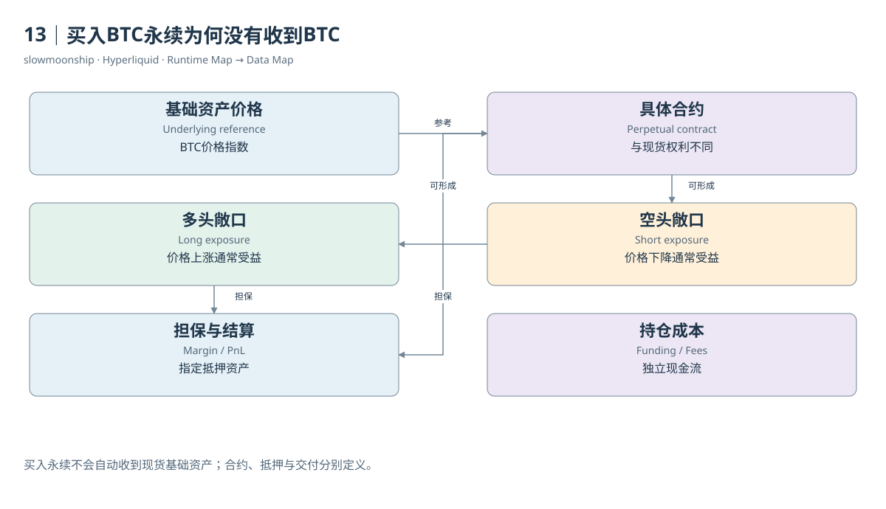

# 13｜买入BTC永续为何没有收到BTC

Alice买入一单位BTC永续合约，Bob在对应撮合中卖出。如果双方此前都没有仓位，Alice形成多头，Bob形成空头。Alice的账户不会因此出现一单位可提取的现货BTC。永续合约是一种与基础资产价格相关的衍生品，记录的是价格敞口及结算关系。

Underlying是参考的基础资产或价格对象，Contract是具体金融产品。BTC作为基础资产，与BTC永续合约不是同一资产。Spot交易改变代币所有数量；Perp交易改变合约仓位与保证金账户。两者可以有相似价格，却不因此拥有同样的交付权利和现金流。

Long表示价格上升时通常受益的方向，Short表示价格下降时通常受益的方向。用教学模拟，双方在100建立一单位仓位，估值上升到110，多头未实现盈亏为正10，空头为负10。这里没有一笔每跳动一个价格就立即发生的普通用户转账，系统先更新金融估值。

合约数量与名义价值也不同。持仓一单位BTC，价格100时名义价值100，价格110时变成110；数量没有变化。保证金只是支持这份敞口的资金，不是合约名义价值全额。杠杆描述敞口相对于资金的关系，不能把它解释成系统送给用户一笔可随意提走的BTC借款。

主要第一方合约采用USDC保证金。当前官方规格还说明，许多基础价格以USDT表示，盈亏不进行USDC/USDT实时汇率换算，具有quanto特征。教学中将报价单位简化为稳定币单位有助于理解，但跨抵押资产做真实财务比较时，必须恢复具体单位与产品规则。

永续Perpetual的名称表示没有普通到期日。它依靠资金费率机制帮助价格与参考价格保持联系。没有到期不意味着可以永久无成本持仓，也不意味着产品永远不会被停止或结算。费用、资金费、清算与市场管理动作仍然会改变持仓经济结果。

系统之所以需要Clearinghouse，是因为仅记一条买卖金额不够。它还要保存方向、数量、入场会计、保证金使用和风险要求，并在价格变化后重新判断账户。一个订单簿为双方找到成交条件，一个金融状态机负责让这些成交可以持续承担未来价格变动。

案例03展示的双方并不是Alice和Bob从零开仓的情形。买方原先为空，买入用于平空；卖方原先为多，卖出用于平多。相同的成交价格和数量，可以在不同前态下产生完全不同的持仓效果。因此，教学的开仓例子不能自动成为真实Fill的分类模板。

理解永续，最关键的是把四件事分开：参考什么价格，持有多少有符号合约敞口，用什么资产担保，怎样结算盈亏和费用。回答这四个问题，就能解释为什么买入BTC永续没有收到BTC，也能为接下来的持仓变化与风险计算找到正确的数据对象。

<!-- BOOK RESOURCES -->

[编辑此图](../../assets/diagrams/perpetual.drawio)

证据：[案例03](../../examples/cases/case-03.md)。

依据：[trading__contract-specifications](https://hyperliquid.gitbook.io/hyperliquid-docs/trading/contract-specifications.md)；[hypercore__clearinghouse](https://hyperliquid.gitbook.io/hyperliquid-docs/hypercore/clearinghouse.md)。

[来源目录](../../research/source_catalog.md) · [目录](../../SUMMARY.md) · [上一章](../../book/part-03/12-orders.md) · [下一章](../../book/part-04/14-position.md)
