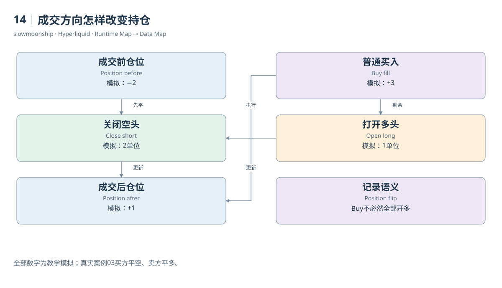

# 14｜成交方向怎样改变持仓

看到一条Buy Fill，能否说用户开了多仓？不能。成交方向只告诉你这一笔买入了多少合约，持仓效果还取决于成交前状态。一个原本做空的人买入，可以减少空仓；买得足够多，还可以先平空再转为多头。金融分类需要前态与事件共同参与。

最简单的表达是有符号仓位。多头数量为正，空头为负；普通买入增加有符号数量，普通卖出减少它。教学模拟中，前仓位为负2，买入0.5后变为负1.5，这是Reduce Short。前仓位为正2，再买入0.5变为正2.5，这是Increase Long。

如果前仓位为负2，一次买入3，结果变为正1。前2单位关闭空头，余下1单位打开多头，这叫Position Flip。该笔Fill的开平仓语义同时跨过零点。只用Buy、Sell两类统计新增多空，会把关闭与反手的经济含义丢掉。

普通Fill中的`startPosition`给出此笔成交前的有符号数量，`dir`提供官方呈现的持仓变化类别。本篇实际买侧记录前仓位为负7.53687，买入0.00012，`dir`为Close Short；卖侧前仓位为正0.00307，卖出0.00012，`dir`为Close Long。两侧各自减少原有仓位。

对这笔事件做局部计算，买侧后仓位为负7.53675，卖侧为正0.00295。这是依据Fill前态与普通成交数量得到的事件后态，不是后来`clearinghouseState`查询时的当前仓位。中间还有后续成交，所以两个时点的结果不同，并不表示接口自相矛盾。

持仓数量变化不等于盈亏。减少空头时，需要用该账户的入场会计与平仓价格计算已实现结果；新增多头时，尚未平掉的部分主要进入未实现估值。案例两侧的`closedPnl`都为负，说明一次双方减少仓位的成交，也可以同时实现各自的亏损。

从Fill重建一段持仓变化，需要一个可信的起始状态与完整事件序列。按市场和账户排序后，检查下一笔`startPosition`能否与前一笔推导结果接上。缺少一笔成交、接管或其他状态变化，都会打断链条。不能把缺口默认为零变化，再称结果为精确仓位历史。

逐小时Position表采用另一种方式：它保存资金费结算轮次的站立持仓。小时里发生开仓又平仓，到了快照时可能没有仓位行。没有行并不表示整个小时没有交易。事件表适合观察动作，快照表适合观察指定时点敞口，二者互相补充。

因此，买卖统计与开平仓统计应分别命名。买入量适合描述订单流；多头新增量必须考虑前后仓位；平仓量还要处理穿越零点的Fill。只要将前态、带方向的数量变化与后态画在同一条线上，复杂的Open、Reduce、Close和Flip就成为可逐笔核对的状态变化。

如果同一毫秒发生多个Fill，还需要可靠的事件顺序。按时间排序但没有处理并列顺序，可能让反手分类出现矛盾；检查连续前态可以暴露这类问题。

<!-- BOOK RESOURCES -->

[编辑此图](../../assets/diagrams/position.drawio)

证据：[案例03](../../examples/cases/case-03.md)。

依据：[trading__entry-price-and-pnl](https://hyperliquid.gitbook.io/hyperliquid-docs/trading/entry-price-and-pnl.md)；[for-developers__api__info-endpoint](https://hyperliquid.gitbook.io/hyperliquid-docs/for-developers/api/info-endpoint.md)。

[来源目录](../../research/source_catalog.md) · [目录](../../SUMMARY.md) · [上一章](../../book/part-04/13-perpetual.md) · [下一章](../../book/part-04/15-pnl.md)
