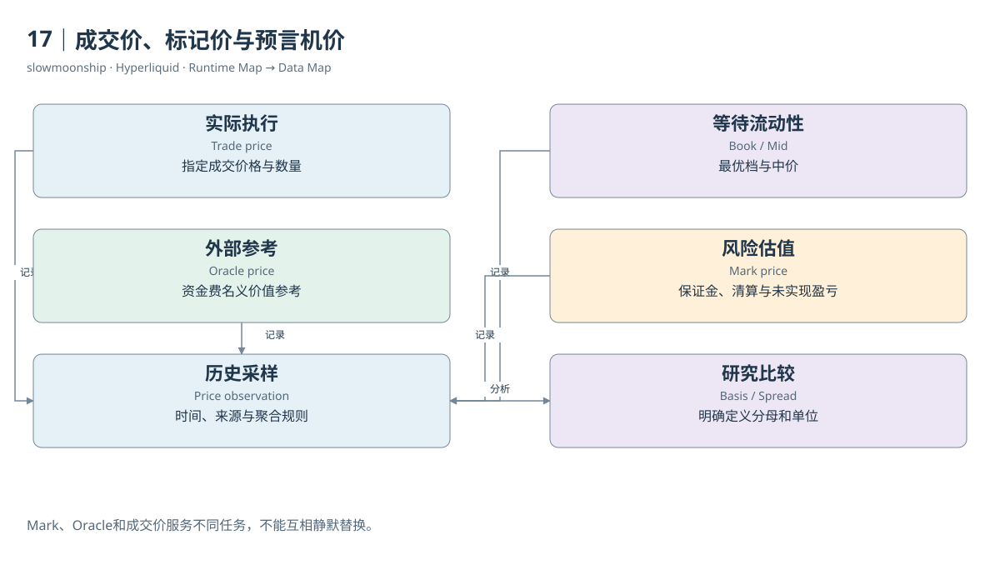

# 17｜成交价、标记价与预言机价

同一时刻，页面上可能同时出现最新成交价、Mark Price、Oracle Price和Mid Price。它们不相等并不稀奇。每种价格服务不同的任务：成交价描述刚才实际交易，簿价格表达等待意图，Mark用于风险估值，Oracle提供参考价格。研究者首先需要说明正在使用哪一种。

Trade Price是一笔成交的价格。它有真实执行数量，但可能只是很小的一笔。Best Bid和Best Ask来自订单簿，中价Mid是两者的平均。中价没有天然成交保证，大额交易更不能只用中价计算可兑现收入。订单簿深度会决定成交跨越多少价档。

Oracle Price由协议规定的外部或适用市场参考源形成。第一方市场的官方说明使用多个来源的加权中位数；某些资产有不同参考机制。HIP-3则由市场部署者负责预言机定义与更新。不能把第一方BTC的数据源规则不加核对地套给每个股票价格关联永续。

Mark Price承担保证金、清算、未实现盈亏及特定触发条件的估值任务。第一方稳健价格规范综合Oracle调整值、本地簿与成交信息、外部永续参考等输入，包含平滑与中位数处理。它不是任意一次最后成交，也不是整个时段简单平均价。

本篇真实BTC市场上下文中，Oracle为83620，Mark为83581，Mid为83580.5。三个数字来自同一份API响应，却代表不同计算路径。若用Oracle给未实现盈亏估值，再用Mark解释界面数字，差额不能自动被称为错误或隐藏手续费。

Funding支付的名义价值使用Oracle，而不是Mark。这项选择与清算使用Mark形成重要区别。把资金费公式和风险公式中的price统一替换成最新成交价，会同时改变两种计算。字段名保留业务角色，比将所有价格标准化成一列close更可靠。

历史价格表也有采样规则。Dune的Oracle表文档描述分钟内最后更新，并区分第一方asset-contexts来源和HIP-3部署者setOracle来源。一分钟一行不代表这一分钟每毫秒都保持该价；价格更新时间与成交时间之间有偏差，需要在Join中明确容忍窗口。

如果要研究清算前后的市场状况，可以并列清算标记价、最近参考价、实际Fill价与订单簿。它们共同解释风险触发和执行质量，但不能互相取代。仅凭一条Fill价格，无法判断触发时Mark是多少；仅凭Mark，也不能精确推出大额市价清算成交的全部价格。

在数据工程里，最好把price_type、source_time、observed_time、market_identity和unit作为价格的伴随信息。缺失价格保持缺失，插值或向前填充必须写出前提。只有让每个数字保留“用来做什么、什么时候形成”，价格差异才会成为可以研究的结构，而不是混乱的噪声。

价差指标也应使用明确分母。例如相对点差可用中价归一化，Mark与Oracle偏离可用Oracle归一化。两种基点数不能因为都叫spread就放在同一序列中。

<!-- BOOK RESOURCES -->

[编辑此图](../../assets/diagrams/prices.drawio)

实际状态：[账户模式](../../examples/api/22-abstraction.json)、[永续账户](../../examples/api/18-account.json)、[现货账户](../../examples/api/19-spot-account.json)、[BTC市场上下文](../../examples/api/01-meta-context.json)。字段含义见[教学卡](../../research/api-field-guide.md)。

依据：[trading__robust-price-indices](https://hyperliquid.gitbook.io/hyperliquid-docs/trading/robust-price-indices.md)；[hypercore__oracle](https://hyperliquid.gitbook.io/hyperliquid-docs/hypercore/oracle.md)；[dune-perp-oracle-prices](https://docs.dune.com/data-catalog/curated/perpetuals/hyperliquid/perp-oracle-prices.md)。

[来源目录](../../research/source_catalog.md) · [目录](../../SUMMARY.md) · [上一章](../../book/part-04/16-oi.md) · [下一章](../../book/part-05/18-margin.md)
