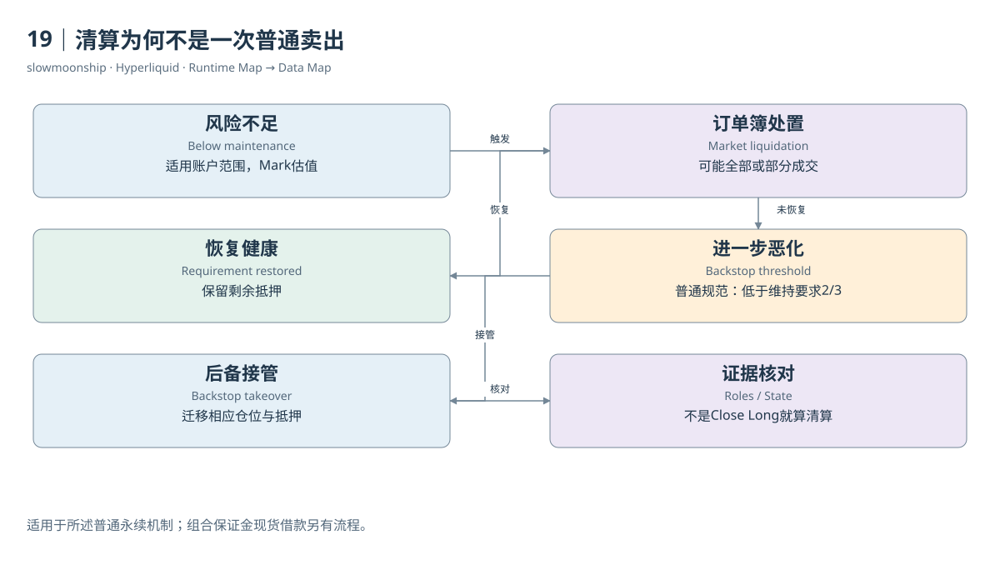

# 19｜清算为何不是一次普通卖出

一个用户的交易历史显示Close Long，可以宣布他被清算吗？不能。主动平仓也会关闭多仓。清算是账户不再满足风险要求时，由协议触发的处置过程；成交只是其中一种执行结果。判断清算，需要明确的清算角色、状态或原始事件证据，而不是猜测成交方向。

普通永续规则在账户权益低于维持保证金要求时触发清算。风险估值采用Mark，而不是用户随手看到的最后成交价。全仓关注适用账户集合，逐仓关注隔离仓位。资金费、其他仓位盈亏和保证金转移都能改变权益，因此触发条件不是一条永远不动的价格线。

第一阶段通常尝试通过订单簿关闭仓位。系统发送清算订单，结果可能是全部成交，也可能只执行部分。若账户重新达到要求，剩余抵押仍属于用户。这里有市场成交价格、订单流和账户风险结果三类证据，仅有一条成交记录，无法完整解释整个处置过程。

官方普通清算文档还规定，大于十万USDC的可清算仓位先以百分之二十数量进入部分清算路径，并设置相应冷却规则。这里的门槛与Testnet不同，适用范围是该规范描述的普通永续机制。Portfolio Margin的现货借款处置另有路径，不应照抄这一流程。

当权益进一步下降且订单簿处置没有成功恢复条件时，普通规范描述后备清算。后备机制可以接管仓位与保证金，而不只是再发一张用户卖单。它可能改变账户拥有的金融状态范围，不能仅通过“清算成交额”一列充分表示，下一章会继续解释接管与ADL。

Dune成交表也需要区分“该撮合涉及清算”与“这一腿是被清算账户”。官方表说明，`liquidation_method`和`liquidated_trader`可能标在两腿；`fill_type = liquidation`才用于辨认相应被处置腿。直接数有method的行，会把同一事件两侧重复计数。

普通市场清算中，被清算者通常是主动处置侧；对手方可能只是原先挂单的Maker。他参与清算撮合，不等于他也被清算。某些后备或自动减仓数据的角色还会反转。研究清算账户数、处置量和对手方流量时，需要分别选择角色与去重键。

本篇两个公开账户Fill没有清算标记；又核对了HLP Liquidator的公开子Vault身份，但其30分钟Fill窗口返回空，因此仍没有取得真实清算案例。清算章节依据官方机制和表结构解释，案例05保留取证缺口。没有查到标记，只说明这段取样不包含相应证据，不能推断当天或全市场没有清算。

精确复原历史清算价格，需要当时的权益、仓位、模式、风险档位与参考价格过程。单一当前快照或静态杠杆只能支持简化情景分析。好的清算研究会连接风险触发、执行路径与最终状态，并让每个结论停在它实际取得的证据范围内。

<!-- BOOK RESOURCES -->

[编辑此图](../../assets/diagrams/liquidation.drawio)

证据：[案例05](../../examples/cases/case-05.md)。

数据练习：[SQL09](../../examples/sql/09-liquidation.sql)（静态审查，未执行）。

依据：[trading__liquidations](https://hyperliquid.gitbook.io/hyperliquid-docs/trading/liquidations.md)；[dune-perp-trades](https://docs.dune.com/data-catalog/curated/perpetuals/hyperliquid/perp-trades.md)。

[来源目录](../../research/source_catalog.md) · [目录](../../SUMMARY.md) · [上一章](../../book/part-05/18-margin.md) · [下一章](../../book/part-05/20-backstop.md)
