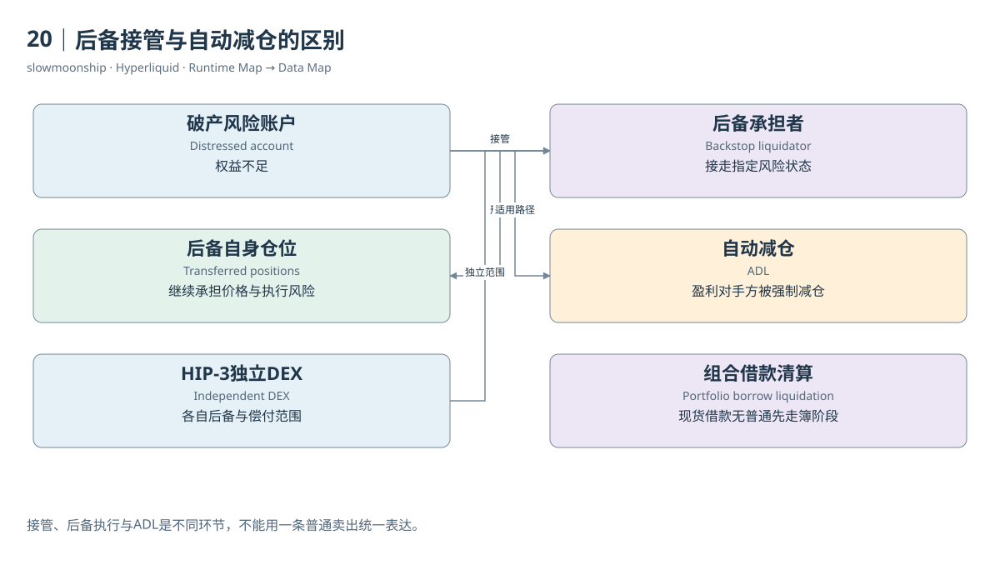

# 20｜后备接管与自动减仓的区别

清算订单并不保证及时找到足够的对手方。极端波动下，账户可能在簿上完成平仓之前已经失去足够权益。这时，系统需要处理的不只是卖出速度，还包括谁承担剩余仓位与负债。Backstop与ADL分别描述不同的风险处置环节，不能统称为一笔普通清算卖单。

普通官方清算规范将后备触发描述为权益低于维持保证金的三分之二，且簿上处置未能恢复要求。Liquidator Vault接管相应仓位与抵押，成为后续风险承担者。阈值属于指定机制，不是所有HIP-3、Portfolio或其他未来产品都共用的一条通用公式。

全仓后备接管会影响对应全仓仓位和资金集合；逐仓接管限于相应隔离仓位及保证金。被接管数量从用户状态迁移到另一个承担者，并不必然以一笔公开市价Fill表达完整过程。要解释账户最终为何归零或留下其他资金，需要读取适用范围和账务证据。

第一方Liquidator Vault是HLP的一项策略，HLP同时还有其他做市和资金运用活动。它可能从接管中取得收益，也可能承担不利价格和后续执行风险。因此，HLP收益不能全部归因为“收走用户保证金”，更不能被解释成每次后备接管都无风险盈利。

当前HIP-3规范还为每个DEX描述独立的链上后备清算者，其系统地址按DEX编号派生，只接收符合全仓条件的资产。每个后备账户具有独立状态，必要时回落到ADL保障DEX偿付结构。这与“所有市场都由同一个HLP统一兜底”的简单说法不同。

ADL即Auto-deleveraging。在适用机制下，系统可以强制减少对面的盈利仓位，以处理破产风险。被自动减仓的盈利账户没有主动发出普通平仓订单，也未必因为自己保证金不足而被清算。它承担的是系统风险分配结果，金融角色与原本破产账户不同。

Dune的规范化字段保留这种角色区别：普通清算腿、ADL腿和行政结算腿不能混合。其表说明某些标为backstop的强制配对中，破产账户与被自动减仓账户位于不同腿。数据标签属于索引模型的表达，不能把一行名称当成整个Vault接管历史的完整证据。

Portfolio Margin的借款清算又有独立规则。当前文档描述资产和负债由特定后备机制接管，现货借款路径没有普通永续的先走订单簿阶段。以为所有清算都会先产生同一种市场卖单，将无法解释组合账户状态。产品范围需要始终跟在流程图旁边。

判断一项风险处置，可以按三个问题展开：谁失去权益，谁接走仓位，谁被强制减少敞口？再找对应Fill、Ledger与状态。接管、后备账户执行和ADL可能相连，却不是同一个记录粒度。保留它们的区别，才能理解金融系统如何把风险从一个账户转移到另一个账户。

实际HLP返回列出了子策略地址，后续VaultDetails确认其中一项名称为HLP Liquidator。这项取证支持公开策略身份及父子关系；对应三十分钟Fill为空，仍不能补出一次真实接管。身份登记与处置事件应分别核验。

<!-- BOOK RESOURCES -->

[编辑此图](../../assets/diagrams/backstop.drawio)

证据：[案例05](../../examples/cases/case-05.md)。

依据：[trading__liquidations](https://hyperliquid.gitbook.io/hyperliquid-docs/trading/liquidations.md)；[trading__auto-deleveraging](https://hyperliquid.gitbook.io/hyperliquid-docs/trading/auto-deleveraging.md)；[hyperliquid-improvement-proposals-hips__hip-3-builder-deployed-perpetuals](https://hyperliquid.gitbook.io/hyperliquid-docs/hyperliquid-improvement-proposals-hips/hip-3-builder-deployed-perpetuals.md)；[trading__portfolio-margin](https://hyperliquid.gitbook.io/hyperliquid-docs/trading/portfolio-margin.md)。

[来源目录](../../research/source_catalog.md) · [目录](../../SUMMARY.md) · [上一章](../../book/part-05/19-liquidation.md) · [下一章](../../book/part-06/21-funding-flow.md)
