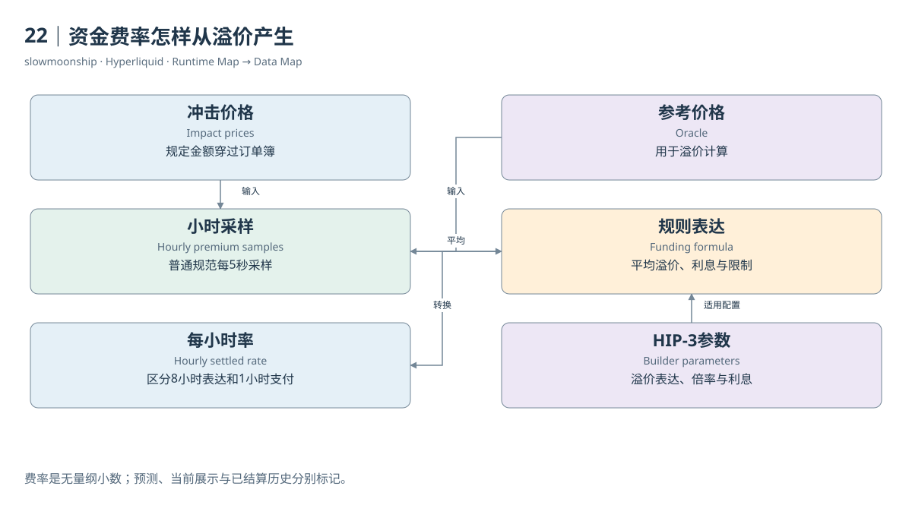

# 22｜资金费率怎样从溢价产生

永续价格比参考价格高，是否就表示资金费必然等于两者的差额？不是。资金费机制将市场溢价转换成一项规定的结算率，包含取样、平均、利息成分和限制。理解计算过程，比记住界面上的一个百分比更能解释它为什么随时间变化。

第一方普通永续的Premium使用冲击价格与Oracle之间的关系。Impact Bid与Impact Ask不是最优买卖档，而是按规定名义金额穿过订单簿得到的平均执行价格。它们考虑一定深度，避免极小挂单就完全决定溢价。不同合约的冲击名义金额需要查规格。

规范以五秒间隔采样Premium，再在小时窗口平均。八小时表达的资金费率为平均溢价加上被限制范围约束的利息减溢价项；实际每小时支付该表达的八分之一。分析代码需要清楚命名`rate_8h_formula`与`rate_1h_settled`，避免在已转换率上再除一次八。

固定利息成分的介绍使用每八小时百分之0.01，换成每小时是百分之0.00125。API通常返回小数率，0.0000125对应百分之0.00125。一个数字若误把小数率当百分数，会相差一百倍；把小时与八小时混用，又会增加八倍偏差。

HIP-3使用更灵敏的冲击买卖价平均相对Oracle的溢价表达，并允许部署者配置相关资金费参数。共享每小时结算框架不代表所有市场长期成本相同。比较两个同名产品，需要连同部署者、资金费倍率、利息配置和参考价格一起读取，不能只按Ticker平均。

官方当前Funding规范还说明费率上限为每小时百分之四，并指出支付间隔和上限不随资产改变。它是规则边界，不是本篇建议采用的收益预测。把极端上限连续年化，会得到数学上很大的数，却不表示这种市场状态会长期持续或能被无风险获得。

当前上下文中的funding、历史`fundingHistory`及跨交易所`predictedFundings`属于不同观察。当前率可能面向正在形成的下一轮，历史率记录已经发生的轮次，预测包含尚未结算的估计。把它们画在同一时间轴上时，应标记状态，不能将预测点伪装成已支付结果。

本篇取得一天BTC历史资金费率，同时保存获取时间与每条事件时间。它可以支持有界小时序列分析；一天样本不能代表全年极端分布。若接口返回重复边界或分页窗口，应按市场及结算时点核对，而不是因为数值相同就删掉相邻小时。

资金费率最终是一条由市场输入和协议规则形成的时间序列。保存取样含义、结算频率、数值单位与产品参数之后，才可以讨论正负持续性、跨市场差异或年化展示。每一步都应从实际率的定义出发，而不是从某个交易所熟悉的显示方式出发。

<!-- BOOK RESOURCES -->

[编辑此图](../../assets/diagrams/funding-rate.drawio)

证据：[案例04](../../examples/cases/case-04.md)。

数据练习：[SQL07](../../examples/sql/07-funding-rates.sql)（静态审查，未执行）。

依据：[trading__funding](https://hyperliquid.gitbook.io/hyperliquid-docs/trading/funding.md)；[trading__contract-specifications](https://hyperliquid.gitbook.io/hyperliquid-docs/trading/contract-specifications.md)；[for-developers__api__hip-3-deployer-actions](https://hyperliquid.gitbook.io/hyperliquid-docs/for-developers/api/hip-3-deployer-actions.md)。

[来源目录](../../research/source_catalog.md) · [目录](../../SUMMARY.md) · [上一章](../../book/part-06/21-funding-flow.md) · [下一章](../../book/part-06/23-funding-payment.md)
