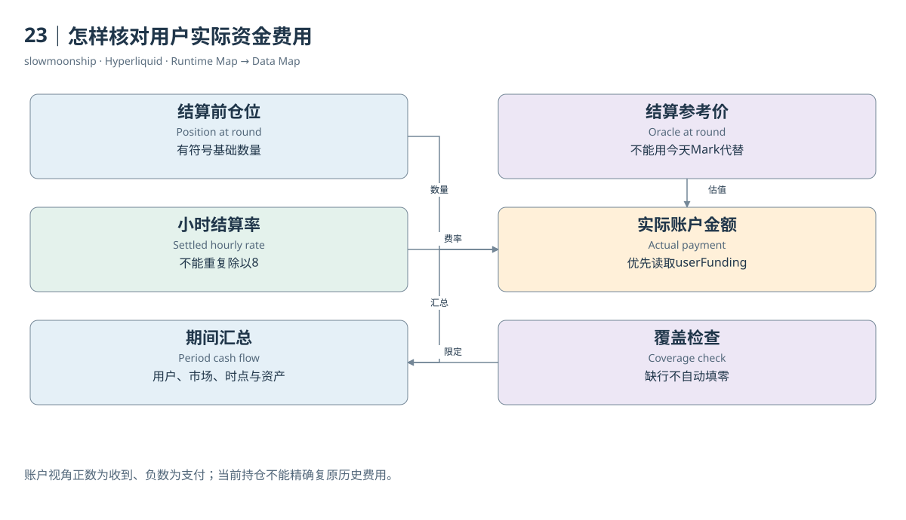

# 23｜怎样核对用户实际资金费用

知道昨天BTC资金费率，能否乘以用户今天的仓位，得到他昨天支付的钱？不能。用户可能在每轮之前增仓、平仓或反手，Oracle也不断变化。精确期间费用需要每个结算时点适用的站立仓位与价格，或者直接读取已发生的用户Funding事件。

对于普通有符号仓位，账户视角的教学表达是：现金流等于负的有符号数量，乘结算Oracle，乘该小时资金费率。多仓为正，在正费率下得到负现金流；空仓为负，得到正现金流。这里只表达方向和单位，实际金额还遵循协议精度与结算规则。

案例04真实记录保存`time`、`delta.coin`、`delta.szi`、`delta.fundingRate`和`delta.usdc`。一轮空仓负9.69594、正费率0.0000110632，实际收到9.034535。我们优先使用接口给出的支付金额，不凭当前仓位替代当时`szi`，也不凭当前Mark替代结算Oracle。

该记录的hash为全零。它仍然可以包含真实结算数据，却不能按hash独立去重。分析时应选择用户、市场、结算时间和记录类型等有依据的组合键，并检查同一窗口的重复返回。缺少非零交易哈希，不等于没有事件，更不允许补造一个看似真实的哈希。

API的用户Funding与非Funding Ledger是两种请求。前者处理资金费，后者记录转移、出入金及其他账务类型。期间对账应分别保存，再按统一账户与资产范围组合。不能只读取非Funding列表，看到余额仍变化，就把差额全部归为无法解释的交易盈利。

Dune的小时持仓表也有`funding_amount_usd`，文档把它定义为账户视角的已结算金额，负数表示支付。它不是Funding Rate乘作者自行估出来的名义值。用户费用SQL可以直接按期间汇总这一列，同时保存取样小时与Trader范围，不需要把费率再乘一次。

小时快照只覆盖该轮有站立仓位的账户。没有行可能表示无仓位，也可能需要检查数据完整性与覆盖开始日期。不能把所有缺失默认当零，再宣称得到所有账户完整费用。若市场资金费序列存在而用户记录缺失，应把金额结论保留为未知或部分覆盖。

市场层的`funding_paid_usd`则表示支付方流出的正金额总量，不能与账户有符号现金流混为一列。将支付和收到两边都按绝对值相加，会把资金费转移放大两倍；将两边净额相加可能接近零，又会掩盖真实发生的总支付。名称应写出总量还是净额。

资金费对账的结果可以是一份逐轮表：结算时间、市场、当时仓位、小时率、实际金额、资产与来源。它让读者直接看见每一笔被动现金流。无法取得当时价格或完整记录的部分明确保留缺口，比分母错位的漂亮年化收益数字更有研究价值。

对账还应检查覆盖窗口的左右边界，确保相邻两次读取没有重复计入同一结算轮次。

<!-- BOOK RESOURCES -->

[编辑此图](../../assets/diagrams/funding-payment.drawio)

证据：[案例04](../../examples/cases/case-04.md)。

数据练习：[SQL08](../../examples/sql/08-user-funding.sql)（静态审查，未执行）。

依据：[for-developers__api__info-endpoint__perpetuals](https://hyperliquid.gitbook.io/hyperliquid-docs/for-developers/api/info-endpoint/perpetuals.md)；[dune-perp-positions-hourly](https://docs.dune.com/data-catalog/curated/perpetuals/hyperliquid/perp-positions-hourly.md)。

[来源目录](../../research/source_catalog.md) · [目录](../../SUMMARY.md) · [上一章](../../book/part-06/22-funding-rate.md) · [下一章](../../book/part-06/24-fees.md)
