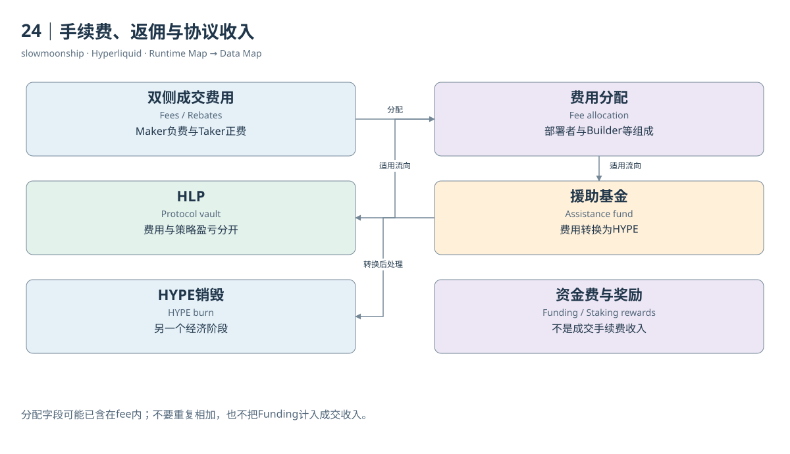

# 24｜手续费、返佣与协议收入

交易历史中的fee有时为正，有时为负。正数通常表示这条Fill支付费用，负数表示返佣。市场、角色、账户费率与资产规则决定具体结果。费用不是资金费，也不是Closed PnL；把这三列全部叫作“成本”，会失去收入去向和经济机制的区别。

Maker提供等待流动性，可能按费率得到返佣；Taker主动成交，通常承担相应费用。案例03中Maker fee为负0.0003 USDC，Taker支付0.004513 USDC。双腿净费用为0.004213。这是指定撮合的费用观察，不代表所有账户都采用相同费率。

费率层级还与规定期间成交量、质押优惠、推荐及市场配置有关。HIP-3部署者费用和Builder Code费用分别涉及市场运营者与应用入口。当前规则还有Growth Mode及Aligned Quote等调整。因此，不能只用一个固定基点乘全部历史成交额，宣称精确得到协议收入。

费用资产同样重要。Spot费用可能涉及基础或报价Token，HIP-3抵押资产也不一定是USDC。Dune列名带`usd`，官方表说明部分金额实际以市场报价代币计量。跨资产加总之前，要说明是否按一美元近似、采用哪份汇率，或者干脆保留代币分组。

当前Dune小时指标说明，`builder_fee_usd`与`deployer_fee_usd`是费用分配中的组成部分，不能再无条件加到`fee_usd`上。计算总收入时，先核对是否已包含，再决定汇总。一个名字叫share的字段，既可能是百分比，也可能是金额；类型和来源说明缺一不可。

费用去向还涉及HLP、Assistance Fund和部署者。官方费用页说明Assistance Fund按L1执行将交易费转换为HYPE，并将其持有的HYPE销毁。收入形成、买入HYPE、销毁HYPE是三个阶段。成交费用总量不自动等于同日买回数量，也不直接等于销毁价值。

HLP策略盈亏、质押奖励与资金费用应另列。做市赚到的价差或仓位收益不是普通手续费；质押奖励来自规定的奖励来源；Funding是多空现金流。一个“协议总收入”数字只有先说明包含谁的经济活动，才有可比较的意义，不能把所有正向变化简单相加。

HIP-4费用文档存在具体冲突：HIP-4介绍页仍称初始测试费用为零，当前费用页已经描述平仓或结算收费及特殊成交量计入规则。本篇保留两页版本差异，没有把所有Outcome永久称为零费。指定市场的实际收费，还需要对应Fill与当时费率证据。

费用研究可以分成交总名义额、用户净费用、分配对象收入和最终代币处理四层。每层使用自己的记录与时间边界。清楚区分这几层，才能解释返佣怎样影响用户、市场费用怎样分配，以及为什么一张手续费图不能替代完整协议经济账本。

财务报表中的收入还涉及受益主体边界。用户返佣、部署者分成和协议留存属于不同对象，分析者应明确是在研究哪一方，而不是把资金流向都称为平台盈利。

<!-- BOOK RESOURCES -->

[编辑此图](../../assets/diagrams/fees.drawio)

证据：[案例03](../../examples/cases/case-03.md)。

数据练习：[SQL03](../../examples/sql/03-maker-taker.sql)（静态审查，未执行）。

依据：[trading__fees](https://hyperliquid.gitbook.io/hyperliquid-docs/trading/fees.md)；[trading__builder-codes](https://hyperliquid.gitbook.io/hyperliquid-docs/trading/builder-codes.md)；[hyperliquid-improvement-proposals-hips__hip-1-native-token-standard](https://hyperliquid.gitbook.io/hyperliquid-docs/hyperliquid-improvement-proposals-hips/hip-1-native-token-standard.md)。

[来源目录](../../research/source_catalog.md) · [目录](../../SUMMARY.md) · [上一章](../../book/part-06/23-funding-payment.md) · [下一章](../../book/part-07/25-spot.md)
