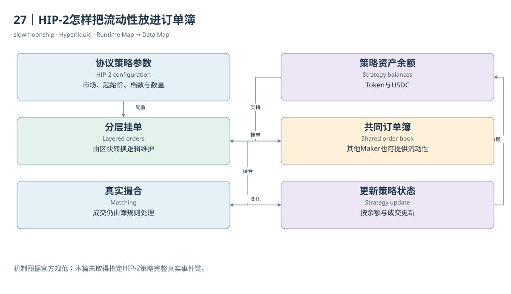

# 27｜HIP-2怎样把流动性放进订单簿

新Token刚出现时，可能还没有很多人愿意挂买卖单。没有足够流动性，价格发现和交易都困难。HIP-2的Hyperliquidity提供一种协议执行的流动性启动策略：它按规定逻辑在Core订单簿挂单，与普通用户的流动性共同参与撮合，而不是另开一套独立AMM交易池。

官方明确说明，这项策略受到Uniswap启发，但它直接运行在区块状态转换中，没有一个私人操作员不断替它发送交易。策略改变与订单簿改变同样受L1执行规则保护。自动化来自协议逻辑，不等于风险消失，也不意味着任意市场都自动拥有深度。

策略配置包括对应Spot市场、初始价格、订单档数、每档数量以及初始买档数量。初始买档需要相应报价资金，初始卖档需要Token供应。配置决定策略从什么位置开始表达买卖意图，不能只用“有一个池子”解释所有初始资金和订单状态。

基础规范通过递推价格形成相邻档位，并按符合时序条件的区块更新。当某个档位全部成交，策略按当前资产余额在相应方向重新配置订单；还有部分余额时，可以形成部分订单。它管理的是分层挂单及资产状态，成交仍然由共同订单簿的撮合规则决定。

教学模拟可以把策略想成一排预先配置的价格阶梯。用户买走某档数量后，策略根据持有的Token与报价资金重新表达下一步挂单。这个比喻帮助理解资金与订单如何连接，但具体档数、价格舍入和更新频率必须来自正式配置，不能用模拟阶梯冒充某个实际Token。

官方当前HIP-2页面限定相应Hyperliquidity机制用于USDC报价Spot对。这项范围不能因为报价资产功能后来扩展，就自动推断所有报价市场都采用同样策略。产品能力、报价资格与某个市场是否真正启用Hyperliquidity，是三项不同事实。

数据分析需要找到策略身份、参数、余额与订单簿事件。单看一份L2快照，无法区分某档数量来自HIP-2还是普通Maker；L2已经汇总同价订单。单看成交价格的规则性，也不足以证明策略来源。归因需要协议状态或已验证的策略关联信息。

本篇没有取得完整指定HIP-2策略的真实状态与原始事件，因此案例07保留缺口。正文解释的是官方机制，不将HYPE现货簿中的某几档宣布为Hyperliquidity。一个流动性策略是否存在，以及它贡献多少成交，需要各自的直接证据和统计范围。

HIP-2最重要的数据启示，是自动策略也可以通过订单簿表达流动性。AMM式思想与CLOB实现可以组合，分析者仍需沿策略状态、挂单、撮合和余额变化分层取证。把它理解为与其他挂单共用的一项协议策略，才能看清价格发现与流动性启动之间的关系。

<!-- BOOK RESOURCES -->

[编辑此图](../../assets/diagrams/hip2.drawio)

证据：[案例07](../../examples/cases/case-07.md)。

依据：[hyperliquid-improvement-proposals-hips__hip-2-hyperliquidity](https://hyperliquid.gitbook.io/hyperliquid-docs/hyperliquid-improvement-proposals-hips/hip-2-hyperliquidity.md)。

[来源目录](../../research/source_catalog.md) · [目录](../../SUMMARY.md) · [上一章](../../book/part-07/26-token-pair.md) · [下一章](../../book/part-07/28-transfers.md)
