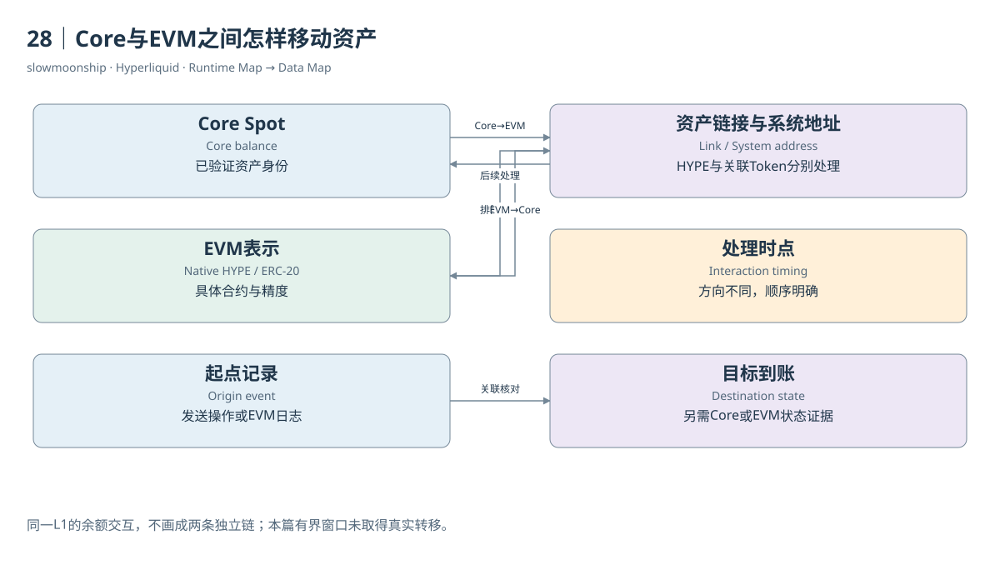

# 28｜Core与EVM之间怎样移动资产

你把Core里的HYPE移到HyperEVM，EVM钱包随后出现可支付Gas的原生余额。这个过程共享同一条L1，却涉及两套余额表示与处理时点。理解转移需要同时看资产关联、系统地址、方向与结果，不能仅凭一个EVM Transfer事件就宣布整条路径已经对账完成。

HYPE是特殊情况。Core中的原生HYPE对应HyperEVM原生余额，系统地址为全长重复2的地址。EVM往Core方向可以向这个系统合约发送原生value，其Received日志记录发送者和数量。它不是必须先封装成普通ERC-20再跨一条外部L1的流程。

其他关联Spot Token采用各自系统地址，地址以前缀0x20及Token索引编码形成。Core资产与具体EVM ERC-20链接后，两个方向按规范使用相应发送操作和Transfer日志。链接记录决定哪个合约被协议识别，不是所有同名合约都能参与这一余额转换。

Core往EVM的转移排队到下一次EVM区块，由系统交易完成对应处理；EVM往Core的转移在产生EVM区块的同一L1区块里、EVM构建之后处理。这项顺序解释了为什么相邻界面可能短暂显示不同状态。查询时点需要跟在金额旁边，不能只要求两边瞬间同时更新。

精度转换会带来另一类差异。Core的Wei Decimals与EVM合约decimals可能不同，关联包含额外精度参数。官方说明，不能整除转换单位的极小余数会按规则处理。核对金额应使用整数缩放与舍入边界，而不是浮点比较两个界面最后几位数字。

系统地址与关联合约也有实现风险。官方转移文档提醒，链接不保证任意合约字节码正确，也不能盲信系统地址库存足够或transfer行为标准。共享L1降低了独立链桥模型的某些复杂性，不能因此把资产关联的具体实现称为无需核查的绝对安全路径。

数据证据至少包括起点事件、系统处理和终点状态。EVM用户交易成功，表明EVM侧执行结果；日志给出相应数量与地址；Core Ledger或余额变化才能进一步核对目标到账。只看系统地址调用次数，最多证明接口使用频率，不能得到所有成功跨环境资产金额。

本篇在固定五十个EVM区块窗口查询HYPE系统日志，返回空数组；固定取样区块的系统交易列表也为空。这个结果只描述有界窗口，没有提供真实HYPE转移案例。案例08保留资产移动取证缺口，同时记录已成功的只读预编译观察，二者不会混称。

为一笔转移建立关联时，保存网络、方向、Token身份、系统地址、EVM哈希、L1或EVM高度、金额精度与Core到账证据。这样，余额转换能够被逐段验证，也能明确哪里缺少历史状态。重要的是连接两个执行环境的账，而不是把一次成功请求扩大成全部到账事实。

<!-- BOOK RESOURCES -->

[编辑此图](../../assets/diagrams/transfers.drawio)

证据：[案例08](../../examples/cases/case-08.md)。

依据：[for-developers__hyperevm__hypercore-less-than-greater-than-hyperevm-transfers](https://hyperliquid.gitbook.io/hyperliquid-docs/for-developers/hyperevm/hypercore-less-than-greater-than-hyperevm-transfers.md)；[for-developers__hyperevm__interaction-timings](https://hyperliquid.gitbook.io/hyperliquid-docs/for-developers/hyperevm/interaction-timings.md)。

[来源目录](../../research/source_catalog.md) · [目录](../../SUMMARY.md) · [上一章](../../book/part-07/27-hip2.md) · [下一章](../../book/part-08/29-evm.md)
