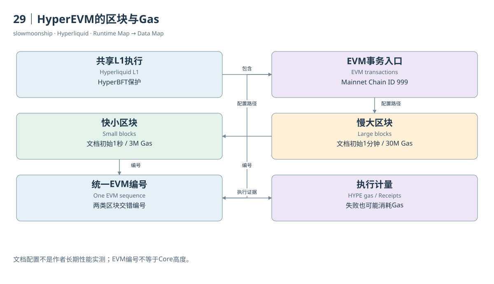

# 29｜HyperEVM的区块与Gas

HyperEVM让开发者使用熟悉的EVM工具，但其区块仍由Hyperliquid共享的L1执行组织。Mainnet EVM Chain ID为999，Testnet为998；本篇实际RPC返回0x3e7，即999。Chain ID标识EVM网络，不能被当成Core资产编号、DEX索引或L1共识轮次。

EVM交易包含发送者、目的地址、nonce、Gas参数和调用数据。执行消耗Gas，以原生HYPE支付费用。交易成功与失败都需要检查收据，失败也可能消耗Gas。`value`只表示该交易随调用携带的原生金额，不能替代所有ERC-20转移或Core资产变化。

HyperEVM采用双区块结构。小区块提供较快确认节奏，大区块容纳更大的Gas预算；两类区块交错进入唯一递增的EVM编号序列。它们不是两条链，也不是两个可以各自独立相加的历史。分析区块间隔时，应在同一序列中理解不同生成节奏。

当前官方双区块页列出初始配置：小区块约一秒、三百万Gas，大区块约一分钟、三千万Gas。文档明确这些属于保守配置与持续升级背景。本篇取样区块Gas Limit为三百万，仅核对这个区块，没有持续采样并证明所有区块一直维持相同间隔。

EVM待处理交易也被描述为L1链上状态的一部分，并按两类区块来源组织。账户nonce与区块选择状态影响进入哪类区块。将一个交易长时间未出现的原因都归为“链很慢”，会忽略Gas、nonce顺序、目标区块类型和请求传播等不同条件。

读取区块与读取历史状态又不同。默认RPC可以返回指定区块及其交易或收据，却对`eth_call`、余额、代码和存储读取限制为latest。能够获取去年一张收据，不代表能对去年任意状态进行假设合约调用。历史数据对象与历史状态执行能力应分别说明。

Core来源的系统交易有专门RPC方法。普通用户交易列表未必完整表达系统资产处理；`eth_getSystemTxsByBlockNumber`用于相应系统交易。统计合约调用或资产移动前，应检查来源范围。将普通交易数量称为整个Hyperliquid全部业务次数，会同时漏掉Core原生活动。

实际取样区块和一张收据已经保存原始返回、固定高度与哈希。验证脚本检查交易与收据的区块关系，保留Gas和日志原始整数。它支撑EVM数据结构练习，不能替代独立执行字节码、校验全部状态根或证明整条L1共识正确性。

从数据分析角度，HyperEVM既继承EVM的交易、日志和调用结构，也带有双区块及系统交互特点。先理解标准对象，再补上这些边界，便能复用Ethereum篇的经验。复用的是分析方法；具体网络、接口能力与Core连接仍然需要当前证据。

固定区块读取有助于复核，因为latest会随请求推进。研究多接口关联时，先固定高度并保存区块哈希，再取相应交易和收据，比连续使用latest更容易确认观察范围。

官方开发者页将当前EVM版本描述为Cancun但不支持Blobs，原生HYPE精度为十八位。EIP-1559基础费按规则销毁，优先费也按HyperBFT环境的规定销毁，处理方式不等于Ethereum执行层给区块提议者的小费。Core交易费用与EVM Gas消耗属于不同经济过程。

<!-- BOOK RESOURCES -->

[编辑此图](../../assets/diagrams/evm.drawio)

证据：[案例14](../../examples/cases/case-14.md)。

数据练习：[SQL14](../../examples/sql/14-evm-transactions.sql)（静态审查，未执行）。

依据：[for-developers__hyperevm](https://hyperliquid.gitbook.io/hyperliquid-docs/for-developers/hyperevm.md)；[for-developers__hyperevm__dual-block-architecture](https://hyperliquid.gitbook.io/hyperliquid-docs/for-developers/hyperevm/dual-block-architecture.md)；[for-developers__hyperevm__json-rpc](https://hyperliquid.gitbook.io/hyperliquid-docs/for-developers/hyperevm/json-rpc.md)。

[来源目录](../../research/source_catalog.md) · [目录](../../SUMMARY.md) · [上一章](../../book/part-07/28-transfers.md) · [下一章](../../book/part-08/30-precompiles.md)
