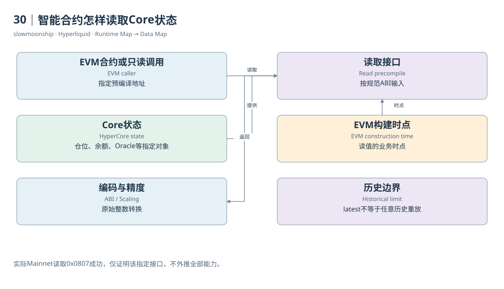

# 30｜智能合约怎样读取Core状态

一个借贷合约希望知道HyperCore中的价格或用户仓位，不需要先等待私人服务器把所有数据复制到合约里。HyperEVM提供读取预编译Read Precompile，合约以规定地址和编码读取Core的特定状态。这个机制连接通用合约与原生金融状态，但读取范围由接口明确限制。

预编译不是普通业务合约的同义词。它提供协议定义的执行能力，地址与输入输出遵循对应规范。官方接口覆盖特定持仓、Spot余额、Vault权益、质押委托、Oracle价格和L1高度等对象。某个字段可在Info API查询，不意味着一定存在完全相同的预编译。

官方交互规范说明，读值对应构建该EVM区块时的最新Core状态。这是重要的观察时点。在同一L1区块里随后处理的EVM到Core转移或CoreWriter操作，不应被假定已经出现在先前读取结果中。读取与后续修改共享排序，却仍存在先后关系。

本篇实际以Mainnet `eth_call`读取0x0807地址的BTC Oracle，输入是编码后的资产索引零，得到非错误整数返回。它证明该指定主网读取路径可用。规范页仍有Testnet字样，本篇将这一冲突保留为来源更新差异，没有因此推断所有预编译都已逐项测试。

返回值的缩放需要查接口。价格预编译按Perp或Spot及数量精度采用不同转换指数。ABI整数不是人类可读价格。错误地统一除以10的18次方，会得到看似精确但没有业务意义的数字。应同时保留资产Meta、原始返回与转换公式。

读取失败也属于执行事实。规范说明无效资产或Vault输入会返回错误，并消耗相应调用框架中的Gas。一个顶层交易失败，不一定说明Oracle停止更新；也可能是编码、资产索引或调用条件错误。诊断需要调用输入、执行上下文与实际错误，而不是只看成功率。

历史读取还受到RPC与状态重放限制。默认`eth_call`仅支持latest，不能用一个旧区块编号假装获得过去任意Core状态。官方说明，实际发生过的预编译调用记录与假设历史调用不是一回事；后者可能需要完整L1重放，而本篇没有部署节点完成这种工作。

Dune Trace可以记录实际接口调用，包含to、input与output等字段。它能支持调用次数和已发生调用的取样研究。没有出现Trace的某个地址，不能自动说明功能不存在；一天没有调用，也不表示整个网络从未使用。流量观察与能力证明需要分开。

读取预编译的教学闭环是：确定业务对象，选择指定地址，按正式编码提供输入，取得与时点相关的返回，再按精度解释。它把两种执行环境接起来，同时保留可观察边界。读者能够知道合约看到了什么，也能知道这与全市场完整历史状态之间还差哪些证据。

<!-- BOOK RESOURCES -->

[编辑此图](../../assets/diagrams/precompiles.drawio)

证据：[案例08](../../examples/cases/case-08.md)。

依据：[for-developers__hyperevm__interacting-with-hypercore](https://hyperliquid.gitbook.io/hyperliquid-docs/for-developers/hyperevm/interacting-with-hypercore.md)；[for-developers__hyperevm__json-rpc](https://hyperliquid.gitbook.io/hyperliquid-docs/for-developers/hyperevm/json-rpc.md)。

[来源目录](../../research/source_catalog.md) · [目录](../../SUMMARY.md) · [上一章](../../book/part-08/29-evm.md) · [下一章](../../book/part-08/31-corewriter.md)
