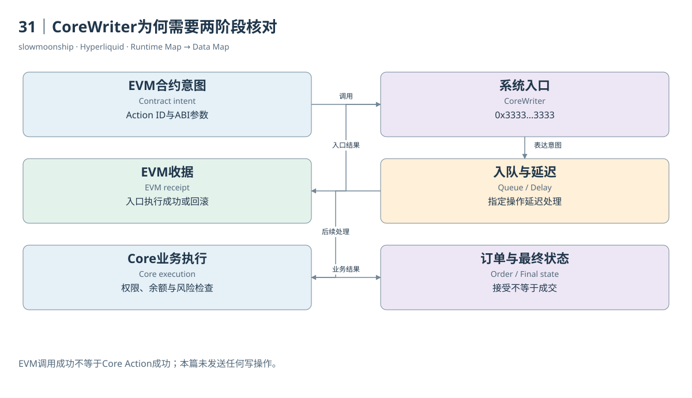

# 31｜CoreWriter为何需要两阶段核对

一个HyperEVM合约成功调用CoreWriter，交易收据显示status为成功。目标Core订单是否已经成功下单？仍然需要核对。CoreWriter首先把合约意图交给后续Core处理，EVM调用结果与金融操作结果位于不同阶段。这是跨执行环境分析最容易跳过的一步。

系统合约位于全长重复3的地址。当前规范描述操作编码由版本字节、三字节Action ID和操作专属ABI参数组成。Limit Order、Vault Transfer、Spot Send、取消订单等各有指定编号。不是任何一段成功发出的字节都能成为有效金融操作。

本篇取回主网该地址的非空代码，也取回作者已有Dune结果中历史CoreWriter Trace计数。这些证据支撑系统入口及既有调用观察。它们没有执行新写操作，也没有逐一证明当前操作列表每一项在每种账户状态下均可成功。入口存在与业务完成是两层验收。

在产生EVM区块的L1处理序列中，先构建L1及EVM区块，再处理EVM到Core的转移，随后处理CoreWriter操作。规范还明确，执行该操作的Core账户需要在EVM区块构建前已存在；同一区块通过转移刚初始化账户，仍可能导致相关操作拒绝。

订单与Vault转移等指定操作还有链上延迟，目的是避免借EVM绕过L1订单入口取得时延优势。官方说明这类操作在Explorer中可以分别呈现入队与Core执行。研究者若按哈希或时间把二者当成两次独立经济成交，会重复解释同一意图。

Core后续处理仍需检查资产、权限、账户模式、余额和金融约束。EVM收据成功只说明相应EVM执行没有回滚，不保证订单满足保证金，也不保证订单发生Fill。甚至一张被接受的订单可以长期不成交，所以“写入成功”“订单接受”和“成交完成”又是三个状态。

实际研究应连接EVM交易与Trace、CoreWriter日志或入队记录、对应Core执行、订单状态及最终账户结果。缺少关联键时，可以保留候选时间窗口，却不能仅凭前后几秒两个相似数量就宣布确定关联。数据链条中的每个连接都需要明确依据。

当前规范已经列出扩展后的Borrow/Lend、账户抽象与Outcome操作，而介绍页仍有写系统尚未上线的旧文字。本篇保存这种差异，并将具体能力证明限制在已取证接口。阅读规范可以理解编码，真实主网权限与执行成功还应以当前行为证据核对。

CoreWriter展示了共享L1中的异步业务边界：合约发出意图，协议随后尝试执行，金融状态最后给出结果。把这三步画清楚，可以正确分析合约如何利用订单簿，也能避免用一个绿色EVM收据代替整个交易生命周期。本篇只教学与取证，不生成或发送可交易的签名操作。

因此，分析报告可以分别标记入口已观察、Core执行已观察与最终状态已核对。缺少其中一层时，保留该层空缺即可，不需要猜一个成功或失败结果。

<!-- BOOK RESOURCES -->

[编辑此图](../../assets/diagrams/corewriter.drawio)

证据：[案例08](../../examples/cases/case-08.md)。

数据练习：[SQL15](../../examples/sql/15-core-interfaces.sql)（静态审查，未执行）。

依据：[for-developers__hyperevm__interacting-with-hypercore](https://hyperliquid.gitbook.io/hyperliquid-docs/for-developers/hyperevm/interacting-with-hypercore.md)；[for-developers__hyperevm__interaction-timings](https://hyperliquid.gitbook.io/hyperliquid-docs/for-developers/hyperevm/interaction-timings.md)。

[来源目录](../../research/source_catalog.md) · [目录](../../SUMMARY.md) · [上一章](../../book/part-08/30-precompiles.md) · [下一章](../../book/part-08/32-evm-data.md)
