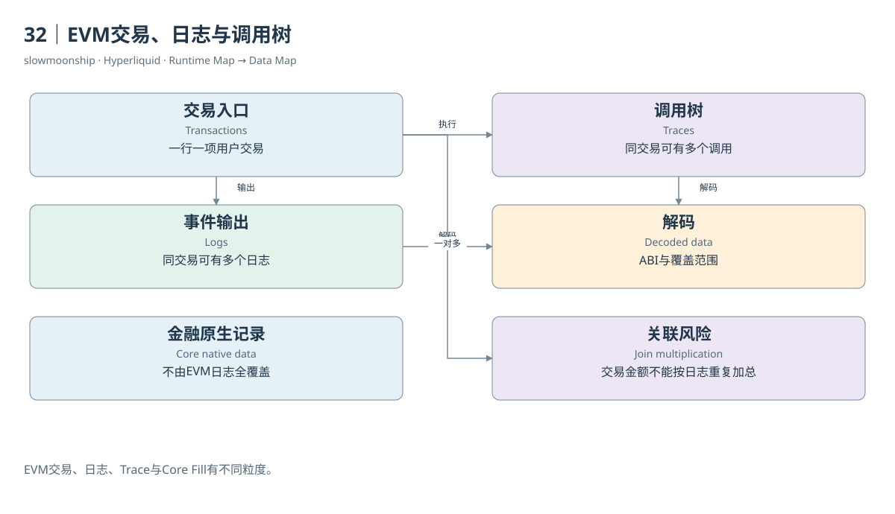

# 32｜EVM交易、日志与调用树

一笔EVM交易可以产生许多日志，也可以调用多个合约。Transactions、Logs和Traces分别呈现入口、事件输出与调用结构，不能按行数互换。一个交易没有日志仍可能成功，一个交易有多个日志也不是发生了多笔用户交易。数据地图需要保留这种一对多关系。

交易表通常以交易哈希识别入口，记录from、to、value、nonce和执行结果。`to`不一定是合约，也可以是普通地址；创建合约时还有特殊形式。将所有目的地址称为“交互合约”，会把普通原生转账也归进智能合约使用量，应先取得合约身份或明确称目的地址。

日志表以交易哈希和日志序号定位一项输出。topic与data需要依据具体ABI解释，事件名相同不保证合约语义相同。ERC-20 Transfer日志属于特定合约声明的转移记录，不能自动表示Core的每一项Spot或Perp活动。合约实现与资产关联仍要核对。

Trace呈现执行调用树。`trace_address`帮助定位嵌套位置；同一交易可以多次调用CoreWriter或读取预编译。接口调用次数、涉及交易次数和独立调用者数量因而不同。三者应该分别命名，不能把Trace行数直接改称使用接口的用户人数。

Dune实时Catalog列出了`hyperevm.traces`及相关Decoded表，而其HyperEVM概览仍保留不支持Trace的说明。作者已有Query旧Result实际返回相应统计。本篇采用Catalog与结果作为指定数据存在的依据，保留概览冲突，不宣称整个最新历史范围都已重新执行核验。

Decoded数据把原始topic或调用输入转成便于阅读的字段，Curated数据还可能增加资产和业务分类。每一次加工都需要来源。Decoded表没有覆盖某个合约，不意味着原始日志不存在；Decode成功也不证明调用者的真实意图。技术记录和行为解释应分层。

连接Transactions与Logs时，若一笔交易有五条日志，交易里的value会被复制五次。要统计原生转账或Gas成本，先按交易粒度汇总，或去除这种复制。连接Trace时同样如此。重复Join不一定产生错误行，却会悄悄改变金额与次数的统计对象。

本篇SQL分别演示交易活动、日志输出和CoreWriter Trace计数，限定日期与分区。真实区块收据练习则检查日志与交易归属。它们可以支撑EVM侧结构理解，但没有任何一张表能够单独证明Core下单最终成交，尤其不能将所有Core成交改称EVM Event。

将入口、调用树和日志放在同一张图上，可以看见程序执行如何留下不同证据。再连接Core业务状态，才可能分析完整交互。读者应带着Ethereum篇的对象知识进入HyperEVM，同时始终记得：EVM数据是一部分运行时地图，整个金融系统还有另一套原生记录。

Gas使用量也不宜从日志行逐项累加。它属于执行收据的计量，日志只是执行输出；统计交易成本时回到交易或收据粒度，才能避免一次调用被重复收费。

<!-- BOOK RESOURCES -->

[编辑此图](../../assets/diagrams/evm-data.drawio)

证据：[案例14](../../examples/cases/case-14.md)。

数据练习：[SQL14](../../examples/sql/14-evm-transactions.sql) · [SQL15](../../examples/sql/15-core-interfaces.sql)（静态审查，未执行）。

依据：[dune-hyperevm](https://docs.dune.com/data-catalog/evm/hyperevm/overview.md)；[for-developers__hyperevm__json-rpc](https://hyperliquid.gitbook.io/hyperliquid-docs/for-developers/hyperevm/json-rpc.md)。

[来源目录](../../research/source_catalog.md) · [目录](../../SUMMARY.md) · [上一章](../../book/part-08/31-corewriter.md) · [下一章](../../book/part-09/33-hip3.md)
