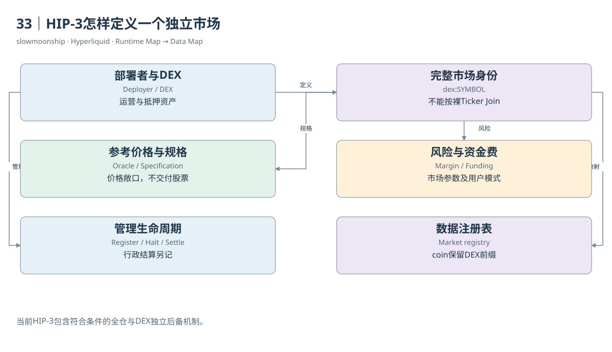

# 33｜HIP-3怎样定义一个独立市场

你在不同入口看到两个BTC永续，不能只因为名字一样就合并。HIP-3允许部署者建立Perp DEX并定义市场，产品的预言机、抵押资产、风险参数和管理规则可能不同。同一种价格参考，并不意味着同一张金融合约；完整市场身份比Ticker更重要。

部署者负责市场定义与运营，包括参考价格、杠杆边界和必要结算。协议提供共用的订单簿与保证金执行基础，不替每个部署者保证基础数据永远正确。研究一个HIP-3产品，需要看部署者、Oracle Updater、抵押Token、合约规格和风险配置，而不是只看成交曲线。

官方当前主网规范要求相应部署者质押五十万HYPE，并规定保持期及资产部署规则。这是版本基准下的要求，不是永不变化的常数。部署者质押与验证者自委托又是不同角色；两者都用HYPE，不代表同一资格、锁定期或罚没含义。

本篇实际`perpDexs`取得XYZ等DEX信息，再读取XYZ的Meta与市场上下文。`xyz:TSLA`明确带DEX前缀，API返回数量精度、最大杠杆与Margin Table等字段。这个合约提供特斯拉价格相关敞口，不交付股票，也不自动赋予股东投票、分红或托管权。

HIP-3订单Asset ID采用十万加DEX Index乘一万，再加Meta市场索引。DEX Index与Meta中的位置都要来自对应网络和当前注册信息。按名称猜编号，或把第一方BTC索引零直接用于另一个DEX同名市场，都会把分析或操作对象指向错误位置。

保证金能力也已经扩展。当前规范包含符合条件的Cross Margin、No Cross及严格逐仓相关状态，并规定部署者启用全仓的资格约束。用户Standard、Unified或Portfolio模式又影响资金共享范围。不能沿用早期只支持逐仓的认知，也不能认为所有HIP-3资产都支持全仓。

部署者可以通过规定的Halt Trading路径停止并结算市场，官方说明该路径取消订单、按当前Mark处理持仓，随后还可以恢复使用。这类行政结算与普通市场成交不同。Dune的settlement角色不宜纳入自愿交易量，否则一个停止市场动作可能看起来像突然爆发交易需求。

Dune Market Details将第一方与HIP-3统一组织，`coin`保留DEX前缀，`market_symbol`去掉前缀。Join应使用coin，不能用会碰撞的Symbol。资产类别、股票或商品等标签属于Curated分类；当前注册表与历史市场参数之间也有版本差异，应避免用今天分类解释过去权限。

一份HIP-3市场卡可以完整回答：谁运营，参考什么价格，使用什么抵押，如何计算资金费与风险，何时上市，是否停止，数据从何时覆盖。只有把这些条件放在同一身份下，成交与OI比较才具有经济意义。市场开放扩展的是金融产品表达能力，并不让相似名字变成相同权利。

跨市场价格比较还要检查交易时段与参考源更新时间。基础股票市场休市时，合约依然可能交易；这种差异不能自动解释为真实股票现货价格发现。

<!-- BOOK RESOURCES -->

[编辑此图](../../assets/diagrams/hip3.drawio)

证据：[案例09](../../examples/cases/case-09.md)。

数据练习：[SQL01](../../examples/sql/01-markets.sql) · [SQL12](../../examples/sql/12-hip3-classification.sql) · [SQL13](../../examples/sql/13-first-hip3.sql)（静态审查，未执行）。

依据：[hyperliquid-improvement-proposals-hips__hip-3-builder-deployed-perpetuals](https://hyperliquid.gitbook.io/hyperliquid-docs/hyperliquid-improvement-proposals-hips/hip-3-builder-deployed-perpetuals.md)；[for-developers__api__hip-3-deployer-actions](https://hyperliquid.gitbook.io/hyperliquid-docs/for-developers/api/hip-3-deployer-actions.md)；[dune-perp-market-details](https://docs.dune.com/data-catalog/curated/perpetuals/hyperliquid/perp-market-details.md)。

[来源目录](../../research/source_catalog.md) · [目录](../../SUMMARY.md) · [上一章](../../book/part-08/32-evm-data.md) · [下一章](../../book/part-09/34-hip4.md)
