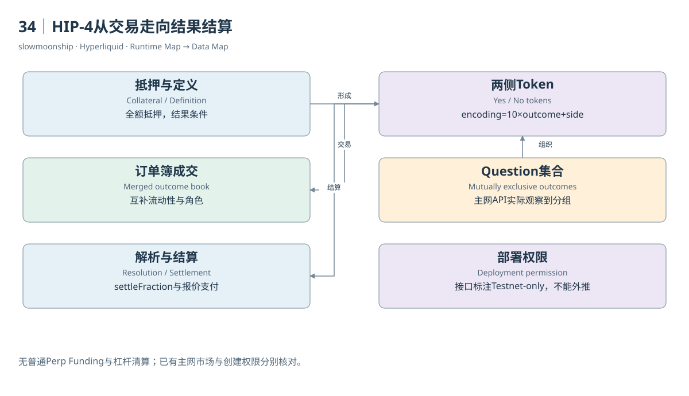

# 34｜HIP-4从交易走向结果结算

买一份BTC价格是否达到目标的Outcome，与买BTC永续有何不同？Outcome在规定结果或到期条件下支付有界金额，采用全额抵押结构；普通永续则持续产生价格敞口、资金费用和保证金风险。它们共用Core订单簿基础，却不是同一种金融状态机。

教学二元市场有Yes与No两侧Token。若结算比例为1，Yes支付1个报价单位、No支付0；比例为0时反过来。价格0.6可以被研究者作为市场定价信号，但它并不是经过外部统计校准的“事件真实概率”。费用、流动性、风险偏好与具体结果定义都会影响价格。

两侧订单簿通过互补关系共享流动性：买Yes价格p，与卖No价格1减p具有对偶联系。当前规范还描述价格、侧别、时间优先及Split、Merge等余额转换。不能将Yes与No的全部成交腿直接相加，尤其不能把铸造、合并和结算等引擎腿当成新的自愿交易。

Question将互斥Outcome组成一个集合，恰好一个结果结算Yes，其他结算No。当前主网`outcomeMeta`实际返回327个Outcome、35个Question及部署者信息，包含体育与价格条件等定义。这是本轮快照观察，数量会变化；不能把介绍页“初始仅二元”的文字当成当前完整市场范围。

部署权限仍需单独判断。官方HIP-4部署者接口标注Testnet-only，本篇没有执行市场创建，不能凭主网已有多种市场就宣布任意用户可无许可部署。规范中的功能、已有主网市场和创建权限是三项证据。文档时间差保存在版本附录中。

真实历史案例使用Outcome 95。实际`settledOutcome`返回目标价77363、结算细节价格76876.9、`settleFraction = 0`，规格写明对应BTC日度价格二元产品。它支撑该市场历史结果，不能从这份返回推出某个用户持有多少份额或收到多少资金。

Outcome身份也有独立编码：encoding等于十乘Outcome编号再加Side，coin为井号加encoding，Token名为加号加encoding，订单Asset ID为一亿加encoding。Side只取零或一。把这些编号当成Spot Pair Index或普通永续Asset，会将结果与产品映射错。

Dune为HIP-4提供五张独立表，包含全量腿、市场元数据、小时指标与日持有状态。该模型需要Split、Merge、Negate和Settlement来解释供应与持有变化。仅靠普通trade腿重建所有余额，会漏掉非成交产生的状态。其历史覆盖与当前数据权限也需分别记录。

全额抵押Outcome没有普通永续的杠杆清算和Funding机制，但结果定义、解析来源、期限和Token持有仍有风险。理解它应沿抵押、交易、结果解析、结算比例与支付展开。本篇将可验证结算与权限未知分开，让读者看见一种新的金融原语，而不把它改写成永续合约的简单变体。

结果解析还要读具体说明中的观察价格、时间窗口、官方来源与备用规则。同样叫BTC达到目标，有的看标记价，有的看规定期间成交条件；这些差异决定合约何时以及怎样结算。

<!-- BOOK RESOURCES -->

[编辑此图](../../assets/diagrams/hip4.drawio)

证据：[案例10](../../examples/cases/case-10.md)。

数据练习：[SQL16](../../examples/sql/16-outcome-volume.sql)（静态审查，未执行）。

依据：[hyperliquid-improvement-proposals-hips__hip-4-outcome-markets](https://hyperliquid.gitbook.io/hyperliquid-docs/hyperliquid-improvement-proposals-hips/hip-4-outcome-markets.md)；[for-developers__api__hip-4-deployer-actions](https://hyperliquid.gitbook.io/hyperliquid-docs/for-developers/api/hip-4-deployer-actions.md)；[trading__contract-specifications](https://hyperliquid.gitbook.io/hyperliquid-docs/trading/contract-specifications.md)；[dune-hip4](https://docs.dune.com/data-catalog/curated/prediction-markets/hip4/overview.md)。

[来源目录](../../research/source_catalog.md) · [目录](../../SUMMARY.md) · [上一章](../../book/part-09/33-hip3.md) · [下一章](../../book/part-09/35-staking.md)
