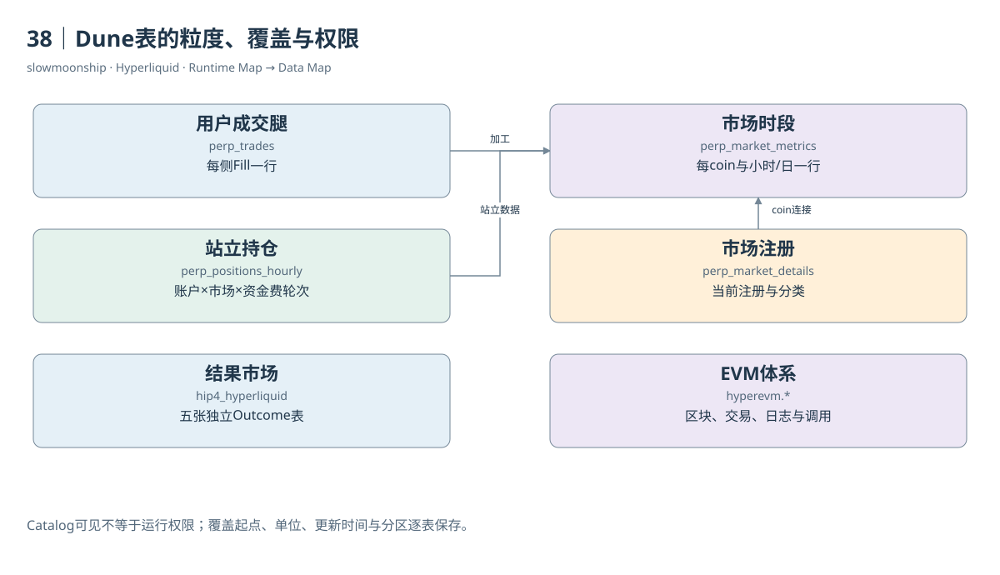

# 38｜Dune表的粒度、覆盖与权限

Dune在2026-07-22宣布加入HyperCore数据，因此“只支持HyperEVM”已经不是当前完整描述。但上线公告与本账户查询权限是两件事。官方说明HyperCore为企业附加数据；Catalog可以展示字段，读者仍需确认工作区授权。看见表名，不能立即宣称已经读到全部数据。

本篇实时取得七张Perp表、五张HIP-4表及八张HyperEVM表的Catalog字段。Perp Oracle表取得官方详细页，但限定Catalog搜索没有返回它，单列文档核验状态。此前运行记录显示Perp数据权限受限；本轮没有执行新增SQL，因此没有重新证明最新读取授权或最新数据时间。

Perp Trades每行是一侧Fill；Market Metrics每行是市场小时或市场日；Positions Hourly每行是账户、市场和资金费轮次；Accounts Daily每行是账户日，没有市场维度。Market Details是当前市场注册视图。这些粒度决定怎样Join，尤其不能给账户日表凭空增加coin再与所有市场连接。

官方覆盖说明，Perp成交从2025-07-27，OI与Funding从2025-09-27，历史簿从2026-06-29开始。第一方价格文档可追溯更早，HIP-3价格有另一覆盖起点。这些是来源声明，具体最早和最新行仍需运行核对。缺失OI的早期交易日不能默认填零。

分区过滤也各不同。Trades与Accounts按`block_date`裁剪；小时和日市场指标按`block_month`；Positions还需要`trader_prefix`；Book用`block_date`。只写coin等业务过滤不一定减少扫描。静态SQL应同时限定分区和事件时间，避免小问题读取整段历史。

当前分类使用coin保留DEX前缀，market_symbol可能碰撞。Details还提供资产类别等加工字段，属于当前分类，不是所有历史时点的原生产品定义。已下架市场可以保留注册行，新上市市场却可能暂时领先轮询注册表；左连接及未匹配检查有助于暴露这种时差。

HIP-4使用独立`hip4_hyperliquid`命名空间，不属于Perp表。其全量腿包含普通交易以及Split、Merge、Negate、Settlement等状态变化。Dune官方文档给出2026-05-02历史起点，Catalog验证五表结构；当前本账户能否读结果没有新增执行证据，不从public可见性推断授权。

作者现有看板主要研究HyperEVM与Core接口。本篇取回十二个已有Query原SQL和两个旧Result，保留原运行日期及窗口。旧结果中的调用量证明那段历史观察，不是2026-10-13的新统计。新SQL标为静态审查，不能借旧看板通过状态替自己声明已运行。

每张表的说明卡应同时写来源、粒度、单位、覆盖、刷新、分区、权限和不适用问题。数据库名字解决“去哪里找”，这些说明解决“找到之后能说什么”。将资料核验与运行验证分级，读者便能复用SQL，也能清楚知道当前仍需哪些外部检查。

Refresh说明也不是数据完整性的证明。已结束小时仍可能尚未摄入资金费轮次；最新价格还可能因上游归档延迟落后数周。正式结果应检查最大业务时间、缺失比例和构建时间，并把这些与预期延迟一起报告。

<!-- BOOK RESOURCES -->

[编辑此图](../../assets/diagrams/dune.drawio)

数据练习：[SQL01](../../examples/sql/01-markets.sql) · [SQL18](../../examples/sql/18-kpi-and-quality.sql)（静态审查，未执行）。

依据：[dune-perps](https://docs.dune.com/data-catalog/curated/perpetuals/hyperliquid/overview.md)；[dune-hip4](https://docs.dune.com/data-catalog/curated/prediction-markets/hip4/overview.md)；[dune-hyperevm](https://docs.dune.com/data-catalog/evm/hyperevm/overview.md)。

[来源目录](../../research/source_catalog.md) · [目录](../../SUMMARY.md) · [上一章](../../book/part-10/37-data-sources.md) · [下一章](../../book/part-10/39-sql.md)
