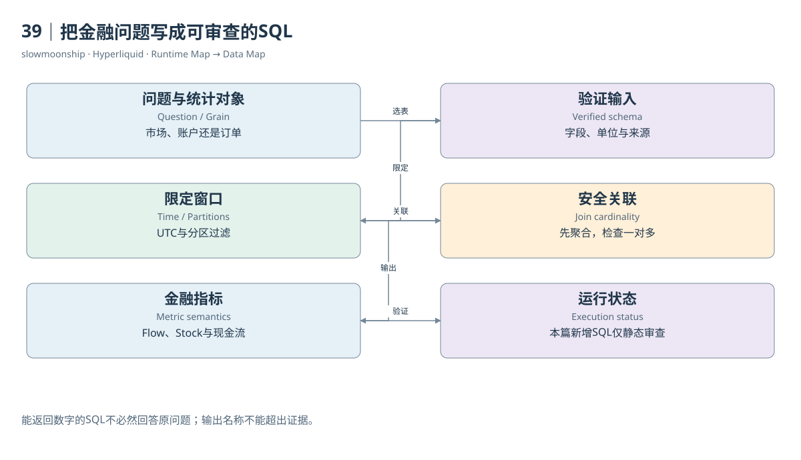

# 39｜把金融问题写成可审查的SQL

“昨天BTC有多少交易量”看起来只需要SUM，实际先要回答四个问题：BTC是哪个市场，昨天按什么时区，一行是成交还是Fill，金额是否包含强制或行政行为。将问题改写成这些可检查条件，SQL才会成为研究方法，而不是只会返回数字的代码。

市场清单从Market Details开始，保留coin、DEX、Asset ID和风险参数。成交层SQL按完整coin筛选，限定UTC完整日，按Taker侧计算每笔匹配一次。若研究自愿交易，再选择相应Fill Role；若采用Metrics的总量，应明确其文档包含的行政或强制成分。

账户参与量则保留该账户所有正常两侧角色，不能为了市场去重而删掉Maker。案例03的Maker在平空且有返佣，删除它会漏掉真实用户行为。相同的`is_taker`条件，在市场指标里可能必要，在账户指标里却会改变问题。过滤规则应跟随统计对象。

订单SQL按账户、coin与oid聚合已发生Fill，可以计算执行数量与加权价格。它只能描述至少有一次成交的订单。未成交、取消与拒绝需要额外生命周期表；成交表中的不同oid数不能直接叫下单次数。静态审查不仅检查字段存在，也要检查指标名是否超出数据。

OI SQL保留指定小时的来源双边量，必要时另列按文档换算的经典单边量，不跨时间相加。与Volume比较时，先把成交聚合到同一小时，再一对一连接。不能将一个小时OI连接到每条Fill后求和，否则站立仓位会按成交行数被复制。

资金费SQL将Rate与Payment分别输出。用户金额直接使用已结算字段，支付方为负、收到为正；市场支付总量采用其独立正值口径。清算SQL按角色与事件身份统计，不把两腿都作为两个被清算人。费用SQL还必须处理返佣负数与分配字段重叠。

订单簿SQL从数组展开买卖价档，先转换十进制字符串，按同一快照计算Spread与价格带深度。买卖数组不要在同一行直接双重展开形成笛卡尔积。价格Join则需要coin与有界时间对齐，保留原始更新时间及陈旧程度，避免没有历史价格时静默用今天价格。

HyperEVM练习分别统计交易、日志与Trace，系统交互只命名为接口调用。HIP-4练习先选择正常trade和Taker，再与市场定义连接；铸造、销毁及结算另行分析。本地SQL包提供十八个主题，所有新增语句静态检查，没有Dune服务端执行结果。

SQL审查最后可以用一张清单闭环：表与列有来源，输入粒度已定义，时间与分区受限，Join不会重复，金额单位可解释，输出名称没有夸大，执行状态真实。它把金融问题与数据地图接起来，让一个数字既能够计算，也能够被另一个读者追溯和质疑。

如果静态检查发现字段只有文档依据而没有当前Catalog返回，应把该区别保留在SQL说明中，等待运行验证。

<!-- BOOK RESOURCES -->

[编辑此图](../../assets/diagrams/sql.drawio)

数据练习：[SQL01](../../examples/sql/01-markets.sql) · [SQL02](../../examples/sql/02-volume.sql) · [SQL03](../../examples/sql/03-maker-taker.sql) · [SQL04](../../examples/sql/04-hourly-flow.sql) · [SQL05](../../examples/sql/05-open-interest.sql) · [SQL06](../../examples/sql/06-flow-stock.sql) · [SQL07](../../examples/sql/07-funding-rates.sql) · [SQL08](../../examples/sql/08-user-funding.sql) · [SQL09](../../examples/sql/09-liquidation.sql) · [SQL10](../../examples/sql/10-depth.sql) · [SQL11](../../examples/sql/11-spread.sql) · [SQL12](../../examples/sql/12-hip3-classification.sql) · [SQL13](../../examples/sql/13-first-hip3.sql) · [SQL14](../../examples/sql/14-evm-transactions.sql) · [SQL15](../../examples/sql/15-core-interfaces.sql) · [SQL16](../../examples/sql/16-outcome-volume.sql) · [SQL17](../../examples/sql/17-trade-book-join.sql) · [SQL18](../../examples/sql/18-kpi-and-quality.sql)（静态审查，未执行）。

依据：[dune-perp-trades](https://docs.dune.com/data-catalog/curated/perpetuals/hyperliquid/perp-trades.md)；[dune-perp-market-metrics-hourly](https://docs.dune.com/data-catalog/curated/perpetuals/hyperliquid/perp-market-metrics-hourly.md)；[dune-perp-orderbook-1m](https://docs.dune.com/data-catalog/curated/perpetuals/hyperliquid/perp-orderbook-1m.md)；[dune-hip4](https://docs.dune.com/data-catalog/curated/prediction-markets/hip4/overview.md)。

[来源目录](../../research/source_catalog.md) · [目录](../../SUMMARY.md) · [上一章](../../book/part-10/38-dune.md) · [下一章](../../book/part-10/40-reconstruction.md)
