# 慢月船：链上数据之路｜Polygon PoS 篇

slowmoonship: Gateway to Onchain Data

研究基准：2026-10-19。

# 前言｜从快速转账到可核对的证据

Polygon的钱包体验往往很简单：连接网络，付少量手续费，等待到账。但当我们追问谁执行交易、怎样确认历史、为什么退出Ethereum还要等待，事情就不再只是一个RPC地址。Bor、Heimdall和根链合约共同组成了需要分层理解的系统。

本篇以2026年10月19日为研究基准，只讨论Polygon PoS Mainnet，也就是当前官方所称Polygon Chain。全书先从一笔交易进入执行与共识，再解释POL历史、桥接、EVM数据和SQL，最后研究真实DeFi项目LGNS。它不是Polygon品牌的产品百科，也不把相同的EVM知识重复写成另一部Ethereum篇。

阅读时不必一次记住所有术语。每章先解决一个问题，图形帮助确认角色关系，SQL展示统计口径，案例把讨论固定到具体交易。图形使用中英文标签，原生draw.io可独立编辑；复杂SQL与研究材料放在正文之外，保持连续阅读。

两个作者原看板是研究入口。Polygon核心结构看板提供真实SQL与历史数据；LGNS看板提出资金和风险问题。旧查询的标题、注释与结果都要接受审查。本篇保留原始副本，纠正能够识别的解释错误，并把历史观测与本轮新验证分开。

LGNS部分区分技术能力、已观察行为和研究判断。数量增长不直接等于财富增长，资金进入合约不自动等于营业收入，地址关联也不直接确定现实身份。通用证据原则集中在附录，正文只在具体推论需要时解释限制。

新教学SQL受到只读执行条件限制，没有重跑；浏览器源码没有在本机重新编译匹配，真实案例没有本地全节点重放。对应缺口保存在报告中。文件检查通过，只说明工程中的特定一致性成立，不能替代协议研究与证据审查。

本篇希望交给读者一条可以反复使用的路线：运行地图、数据地图、资金地图、证据地图。先看清系统怎样留下记录，再让记录支持恰当的结论。

---

# 第01章｜为什么转账很快，却有三套系统

你在钱包里发送一笔POL转账，几秒钟后，收款人就看到了余额。打开网络介绍，却同时遇到Bor、Heimdall和Ethereum三个名字。难道一笔钱要先后经过三条链，才能到达对方？这个疑问正好是认识Polygon的入口：先分清谁执行交易，谁组织确认，谁承担跨链合约职责。

钱包连接的通常是一个RPC节点。它接收签名交易，检查格式，再把交易传播出去。Bor是Polygon的执行客户端，能够运行EVM，也就是执行Solidity合约所需的虚拟机。转账或合约调用被放进Bor区块后，节点按照同样的规则计算新状态。钱包看到的交易哈希、Gas消耗、回执和事件，主要都来自这一层。

执行正确还不够，网络还必须解决另一类问题：谁有资格生产区块，验证者怎样认可一段区块历史，生产者停止工作后怎样恢复。Heimdall承担这部分协调与共识职责。当前的Heimdall v2基于Cosmos SDK和CometBFT构建，拥有自己的区块、消息和状态。它不是部署在Bor上的一个普通合约，也不会把每笔用户交易再执行一次。

Ethereum上的合约又负责不同的事情。验证者质押、相关管理与检查点提交，都有Ethereum侧的记录。检查点把一段Bor历史的承诺提交过去，供桥接等机制使用。用户在Polygon给朋友转POL，通常不需要自己再发一笔Ethereum交易；取款跨回Ethereum时，才会进入包含检查点与退出证明的另一条流程。

因此，本篇采用三层观察图：Ethereum合约、Heimdall共识、Bor执行。图中连线表示信息与职责的联系，不能读成每笔交易依次在三个地方执行。尤其要记住，本地最终确认由Polygon自己的协议建立；把检查点提交到Ethereum，并没有把Polygon自动变成一个由Ethereum验证全部执行的Rollup。

这也决定了研究方法。Bor数据适合回答谁调用了哪个合约、产生了什么事件；Heimdall数据适合解释验证者、Span与Milestone；Ethereum数据适合核对质押、检查点和桥接的根链步骤。只打开一张交易表，就想同时回答三类问题，常会把看不到的数据误认成不存在。

从用户体验看，钱包只需要告诉你收款是否完成；从研究角度看，同一句话却要拆成执行、共识与跨链三个问题。比如比较两个网络的确认速度，必须先确定双方采用的确认定义。否则把一个网络的回执时间与另一个网络的桥接等待时间相比，得到的数字再精确，也没有共同衡量对象。

后面我们会沿着一笔交易往下走，再把网络记录转换成可查询的数据，最后调查一个真实DeFi项目。读者不必先背熟全部名称。先把三个动作记清：Bor执行，Heimdall协调确认，Ethereum合约记录特定的质押和跨链事务。每遇到一份数据，都先问它属于哪一层，解释就有了落点。

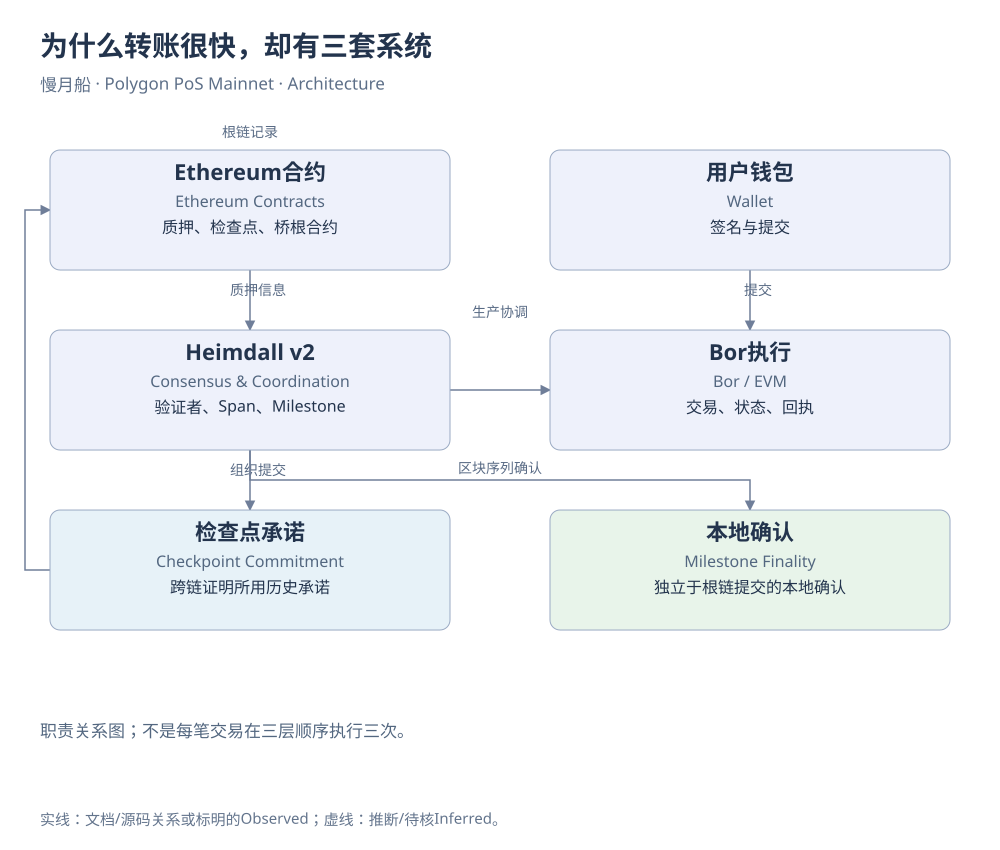

[可编辑原图](assets/diagrams/architecture.drawio)

来源与核对：[architecture](https://docs.polygon.technology/pos/architecture/overview.md)；[heimdall](https://docs.polygon.technology/pos/architecture/heimdall_v2/introduction.md)。研究基准：2026-10-19；资料获取：2026-10-19—20。

[返回目录](SUMMARY.md)

---

# 第02章｜先确认自己在哪一条链

相同的钱包地址，可以同时出现在Ethereum和Polygon。地址看起来一样，余额却不同，发送交易使用的手续费资产也不同。这不是钱包显示故障，而是两个网络维护着不同状态。开始分析前，最便宜也最重要的一次检查，是确认网络身份，而不是先看代币名称或网站Logo。

本篇只讨论Polygon PoS Mainnet，当前官方也称Polygon Chain，Chain ID为137。JSON-RPC的eth_chainId通常把它返回为十六进制0x89。Chain ID参与交易签名的网络区分，但一个页面写着137，还不足以证明页面的全部内容可靠。实际研究应同时保存RPC来源、区块号、区块哈希和交易所属网络，使不同服务返回的记录能够对齐。

Polygon品牌还包含zkEVM、CDK和Agglayer等对象。zkEVM是另一套执行与证明系统，CDK是构建链的技术工具，Agglayer讨论的是互操作与聚合关系。这些名称与Polygon PoS存在联系，却不能共享一份交易总数或合约地址清单。把zkevm表中的活动并入polygon表，会让看似完整的统计失去明确对象。

地址同样需要带上网络。一个完整的代币身份至少应写成“链＋合约地址”，符号只方便阅读。Polygon上的DAI与Ethereum上的DAI不是同一个状态槽里的余额；同名稳定币也可能分别是原生发行版本和桥接表示。研究中如果只按symbol='USDC'筛选，就可能把不同机制、不同信用关系的资产混在一起。

当前Polygon使用POL支付原生手续费。历史材料中常见MATIC，数据平台也可能保留旧符号或进行历史归一化。网络身份、计量单位与显示名称应分别记录。一个平台把旧交易显示为POL，不意味着当年那笔交易又发生了一次兑换；反过来，界面仍写MATIC，也不能证明主网尚未完成协议迁移。

在Dune中，本篇的Raw表使用polygon命名空间，跨链Curated表则还要加blockchain='polygon'。在浏览器里，交易链接应指向PolygonScan，而不是Ethereum浏览器。跨链案例确实需要两条链时，应给每条证据各自标明Chain ID，并通过消息或退出标识建立联系，不能仅因时间接近就合并。

实际建立案例文件时，可以把网络身份放在每条记录旁，而不是只写在文件标题。CSV导出后常被单独使用，脱离正文的哈希与地址仍应能够正确定位。尤其在合约跨链部署地址相同的情况下，这一步能够阻止看似匹配、实际属于另一个账本的连接。

你可以把研究起手式理解成给包裹贴地址：先写网络，再写合约或交易，再写观察时刻。这个步骤没有复杂计算，却能阻止很多后续错误。本篇的案例索引保留这些定位字段；某个字段尚未取得时会明确留空，而不会用另一条链的记录补齐。只有对象固定下来，统计结果才有机会被别人复核。

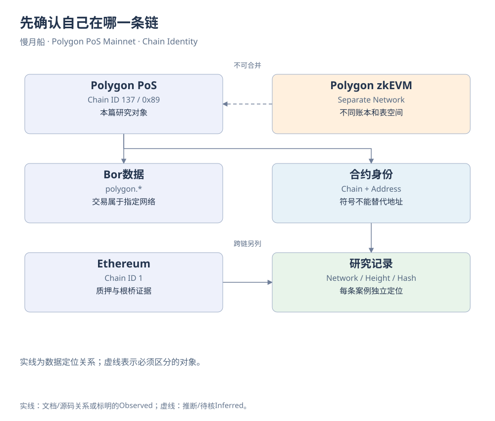

[可编辑原图](assets/diagrams/chain-identity.drawio)

来源与核对：[rpc-endpoints](https://docs.polygon.technology/pos/reference/rpc-endpoints.md)；[dune-polygon](https://docs.dune.com/data-catalog/evm/polygon/overview.md)。研究基准：2026-10-19；资料获取：2026-10-19—20。

[返回目录](SUMMARY.md)

---

# 第03章｜钱包显示成功之后发生了什么

钱包弹出“成功”，回答的通常是这笔交易有没有进入某个区块、执行有没有回退。用户真正关心的却可能是另一个问题：这次付款还会不会被换掉？如果是在提款，还要追问Ethereum上的资产是否已经释放。三个问题相互关联，但它们对应的状态不同，不能都装进一个绿色对勾。

签名交易先进入节点，再等待生产者打包。被Bor执行后，回执包含状态、Gas与日志。成功的回执说明本次顶层执行没有整体回退，却不保证所有业务意图都实现。例如某个调用返回false，或者合约捕获内部失败后继续运行，交易仍可能成功。研究者必须结合输入、日志和相关余额变化解释实际结果。

区块刚被看到时，观察者拿到的是当前链头附近的一份记录。Milestone进一步让验证者对连续Bor区块的哈希序列达成协议认可，建立Polygon本地的确定性最终确认。这里的“确定性”建立在协议规定的投票权门槛、诚实与运行假设之上；它描述的是网络规则，不能被改写成任何节点或接口永远不会故障。

Heimdall v2的Milestone使用CometBFT投票扩展组织相关意见。它不是给每笔转账单独发送一笔确认交易，而是确认区块序列，区块里的交易随之获得相应的本地确认。研究一笔交易时，可以把交易所在Bor高度与已确认区间对照；只有交易回执，没有Milestone记录，就不应声称自己已经独立验证了全部共识过程。

Checkpoint在更长的跨链流程里发挥作用。它经过提议、验证、Ethereum提交和确认等步骤，把Bor历史承诺带到根链合约。对于标准PoS桥的退出，用户还需要准备相关证明并完成Ethereum侧操作。因此，Polygon上的提款发起成功，并不等于Ethereum已经放款；等待检查点与等待本地Milestone也不是同一段等待。

分析界面最好把这些状态展开：已提交、已执行、本地最终确认、已纳入检查点、退出已完成。并非每笔普通转账都要展示全部五项，但研究记录应能区分它们。如果一个节点仅返回receipt.status=1，我们就记录执行成功；如果又取得跨链完成事件，才把退出状态提升到相应级别。

还有一个容易忽略的层次是应用确认。交易执行成功之后，界面可能等待后端索引更新，或等待另一合约完成业务条件。余额显示延迟不一定是共识延迟；共识已经完成，也不保证某个中心化应用立即记账。测量体验时应为这些阶段分别记录时间。

后面的真实案例会保留交易、事件与区块定位。本轮并没有本地运行完整Polygon节点，所以浏览器与索引返回的状态仍属于外部可核对记录，不能冒充本机重放和验签。这个界限不会削弱案例的教学价值：它让读者知道每一个“成功”究竟回答了什么，以及下一份证据应该去哪里寻找。

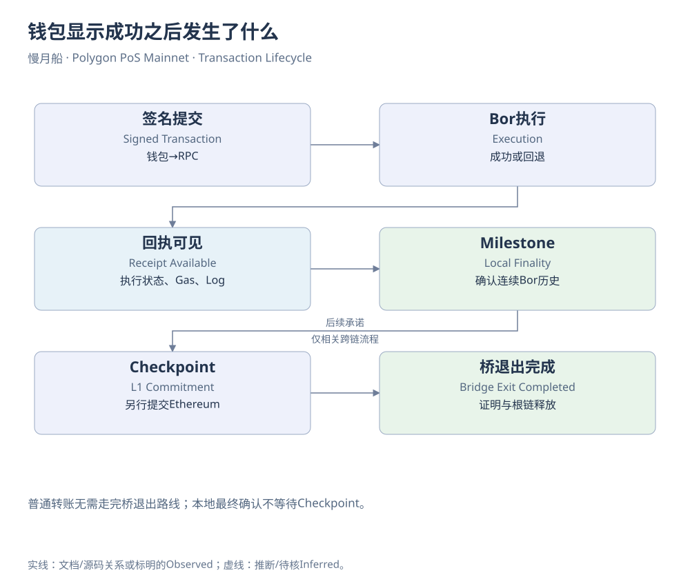

[可编辑原图](assets/diagrams/transaction-lifecycle.drawio)

来源与核对：[pol-finality](https://docs.polygon.technology/pos/concepts/finality/finality.md)；[milestones](https://docs.polygon.technology/pos/architecture/heimdall_v2/milestones.md)。研究基准：2026-10-19；资料获取：2026-10-19—20。

[返回目录](SUMMARY.md)

---

# 第04章｜三张地图带你读完本篇

理解一条链，不必从几十个接口开始。先画运行地图，说明一次操作怎样被执行与确认；再画数据地图，说明记录怎样进入查询表；最后画资金与证据地图，说明哪些变化支持什么结论。Polygon篇沿着这条路线展开，因为同一组数据在不同层次的问题里，往往具有不同意义。

运行地图中，钱包、Bor、Heimdall和Ethereum合约各有位置。Bor保存EVM执行产生的区块、交易、回执与状态；Heimdall组织验证者、生产者安排、Milestone、Checkpoint和状态同步；Ethereum留下质押及桥接根链合约的调用。三层记录通过高度区间、哈希、事件和消息标识关联，并不存在一张天然囊括所有活动的超级表。

数据地图从节点记录走向Raw、Decoded与Curated。Raw保存接近原始执行的字段；Decoded使用ABI把字节解释成命名参数；Curated再按照模型整理转账、交易和价格。越方便使用的表，通常包含越多额外规则。比如一行DEX成交可能是路线中的一段，而一行代币转账也不必然代表一次独立付款。

作者的Polygon看板提供了很好的中间桥梁：区块、交易、费用、调用轨迹、部署、日志、代币移动和DEX活动，都有可以阅读的原SQL。我们不会把图表标题直接当成技术事实，而会回到查询的时间窗口、表字段和行粒度。尤其是系统交易、零地址miner以及创建表分区，都会影响你怎样解释看似普通的计数。

资金地图则从合约角色出发。一个用户买入代币，可能先把稳定币交给Router，再进入Pool，最后收到目标代币；质押又会把代币交给Staking并得到记账凭证。若把路径上每一次Transfer都叫作项目收入，同一笔资金会被重复放大。研究者应先选边界，再计算流入与流出。

证据地图把这些计算放回结论中。源码证明合约具有什么能力，交易证明某次调用发生，索引统计描述某个窗口的模式，项目披露解释其自称的机制。风险判断需要把它们连接起来，不能跳过中间环节。LGNS案例会展示同一个历史结果怎样支持具体观察，同时仍然无法回答管理员身份、外部收入和法律性质等问题。

这套路线也方便阅读时跳转。懂EVM的读者可以先读Heimdall和桥接，再回看数据差异；熟悉SQL的读者可以用真实交易案例对照前面的机制。无论从哪里进入，都应回到同一套网络身份、历史时点与事件定位，避免各章形成互不兼容的解释。

读完本篇，你应能够独立追问四件事：网络怎样运行，数据怎样形成，资金怎样穿过合约，以及结论能走到哪一步。SQL和图形都是辅助工具，核心是把对象、时间和因果关系固定下来。下一部分先进入Bor，把一笔看似简单的请求拆成可观察的执行过程；之后再逐步接上共识、桥接和项目调查。

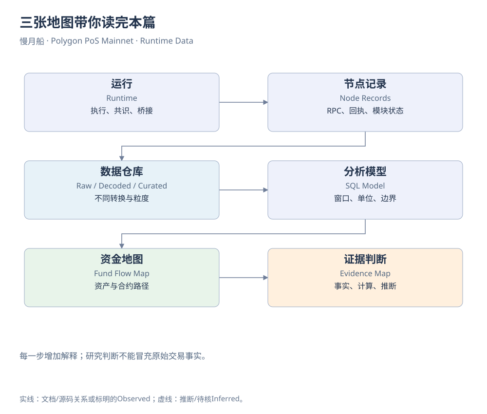

[可编辑原图](assets/diagrams/runtime-data.drawio)

来源与核对：[architecture](https://docs.polygon.technology/pos/architecture/overview.md)；[dune-polygon](https://docs.dune.com/data-catalog/evm/polygon/overview.md)。研究基准：2026-10-19；资料获取：2026-10-19—20。

[返回目录](SUMMARY.md)

---

# 第05章｜Bor把一次请求变成状态变化

在Polygon上调用一个合约，可以想成向一台公开的状态机器递交指令。输入相同的旧状态、交易顺序和执行规则，节点就应得到相同的新状态。Bor负责运行这台机器。它能够执行EVM字节码，因此熟悉Ethereum工具的开发者能够沿用许多钱包、合约语言和分析方法，但区块生产与协议参数仍由Polygon自己的规则决定。

一笔交易带着发送者、接收地址、原生币数量、输入数据、Nonce和费用参数。普通POL转账主要改变原生余额；调用ERC-20的transfer，则是在代币合约内部修改余额账本。交易的value可以为零，用户却真的转出了代币。这是理解EVM数据的第一道门槛：顶层原生币数量不是一次业务操作的全部金额。

Bor按区块给定的交易顺序执行。合约可以继续调用别的合约，读取储存、转移资产、创建新合约并发出事件。成功执行后，新状态被提交；如果顶层执行回退，其内部状态变化和日志也会回退，但发送者通常仍支付已经消耗的Gas。失败因此既是一种执行结果，也是一种真实的网络资源消耗。

状态是某一时点的结果，历史记录则解释它怎样形成。balanceOf返回某个账户当前的代币余额，并不自动告诉你全部入账、出账和Rebase历史。要研究过去的余额，需要指定历史区块，或者使用覆盖完整且机制适用的历史重建方法。把今天的余额复制到过去某一天，会让资金流调查从起点就失真。

合约创建也发生在执行过程中。用户可以直接发起创建交易，工厂合约也能在内部调用中创建子合约。只检查顶层to为空的交易，会漏掉工厂部署。Dune的creation_traces提供了部署对象的物化视图，而traces还能帮助理解调用路径；两者字段不同，不能假定创建表天然保存CREATE2类型或完整成功状态。

EVM兼容还需要放在时间中理解。Bhilai引入的相关Pectra能力、后续Gas重定价，以及系统交易表示，都可能改变分析对象。某个输入能够在当前区块执行，不意味着相同字节在所有历史高度都遵循同样规则。重放历史时必须使用对应硬分叉配置，比较费用时也要留意不同版本的资源定价。

并行执行优化不会改变这种观察原则。客户端可以在实现内部加速处理，但对外仍需形成符合协议顺序的确定结果。分析交易排序时，应读取区块中的实际位置，不能从CPU执行方式推断用户交易在账本上获得了另一种顺序。

观察一次执行，可以沿着“交易输入→内部调用→日志→余额变化”推进。输入说明请求，调用说明路径，日志说明合约主动报告的事件，余额说明结果。它们并不互相替代。后面分析LGNS质押时，正是通过这些不同窗口，才能区分用户转入的LGNS、收到的sLGNS记账单位，以及之后真正能够赎回或卖出的资产。

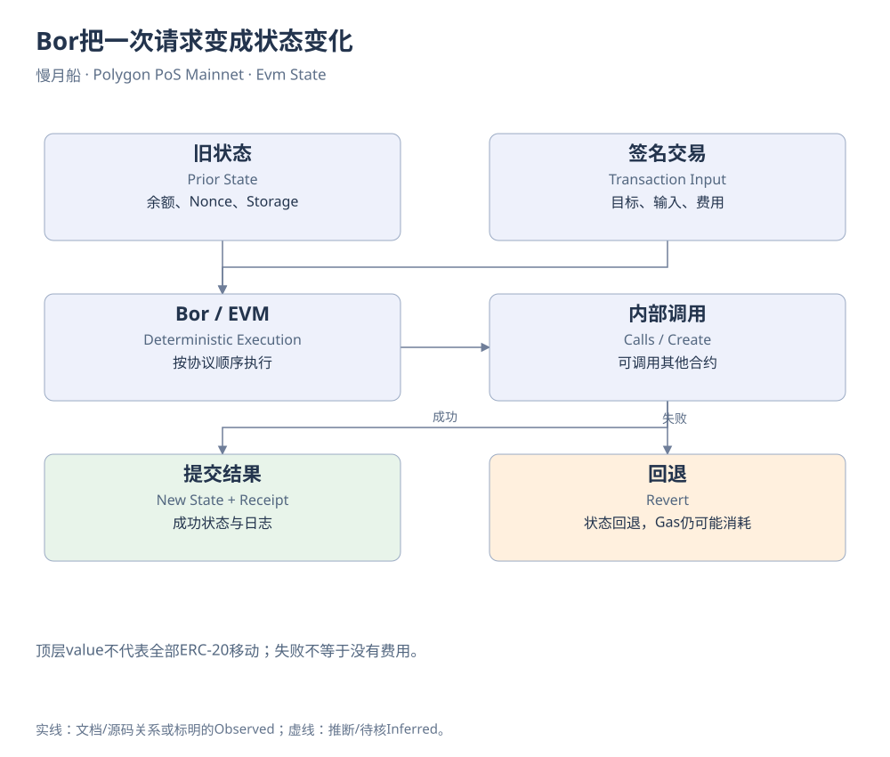

[可编辑原图](assets/diagrams/evm-state.drawio)

来源与核对：[bor-intro](https://docs.polygon.technology/pos/architecture/bor/introduction.md)；[eip-20](https://eips.ethereum.org/EIPS/eip-20)。研究基准：2026-10-19；资料获取：2026-10-19—20。

[返回目录](SUMMARY.md)

---

# 第06章｜区块头里藏着哪些版本线索

一个Bor区块不只是一袋交易。区块头保存父区块哈希、状态承诺、交易和回执相关承诺、Gas参数、时间及额外数据。这些字段把当前执行接到前面的历史上。分析者最常用的是高度和时间，但遇到生产者归因、费用变化或协议升级时，只看这两个字段远远不够。

高度告诉你区块在当前历史中的位置，哈希则标识具体内容。保存真实案例时，两者最好同时保留。某个查询只记录高度，后续数据源又使用另一段分叉历史，就可能把同一位置的不同区块误认成同一个对象。交易索引、日志索引和调用轨迹地址，也必须在各自所属的区块或交易上下文里解释。

Ethereum风格的字段名不保证Polygon使用相同语义。作者旧研究发现，所抽查的polygon.blocks.miner为零地址。这个现象应被记录成字段观察，不能顺着名称推论“零地址生产了区块”。Bor生产者使用签名授权，相关签名与版本化额外数据位于区块头中，生产资格还需要Heimdall的Span信息配合验证。

Rio之后，当前Span由单一获选生产者签发区块。旧资料中在Sprint边界嵌入验证者集合、依赖候补生产者轮换的描述，不能直接套到当前主网。图中应当把生产者签名、Span授权与验证者确认分开，而不是从一个miner字段画出整个共识关系。归因需要知道该高度的实际协议版本。

Giugliano又增加了新的可观察线索。PIP-83把GasTarget与BaseFeeChangeDenominator写入版本化的额外数据，并提出bor_getBlockGasParams以及可选的borExtra扩展参数。它们帮助外部工具知道生产者报告的费用参数，但参数存在并不等于其计算方式被逐项强制验证；Base Fee的有效性还受PIP-79规定的边界规则约束。

这类字段未必已经进入Dune的blocks表。本轮Catalog确实返回的字段，与节点RPC能够提供的字段，应分别列清。需要新的头部参数时，先确认节点版本和方法支持，再保存完整响应；接口返回方法不存在，只说明该服务没有提供相应能力，不能据此认定协议没有这个字段。

读取extraData时，还应保留原始字节与解码版本。把签名末尾固定长度截取与中间RLP字段混用，可能在升级后得到错误地址或参数。研究文件中的十六进制内容因此不会先清洗成普通文字，也不把整个字段当成可以自由解释的备注。

区块头也是版本时间线的一部分。Bor高度与Heimdall高度属于不同序列；Zurich和Ithaca的激活数值不能放进Bor高度过滤条件。研究文件因此为每次升级同时保存网络、客户端、激活维度和来源。先给高度写清单位，才能避免把准确的数字用在错误的链上。

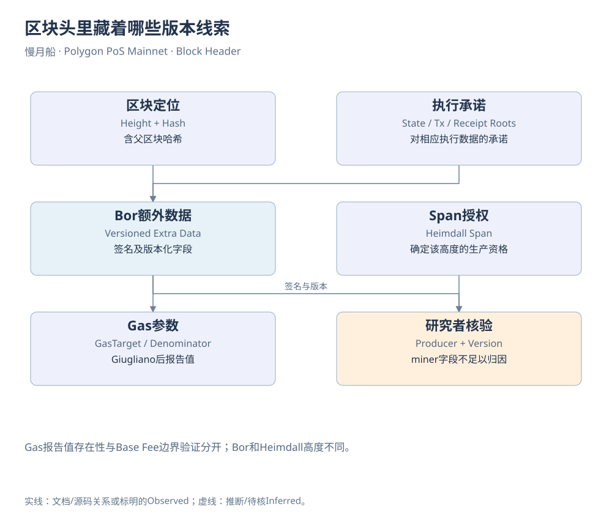

[可编辑原图](assets/diagrams/block-header.drawio)

来源与核对：[pip-83-asof](https://raw.githubusercontent.com/0xPolygon/Polygon-Improvement-Proposals/7ca861517bcdcba3e1f2b751762c6c2e786d7caa/PIPs/PIP-83.md)；[bor-asof-config](https://raw.githubusercontent.com/0xPolygon/bor/1cdf43c99d97cb9e18860776d8f69a416b49adf4/params/config.go)。研究基准：2026-10-19；资料获取：2026-10-19—20。

[返回目录](SUMMARY.md)

---

# 第07章｜交易、回执、日志和调用轨迹

同一笔合约交易，在数据仓库里可能有一行Transaction、几十行Trace和上百行Log。第一次看到这种结果，很容易以为网络把交易重复保存了。其实这些表观察的是不同层次：Transaction是外部提交的事务，Trace是执行路径，Log是成功提交的事件记录，而Receipt汇总顶层执行结果。

交易输入告诉我们用户向哪个入口提出了什么请求。Trace继续展开入口调用了哪些合约，是否使用delegatecall，是否创建对象，哪一层失败。Log则由合约通过EVM日志指令发出，ABI把topic和data解释为事件参数。一条Trace不必发出Log，一条Log也不能反过来完整描述整条调用路径。

内部调用失败与顶层失败要分开。合约可以捕获某次调用失败并执行备用逻辑，所以Trace中的success与Transaction.success不一定完全一致。统计失败率时，必须先说明分母是一笔外部交易还是一个内部执行帧。把所有失败Trace除以交易总数，得到的是另一种指标，不能命名为用户交易失败率。

日志的稳定定位通常需要交易哈希加日志索引，必要时再带区块哈希。ABI解码后的事件表应能回到同一条Raw Log。只按交易哈希连接，会把同一交易里多个同类事件交叉配对。例如一次路由交换连续经过两个池，两个Swap事件都属于同一交易，不能因为哈希相同就把任意Transfer归给任意一段成交。

Trace的路径用数组表示嵌套位置，空数组通常代表顶层帧。它和日志索引没有数值对应关系。输入数据里的函数选择器也不等于业务类型的完整证明：代理会把调用委托给实现，入口合约还可能代表另一个用户执行。识别发起账户、实际付款地址和最终受益地址，需要结合合约语境。

本篇的案例先保留原始字段，再单独列推导字段。原始金额使用整数与明确精度，推导的代币数量和费用另做换算。Dune返回的解码结果属于索引层解释；已验证源码和ABI则帮助核对这种解释是否符合合约。二者相互补强，但不是两次独立的链上执行。

Receipt与Trace还有可得性差异。普通节点通常能返回交易回执，而完整历史调试轨迹可能需要额外接口、历史状态和更高资源。某服务未提供Trace，不代表交易没有内部调用；它只说明目前没有取得能够展开该执行路径的数据。

当一笔记录看起来矛盾时，先检查是否比较了不同层。交易成功但内部有失败，可能是容错逻辑；代币Transfer很多但用户只有一次Swap，可能是路由；原生value为零但资产变化巨大，可能是ERC-20调用。理解这些层次之后，后面的SQL连接与资金图才不会把技术记录误写成经济活动次数。

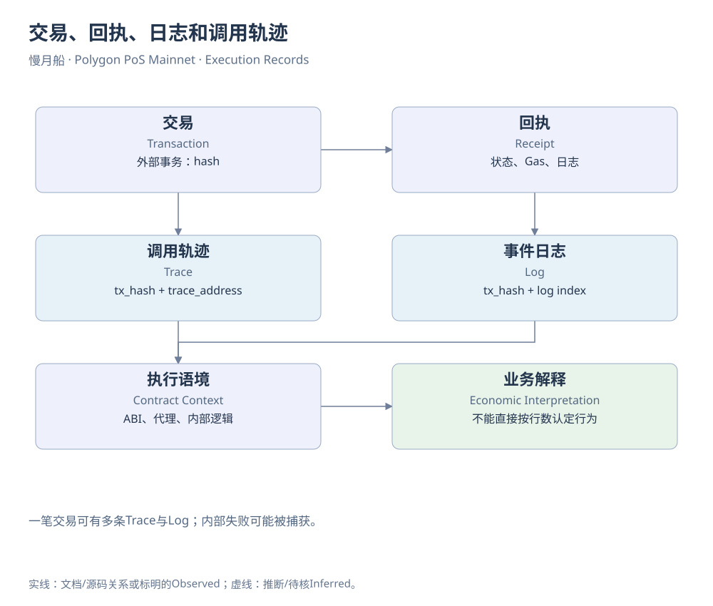

[可编辑原图](assets/diagrams/execution-records.drawio)

来源与核对：[dune-polygon](https://docs.dune.com/data-catalog/evm/polygon/overview.md)；[dune-transfers](https://docs.dune.com/data-catalog/curated/token-transfers/evm/token-transfers.md)。研究基准：2026-10-19；资料获取：2026-10-19—20。

[返回目录](SUMMARY.md)

---

# 第08章｜Gas花在了哪里

用户常问“这笔转账花了多少Gas”，真正想知道的通常是付出了多少POL。Gas是资源计量，Gas Price是每单位资源的价格，实际费用才是两者相乘后的金额。把这三者分开，才能比较网络拥堵、合约复杂度和用户成本，也能避免把一个很高的Gas Limit误认为已经支付的费用。

Gas Limit是交易允许消耗的上限；Gas Used是执行实际消耗的数量。对于常见用户交易，实际执行费用可由回执Gas Used乘以有效Gas Price得到，再按原生币的最小单位换算。Max Fee与Max Priority Fee表达费用上界和优先费约束，不是最终全部支付的单价。退款、回退与费用机制的具体表现，还要看对应交易类型和版本。

EIP-1559把费用市场中的Base Fee与优先费分开。Polygon沿用相关结构，同时拥有自己的参数与分配安排。不要把“用户付费”“协议销毁”“生产者收入”“质押奖励”写成同一个数字。它们分别涉及收取、归集、分配或发行，可能发生在不同合约和时间点，不能仅凭交易总费用推算所有接收方收入。

2026年的参数变化尤其值得注意。Lisovo相关PIP-79允许在约束边界内配置费用参数；Giugliano通过PIP-83把报告参数放入区块头。研究历史Base Fee时，不应永远硬编码Ethereum常见的目标比例和变化分母。区块Gas Limit、目标Gas和参数报告值需要带着版本一起读取。

Gas能力也不是固定TPS。一个简单转账、一笔多跳Swap和复杂合约调用消耗的资源相差很大。把每块Gas容量除以某种基准交易的Gas，可以得到该工作负载下的容量估算；真实TPS则来自指定窗口内确认交易数除以经过时间。宣传中的支付处理能力和全链混合交易实测值，不能画成同一条连续曲线。

Polygon还存在协议发出的系统记录。原看板的历史抽查发现type为127的行，PIP-74对应StateSyncTx的规范化表示。费用分析不能把它们无条件当作普通钱包签名交易。教学查询保留type分组，并建议与gas.fees核对，先解释索引表达，再决定是否纳入用户成本指标。

进行费用分解时，还要检查时间选择。一次尖峰可能来自短时需求或特定应用批量操作，日平均会把它抹平；只挑最贵一笔，又不能代表普通用户体验。把完整窗口、中位数和极端样本一起展示，通常比给出单一平均值更有信息。

实际分析时，先选择完整UTC窗口，记录交易类型，再计算费用总额、中位数与分位数。平均费用可能被少数昂贵调用拉高，美元费用又引入价格来源与时点。一个好的结果应让读者同时看到POL金额、统计范围和价格覆盖率。下一部分转向验证者，解释是谁组织这些执行记录成为可信的网络历史。

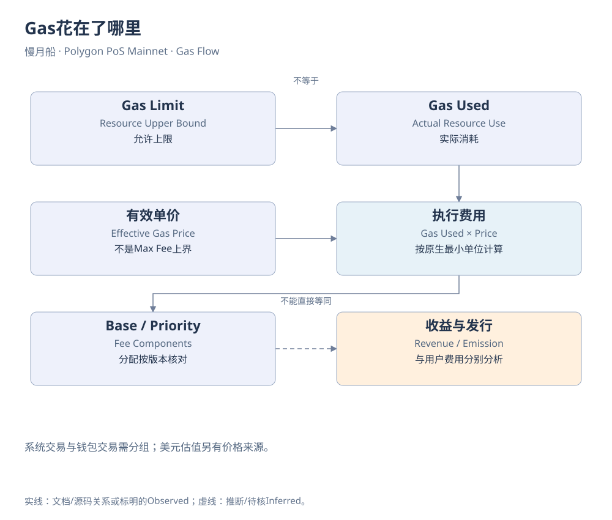

[可编辑原图](assets/diagrams/gas-flow.drawio)

来源与核对：[eip-1559](https://eips.ethereum.org/EIPS/eip-1559)；[pip-79-asof](https://raw.githubusercontent.com/0xPolygon/Polygon-Improvement-Proposals/7ca861517bcdcba3e1f2b751762c6c2e786d7caa/PIPs/PIP-79.md)；[pip-83-asof](https://raw.githubusercontent.com/0xPolygon/Polygon-Improvement-Proposals/7ca861517bcdcba3e1f2b751762c6c2e786d7caa/PIPs/PIP-83.md)。研究基准：2026-10-19；资料获取：2026-10-19—20。

[返回目录](SUMMARY.md)

---

# 第09章｜验证者与区块生产者怎样分工

“谁决定下一段时间由谁生产区块？”这个问题不能只看哪个地址最近发过区块。Polygon把参与确认的验证者与实际生产Bor区块的角色分开。验证者按照协议与质押权重参与Heimdall共识，并通过规则选出生产者；生产者负责给出可执行的Bor区块，其他参与者仍需检查执行与历史。

验证者的质押与委托关系具有Ethereum侧的合约基础。Heimdall跟踪相关事件和验证者状态，再形成当前有效的验证者集合与投票权。投票权不是简单的一人一票，观察验证者数量也不能替代权重分析。研究集中程度时，既要看参与者数，也要看投票权分布，并明确地址关联标签来自哪里。

Rio后的VEBloP，即Validator-Elected Block Producer，改变了生产组织。当前文档描述一个由验证者加权投票确定的合格生产者池，再为每个Span指派一个生产者。Span可以理解成一段具有明确生产授权的Bor区块范围。它记录生产安排，不能直接等同于固定秒数，也不是用户交易的批处理对象。

一个Span内的单一生产者并不等于网络只有一个验证者。生产集中与验证分散是不同维度：前者影响排序、传播与活性，后者承担执行检查和共识确认。也不能据此把Polygon称作只有一个排序器的普通Rollup，因为它的共识、质押、桥接与安全假设仍需按本网络规则分析。

Sprint是Span内部更小的区块分组。旧机制中，它与生产者轮换和延迟有关；Rio之后，单生产者Span改变了这部分逻辑，但Sprint边界仍用于状态同步等工作。因此看到旧教程写“每个Sprint换生产者”，应先确认其历史范围。一个旧术语继续存在，不意味着它承担的职责从未变化。

生产者如果停顿，当前网络需要Heimdall调整Span来恢复生产，而不是任意候补节点自行接管。2026年的Zurich与Ithaca又改进了生产者选择、边界检查与特定挂起状态下的恢复规则。研究网络故障时，不能仅根据两块之间的时间差判断原因，还应读取当时的Milestone、Span与节点运行信息。

生产者身份的核验需要把Bor区块签名与对应Span授权连接起来。Dune中的miner字段不足以完成这项工作；同样，看到某个验证者出现在集合里，也不代表它生产了该时段全部区块。合格、获选、实际签发、最终被确认，是四个可以分别观察的事实。

一个小练习是给某段历史建立角色表：列出验证者集合版本、投票权、生产者池、Span起止高度和实际区块作者。若缺少某列，就保留缺口。这样得到的分析，远比把活跃地址数量命名为“去中心化程度”更有解释力，也为下一章理解Heimdall自己的数据结构打下基础。

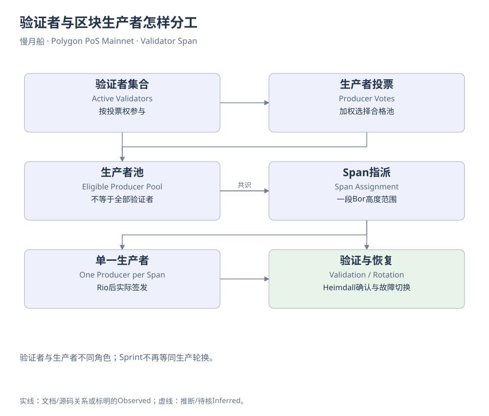

[可编辑原图](assets/diagrams/validator-span.drawio)

来源与核对：[bor-intro](https://docs.polygon.technology/pos/architecture/bor/introduction.md)；[pip-64-asof](https://raw.githubusercontent.com/0xPolygon/Polygon-Improvement-Proposals/7ca861517bcdcba3e1f2b751762c6c2e786d7caa/PIPs/PIP-64.md)。研究基准：2026-10-19；资料获取：2026-10-19—20。

[返回目录](SUMMARY.md)

---

# 第10章｜Heimdall v2为什么不是另一台EVM

Heimdall也有区块和交易，却不是第二条用来执行用户Solidity合约的EVM链。它的工作更像一个有明确业务模块的协调账本：跟踪验证者，组织生产安排，处理检查点和状态同步，并对Bor历史形成Milestone。理解它最有效的方式，是按职责阅读模块，而不是把Ethereum交易字段逐项搬过去。

当前Heimdall v2建立在Cosmos SDK与CometBFT基础之上。Cosmos SDK提供模块化应用框架，CometBFT负责拜占庭容错共识与应用交互。ABCI++及投票扩展允许验证者在共识过程中携带需要的额外意见。它们解释的是Heimdall怎样组织协调，并不是在说Polygon用户必须改用Cosmos钱包发送普通EVM交易。

2025年的v2迁移改变了序列化、签名与模块处理等细节。旧版命令、REST路径、交易型Milestone叙述，可能仍出现在搜索结果甚至部分文档残留中。遇到这种冲突，应先看当前机制与源码，再把旧命令标为历史接口。一个页面仍能打开，不代表其中每一段都适用于当前节点。

两个客户端的高度也不能互换。Bor高度定位EVM执行区块，Heimdall高度定位共识应用自己的区块。一个Heimdall区块可以处理关于某段Bor区块的意见，两者没有“一块对一块”的普遍对应关系。协议升级如果在Heimdall高度激活，研究者必须保存这个维度，否则同一个数字会被错误地拿去筛Bor交易。

模块状态把两层连接起来。Stake模块管理验证者信息，Bor模块处理Span，Milestone模块保存最终确认区间，Checkpoint模块协调Ethereum提交，Clerk模块保存状态同步记录。普通polygon.transactions主要描述Bor执行，不会因为名称带着Polygon就自然包含这些模块的全部历史。

接口选择因此从问题出发。查一笔代币转账用Bor RPC或EVM表；查某次生产安排用Heimdall的Bor模块；查最终确认范围用Milestone接口；查Ethereum是否接受检查点则要回到根链交易和合约。需要按同一时点比较时，保存各自高度、时间和来源，不能把几个latest响应当成原子快照。

节点内部的信任边界也值得看清。Bor从其配置的Heimdall端点取得协调数据，服务连接方式与故障切换影响运行。2026年新增的传输与恢复能力属于具体版本的实现变化，不能统称为“共识更快”。有的改动影响全体节点必须一致遵守的规则，有的只是本地通信优化。

节点日志可以帮助定位运行问题，却不是永久链上事实。日志中的超时、重试和端点切换需要与已提交状态区分；某节点观察失败，不等于网络所有验证者都未处理。分析共识异常时，应注明这是本地运行证据还是已进入共识的记录。

这种分层观察能解释一个常见疑问：为什么EVM交易照常可查，共识研究却仍需要另一套接口？因为执行历史与组织这些历史的协调状态，本来就是不同的数据对象。把Heimdall理解为具有模块和版本的应用后，Milestone与Checkpoint之间的区别就容易具体说明了。

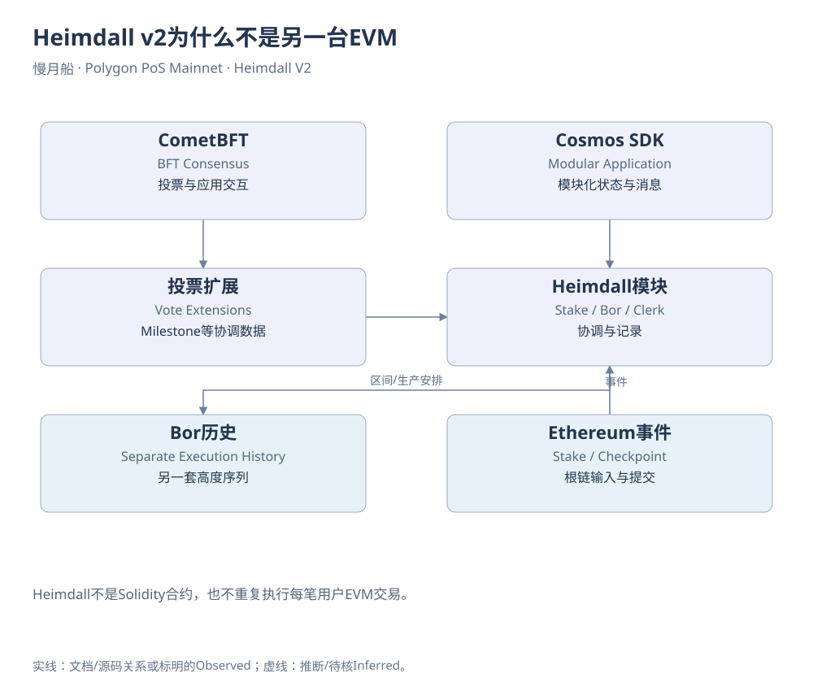

[可编辑原图](assets/diagrams/heimdall-v2.drawio)

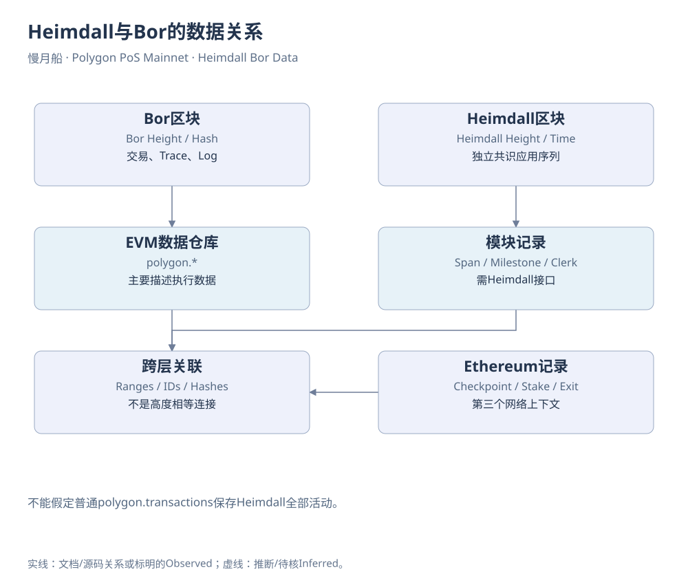

[可编辑原图](assets/diagrams/heimdall-bor-data.drawio)

来源与核对：[heimdall](https://docs.polygon.technology/pos/architecture/heimdall_v2/introduction.md)；[heimdall-changes-v2](https://docs.polygon.technology/pos/architecture/heimdall_v2/changes-from-v1.md)。研究基准：2026-10-19；资料获取：2026-10-19—20。

[返回目录](SUMMARY.md)

---

# 第11章｜Milestone怎样确认一段Bor历史

假设你看到Bor高度一百万处有一笔付款。确认付款执行成功，只需要交易和回执；判断它是否属于网络已经最终认可的历史，还需要知道这一高度是否落入Milestone确认的连续区间。Milestone针对区块序列，而不是为每笔交易单独盖章。

验证者通过Heimdall v2的投票扩展提交对近期Bor区块哈希的意见。协议从这些意见中寻找具备足够投票权支持、并与此前已确认历史连续的序列。高度与哈希必须一起比较，因为同一个高度在分叉情况下可能出现不同区块。只对高度投票，无法表达认可的是哪一份具体内容。

官方文档用约三分之二投票权门槛解释Milestone确认，并在具体规则中说明连续序列与多数支持。这里的计量单位是投票权，不是收到多少个HTTP响应。一个研究者询问三个公共RPC并得到相同结果，并不等于已经复现Heimdall的投票检查；它只是取得了多个服务对当前状态的回答。

Milestone一旦按协议确认，相关Bor历史获得本地确定性最终确认。这个过程不必等待下一个Ethereum检查点。它依赖Polygon验证者与共识实现的安全假设，不能被写成Ethereum在这时重新执行并验证了每一笔Bor交易。确认位置在Polygon本地，后续跨链承诺另有职责。

v2还改变了观察方式。旧版可能把Milestone描述成一种提交交易，当前核心流程依靠ABCI++与投票扩展推进，因此不能只在交易列表里搜索某个方法名来统计全部最终确认活动。应读取相应模块状态、区间和实现规定的消息结构，再与目标交易所在区块对照。

后续升级表明，最终确认与网络活性必须一起看。Zurich强化了多数序列选择的确定性；Ithaca处理了生产者停顿、Milestone处于特定待定状态时无法自主恢复的问题。它们不等于宣布任何条件下都不会停机，而是在协议中补足明确的故障恢复路径。时间宣传数字也不能代替逐笔延迟测量。

实际检查可分三步：保存交易所属Bor区块哈希，取得覆盖该高度的Milestone记录，再核对区间和末端承诺的含义。本轮提供的是接口和证据定位方法，没有把缺少的验证者签名包写成已经验签。如果只有索引器返回的confirmed标签，就按该服务的确认口径记录，不把它升级为本地共识证明。

同样，最终确认延迟需要起止点。以钱包签名时刻开始，会包含本地等待和传播；以Bor入块时刻开始，则更接近共识确认阶段。两种测量都可以使用，但不能在一张图中无说明地混合，随后把差异全部归因于Milestone机制。

Milestone使“交易已经确定”与“跨链退出已经完成”能够分开叙述。对普通收款，前者通常是关心的终点；对把资产取回Ethereum的人，前者只是后续证明流程的基础。下一章讨论的Checkpoint，就是这条后续路线里的另一种历史承诺。

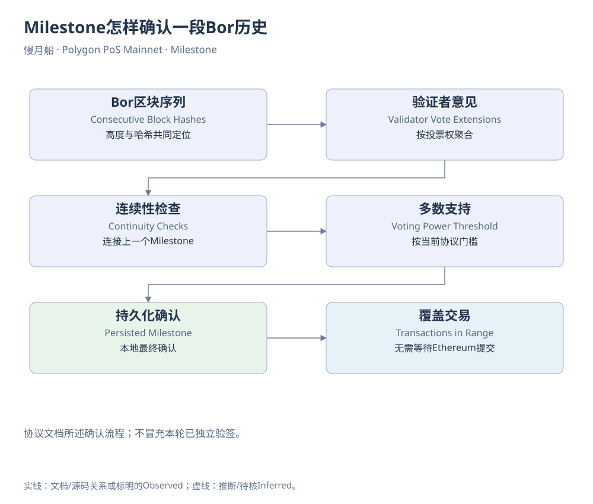

[可编辑原图](assets/diagrams/milestone.drawio)

[可编辑原图](assets/diagrams/milestone-vs-checkpoint.drawio)

来源与核对：[milestones](https://docs.polygon.technology/pos/architecture/heimdall_v2/milestones.md)；[pip-89-asof](https://raw.githubusercontent.com/0xPolygon/Polygon-Improvement-Proposals/7ca861517bcdcba3e1f2b751762c6c2e786d7caa/PIPs/PIP-89.md)；[pip-90-asof](https://raw.githubusercontent.com/0xPolygon/Polygon-Improvement-Proposals/7ca861517bcdcba3e1f2b751762c6c2e786d7caa/PIPs/PIP-90.md)。研究基准：2026-10-19；资料获取：2026-10-19—20。

[返回目录](SUMMARY.md)

---

# 第12章｜Checkpoint把什么带到Ethereum

Polygon已经有Milestone，为什么还要把检查点提交到Ethereum？因为本地确认与根链合约能够使用的证明，是两个问题。Ethereum合约不能凭一个钱包页面的绿色状态放款，需要读取它所认可的链上承诺，再验证用户提交的退出证明。Checkpoint正是在这个连接位置发挥作用。

检查点覆盖一段Bor区块范围，并以根哈希等字段表达对相关历史的承诺。Heimdall协调提议与验证，检查点提交者再向Ethereum合约发送交易。研究者应分别记录范围起止、根哈希、提议者、Ethereum交易和确认状态。把“创建了检查点”与“根链已经接受”混为一谈，会漏掉中间失败或延迟。

提交可能因为Ethereum手续费、交易失败或网络条件而受阻，所以协议还有提交后的确认与后续协调。一个检查点流程至少可以观察到提议、Heimdall处理、Ethereum提交、根链接受和相应确认。它们不是同一条记录上的五个别名，也不保证发生在同一秒钟。

Merkle承诺的直觉是把大量内容压成一个可以验证成员关系的摘要。退出证明需要把目标事件或回执连接到相应承诺。承诺能够支持特定验证，不能自动替代被承诺数据的完整可用性，也不能让Ethereum像验证Rollup那样承担Polygon全部执行安全。系统仍有自身验证者、桥合约和管理机制的假设。

标准PoS桥从Polygon往Ethereum退出时，常需要先在子链发起销毁，再等相关区块被检查点覆盖，最后把证明提交到Ethereum，触发释放。检查点覆盖只是其中一个条件。已经覆盖的销毁事件，也可能尚未被用户完成退出；查询“提款笔数”时应先说明统计发起、具备证明条件还是已完成释放。

质押奖励与检查点还有经济联系，但不应把每次提交都视为固定金额的Ethereum收入。奖励参数、签名参与、区块范围和协议阶段都会影响结果。2026年的奖励调整提案尤其说明，区块时间变化会改变检查点频率，单次参数和年度发行不能脱离时间背景直接比较。

取数据时，Bor提供被覆盖的区块与回执，Heimdall提供检查点协调记录，Ethereum提供接受承诺的实际交易。三个来源中的高度需要明确所属链。作者原Polygon看板的边界查询实际读取Ethereum侧FxRootTunnel事件；即便网络归属正确，也不能把特定Tunnel事件当作根链全部桥接存款。

检查点范围还可用于判断证明覆盖，而不是估算全部用户活跃度。一份检查点可能覆盖很多普通转账，也可能覆盖不同业务组合。提交次数变化可能来自区块间隔或参数变化，不能直接解释成跨链提款需求同比增长。

因此，Checkpoint最适合被画成一条独立的跨链承诺路线，与Milestone本地确认路线并列。两条路线可以引用同一段Bor历史，却解决不同问题。保持这种区分，后面阅读桥接SQL时，便能看出一个事件计数到底是在测量用户操作，还是在测量协议为跨链证明准备的基础设施活动。

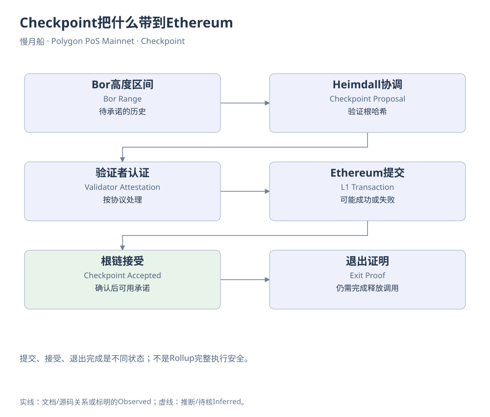

[可编辑原图](assets/diagrams/checkpoint.drawio)

来源与核对：[checkpoints](https://docs.polygon.technology/pos/architecture/heimdall_v2/checkpoints.md)；[stakingmanager](https://docs.polygon.technology/pos/reference/contracts/stakingmanager.md)。研究基准：2026-10-19；资料获取：2026-10-19—20。

[返回目录](SUMMARY.md)

---

# 第13章｜从Bhilai到Rio，旧教程哪里变了

搜索Polygon教程时，你可能同时看到两秒出块、多个生产者轮换、五秒最终确认和更快支付等说法。它们未必全部错误，却可能属于不同时间和不同指标。阅读技术材料首先要给它加一个日期，再问它讲的是执行、生产、确认还是容量。本章把2025年的关键变化放回这条时间线。

Bhilai在Bor主网高度73,440,256激活。PIP-63列出Gas容量调整、Base Fee变化分母以及Pectra相关EIP等内容。对数据研究而言，重点是执行能力和交易类型发生变化：EIP-7702相关SetCode交易及授权列表进入观察范围，费用与容量的基线也不能继续沿用更早的参数。

EIP-7702让外部账户能够通过授权指定代码执行行为。看到type 4或Dune中相应类型标签时，应检查authorization_list等字段，不能把它简单算成新增普通合约部署。交易发送者、授权者和被委托代码地址可以不同，钱包身份和执行身份的关系因而比传统转账更丰富。

2025年7月的Heimdall v2升级则作用于共识协调层。官方发布材料强调更快最终确认，具体机制包括CometBFT与投票扩展。它与Bhilai不是同一件事，也不能把一次执行层升级的日期写成全部共识实现同时替换的日期。数据结构、节点版本和观察接口需要分别核对。

Rio于2025年10月8日上线，Bor激活高度77,414,656。VEBloP把区块生产者选择与执行验证进一步分工，每个Span由一位获选生产者负责。旧的Sprint轮换解释不再足以说明当前生产安排。画图时，应把验证者投票、生产者池、Span指派和Bor出块依次表达，而不是画成所有验证者同时生产每个区块。

Rio资料也讨论Stateless Validation。它指借助Witness携带执行所需状态信息，让验证者能够检查执行而不必保持同样完整的本地状态数据库。Witness不是对执行正确性的零知识证明，也不让验证者免于执行检查。架构目标、具体客户端能力与全网部署覆盖仍应分开，不能从发布宣传推断每个节点都已采用完全相同模式。

提案与实现还可能有不同命运。早期区块公告能力曾列入Bhilai，之后回退，再由Giugliano引入经修订的实现。单看某个Final提案的包含列表，会错过这段变化。研究时间线因此同时参考PIP、发布说明和固定版本源码，把提议、计划激活和已发布实现分别标注。

版本还影响失败原因。某个历史交易在当时不支持的操作上失败，不能用今天已支持的指令说明它本应成功。教学复盘保留历史环境，才不会把后来的协议能力倒灌进旧交易，得出合约或节点曾经异常的错误判断。

2025年的变化给出一个实用阅读习惯：遇到性能数字先找分母，遇到机制描述先找版本。支持多少支付每秒、区块间隔、Milestone延迟与平均Gas费用都描述不同维度。后面复读作者看板时，我们使用明确历史窗口中的实际计数，不把某次升级公告上的容量数字冒充看板实测结果。

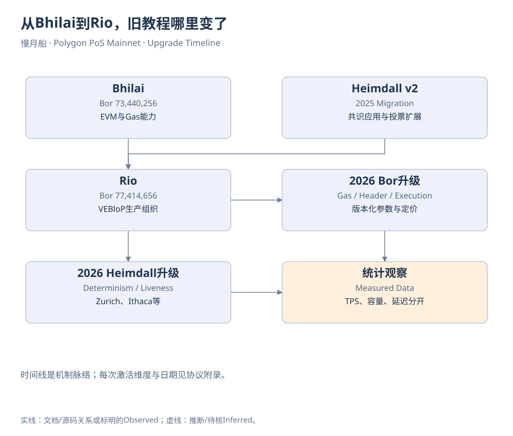

[可编辑原图](assets/diagrams/upgrade-timeline.drawio)

来源与核对：[pip-63-asof](https://raw.githubusercontent.com/0xPolygon/Polygon-Improvement-Proposals/7ca861517bcdcba3e1f2b751762c6c2e786d7caa/PIPs/PIP-63.md)；[rio-blog](https://polygon.technology/blog/polygon-launches-major-payments-upgrade-with-rio-faster-lighter-and-easier-to-build)；[pip-64-asof](https://raw.githubusercontent.com/0xPolygon/Polygon-Improvement-Proposals/7ca861517bcdcba3e1f2b751762c6c2e786d7caa/PIPs/PIP-64.md)。研究基准：2026-10-19；资料获取：2026-10-19—20。

[返回目录](SUMMARY.md)

---

# 第14章｜2026年的费用和故障恢复规则

2026年的Polygon不能只用“比以前快了”概括。费用参数变得更可配置，区块头增加可观察字段，部分操作重新定价，Heimdall还改进了确定性与故障恢复。它们分别改变计算、数据解释和运行边界。把这些变化压成一条TPS增长曲线，会漏掉真正影响分析的细节。

Lisovo主网Bor高度为83,756,500。PIP-79允许对EIP-1559参数进行受边界约束的配置，PIP-81列出此次升级相关内容。研究者因此不能永远假定固定目标比例和分母。要重建某块Base Fee，应查看相应版本和实际参数；只从当天平均Gas价格倒推生产者选择，容易混入交易需求的变化。

Giugliano的发布公告和Bor配置把主网高度写为85,268,500，而本轮取得的PIP-84正文仍写85,245,000。这里不能默默选一个数字。书稿采用客户端配置与发布公告一致的高度，同时在时间线保留冲突。PIP-83增加Gas参数头部记录与RPC可见性，PIP-66重新引入早期区块公告能力。

Chicago也必须进入本轮研究范围。PIP-88规定在Bor高度87,218,600重新定价部分存储访问、运算和预编译操作。相同业务跨升级后消耗的Gas可能变化，不能仅凭费用增加就认定合约变低效或网络更拥堵。比较前后成本，应同时查看Gas Used、有效单价和调用内容。

Zurich作用于Heimdall，其主网激活维度是Heimdall高度47,880,000。重点包括让状态同步查询更确定、生产者与Milestone选择更一致，以及限制共识关键处理工作。gRPC传输、端点故障切换和桥接恢复等同版本功能，还要区分哪些受高度开关控制，哪些是节点配置或运行改进。

Ithaca的主网Heimdall高度为50,185,000，官方上线文章发布于2026年7月30日。PIP-90描述生产者停顿且Milestone待定时的Span恢复规则。把这个高度当作Bor高度会得到错误历史；把发布文章日期当作区块精确时间，也会丢掉激活时间与公告时间的区别。

截至基准日，官方发布列表还出现Bor v2.10.3等稳定性更新。发布新二进制不一定触发新硬分叉，也不意味着每个RPC已经升级。较新的验证者准入与奖励分配提案，需要核对治理执行，不能仅凭存在提案就宣布已在链上启用。本篇保留这种状态差别，而不编造后续升级。

继续检查官方发布列表，还发现Bor的Valencia与Austin，主网高度分别为89,531,000和91,949,700；Heimdall的Phuket、Kyoto与Lugano也在基准日前出现。Lugano发布说明确认主网于2026年10月1日在Heimdall高度54,627,000激活，强化检查点窗口和消息验证等边界。它们已列入时间线；未取得精确激活日或完整改动复核的条目保留缺口，不能因任务清单没有列出就忽略。

本章采用版本化的解释方式：先确定研究高度，再查当时生效的规则，最后计算指标。激活日没有精确原始区块时间的条目，会保留日期核验缺口。这样既能解释当前网络，也能尊重历史案例原有的执行环境，让2024年的交易不会被2026年的规则重新命名成另一种行为。

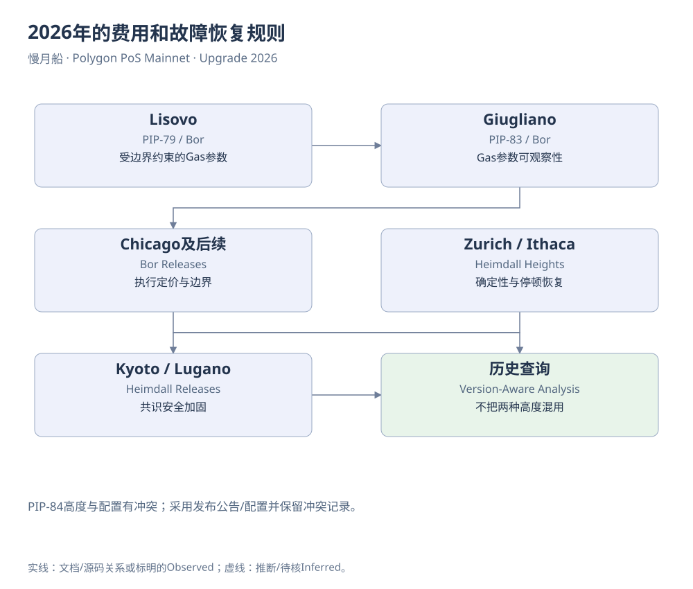

[可编辑原图](assets/diagrams/upgrade-2026.drawio)

来源与核对：[pip-79-asof](https://raw.githubusercontent.com/0xPolygon/Polygon-Improvement-Proposals/7ca861517bcdcba3e1f2b751762c6c2e786d7caa/PIPs/PIP-79.md)；[pip-84-asof](https://raw.githubusercontent.com/0xPolygon/Polygon-Improvement-Proposals/7ca861517bcdcba3e1f2b751762c6c2e786d7caa/PIPs/PIP-84.md)；[pip-88-asof](https://raw.githubusercontent.com/0xPolygon/Polygon-Improvement-Proposals/7ca861517bcdcba3e1f2b751762c6c2e786d7caa/PIPs/PIP-88.md)；[pip-89-asof](https://raw.githubusercontent.com/0xPolygon/Polygon-Improvement-Proposals/7ca861517bcdcba3e1f2b751762c6c2e786d7caa/PIPs/PIP-89.md)；[pip-90-asof](https://raw.githubusercontent.com/0xPolygon/Polygon-Improvement-Proposals/7ca861517bcdcba3e1f2b751762c6c2e786d7caa/PIPs/PIP-90.md)。研究基准：2026-10-19；资料获取：2026-10-19—20。

[返回目录](SUMMARY.md)

---

# 第15章｜MATIC与POL怎样接上历史

旧钱包界面写MATIC，新文档写POL，历史费用表又可能统一显示POL。读者很容易把它理解成所有历史余额都换成了另一份资产。要看清这件事，必须区分协议中的原生手续费单位、Ethereum上的ERC-20代币、迁移操作和界面符号，这四者会一起变化，却不是同一个对象。

2024年9月4日，Polygon PoS完成MATIC向POL的原生币升级。对于PoS链上的原生余额，官方说明用户通常无需执行手动迁移操作。钱包若仍配置旧符号，可能继续显示MATIC，但这不代表余额留在旧协议。给一笔历史交易改显示名称，也不等于为它新增一笔链上转账或兑换。

Ethereum上的情况不同。MATIC和POL是具有不同合约地址的ERC-20资产，迁移需要对应合约流程。研究者应分别保存根链代币地址、迁移合约和迁移事件，而不是把两个合约的Transfer历史按符号直接拼接。其他网络和交易所的处理方式，也应以其具体支持状态解释。

质押记录还涉及Ethereum上的StakeManager与验证者份额体系。它与用户在Polygon支付Gas使用的原生余额具有经济联系，但数据位置不同。统计“POL质押量”时，应说明是在读取根链质押合约、包装代币余额，还是某种流动性质押产品的供应量。后者不能直接替代协议锁定量。

原生币和包装币也要分开。原生POL通过账户余额与交易费用表现，包装版本通过合约的ERC-20账本表现。包装或解包会改变两种表现形式，不能把它们视为两次外部资金进入网络。若使用跨链转账总表，还应确认平台怎样识别原生资产、包装合约和历史名称。

作者旧Polygon研究在指定日期观察到gas.fees.currency_symbol为POL。这是有关平台返回值的历史事实，并不能单独证明所有年份都采用同一归一化规则。重做长期费用序列时，需要保留原始数量单位与价格键，检查旧MATIC价格是否被映射到POL，以及迁移附近是否出现缺值或重复。

一个稳妥的资产档案可以列四栏：网络、表现形式、合约地址或原生标识、适用时间。Ethereum上的代币合约应给出完整地址；Polygon原生POL则不能为了凑地址随便套用根链合约。系统原生代币接口地址与包装币地址也有不同职责，读者应从官方合约清单核对。

长期分析还应保留价格口径。即使原生数量连续，美元价值也依赖当时采用哪种价格序列。迁移窗口若出现两套符号同时有价格，不能把两者价值相加；应先确认它们是否代表同一份经济敞口，再选择合适的连接规则。

| 表现与网络 | 地址或标识 |
|---|---|
| Ethereum MATIC ERC-20 | `0x7D1AfA7B718fb893dB30A3aBc0Cfc608AaCfeBB0` |
| Ethereum POL ERC-20 | `0x455e53CBB86018Ac2B8092FdCd39d8444aFFC3F6` |
| Polygon原生接口 | `0x0000000000000000000000000000000000001010`，不等于根链ERC-20 |
| Polygon包装币 | `0x0d500B1d8E8eF31E21C99d1Db9A6444d3ADf1270`，历史常标WMATIC |

前三项来自官方合约清单，包装地址来自固定Bor配置；实际当前元数据另需指定区块读取。

历史名称是进入过去数据的钥匙，而不是需要消灭的错误。书稿引用旧交易时会保留其历史背景，同时解释当前名称；分析表若做统一计价，则明确说明归一化规则。这个习惯同样适用于后面的DAI、USDC和LGNS：名称可以帮助阅读，身份与金额仍由网络、地址、精度和时点决定。

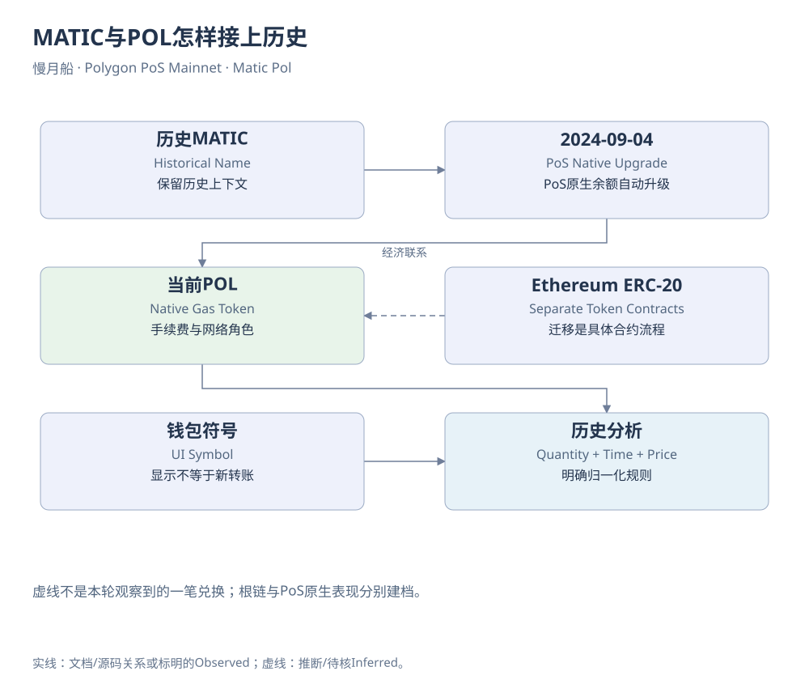

[可编辑原图](assets/diagrams/matic-pol.drawio)

来源与核对：[matic-to-pol](https://docs.polygon.technology/pos/concepts/tokens/matic-to-pol.md)；[pol](https://docs.polygon.technology/pos/concepts/tokens/pol.md)；[genesis-contracts](https://docs.polygon.technology/pos/reference/contracts/genesis-contracts.md)；[bor-asof-config](https://raw.githubusercontent.com/0xPolygon/bor/1cdf43c99d97cb9e18860776d8f69a416b49adf4/params/config.go)；[pol-live-2024](https://polygon.technology/blog/matic-to-pol-migration-is-now-live-everything-you-need-to-know)。研究基准：2026-10-19；资料获取：2026-10-19—20。

[返回目录](SUMMARY.md)

---

# 第16章｜原生币、包装币和映射币

钱包里都显示“一个币”，底层却可能是三种不同事物：网络的原生余额、某个ERC-20合约记账的资产、或锁定另一条链资产后铸造的表示。它们可以具有相近价格，却留下不同记录。分析Polygon资产时，先认清表现形式，比先给全部Token加上美元价格更重要。

原生POL由协议账户状态记录，用于支付手续费。普通原生转账通常可以从Transaction.value或成功的内部调用价值变化观察；手续费则还有自己的扣除与归集路径。ERC-20转账通过合约修改余额，并通常发出Transfer事件。原生币的系统接口即使看起来像一个代币地址，也不能让所有原生价值变化都变成普通ERC-20日志。

包装币把原生资产放入合约，再给用户一份可用于ERC-20接口的表示。存入和取出涉及两种账本的对应变化。若一张表统计原生转出，另一张表统计包装币铸造，同一笔包装不能被当作两个新投资者的资金流入。选择经济口径时，应把表示转换和外部资产进入区分开。

桥接表示则把对应关系延伸到两条链。根链资产锁在桥合约里，子链合约铸造或释放对应资产；返回时再销毁并退出。不同桥与不同资产的流程可能不同，因此不能仅凭合约名称包含Child就推定全部安全边界。映射关系、桥接协议与管理员权限都属于资产身份的一部分。

稳定币尤其容易混淆。Polygon上可以同时存在发行方原生发行的USDC与历史桥接版本。符号、钱包图标和交易所名称未必清楚表达差别，官方合约地址与具体发行说明才是定位依据。分析转账量时，分开列示不同合约，再说明是否及如何汇总，避免把同一资产迁移计为业务增长。

代币精度同样来自具体合约。一个合约的原始整数一百万，可能代表一个代币，也可能代表千分之一个。LGNS与sLGNS为9位，而同池DAI使用18位；若统一除以1e18，结果会差九个数量级。价格比率也必须先把池子两侧储备按各自精度缩放，再相除。

非同质化资产还增加Token ID维度。ERC-721强调单个编号所有权，ERC-1155允许同一编号具有数量。它们不能被塞进只考虑一个合约总金额的ERC-20模型。Dune将相关转移放在不同数据域，本轮只对Catalog实际返回的表作能力说明，不假定所有NFT交易都有完整美元估值。

读者可以为任一资产写一段简短身份证明：它在哪条链，由哪个账本记录，以什么单位计量，是否代表另一份被锁资产。四句话都能回答后，再去讨论持有人、供应和流动性。下一部分研究桥接，就是把这份资产身份证沿着两条链展开，检查每一步究竟增加了什么记录。

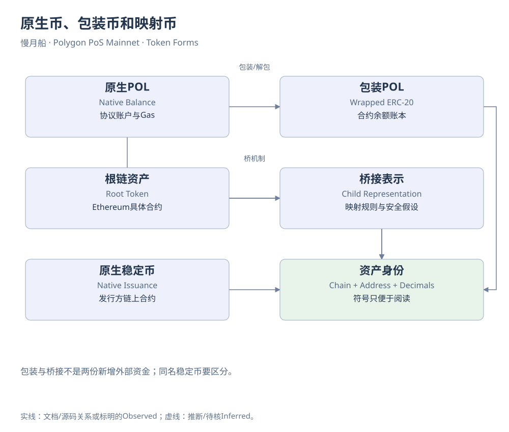

[可编辑原图](assets/diagrams/token-forms.drawio)

来源与核对：[genesis-contracts](https://docs.polygon.technology/pos/reference/contracts/genesis-contracts.md)；[mapped-tokens](https://docs.polygon.technology/pos/reference/mapped-tokens.md)；[circle-usdc](https://developers.circle.com/stablecoins/usdc-contract-addresses)。研究基准：2026-10-19；资料获取：2026-10-19—20。

[返回目录](SUMMARY.md)

---

# 第17章｜一笔跨链转入为什么有多份记录

从Ethereum转入Polygon的一百个代币，为什么会出现批准、存款、状态同步和铸造等多条记录？因为桥接不是把同一个交易复制到另一条链，而是让两个账本通过消息与合约规则建立对应。用户看到一项操作，研究者需要观察它在不同位置留下的步骤。

以标准PoS桥的典型ERC-20存款为例，用户先让桥接合约具有转移代币的授权，再提交Deposit。授权可能在更早时已经完成，因此一次存款不一定当场多出一笔Approve。Ethereum交易成功后，根链合约锁定或接收相应资产，并通过状态同步机制发出目标链需要处理的消息。

消息不会因为Ethereum回执成功就瞬间变成Polygon余额。Heimdall验证者观察符合规则的根链事件，形成状态同步记录；Bor在相应处理边界获取记录并交给StateReceiver，再由目标合约执行。只有目标步骤实际成功，收款人的子链资产余额才会更新。中间任何状态，都应有自己的观察依据。

Root Token和Child Token表示两边的对应资产合约。研究时应先核对映射，再解释铸造或释放。不同资产未必采用同一种实现，原生发行的稳定币也不能因为出现在Polygon就自动归为PoS桥铸造。具体合约、桥协议和发行机制决定这笔记录的经济含义。

关联两边记录时，消息ID、根链事件位置、接收合约和载荷比时间接近更可靠。两条链的区块时间不构成唯一键，跨链延迟还会随网络与执行条件变化。应保存Ethereum的交易哈希与日志索引，以及Polygon对应状态同步记录和目标执行交易，而不是强迫它们具有相同交易哈希。

桥接数据还有一项容易忽略的限制：表名中出现Root、Deposit或Tunnel，不能证明该表就在Ethereum。原看板SQL实际使用polygon_pos_bridge_ethereum命名空间，观察Ethereum侧FxRootTunnel事件；旧研究摘要中把它说成Polygon侧信号的文字不应继承。它仍不能据此统计全部Ethereum桥接存款。数据所在网络和合约承担的角色需要分别确认。

一个完整案例应有根链扣款或锁定证据、状态同步标识、目标合约处理和目标余额变化。本轮若没有取得完整配对，就只能交付单侧事件与补证方法，不能给它命名为“跨链完成”。这不是要求每次教学都重建全桥，而是确保案例标题没有超过实际取得的记录。

Approve本身尤其不应进入桥接金额总和。它授权未来能够转多少，并不证明相应资产已经离开用户。无限授权也不是无限实际存款。只有后续转移、锁定和目标处理，才构成可观察的资产变化。

在资金统计中，这一百个代币在根链锁定、在子链出现表示，是同一份跨链资产的两个侧面。把锁定额和铸造额相加，会把净进入Polygon的资金翻倍。下一章进一步拆开状态同步消息，理解“知道Ethereum发生过什么”与“目标合约已经执行”之间还有哪些步骤。

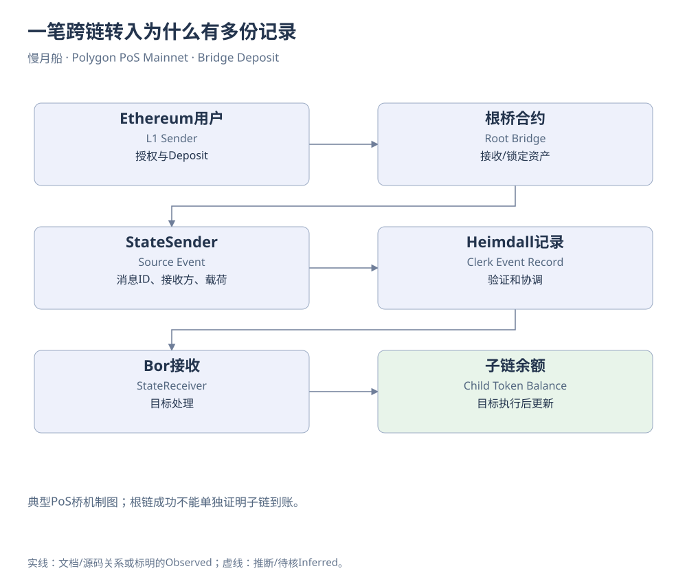

[可编辑原图](assets/diagrams/bridge-deposit.drawio)

来源与核对：[state-sync](https://docs.polygon.technology/pos/architecture/bor/state-sync.md)；[state-transfer](https://docs.polygon.technology/pos/how-to/bridging/l1-l2-communication/state-transfer.md)。研究基准：2026-10-19；资料获取：2026-10-19—20。

[返回目录](SUMMARY.md)

---

# 第18章｜State Sync怎样把消息带到Bor

状态同步可以传递桥接存款，也可以传递其他应用消息。它并不是把Ethereum整个状态数据库复制到Polygon，更不是让两条链共享全部账户余额。它选择特定合约事件，把载荷经过验证与协调后交给Bor上的接收入口，再由目标合约解释。

根链StateSender发出StateSynced类事件，其中的记录标识、接收地址和data共同描述一条消息。Heimdall的Clerk模块保存事件记录，包括来源链交易、日志位置与载荷等信息。这个模块提供的是经过协议处理的消息记录，不等于用户资产已经到达目标地址。

Bor在Sprint边界获取待处理记录，通过StateReceiver提交执行。目标接收合约必须理解载荷并遵守自己的规则。成功提交、目标回调成功与代币余额增加，需要按具体实现检查。若应用接收的是治理消息，结果甚至不涉及代币铸造，所以不能把全部StateSynced事件数量命名为桥接转账次数。

历史上的状态同步还具有特殊的交易与回执表现。PIP-74用0x7f包络规范StateSyncTx，使协议生成的记录能够更规范地进入交易和回执数据。本轮作者历史结果里出现的type 127，与这个类型编号对应；但Dune的字段填充方式属于索引表示，不能据零地址from就称它是普通钱包转账。

系统交易会影响统计分母。计算用户活跃发送者、签名交易数量或Gas支付分布时，要决定是否排除这类协议记录；研究执行覆盖时，则可能需要保留。最稳妥的做法是先按类型单列，再说明口径，而不是在清洗时静默删除所有零地址数据，把重要协议行为一起抹掉。

Zurich进一步处理了历史重放的一致性问题。若状态同步查询只按记录时间、并根据查询时“已经看见”的记录集合回答，后来重放同一历史区块可能得到不同消息。新的可见高度与时间映射规则，目的是让相同链状态下的回答更确定。这种改动直接关系到数据回放，不能只解释为接口提速。

研究消息时，应保存来源事件、Heimdall记录、可见性条件、Bor处理边界与接收合约结果。ID顺序和重复处理保护也很重要：同一消息被多个服务看到，不代表发生多次经济动作。一个状态同步失败样本，不能直接推导为全部桥接资产丢失；需要看实际失败层次和后续恢复。

这一机制还提醒我们，Transaction表只是观察网络的一种方式。用户交易、协议消息与合约回调虽然最终可能出现在相近的执行记录里，其授权来源不同。把它们分别标清，才能在下一章研究反向提款时，看出为什么销毁事件之外还需要检查点和Ethereum退出调用。

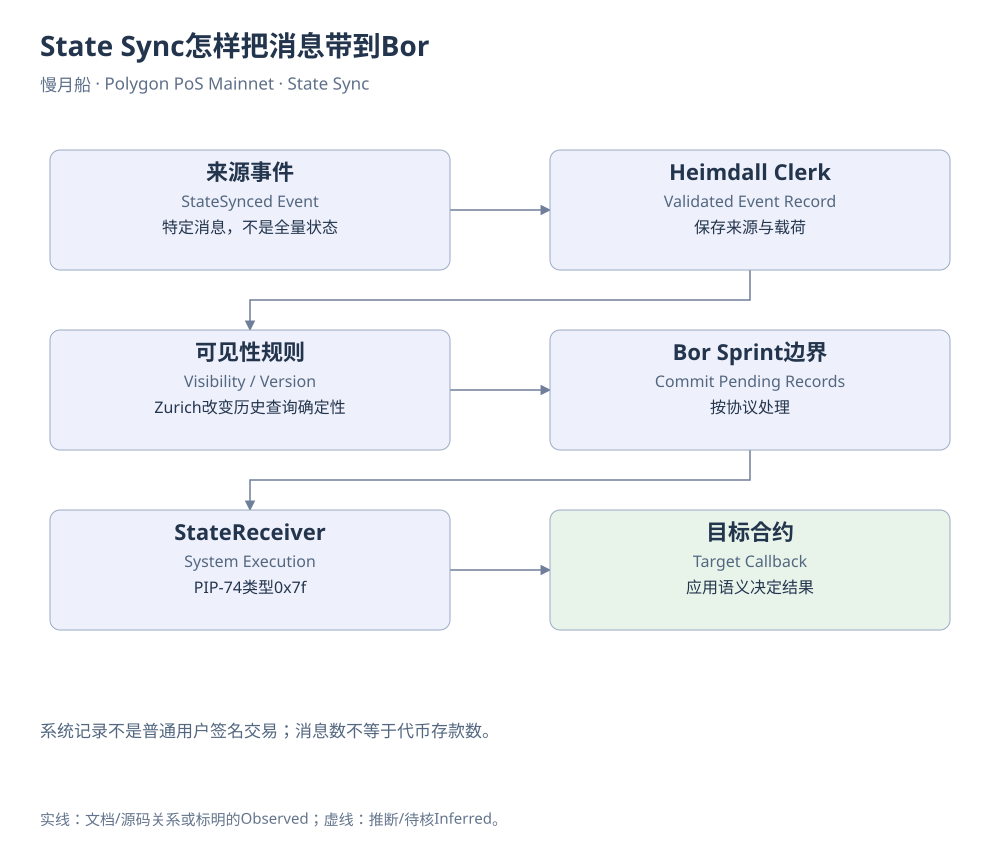

[可编辑原图](assets/diagrams/state-sync.drawio)

来源与核对：[clerk](https://docs.polygon.technology/pos/architecture/heimdall_v2/clerk.md)；[state-sync](https://docs.polygon.technology/pos/architecture/bor/state-sync.md)；[pip-74-asof](https://raw.githubusercontent.com/0xPolygon/Polygon-Improvement-Proposals/7ca861517bcdcba3e1f2b751762c6c2e786d7caa/PIPs/PIP-74.md)；[pip-89-asof](https://raw.githubusercontent.com/0xPolygon/Polygon-Improvement-Proposals/7ca861517bcdcba3e1f2b751762c6c2e786d7caa/PIPs/PIP-89.md)。研究基准：2026-10-19；资料获取：2026-10-19—20。

[返回目录](SUMMARY.md)

---

# 第19章｜从Polygon提款到Ethereum

从Polygon把代币取回Ethereum，最容易误读的是第一步。用户发起withdraw并看到成功，浏览器里也确实有销毁记录，但Ethereum余额还没有增加。这并不矛盾：销毁只是在子链声明要退出，根链释放资产还需要承诺、证明和实际完成调用。

典型PoS桥退出先由Polygon子链代币合约处理提款，产生相应销毁或退出事件。研究者先核对合约映射、金额精度、目标地址和实际事件。一个代币向零地址转移，也不能脱离合约语义自动认定为桥接提款；普通销毁与跨链退出有不同的后续条件。

相关Bor区块获得本地最终确认后，仍需被Ethereum侧接受的检查点覆盖。Milestone告诉Polygon网络哪段历史已经最终认可，Checkpoint为根链证明提供承诺。它们可以引用同一段Bor历史，却不是可以互换的确认标签。等待检查点的时间不能被当作普通Polygon支付最终确认延迟。

退出证明把目标回执或事件接到检查点承诺上。具体字段与路径取决于桥合约及其版本，不应凭记忆拼一份所有代币通用的证明。提交Ethereum退出交易后，还需要检查交易是否成功、退出标识是否被记录、对应资产是否释放到正确地址。交易发出与资产到账之间仍有一步执行结果。

已处理退出还要防止重复领取。合约通常以相应标识记录处理状态，因此研究完成率时，应该按退出对象而非提交次数计数。用户重复提交失败交易，不会创造第二次提款；一笔批量或多事件交易，也可能涉及多个需要分别定位的退出对象。

数据关联可建立一张状态表：子链销毁交易、事件索引、Bor区块、检查点范围、根链退出交易、释放结果。尚未取得的一侧保留空值，并标注未配对原因。不能用两个金额相同的Transfer直接认定桥接配对，因为很多用户会转移相同整数，且桥可能支持不同接收地址。

本轮桥接部分提供经过协议核对的流程与教学筛选SQL，尚未取得完整双向桥接闭环样本。因此案例目录将“机制已研究”与“真实完成案例缺口”分开。读者可以用保留的字段清单补齐证据，而不会把一份示意JSON误当成已发生的主网提款。

退出金额还应明确是原始整数还是标准化数量。桥载荷可能包含编码后的数量或接收地址，研究者需要根据ABI解析，而不是从十六进制字符串长度猜测金额。证明内容与经济金额属于不同字段，不能混成一个统计列。

这种拆分也有实际价值。发现用户资金未到时，可以判断它停留在子链发起、等待检查点、证明准备还是根链执行阶段。把整个过程统称为“桥慢了”，既难以定位问题，也无法正确统计待处理金额。下一章就从这些状态出发，建立不会重复计算的桥接账本。

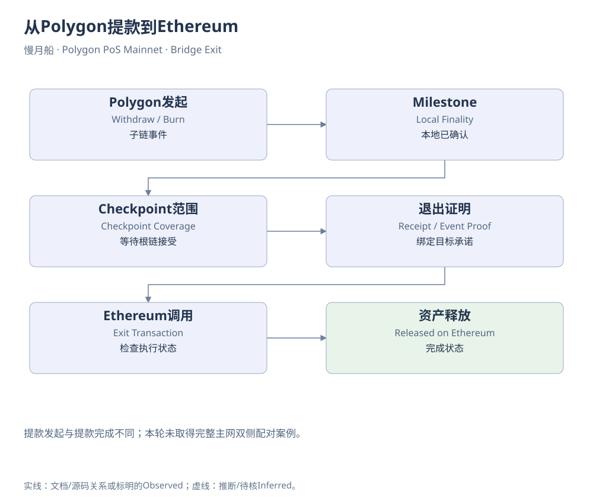

[可编辑原图](assets/diagrams/bridge-exit.drawio)

来源与核对：[checkpoints](https://docs.polygon.technology/pos/architecture/heimdall_v2/checkpoints.md)；[state-transfer](https://docs.polygon.technology/pos/how-to/bridging/l1-l2-communication/state-transfer.md)。研究基准：2026-10-19；资料获取：2026-10-19—20。

[返回目录](SUMMARY.md)

---

# 第20章｜跨链统计怎样避免一笔钱算四次

一百个代币经历锁定、铸造、销毁和释放，链上会留下四种动作，却不是四百个代币的新增经济活动。桥接分析的难点不在加法，而在决定哪些记录表示同一份资产的不同阶段，以及我们要测量的是库存、流量还是完成状态。

锁定额描述根链合约接收并保管的资产；铸造额描述子链新增表示；销毁额描述表示被消去；释放额描述根链资产真正交付。典型映射机制下，它们存在对应关系，但观察窗口不同、消息尚未执行、手续费或特殊资产规则，都可能造成暂时差异。差异需要解释，不能强行归零。

假设某天Ethereum锁入一百、Polygon只处理八十，其余二十仍待处理。按根链发起口径，存款是一百；按子链到账口径，到账是八十；待处理是二十。把一百加八十叫作一百八十流入，混合了两个阶段。反向提款也同理：销毁与释放应各自统计，再通过配对关系解释差额。

库存指标与流量指标更不能直接相加。某时点桥合约余额是库存，当日Deposit之和是流量。桥合约余额可能包含历史未退出资产，也可能受特殊转账或管理操作影响。仅凭余额上升，不能断言新增用户存款恰好等于差值；应与事件、消息状态和资产机制共同核对。

跨链稳定币还可能通过发行方的原生铸造销毁体系迁移，而非同一PoS桥。不同机制可以提供相似用户体验，资金统计却需要分别建模。研究者应在记录中保留bridge_protocol、root_token、child_token、message_id与两边网络，而不是以symbol相同为唯一关联条件。

时间窗口最好保留两套：发起时间用于观察需求，完成时间用于观察到账和处理速度。若只按完成日期筛选，再用发起金额作分母，会把跨日待处理项丢掉。计算延迟时还要保留未完成样本，不能只对已经成功完成的记录取平均，再称为所有用户的等待体验。

教学SQL因此先输出单侧候选，使用真实事件键防止重复，并把跨链配对留给明确标识。作者原边界查询更适合展示“表所在网络与合约命名不同”的问题，不适合直接作为全部桥接资金量。完整资金量需要补齐根链和子链覆盖，不能靠扩大表名解释来完成。

统计完成率时，观察期末尚未完成的发起项应保留在分母或单独列示。若把它们全部删除，就会高估桥接处理效果。发起队列和完成队列最好各自保存，后续新增证据到来时再更新配对状态。

桥接账本最后应能回答四个清楚的问题：发起多少，到账多少，等待多少，哪些已完成返回。每个数字都有一套证据路径和时间定义。读者建立这张账后，再进入DeFi项目，就会自然警惕另一种重复：同一笔稳定币经过Router、Pool和Treasury时，也不能被重复叫作外部收入。

[可编辑原图](assets/diagrams/bridge-accounting.drawio)

来源与核对：[mapped-tokens](https://docs.polygon.technology/pos/reference/mapped-tokens.md)；[state-transfer](https://docs.polygon.technology/pos/how-to/bridging/l1-l2-communication/state-transfer.md)。研究基准：2026-10-19；资料获取：2026-10-19—20。

[返回目录](SUMMARY.md)

---

# 第21章｜五张Raw表各自回答什么

来到数据仓库，第一件事不是运行最大的查询，而是确认一行代表什么。Polygon的五张核心Raw表分别保存区块头、外部交易、调用轨迹、原始日志和合约创建记录。它们都接近Bor执行，却没有哪一张表天然代表“一个用户的一次经济活动”。先把行粒度写清，SQL才有稳定含义。

polygon.blocks通常一行对应一个区块头，number与hash用于定位。polygon.transactions一行对应索引器表达的一笔交易，保存hash、block_number、发送与接收、费用、输入及类型等字段。两者连接时，除了高度，还可用区块哈希检查历史一致性；统计每日区块数与每日交易数时，分区日期字段也可能不同。

polygon.traces展开内部执行帧。候选定位包括tx_hash与trace_address，具体还要检查表的覆盖和特殊记录。polygon.logs保存topic、data、contract_address与日志索引；一笔交易可以产生多条日志，因此tx_hash不能单独成为日志表唯一键。交易计数和事件计数应分别计算。

polygon.creation_traces把创建结果整理成部署记录。一个工厂交易可创建多个地址，同一地址的历史记录也不一定满足研究者想象的永久唯一。本轮Catalog继续出现分区声明与实际字段不一致：元数据说block_date，字段列表却提供block_month。教学SQL因此按月裁剪，再用block_time限制具体分析窗口。

这个例子说明Catalog本身也需要审查。字段声明不可空，不代表历史实际结果就没有空值；表说明有某种覆盖，也不保证所有年份都完整。原作者样本中解码事件的transaction_index为空，而原始日志仍可通过事件键匹配。应保存这种差异，不能为了符合Schema描述而把空值替换成零。

候选表也不能先写进结论再寻找依据。用户提示中提到的withdrawals，需要确认其存在和Polygon适用语义；本轮不把未经确认的表写成PoS桥退出总表。原生协议提款、EVM函数withdraw和跨链桥提款，名称相似，数据对象却不同。查到一个同名字段也不能自动解决语义问题。

Raw并不意味着没有索引规则。系统交易、回执表达、Trace覆盖与合约创建物化，都经过平台处理。研究者可将Dune样本与浏览器或节点记录交叉核对，但必须保留来源边界。这里的“原始”是相对Decoded和Curated而言，不能被写成独立验证整条链共识的保证。

表间外键通常也是研究者验证的关系，而非数据库强制约束。即使设计上交易属于某个区块，实际索引覆盖仍可能产生缺口。因此小窗口的孤儿记录检查、重复键检查与时间边界检查，是把Schema关系提升为数据证据的重要步骤。

本篇附录保存当前字段与类型快照，正文只保留最重要的关系。读者写查询时，先挑能直接回答问题的那一张表：要数交易不必连接所有日志，要看合约创建先看创建记录，要解释内部转移再展开Trace。减少不必要连接，既节省计算，也让结果更容易解释。

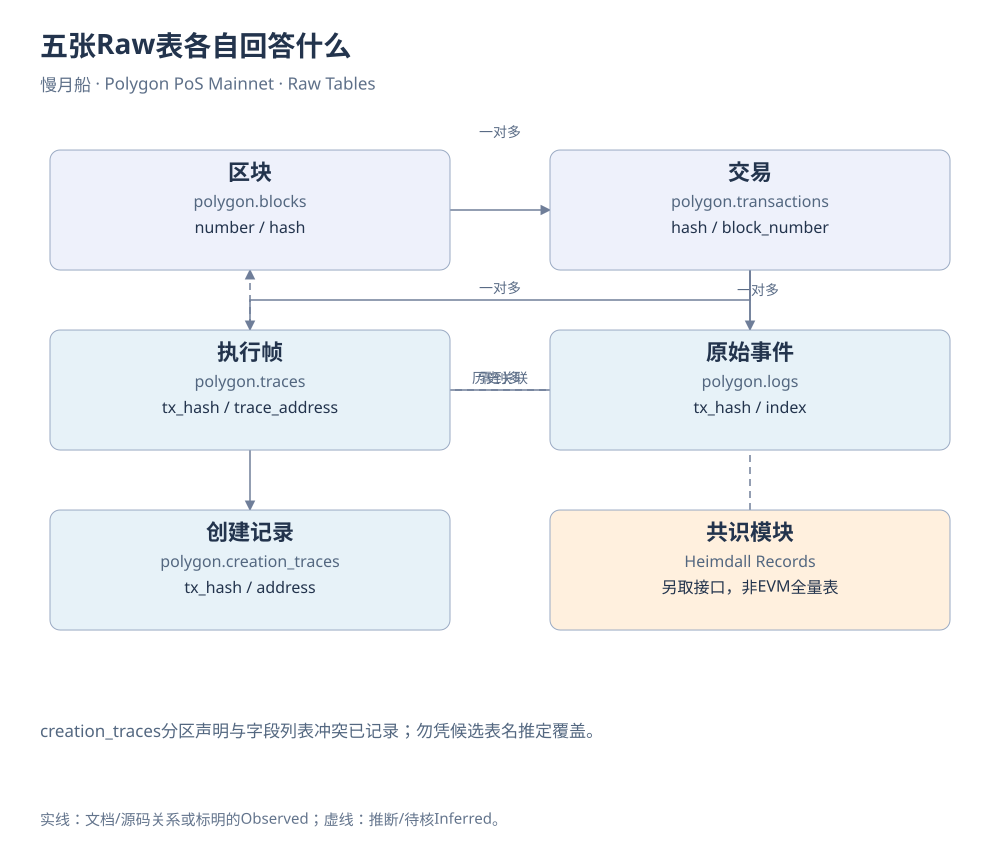

[可编辑原图](assets/diagrams/raw-tables.drawio)

来源与核对：[dune-polygon](https://docs.dune.com/data-catalog/evm/polygon/overview.md)。研究基准：2026-10-19；资料获取：2026-10-19—20。

[返回目录](SUMMARY.md)

---

# 第22章｜为什么三条Trace乘四条Log会变十二行

一笔交易有三条Trace和四条Log。把两表直接按交易哈希连接，为什么会得到十二行？因为数据库为同一键上的每条左记录配上每条右记录，三乘四就是十二。它没有出错，出错的是研究者把连接后的行数继续叫作交易次数，或把每行重复的金额再加了一遍。

设交易费用是一POL。连接Trace与Log之后，这一费用可能在十二行里各出现一次。SUM(fee)得到十二POL，并不说明用户真的付了十二倍。简单加DISTINCT也未必正确：两笔不同交易可能恰好付同样费用，SUM(DISTINCT fee)反而会把真实金额合并掉。修复方法来自粒度，而不是事后碰运气去重。

如果问题是比较每笔交易的Trace数与Log数，先分别按tx_hash聚合，再连接Transaction。此时每个子表每笔交易只剩一行，连接关系才符合预期。若问题是解释具体某条事件，则应保留日志索引，寻找对应调用语境，而不是把所有Trace与所有Log做笛卡尔式配对。

过滤条件也会改变粒度和总体。LEFT JOIN之后，在WHERE里要求右表某字段非空，通常会把缺少右记录的交易剔除，效果接近内连接。分析零日志交易时，这种写法会让它们消失。应明确条件属于子表筛选、连接条件还是最终样本定义，并对连接前后交易数做检查。

COUNT(*)数连接行，COUNT(DISTINCT tx_hash)数不同交易标识，COUNT(DISTINCT from)数地址。这三者可以同时有意义，却不能互换名称。去重键还要带上网络；跨链Curated表里相同格式哈希没有天然的全球研究语义。多跳DEX路径尤其需要区分成交段数、交易数与用户操作数。

金额连接比次数更危险。给Transfer接价格时，如果一个时间点匹配多行价格，金额也会膨胀。应先确定价格表的时间粒度与合约键，再将价格限定为每条转账最多一个匹配。缺价行要保留覆盖标记，不能被内连接静默删掉后仍称为全部转账总额。

本篇提供一条合成示例展示三乘四，以及按交易预聚合后的修正。它使用VALUES构造教学数据，不伪装成真实链上记录。另有真实交易查询沿着作者旧样本定位，通过明确日期和哈希限制范围。演示统计错误与证明主网事实，可以使用不同材料，但必须清楚标识。

注意数据库中的空值也会影响计数。COUNT(column)通常不计算空值，而COUNT(*)会计算该行；缺少交易哈希的特殊记录可能因此在两种口径中产生差别。解释差异时先读字段与样本，不要立即用填零或删除来让两组数字相等。

一个实用习惯是在每个CTE旁写“一行是什么”。只要最终连接的两边粒度不一致，就先想清楚是否允许一对多。最后再验证金额是否守恒、交易键是否意外增加。这种习惯比记住几十条SQL技巧更持久，也会在LGNS的资金边界和LP事件分析中反复发挥作用。

[可编辑原图](assets/diagrams/grain-join.drawio)

来源与核对：[dune-transfers](https://docs.dune.com/data-catalog/curated/token-transfers/evm/token-transfers.md)；[dune-dex](https://docs.dune.com/data-catalog/curated/dex-trades/evm/dex-trades.md)。研究基准：2026-10-19；资料获取：2026-10-19—20。

[返回目录](SUMMARY.md)

---

# 第23章｜Raw怎样变成Decoded与Curated

Raw事件里只有topic和字节，Decoded表却能直接给出amount、sender等名称，Curated表还能显示代币符号与美元金额。这条路径省去了大量重复工作，也加入了不同层次的解释。分析者需要知道每一层从哪里来，才能判断某个方便字段是否适合当前问题。

Decoded依靠合约ABI，把事件签名与参数布局对应到Raw Log。它能把复杂字节展开成可读列，但不能自动证明项目宣传的经济意义。一个名叫Reward的事件，可能记录新发行代币，而不是外部收入；一个名叫Deposit的事件，也可能只是合约内部记账。名称来自接口，含义仍需源码与资金变化解释。

解码结果应能回到原始身份：链、合约、交易哈希、日志索引。作者Polygon样本把Aave Supply事件与Raw Log按这些条件核对，展示了正确的血缘连接。若某个字段在Decoded中为空，应检查来源与模型，不能因为Raw能匹配就认定所有解码字段都同样完整。

Curated进一步跨协议整理业务对象。tokens.transfers统一多种可替代资产移动；dex.trades整理池子成交段；gas.fees归纳费用。它们有明确的转换规则和覆盖范围。例如转账表包含原生与ERC-20路径，字段填充方式可能不同；DEX表一行常代表一段池级成交，不能直接当作用户的一次完整交换。

价格富化又增加了来源、时间与估值选择。美元金额可能使用外部价格或链上模型，并不保证每个长尾资产都有同样可靠的价格。没有价格应当显示为缺失，而不是默认零美元；有价格也不代表用户能按该价格卖出全部持仓。LGNS的退出模型正是为了解释这层差别。

实体标签位于更外的一层。某个地址被标为交易所、Router或项目金库，可能来自公开披露、平台维护或启发式。标签可以帮助提问，却不能自动证明最终控制人。可编辑资金图应给观察到的转移画实线，给推测关联画虚线，并把标签来源附在证据记录中。

当不同表结果不一致时，应沿血缘往回查。先比时间窗口和网络，再比资产地址和单位，然后看Raw覆盖、解码ABI与Curated模型。不要直接把较大的那个数字当作更完整，也不要因为某个表更方便就宣布另一来源错误。差异本身可能暴露未覆盖的交易类型或不同经济口径。

如果研究结果需要长期保存，应把取得的Schema和模型说明一起归档。平台后来增加覆盖、修改字段或更新标签，今天重复打开同一链接可能得到不同内容。正文中的获取日期与本地快照，使历史判断仍然能够被追溯。

数据血缘最后让读者可以沿“结论→计算→表→事件→合约”退回原点。书稿中的图表和SQL都保留这条路线。下一章把它用在作者现有Polygon看板上，既复用已有成果，也检查历史图表中哪些观察需要加上新的版本或解释。

[可编辑原图](assets/diagrams/data-lineage.drawio)

来源与核对：[dune-transfers](https://docs.dune.com/data-catalog/curated/token-transfers/evm/token-transfers.md)；[dune-dex](https://docs.dune.com/data-catalog/curated/dex-trades/evm/dex-trades.md)；[dune-prices](https://docs.dune.com/data-catalog/curated/prices/overview.md)。研究基准：2026-10-19；资料获取：2026-10-19—20。

[返回目录](SUMMARY.md)

---

# 第24章｜复读作者的Polygon看板

作者的Polygon PoS核心数据结构看板并不是一个只展示价格的页面。它把区块、交易、费用、调用、部署、日志、资产移动和DEX活动放在同一条学习路线里。本轮取回Dashboard 220013的全部十张图表及十条不同Query，再通过原SQL与旧结果阅读它们的实际口径。

前三条Query观察每日区块、交易与费用，主要窗口为完整UTC日。接下来的合约执行、创建和日志查询展示EVM活动；转账与DEX查询进入Curated层；Aave Supply示例连接解码事件与Raw日志；最后的边界查询读取Ethereum侧特定FxTunnel事件，提醒读者必须回到实际表名确认网络与覆盖。它们适合串成教学过程，而不是十个互不相关的指标。

旧结果有自己的日期。本轮读取的latest执行样本不等于重新执行，也不保证它就是最初建看板当天的版本。原SQL中的滚动窗口依赖当时的current_date；离线教学版本改用固定日期，目的是让范围明确，而不是改写原历史结果。保存SQL与执行结果版本未能独立绑定的地方，也在目录里标出。

看板里最有价值的内容常来自异常。创建表Catalog声称按block_date分区，却没有暴露该列；miner为零地址却不能作为生产者身份；系统交易type 127不能算作普通钱包行为；解码事件的交易索引可能为空。这些发现比一条漂亮增长曲线更能训练数据判断，因为它们迫使我们核对字段与机制。

也有需要纠正的原始文字。看板说明把零地址miner进一步称为Bor proposer，超出了该字段观察能够证明的范围。本篇保留原看板副本，不修改作者远端作品，但正文明确说明应通过区块签名与Span授权识别生产者。复用研究成果，不等于自动继承每一句解释。

DEX查询中的成交段、交易数和多段交易比例，可以解释为什么不能把行数当用户Swap数。费用查询可以比较POL计量与价格富化；转账查询则区分原生路径与ERC-20日志路径。每条查询进入正文的价值，来自它教会读者怎样限定问题，而不是原样复制全部SQL注释。

历史结果与当前Schema也需要分开。当前字段仍在，不代表历史每行完整；旧查询成功过，不代表今天修改后无需重新验证。本轮新教学SQL只做静态核对，运行状态保留为STATIC_CHECKED与BLOCKED_READ_ONLY_ACCOUNT，不把原作者旧执行当作新SQL已经跑通的证据。

看板图表数量与Query数量也不能混用。LGNS看板有十四张图，却只关联六条不同Query，因为一个结果可以生成多个视图。研究目录按Query去重，图表位置另存；这样既不漏掉展示，也不会把同一计算误算成多份独立证据。

研究目录为每条Query保存标题、链接、版本、使用表、旧执行ID、取得行数和章节映射。读者可以从正文回到原作品，再深入SQL副本与结果快照。这使书稿有一个真实研究底座，也为下一部分分析代币、交换和金库提供了共同的数据语言。

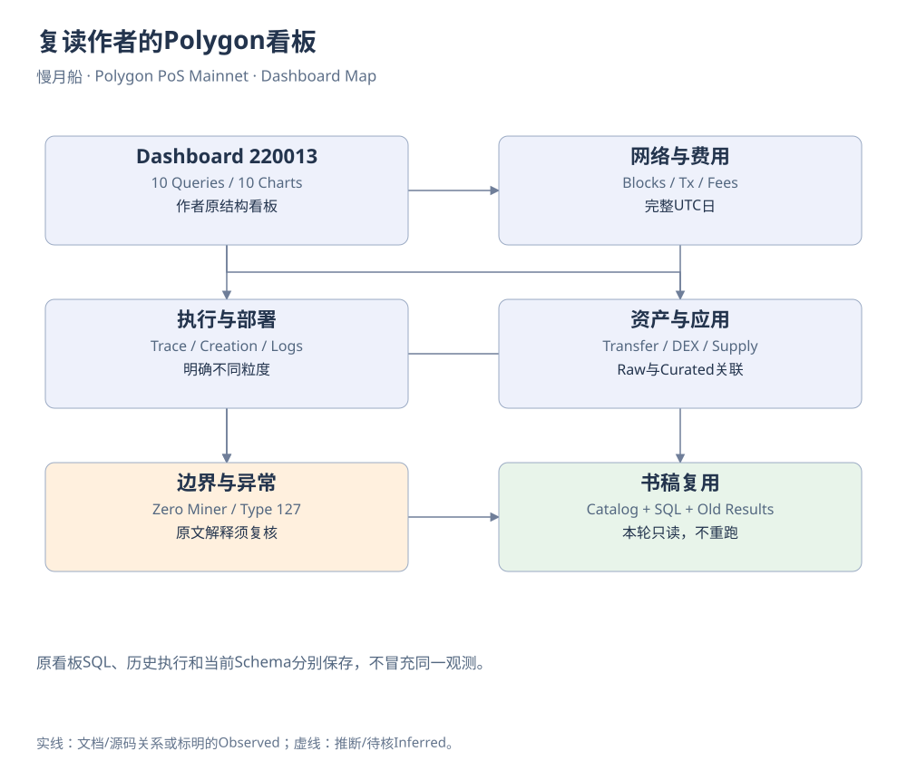

[可编辑原图](assets/diagrams/dashboard-map.drawio)

延伸核对：[原看板逐Query目录](research/dune/polygon_dashboard_catalog.md)。

来源与核对：[dune-polygon](https://docs.dune.com/data-catalog/evm/polygon/overview.md)；[pip-74-asof](https://raw.githubusercontent.com/0xPolygon/Polygon-Improvement-Proposals/7ca861517bcdcba3e1f2b751762c6c2e786d7caa/PIPs/PIP-74.md)。研究基准：2026-10-19；资料获取：2026-10-19—20。

[返回目录](SUMMARY.md)

---

# 第25章｜转账事件怎样成为代币账本

一个ERC-20代币可以理解为合约维护的余额账本。用户调用transfer，合约检查条件、调整余额，并通常发出Transfer事件。分析者因此能够从日志中观察资产移动，但事件只是合约报告的一种记录，能否用它完整重建余额，还取决于合约机制与历史覆盖。

标准Transfer包含from、to和value。前两个地址常在索引topic中，value通常位于data。使用Raw Log时，先核对事件签名与参数布局，再按合约decimals缩放整数；使用Decoded表时，同样要保留合约地址和事件索引。两个同名Token之间没有可以直接合并的余额账本。

Mint与Burn常以零地址作为一侧，帮助观察供应变化。但不能把任何零地址转移都自动解释为协议发行，也不能假设全部供应变化都一定产生逐账户Transfer。某些合约使用特殊会计，可能有额外事件或不同的状态更新方式。研究供应量，应同时检查totalSupply实现及其修改路径。

Rebase代币就是重要例子。持有人余额可以随着一个全局换算系数变化，而没有每个账户分别收到一次普通Transfer。只把历史转入减转出，可能无法还原当前余额。sLGNS使用内部gons与显示余额的换算，这类机制需要读取Rebase事件、指数或历史状态，不能直接套普通ERC-20余额累加。

带交易费的Token也会使“用户请求数量”和“接收方实得数量”不同。一次转移可能向费收地址分出一部分，或者在买卖交易对时触发额外逻辑。分析Swap输入时，应确认进入池子的净数量，而不是只读用户调用参数。LGNS源码中针对主交易对的费用路径，后面会以具体条件展开。

tokens.transfers提供了整理后的观察入口，包含原始金额、标准化金额、代币标识与可用价格。它让跨协议分析更方便，但不会自动解决特殊代币的全部会计。读者应检查金额是否已经缩放，避免对amount再次除以精度；amount_raw则应保留整数语义，避免过早转成浮点损失低位。

持有人统计还要先定义样本。出现过转账的地址数不是当前正余额持有人数，当前正余额地址数也不是独立投资者人数。合约、池子、交易所、质押托管地址都可能持有大量代币。把合约托管与最终用户仓位分开，才能解释持币集中、流通量与质押量之间的差别。

授权事件提供的是可支配额度，不是实际转账。Allowance很大可以构成权限暴露，但只有后续transferFrom等执行才说明资产被动用。资金流模型不应把Approve.value与Transfer.value放在同一金额列累计。

本篇的教学查询分别展示Raw事件和Curated转账，并在说明里记录适用边界。它们适合回答“哪些合约报告了哪些移动”，而完整余额与供应历史需要额外覆盖检查。下一章把这些移动放进一次真实交换，看看为什么多个Transfer会共同组成一个用户的Swap。

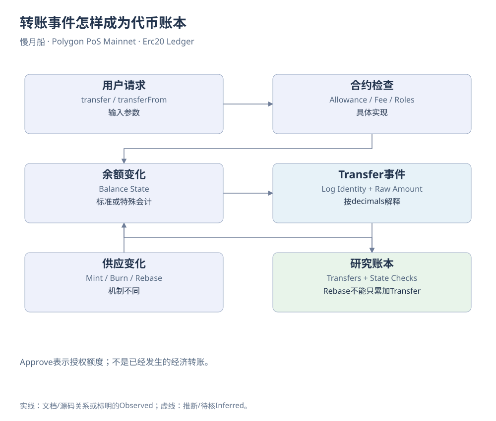

[可编辑原图](assets/diagrams/erc20-ledger.drawio)

来源与核对：[eip-20](https://eips.ethereum.org/EIPS/eip-20)；[dune-transfers](https://docs.dune.com/data-catalog/curated/token-transfers/evm/token-transfers.md)。研究基准：2026-10-19；资料获取：2026-10-19—20。

[返回目录](SUMMARY.md)

---

# 第26章｜一笔Swap怎样穿过Router与Pool

用户用稳定币买代币，通常只在界面上确认一次交换。链上却可能出现授权、Router调用、多个Pool的Swap事件和多条Transfer。把这些记录连起来，需要先区分入口和成交场所：Router负责组织路线，Pool负责按照自身规则交换资产，用户最终收到的数量则由整条路径决定。

以常数乘积池为例，池内有两种资产储备。用户把输入资产送入池子，池子按规则释放输出资产，随后更新储备并发出事件。Router可以选择一条直接路径，也可以先换成中间资产再去另一个池。因此一笔顶层交易包含两个或更多Swap事件十分正常，不能简单称为重复成交。

交易的from通常是提交者，Swap事件中的sender可能是Router，接收地址又可能是下一个Pool。用户身份、资金来源与事件参数各有位置。遇到聚合器、代理钱包或账户抽象时，顶层发送者甚至不一定是最终付款者。研究者应按合约调用与资产移动重建角色，而不是从一列地址直接命名交易人。

DEX Curated表通常以池级成交段为粒度。把每段amount_usd求和，可以描述池级成交活动，却可能把同一用户路线中的价值计算多次。若目标是用户交换笔数，需要按交易和业务上下文整理；若目标是每个池的手续费基础，则池级成交段反而正是需要的对象。指标名称必须体现这个选择。

输入与输出还涉及不同精度。价格是标准化数量之间的比值，不能用两个原始整数直接相除。带转账费代币要进一步确认池子实际收到的净输入；失败交易里的临时调用与最终提交日志，也不能混入成功成交量。执行语义决定哪些移动真正改变了最终状态。

真实交换案例最好包含顶层交易、Router或入口、Pool、Swap日志、相邻Transfer及最终收款。顺序有助于解释路径，却不能仅凭相邻日志就认定经济因果，因为同一交易还能执行添加流动性、领取奖励或其他业务。需要结合方法参数和合约实现，识别哪些记录属于目标操作。

作者LGNS辅助查询已经提供目标交易对的事件与资金对照。进入专题时，我们会复用这些旧结果，并用取得的已验证Pair源码检查常数乘积规则。旧SQL对手续费的历史判断与本轮重新证明的范围将分开，不因为模型能算出数字就宣布过去每笔成交都已独立重放。

Swap是一次资产交换，不是天然的项目营业收入。稳定币从用户进入Pool，可能马上支付给另一个卖出者；Pool收取的费用也可能归LP，而非Treasury。理解这条路径后，就能看出成交量、池子储备和项目可支配资金为什么是三种完全不同的数字。

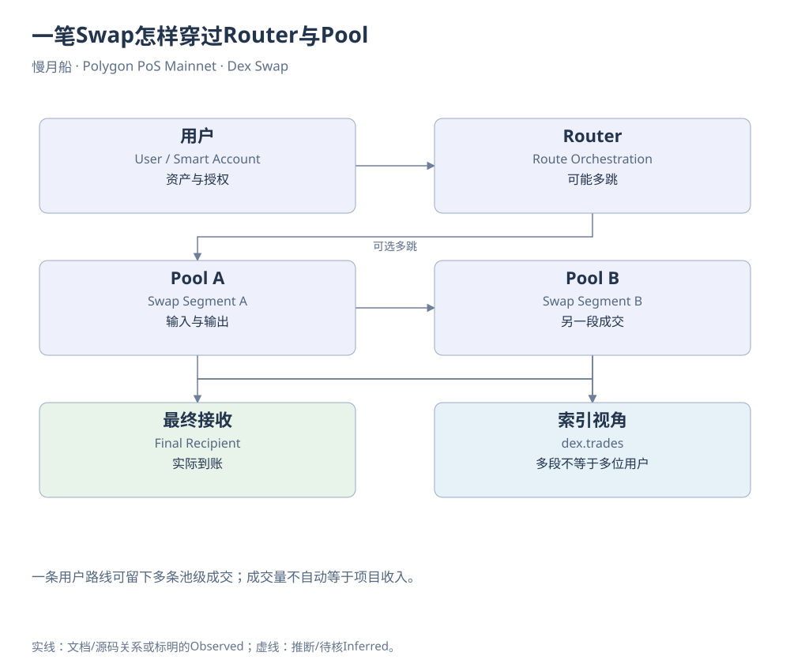

[可编辑原图](assets/diagrams/dex-swap.drawio)

来源与核对：[uniswap-v2-pair](https://raw.githubusercontent.com/Uniswap/v2-core/master/contracts/UniswapV2Pair.sol)；[dune-dex](https://docs.dune.com/data-catalog/curated/dex-trades/evm/dex-trades.md)。研究基准：2026-10-19；资料获取：2026-10-19—20。

[返回目录](SUMMARY.md)

---

# 第27章｜成交量、储备和退出流动性

一个Pool当天成交一亿美元，是否说明它有一亿美元可供用户退出？答案需要看储备。成交量是窗口内流量，同一份流动性可以被反复交易；储备是某个时点池子实际持有的资产。两者可以相差很大，不能因为成交活跃就认定任何规模的持仓都能按当前价格卖出。

常数乘积池用两种储备的关系决定边际价格。小额交易对储备影响较小，报价接近现价；大量卖入一种代币，会逐步压低它的边际价格，能够换出的另一种资产不会按原价格线性增长。手续费、代币转账费和路径选择还会进一步改变最终到账。

设池子有输入侧储备x、输出侧储备y，实际进入池子的输入量为a，保留手续费后的比例为q。简化的输出为y乘aq，再除以x加aq。这个公式描述一次给定状态下的交换，不包括前置交易、MEV、失败、Gas或其他池路径。它适合压力情景分析，不能被写成未来成交承诺。

LP Token代表流动性份额，不等于池子持有的对手资产数量。LP总供应量要结合实际储备与份额规则解释；LP持有人也可能是托管、锁仓或业务合约。判断谁能撤出流动性，需要检查LP控制路径，而不能只看代币项目Treasury余额。流动性所有权与代币发行权同样是两类权限。

添加流动性和买入也不是同一动作。前者通常把两侧资产放进池子并取得LP份额；后者输入一种资产、取得另一种。删除流动性则销毁LP并取回两侧资产。若只看稳定币流入，可能把买入和加池混在一起；只看稳定币流出，又可能把卖出和撤池混在一起。

池子储备重建应与Sync或历史getReserves对照。累计Mint、Burn和Swap净流量能够提供解释，但直接转账、skim、sync和特殊代币机制可能造成差异。样本守恒通过说明该范围中的计算一致，不代表全部历史都独立验证，更不证明资金来源属于真实新增用户。

做退出分析时，应同时展示现价账面值、扣除费用后的输入、曲线报价与储备时点。不同本金规模要单独计算，不能把一千DAI仓位的收益率乘上一千用于百万DAI仓位。LGNS旧模型正好提供多个规模的结果，展示小额看起来平稳时，大额退出折价如何开始扩大。

同样，两侧储备的美元总值不是可以全部提走的现金。LP按份额移除通常取得两种资产，其中项目自发代币仍需面对市场流动性。把它按当前价格全额计入外部可兑现储备，会把退出时同样存在的曲线约束再次忽略。

这里的研究目标不是预测价格，而是拆开“有价格”“有储备”和“能兑现多少”三件事。先固定状态，再列假设，最后计算情景输出。下一章把Pool放回更完整的DeFi系统，区分质押、借贷和金库，以免把某个局部余额当作整个项目的偿付能力。

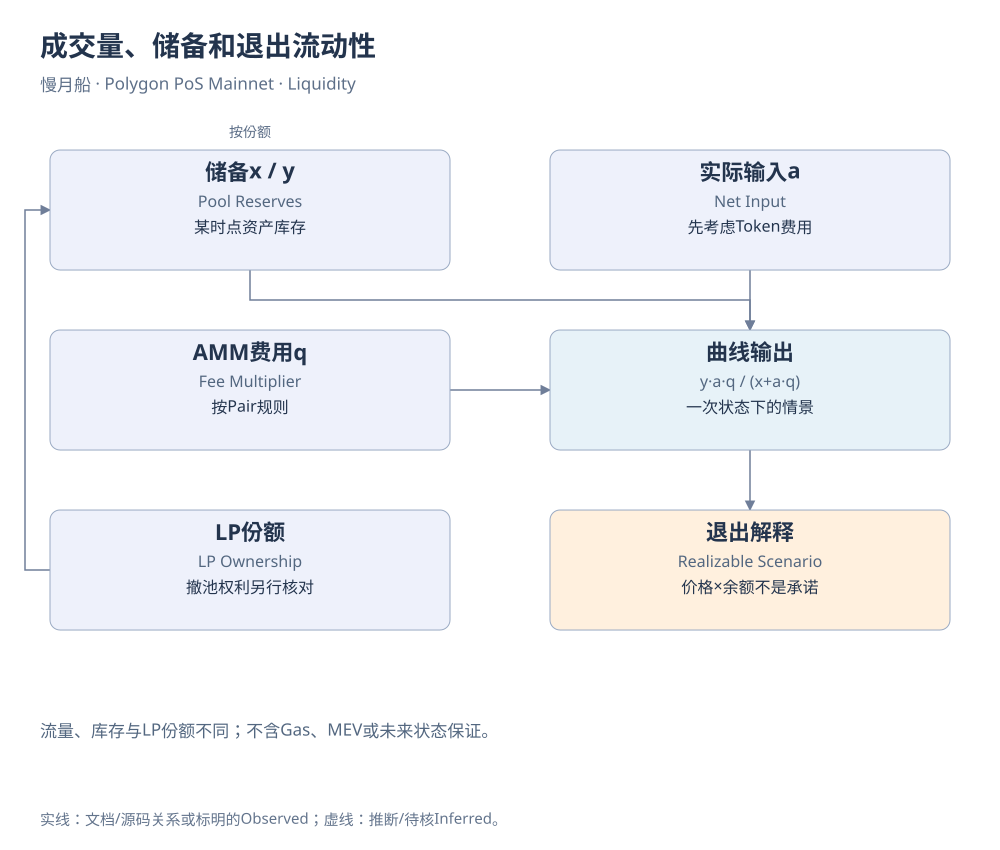

[可编辑原图](assets/diagrams/liquidity.drawio)

来源与核对：[uniswap-v2-pair](https://raw.githubusercontent.com/Uniswap/v2-core/master/contracts/UniswapV2Pair.sol)。研究基准：2026-10-19；资料获取：2026-10-19—20。

[返回目录](SUMMARY.md)

---

# 第28章｜质押、借贷、金库和升级权限

界面上的“存入”可能代表完全不同的合约关系：用户把代币交给Staking获得记账凭证，把抵押品交给借贷协议取得借款能力，或把资产交给Vault由策略管理。相同按钮不能决定资金性质。分析前应先读清用户失去了什么、得到了什么，以及未来退出需要满足哪些条件。

Polygon验证者质押用于网络安全，项目内Staking则由项目自己的合约定义。后者可能发奖励、Rebase或锁定凭证，并不直接参与Heimdall共识。把两种质押的锁仓量相加，会混合协议安全与应用经济；把项目奖励叫作Polygon出块收益，也会错误解释收入来源。

借贷协议还涉及资产与负债。存入凭证可能随利息变化，借款需要抵押与清算规则，合约余额里也可能包含用户存款而非协议自有储备。看到一个借贷合约持有大量稳定币，不能直接说这些都是可分配利润。账面持有资产与对用户承担的义务，必须同时分析。

Vault更强调管理路径。资产可能被部署到其他协议，当前Vault地址余额很少，不意味着资产全部消失；反过来，持有一份策略Token，也不代表所有底层资产能立即变现。研究需要跟踪份额、兑换规则、策略持仓与退出限制，不能在遇到复杂性时把全部Token统一按现价计入现金。

Proxy又使合约行为具有版本。用户调用代理地址，代码通过delegatecall进入实现，储存通常仍在代理。分析某笔历史交易时，需要知道当时实现，而不是只读今天浏览器展示的最新源码。EIP-1967提供常见实现与管理员槽位约定，但并非所有代理都遵循同一种模式。

权限图应包含谁能升级、谁能增发、谁能暂停、谁能修改费用，以及控制者如何变更。多签门槛和Timelock延迟也要通过具体合约状态核对。存在治理文档，不等于治理规则已经部署；源码里有onlyManager，也不等于当前Manager身份和历史调用已经全部取得。

事件可以帮助追踪版本与权限，但事件缺失不能自动证明没有变化。历史实现、存储槽、角色管理和实际调用需要组合使用。对于不可升级合约，也仍可能存在强管理权限；对于可升级合约，风险程度还取决于控制结构和延迟。不能只用一个布尔字段给项目作完整判断。

实际审查还要关注暂停与恢复。暂停入口可能保护系统，也可能使用户暂时无法退出；只有把可暂停的方法、权限范围和历史执行放在一起，才能解释对用户的具体影响。一个笼统的paused标签不足以覆盖全部业务路径。

至此，我们已经拥有网络、执行、桥接与应用的基本地图。下一部分开始写SQL，将这些概念变成可检查的表、字段、窗口和行粒度。每条查询只承担一个清楚问题，复杂推论留在证据说明里，避免让一张结果表同时冒充资产账本、利润表和风险结论。

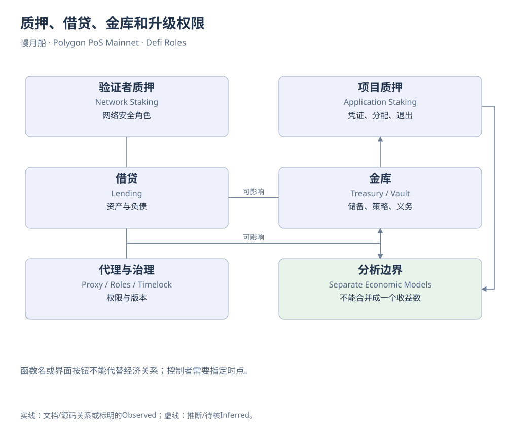

[可编辑原图](assets/diagrams/defi-roles.drawio)

来源与核对：[eip-1967](https://eips.ethereum.org/EIPS/eip-1967)；[stakingmanager](https://docs.polygon.technology/pos/reference/contracts/stakingmanager.md)。研究基准：2026-10-19；资料获取：2026-10-19—20。

[返回目录](SUMMARY.md)

---

# 第29章｜先写清口径，再写区块与费用SQL

写第一条SQL之前，先写一句人话：“统计2026年9月10日UTC完整一天，Bor产生多少区块、包含多少交易。”这句话确定网络、时间、对象和粒度。若这些条件没有固定，查询即使能跑，也可能无法回答原问题。教学查询因此优先使用固定窗口，让读者能够核对同一份历史范围。

每日区块数从blocks读取，交易数从transactions读取。先分别聚合到日，再连接两个日级结果。这样空区块不会因内连接交易表而消失，也不必把每个区块头复制到全部交易行。若计算区块间隔，应明确使用相邻区块时间差，还是首末时间除以间隔数，两者在边界上有差别。

分区条件是查询设计的一部分。blocks在本轮Schema中使用date，transactions使用block_date，creation_traces则需要特别处理block_month与block_time。只在外层写日期条件，未必能让底层扫描按预期裁剪。查询说明同时记录过滤列与实际时间范围，帮助读者区分成本控制和业务口径。

费用查询先按交易类型分组，再观察Gas Used、Gas Price和实际费用。把Gas Used乘Gas Price时，应先处理数值类型，避免整数乘积越界；转成POL后再做展示。原始整数仍应保留在样本中，因为过早使用浮点可能掩盖小额差异。需要精确核算时，优先采用整数或合适的Decimal计算。

交易失败也消耗Gas，因此费用总额与成功业务交易数不能混在一个隐含分母里。可以分别显示全部交易费用、成功交易数量、失败率和系统类型数量。没有说明分母的“平均手续费”，在两份看板之间很难比较，也可能随业务组合变化而变化。

作者旧看板返回过完整一天的区块和交易统计，本轮读取的历史趋势样本还包含2026年6月13日等日期。教学正文不把这些样本改称今天的网络状态。若要比较升级前后，应选择两侧同等长度窗口，并检查数据覆盖、节假日与业务结构，避免把所有变化都归因于升级。

本轮教学SQL没有提交到服务端执行。STATIC_CHECKED表示表字段、窗口、单位和连接逻辑经过静态核对；BLOCKED_READ_ONLY_ACCOUNT表示未进行新执行。这两个标签共同说明验证范围，原作者历史成功运行只用于解释旧材料，不替代新SQL的执行结果。

窗口边界还要使用一致的开闭区间。常见写法是起点包含、终点不包含，避免相邻两天重复计算午夜记录。若原数据时间带时区，查询中的字面量与转换也应说明；本篇日级练习统一以UTC解释，而不是默默采用读者本机时间。

一次好的查询交付应包括SQL、简短口径、预期行粒度和未验证项。读者拿到它，可以先用小窗口核对，再决定是否扩大范围。我们从这组基础查询开始，是因为区块与费用看似简单，却已经包含版本、类型、分区和计量单位四类容易忽视的判断。

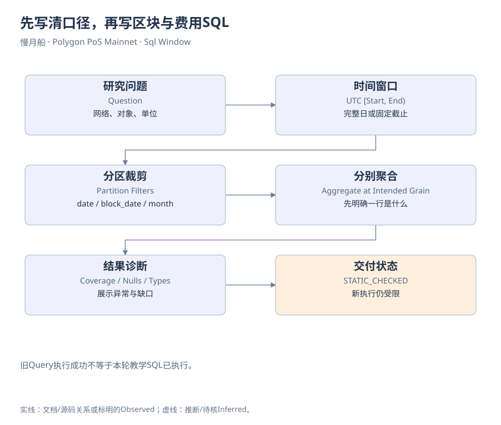

[可编辑原图](assets/diagrams/sql-window.drawio)

延伸核对：[SQL01区块与交易](examples/sql/core-structure/01-daily-blocks-tx.md) · [SQL02费用](examples/sql/core-structure/02-gas-by-type.md)。

来源与核对：[dune-polygon](https://docs.dune.com/data-catalog/evm/polygon/overview.md)；[dune-functions](https://docs.dune.com/query-engine/Functions-and-operators/varbinary.md)。研究基准：2026-10-19；资料获取：2026-10-19—20。

[返回目录](SUMMARY.md)

---

# 第30章｜把同一笔交易的执行记录对齐

现在把分析范围缩到一笔真实交易。作者原始样本Query 8675768返回交易0x1a888adf77836ee9d430c2e449ba226a99804c7e5562d89aa2956aa5b397719a，位于Bor高度93,586,510，时间为2026年9月10日23:59:58 UTC。它提供了把交易、调用与日志对齐的具体锚点。

这笔交易的顶层value为零，Gas Used为91,672，样本中的有效单价为277,972,801,743个原生最小单位。两者相乘得到25,482,322,681,384,296个最小单位，即约0.0254823 POL。浏览器页面返回的手续费与这个整数计算一致。费用来自执行资源，不能因为value为零就把交易价值和成本都写成零。

Query 8675774返回同一交易的一条delegatecall轨迹，路径为[0,0]，输入包含transfer选择器。Query 8675790则返回该交易的系统合约日志样本。三份记录共享交易与区块定位，却仍有不同的行对象。把它们展示成并列视图，比直接合成一张多对多明细表更清楚。

教学SQL先读取Transaction一行，再分别读取该哈希下的Trace与Log。若要显示计数，把两个子表预聚合到交易；若要逐项审查，则分别保留路径和日志索引。日期过滤仍然存在，因为一个精确哈希不一定自动使所有数据引擎采用同样的扫描策略。

另一个样本0x443c78ecc0bf2427fa789daeb7c80281842fde3b42d413ac7ac1606e1f8a56f8展示工厂创建与Aave Supply。创建地址出现在creation_traces，Supply事件位于日志索引676，Decoded与Raw按事件键匹配。它说明一次交易可以创建合约并进入其他协议，顶层入口不是全部业务边界。

样本中的reserve原始整数需要对应资产精度才能解释，不应因字段名叫amount就默认已经是可读Token数量。事件中的user与onBehalfOf也分别表达不同角色。读取真实案例时，保留这些名称和原始地址，比把它们都改写成“用户”更有助于理解资产与授权关系。

本轮交叉核对来自作者历史结果和公开浏览器页面，没有取得本地全节点重放证明。调用轨迹尤其依赖服务端重建与输出方式，不能把一个Trace样本当作全部执行树。案例索引分别列出已取得字段与缺口，让读者可以继续补充完整Receipt、Trace及历史状态。

费用计算还可以保持完全整数：先乘91,672与277,972,801,743，再除以十的十八次方用于展示。这个过程不需要美元价格，也不会把当下POL报价带入历史成本。若展示美元值，则必须另列历史价格来源。案例中浏览器的当前美元提示与其交易日价格并存，不能随手取其中一个就称为当日真实支出。因此，代币数量、费用与美元展示各保留自己的证据来源，避免混成一个没有单位的价值字段。

这两笔交易不需要成为全书的唯一案例。它们的价值是固定一个可重复定位的观察点，让表关系、费用单位、代理调用和工厂创建不再停留在术语层面。下一章将同样的方法扩展到多笔资产移动，处理精度、价格和DEX粒度的问题。

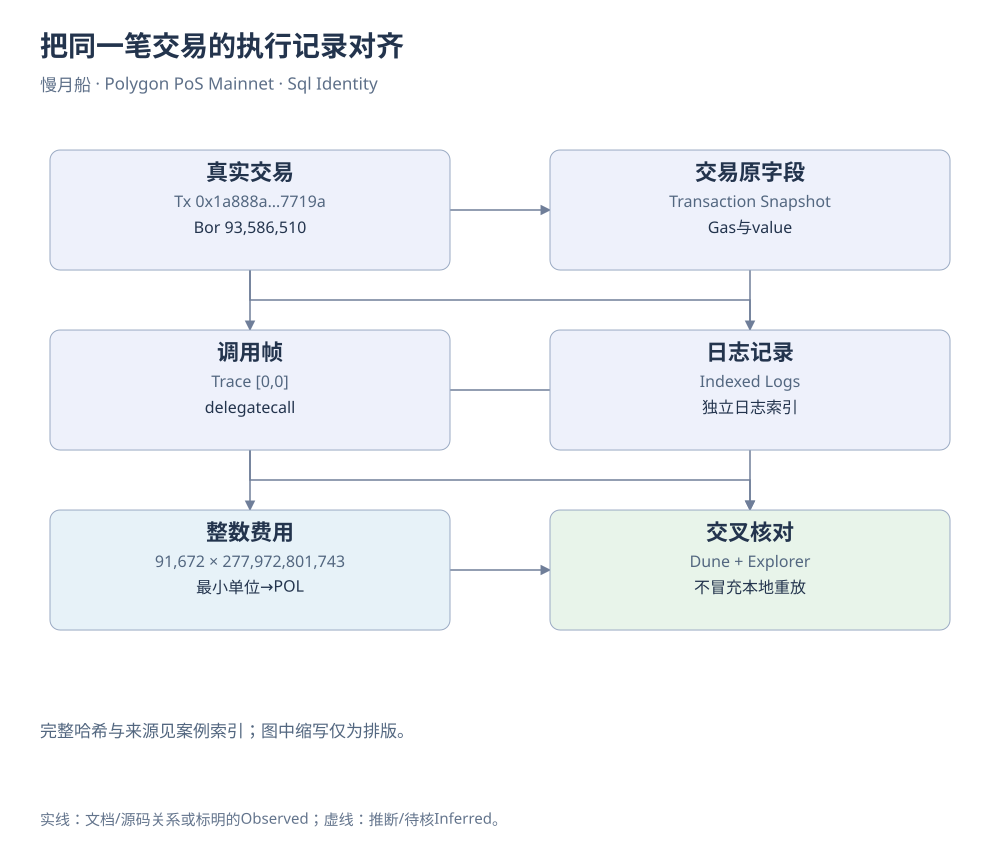

[可编辑原图](assets/diagrams/sql-identity.drawio)

延伸核对：[真实普通POL转账](examples/transactions/case-01.md) · [调用与代理样本](examples/transactions/case-02.md) · [工厂创建样本](examples/transactions/case-04.md) · [SQL03交易粒度](examples/sql/core-structure/03-transaction-grain.md)。

来源与核对：[dune-transfers](https://docs.dune.com/data-catalog/curated/token-transfers/evm/token-transfers.md)；[dune-functions](https://docs.dune.com/query-engine/Functions-and-operators/varbinary.md)。研究基准：2026-10-19；资料获取：2026-10-19—20。

[返回目录](SUMMARY.md)

---

# 第31章｜资产、价格与DEX分析的单位

资产SQL最容易出现的错误，往往不是语法，而是把已经标准化的金额再缩放一次，或把没有美元价格的资产当成零价值。写查询时应先给每个金额列贴单位：原始整数、代币数量、报价资产数量或美元估值。列名清楚，计算才不容易在中间失去意义。

tokens.transfers中的amount_raw保留整数语义，amount通常已经按代币精度标准化。若从Raw Log解码value，需要自己查decimals；若直接用amount，就不要再次除以十的精度次方。不同资产精度必须分别取得，不能用一个1e18覆盖所有Polygon Token。

稳定币也要按地址筛选。一个符号可能有多种合约，一种资产也可能在迁移后换了名称。教学查询把网络与合约条件写在底层，再按日聚合。若要合并原生USDC与桥接版本，说明中必须解释这个经济口径，并保留分项结果，让读者仍能看见不同资产来源。

美元价格会引入新的连接键。价格粒度可能是分钟、小时或日，源数据可能来自不同市场。给转账匹配价格时，先确保每条转账只得到一个价格；缺价行单列，不能被内连接删除。SUM(amount_usd)描述的是已有估值覆盖的部分，不自动等于全部资产移动的经济总量。

DEX查询需要同时报告成交段数与不同交易数。一个用户路线经过多个池时，段数自然更多；若把每段美元金额相加，得到的是池级活动量。研究某个项目的买卖压力，还要固定目标池与资产方向，不能把全链成交量当成该项目新资金流入。

流动性查询进一步读取Mint、Burn或Sync。储备比值必须先按两侧精度换算；某个Sync时点的储备也不能代表整天始终可用的退出深度。需要日末状态时，应确定当天最后事件与历史覆盖，必要时用历史合约读取交叉核对，而不是对一天所有储备快照求和。

LGNS案例为单位检查提供了很好的练习。代币与sLGNS均为9位，DAI为18位；LogRebase里的比率却另用1e18缩放，index又回到9位显示余额单位。同一个项目内部就有三种不同计量方式。把它们写成同一个“amount”，SQL很容易得到看似精确却完全错误的结果。

精确资产核算与展示数值可以并存。底账保留整数和精度，图表使用适当小数；合计时在原始单位完成，再进行展示换算，能减少逐行舍入误差。若使用DOUBLE分析大范围趋势，应把近似计算与精确账本核对分开说明。

查询说明最后应回答结果能够支持什么。Token转账额可以描述资产移动，DEX量可以描述池级成交，储备可以支持某时点情景报价。它们不能直接回答用户利润、项目营业收入或全部赎回能力。保持单位与对象一致，才能把数据分析接到后面的证据判断。

[可编辑原图](assets/diagrams/sql-units.drawio)

延伸核对：[18条SQL说明与源码](examples/sql/README.md)。

来源与核对：[dune-transfers](https://docs.dune.com/data-catalog/curated/token-transfers/evm/token-transfers.md)；[dune-prices](https://docs.dune.com/data-catalog/curated/prices/overview.md)；[dune-dex](https://docs.dune.com/data-catalog/curated/dex-trades/evm/dex-trades.md)。研究基准：2026-10-19；资料获取：2026-10-19—20。

[返回目录](SUMMARY.md)

---

# 第32章｜跨链和项目SQL怎样保持可审查

跨链与复杂项目的SQL，不适合从一个巨大的WITH开始堆。先把要证明的关系拆成可检查步骤：资产身份、事件定位、金额单位、合约角色、统计边界和结果解释。每一步都有自己的输入与输出，后面即使出现异常，也能知道是哪一层需要重新核对。

桥接教学查询只提取明确网络上的候选事件。根链记录与子链记录必须靠消息或退出标识配对，不能因为同额、同日就相连。尚未取得完整两侧Schema或历史结果时，SQL说明保留缺口，不能把一段伪造的返回JSON作为“预期成功样本”放进真实案例目录。

项目调查先建立合约集合，再计算边界流量。地址集合是研究假设的一部分：包括Token、Staking、Treasury和Pair，与只观察Pair会得到不同结果。内部转移应在集合内抵消，外部流入与流出按方向分类。某地址尚未确认关联，不应为了让结果好看就补入“项目钱包”。

作者LGNS查询之间还有依赖关系。某些Query引用query_编号，复用之前整理的日级价格、Rebase指数或资金底账。阅读下游结果必须同时保存上游SQL与口径，不能把query_对象当成永远不变的基础表。当前保存版本与历史执行的绑定若无法证明，应明确记录，而不是默认为完全一致。

固定截止尤其重要。LGNS退出模型使用2026年8月18日09:28:58 UTC，一些资金流Query的旧结果却覆盖到8月20日。即使它们都显示“累计净流入”，也不能直接相减后声称发现缺口。应先统一地址集合、事件范围和截止时刻，再比较差异。

静态审查也有边界。我们能够检查表字段、别名引用、日期裁剪、精度来源和连接粒度，却不能仅凭文本证明服务端解析成功或全量数据满足唯一键。SQL伴随说明因此分开写静态状态、旧结果来源和未完成运行项。恢复执行权限后，应先用固定小窗口验证，再决定是否扩展。

工程中保留原SQL只读副本，教学版本独立存放。修正错误时说明原因，不改写作者历史结果，也不偷偷更新远端看板。这样读者能够同时看到原研究如何提出问题，以及本轮怎样把它变成更适合出版和教学的材料。可追溯性比把所有文件标成PASS更重要。

每条查询最好同时输出覆盖诊断，例如记录数、缺价数、未分类数或匹配失败数。诊断列让读者看到计算之外的限制。为了图表整齐而隐藏这些行，可能使模型看起来比实际完整，尤其不适合用于风险调查。

完成这一步后，SQL不再只是生成数字的工具，而是证据链中的一段明确计算。下一部分进入调查方法：同一个数字怎样与源码、权限和真实交易组合，哪些结论可以直接陈述，哪些仍需要外部披露、历史状态或控制者信息才能回答。

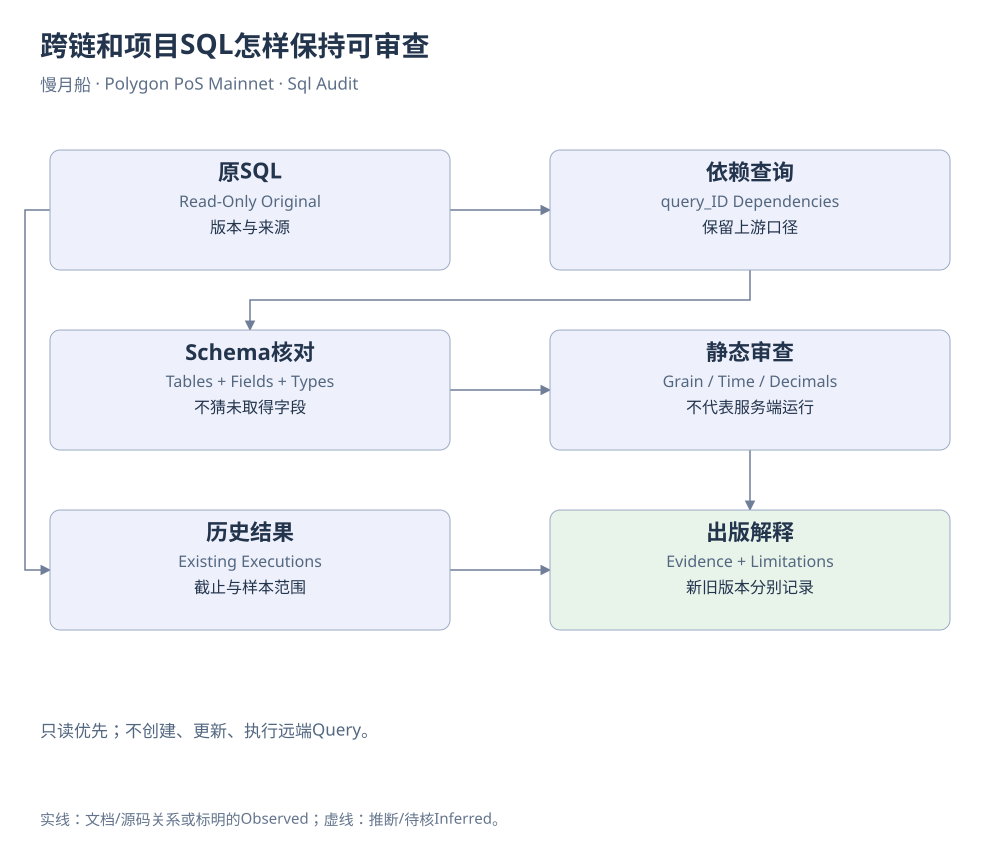

[可编辑原图](assets/diagrams/sql-audit.drawio)

延伸核对：[Query章节映射](research/dune/query_chapter_mapping.md)。

来源与核对：[state-sync](https://docs.polygon.technology/pos/architecture/bor/state-sync.md)；[dune-functions](https://docs.dune.com/query-engine/Functions-and-operators/varbinary.md)。研究基准：2026-10-19；资料获取：2026-10-19—20。

[返回目录](SUMMARY.md)

---

# 第33章｜调查先从合约身份开始

研究一个项目，最先确认的不是它的收益率，而是我们正在看哪一个合约。名称和Ticker可以被重复使用，官网链接也可能指向多条链或多个版本。一个可靠的起点，是把项目身份拆成网络、Token地址、部署来源、源码、ABI和关联角色，逐项留下证据。

Token地址来自哪里，需要说明。作者旧SQL、项目官方披露、浏览器标签和第三方价格网站都可以提供线索，但来源可信度不同。本轮LGNS首先从作者Query取得候选，再取得对应PolygonScan已验证源码。这样才能把研究对象固定为Polygon上的具体合约，而不是所有叫Longinus或Origin的资产。

部署交易与部署者提供历史锚点。它们可以证明某地址参与创建某合约，却不直接证明现实中的最终控制人。工厂还可能代替用户部署，创建者地址与经济发起者需要区分。若部署字节码、构造参数与已验证源码尚未本地重编译核对，就保留浏览器验证这一来源层次。

合约身份还会随代理实现变化。当前页面展示的源码可能对应当前实现，而历史交易执行的是旧版本。研究者应检查代理类型、实现槽位、升级事件和历史实现。找不到代理标志不能自动断言不可升级；同样，看到delegatecall也不能马上认定存在管理员可任意升级的代理。

关联角色需要逐项确认。Staking可能在构造参数里记录Token和凭证地址，Treasury可能通过角色获得铸币能力，Distributor可能向质押系统提供奖励，Pair则保存交易资产。一个地址出现在旧SQL的VALUES列表里，只能说明作者把它纳入研究；要提升为已核实角色，还需要源码、状态或实际调用。

Token元数据也有时间性。decimals通常稳定，却仍应确认是否可变；totalSupply是特定区块状态，初始供应则来自部署与初始化路径。源码里有一个初始常量，不代表该数量全部进入公开流通。预铸、托管、销毁和不可流通余额，都可能使总供应与流通量分离。

完整身份表可以分为已确认、候选与未知。已取得源码的合约单列，只有旧Query标注的角色保留候选状态；当前管理员、历史余额和未获取Distributor地址明确留空。这样的表不是越填满越好，关键是每一格都能回答“依据是什么、适用哪个时点”。

身份档案还应保存浏览器源码的验证状态与获取日期。验证源码是重要线索，本轮没有重新编译并逐字节匹配部署字节码，因此不把浏览器的验证标记写成本机已经完成的验证。两种检查可以衔接，却应分别报告。

身份确认完成后，其他问题才有明确对象。我们可以读这个Token的增发路径，查这个Pair的储备，跟踪这个Staking的事件，而不会把另一版本数据混进来。后面的权限与资金研究都依赖这份底表，因此它应与正文一起交付，而不是只藏在研究者记忆中。

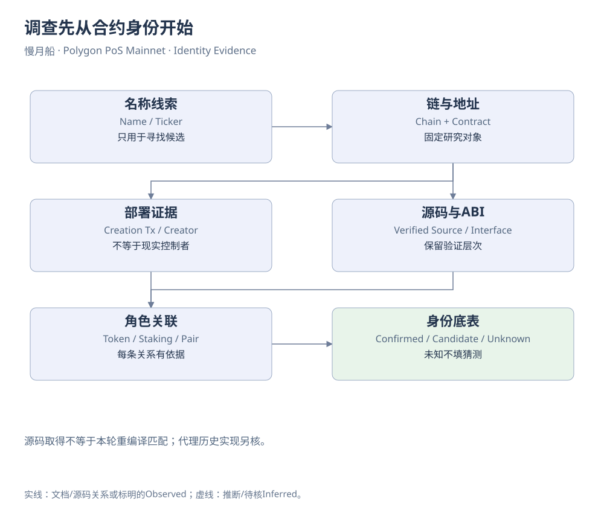

[可编辑原图](assets/diagrams/identity-evidence.drawio)

来源与核对：[eip-1967](https://eips.ethereum.org/EIPS/eip-1967)；[eip-20](https://eips.ethereum.org/EIPS/eip-20)。研究基准：2026-10-19；资料获取：2026-10-19—20。

[返回目录](SUMMARY.md)

---

# 第34章｜权限、控制者与实际行为

源码中出现一个管理员函数，说明有人可能在满足条件时调用它；交易中出现一次成功调用，才说明这项能力在某时刻实际被使用。风险研究必须同时关注两者，却不能把它们合并成“管理员已经作恶”。权限、控制者和行为，是三个需要分别取证的问题。

权限分析从入口与限制条件开始。一个mint函数可能要求Vault角色，一个setRatio可能要求默认管理员，一个manage可能检查储备管理者映射。函数名称相似不代表授权相同。应沿着modifier、角色管理和内部调用继续阅读，确认谁有资格，以及资格本身能否被另一个管理员修改。

控制者则需要指定区块的状态。源码证明存在manager变量，并不能给出今天或历史上的实际地址；构造函数最初授予部署者，也不证明权限从未转移。AccessControl的角色事件、管理权交接函数、存储状态和多签合约，都可能提供线索。没有完整历史时，不把最初部署者永远标为当前管理员。

实际行为用交易与事件说明。一次费用比例变化，需要调用输入、成功状态和相应事件；一次增发，需要铸造路径与供应或余额结果。看到某个角色拥有mint权限，可以列为技术能力，但“无限增发已经发生”仍需数量与时间证据。即使发生增发，也要进一步区分协议正常发行和违反承诺的使用。

LGNS源码给出一个具体例子：默认管理员可以设置主交易对和费用比例，比例受PRECISION上限约束；Vault角色控制Token增发。Staking的Manager能够设置部分关联合约和Warmup周期。Treasury又有储备管理者、流动性管理者与奖励管理者等不同路径。把这些都画成一个Owner节点，会丢掉真正的授权结构。

权限图应让读者看出授权方向。管理员授予角色，角色允许函数，函数影响资产或参数；另用实际交易连接已发生动作。当前控制者未知时，节点写“待指定区块读取”，不能用推测地址填补。若存在Timelock，要核对延迟与执行机制，而不是只从项目介绍中复制“有时间锁”。

严重能力可以直接准确陈述，例如某角色能够转移储备，或管理员能够把费用调到源码允许的高比例。这些是有意义的技术风险，不需要夸大成已经损害用户。评估还应考虑控制集中程度、公开承诺、可观察历史和用户退出条件，说明风险何时会变成实际影响。

这种写法既不会替项目背书，也不会用推断填补事实。它把可验证的问题摆在台面上：谁能做什么，谁现在控制它，过去实际做过什么。下一章将权限图与资金图连接，研究某种能力是否真的改变了外部资产的流向。

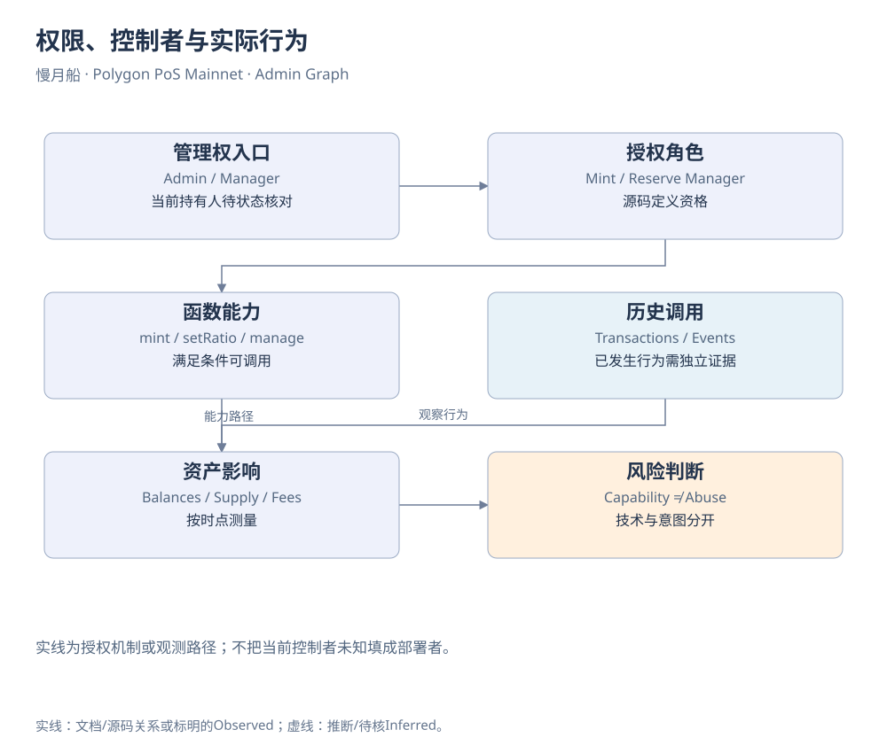

[可编辑原图](assets/diagrams/admin-graph.drawio)

[可编辑原图](assets/diagrams/lgns-admin.drawio)

来源与核对：[eip-1967](https://eips.ethereum.org/EIPS/eip-1967)。研究基准：2026-10-19；资料获取：2026-10-19—20。

[返回目录](SUMMARY.md)

---

# 第35章｜资金流图为什么必须先定义边界

画资金流图之前，先在纸上圈一个边界。如果圈住Pair，用户买入是流入，卖出是流出；如果圈住Pair、Treasury和Staking，部分原来被视为外部的移动会变成内部转移。边界不是绘图装饰，而是决定净流量计算含义的模型选择。

设集合S包含已经核实的核心合约。外部地址转入S记为流入，S转向外部记为流出，S内部互转另列并在净外部流量中抵消。这个规则能减少重复，却不能把所有流入都变成营业收入。流入可能是用户存款、流动性提供、借款、循环资金或其他需要解释的资产移动。

事件粒度也影响分类。同一笔交易可以同时Swap、增减流动性和支付费用。若查询先给整笔交易贴上“加池”标签，再把该交易全部DAI Transfer归为加池，就可能吞掉其他业务移动。更可靠的方法是先按事件或明确资产路径分类，再汇总到交易或月份，并保留未分类项。

守恒检查帮助发现错误。指定资产、边界与窗口后，期末减期初应与净流量在相同会计假设下相容。若不相容，先查窗口、初始余额、特殊机制、重复连接与遗漏，不要马上推断资金被盗。某些代币会Rebase或收费，普通Transfer累加本来就可能不适用。

“第一跳去向”也不是资金血缘的完整证明。一个地址收到资产后，在二十四小时内又转出相近数量，可能涉及此前余额、其他入账和循环操作。把后续全部转账都归给前一笔资金，会发生重复归因。时间窗口模型应说明资金混合与重用问题，不能把统计关联画成唯一确定路径。

地址角色同样要谨慎。Router可以代表许多用户，托管合约可以由某个管理员控制，EOA也可能由机构自动化管理。资金返回Pair可能是重新加池、交易或其他操作，不能仅凭终点相同就证明全部资金从未被项目控制。需要具体交易上下文与LP份额变化来解释。

作者LGNS研究中，Pair边界和六合约核心边界给出不同问题的答案；撤池排名与第一跳模型又观察资金接收路径。书稿不会把它们合并为一个“项目赚了多少钱”。独立专题保留原始Query、截止时间与角色来源，让读者看到模型怎样改变数字与结论。

金额图还需要标单位和聚合窗口。箭头粗细若表示累计DAI流量，就不能与旁边表示Token数量的线直接比较；节点余额若来自期末快照，也不能画成窗口内总流入。图例说明这些差别，才能避免视觉上制造错误因果。

一张好的资金图最终应当可以退回明细：箭头对应什么资产、哪些事件、什么时间、如何汇总、是否属于观察或推测。未知路径留在图上，比凭猜测把每条线闭合更有价值。只有这样，资金地图才能成为下一章风险判断的证据，而不是一幅已经预设结论的故事图。

[可编辑原图](assets/diagrams/fund-boundary.drawio)

来源与核对：[dune-transfers](https://docs.dune.com/data-catalog/curated/token-transfers/evm/token-transfers.md)。研究基准：2026-10-19；资料获取：2026-10-19—20。

[返回目录](SUMMARY.md)

---

# 第36章｜怎样把风险信号写成可靠结论

链上调查能够提出明确而有分量的判断，但结论必须说明自己属于哪一层。交易证明一笔调用，源码说明技术能力，SQL描述一个窗口的统计，风险评价则把这些事实放到经济与治理背景中。它们可以互相支持，却不能跳过层次，把最后的评价直接称作原始链上事实。

本篇采用五层证据：原始链上记录、协议或项目文档、索引与计算结果、启发式分析、研究判断。比如LGNS某条LogRebase有可定位的交易和索引；Rebase率是按已核实布局换算的数；静态持有模型又加入时间、价格和不退出假设；“用户是否赚到钱”还需要真实交易与成本，不能从模型余额直接回答。

风险信号和已确认能力也要区分。管理员能修改费用，是源码层面可以说明的能力；某时刻费用被调高，是行为事实；这种行为是否违反承诺、是否造成损失，需要额外材料。风险研究可以指出权限集中与潜在影响，不必等待法律裁判，但也不能把技术能力写成诈骗意图。

相反解释是审查的一部分。大额撤池可能是恶意退出，也可能是迁移、再平衡或业务合约操作；高频成交可能是真实交易、自动策略、循环活动或其他机制。提出其他解释不等于替项目辩护，而是明确下一份区分证据：LP去向、后续交易、合约权限或公开迁移公告。

项目方主张应建立单独对照表。宣称收益来自经营，需要可追溯的外部收入与分配依据；宣称储备充分，需要资产种类、可支配性与义务口径；宣称合约审计，需要匹配报告版本、地址、范围和未解决发现。没有取得证据时，结论是尚未核实，而不是自动判定真实或虚假。

风险评分如果没有明确模型，往往掩盖不确定性。把权限、流动性和披露各打一个随意分数，再求平均，会使读者误以为存在可验证的综合概率。本篇使用具体问题、证据状态和缺口，不给LGNS生成无来源的安全分或诈骗概率。数字应来自计算，而不是替代论证。

负面结果同样需要覆盖。某次查询没有找到提款事件，可能是没有发生，也可能是ABI没有该事件、表覆盖不足或查询窗口错误。只有搜索范围与机制明确，缺失才具有解释力。作者Staking Query主动保留Unstake缺口，就是比输出一个没有依据的零更好的处理。

最终报告应直接列出能证明的事实、观察到的风险、可能解释和缺失证据。法律性质、现实控制人和最终受益关系可能需要链外调查，不能靠地址聚类一步完成。接下来的LGNS案例将按这一标准，把真实合约、历史模型与资金边界连接起来，展示一份克制但不含糊的研究结论。

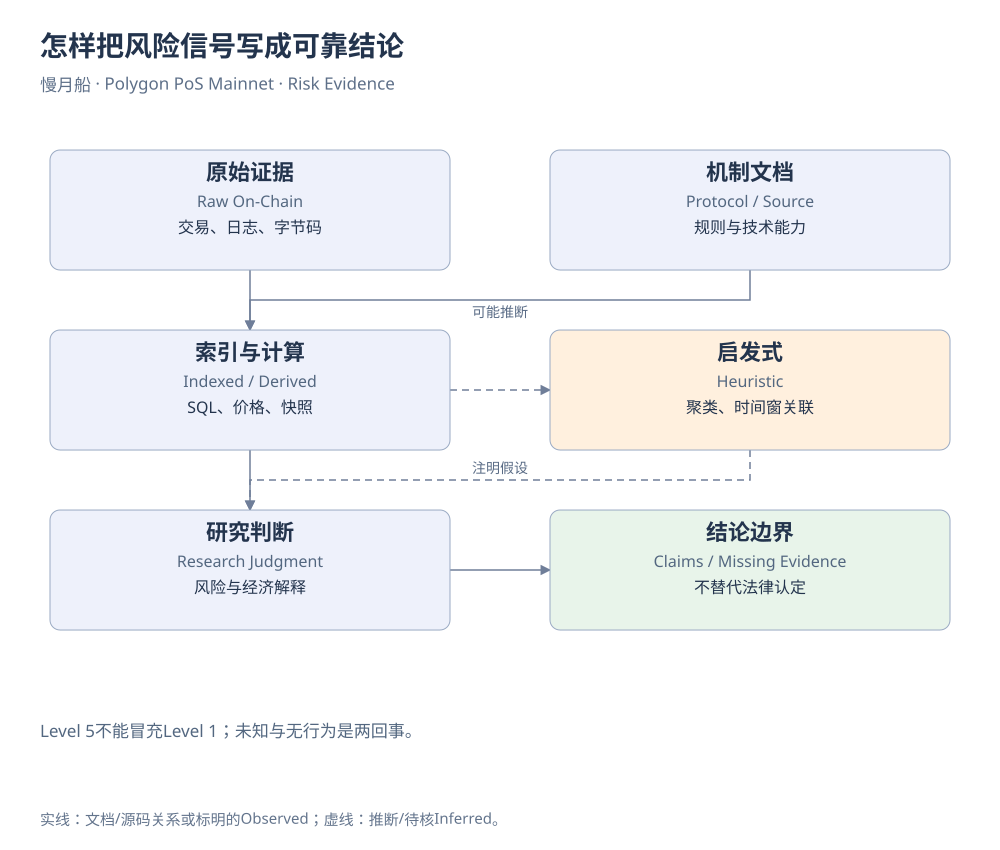

[可编辑原图](assets/diagrams/risk-evidence.drawio)

来源与核对：[eip-20](https://eips.ethereum.org/EIPS/eip-20)。研究基准：2026-10-19；资料获取：2026-10-19—20。

[返回目录](SUMMARY.md)

---

# 第37章｜LGNS到底是哪组合约

作者看板的标题是“LGNS是诈骗盘吗”。它提供了一个调查问题，而不是已经完成的法律判断。本轮从看板进入，取得14张图表关联的6条不同Query，并补充16条辅助研究Query。真正需要研究的，是Polygon上这一组合约怎样发行、质押、交易和管理资产，以及这些机制留下什么证据。

目标Token为Longinus，符号LGNS，合约地址0xeb51d9a39ad5eef215dc0bf39a8821ff804a0f01。其已验证源码中，OriginERC20Token构造函数明确使用9位精度。源码与浏览器页面还定位了部署交易0x1074b961d4f3b1fb9519f91e18c10d769600a61258affdaeffb5d504168365da，区块54,339,832，时间为2024年3月6日16:34:26 UTC。

围绕Token，旧SQL识别了sLGNS、Staking、Treasury、Turbine和LGNS/DAI Pair。本轮取得前述Token之外的sLGNS、Staking、Treasury及Pair源码与ABI，Turbine角色仍主要来自原研究。五份源码页面均给出同一创建地址，但“同一部署来源”只支持合约关联线索，不直接证明现实身份或每个时点的实际控制者。

sLGNS地址为0x99a57e6c8558bc6689f894e068733adf83c19725，Staking为0x1964ca90474b11ffd08af387b110ba6c96251bfc，Treasury为0x7b9b7d4f870a38e92c9a181b00f9b33cc8ef5321。Pair为0x882df4b0fb50a229c3b4124eb18c759911485bfb。完整地址表与来源单独保留，正文图不靠缩写承担身份确认。

源码中的角色很具体。LGNS的MINT角色控制增发，默认管理员可以调整主交易对和费用比例；Staking管理质押与Warmup；sLGNS用gons换算显示余额；Treasury按批准角色处理储备存入、提取、管理和奖励铸造。变量仍可能沿用OHM、USDT等模板名称，不能因此把它们当成实际部署资产，关联状态仍需核对。

尤其值得注意的是Treasury.withdraw要求调用者具有储备支出资格。源码存在赎回函数，不等于每个普通持币人都能随时按固定价值直接赎回Treasury资产。管理权限、资格映射、支持资产和实际余额共同决定可用路径；用“有金库”三个字代替这些条件，会夸大储备与用户权利的联系。

当前供应、管理员成员、角色历史、Distributor地址和全量LP持有人，本轮没有取得指定区块的完整状态。源码初始设置与旧Query注释不能替代这些数据。专题因此把已验证源码能力、旧结果观察和待补状态分别列示，不把合约关系图画成所有当前控制关系都已确认。

部署身份与运行状态在这里有实际区别。取得的源码显示LGNS继承AccessControl，sLGNS与Staking使用Manager式管理，Pair保存自己的储备和LP份额规则。这些结构已经足以形成能力图；但角色成员、Manager现值和构造后初始化调用仍需指定高度证据。研究不能因为五个合约共享部署来源，就把所有管理箭头都连接到该创建地址。对尚未取得源码的Turbine，图中使用候选关系并保留原Query来源，避免让一个旧标签在图里变成新的独立事实。

这份身份底表为后面两章提供清楚起点：用户质押的是LGNS，取得和增长的是sLGNS计量关系；退出市场则还要面对DAI储备与交易费用。把这些对象分开后，研究才能从“币越来越多”走向“用户实际能够得到什么”。

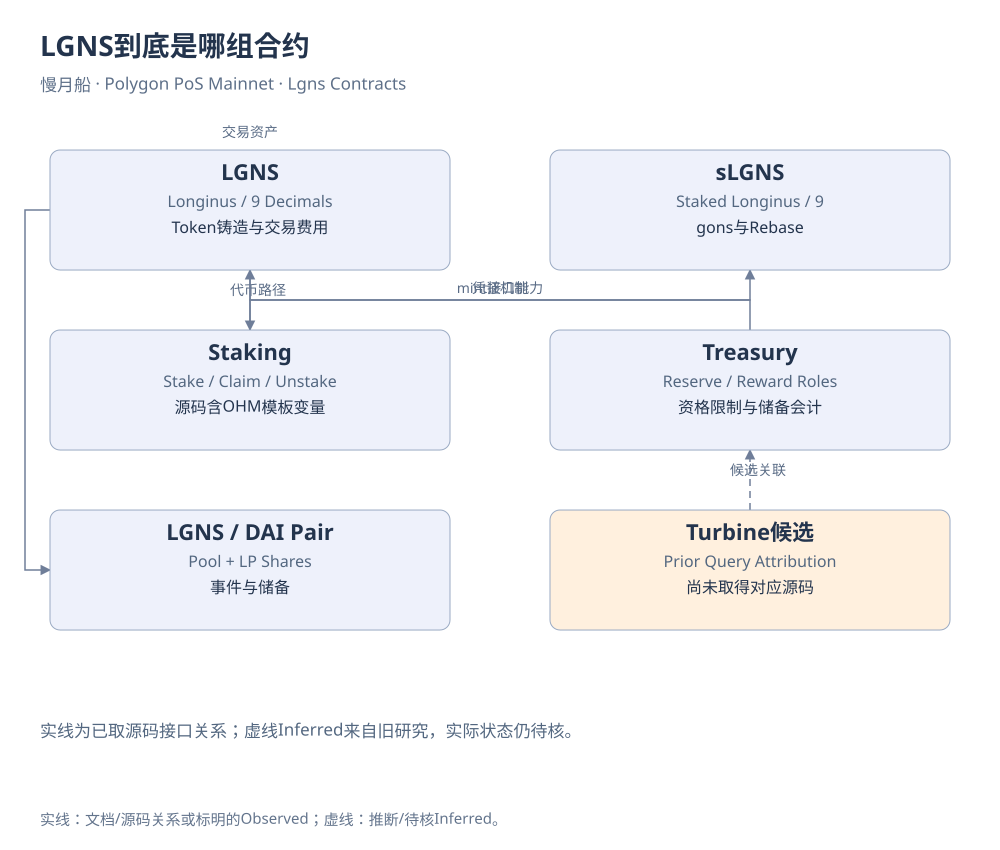

[可编辑原图](assets/diagrams/lgns-contracts.drawio)

延伸核对：[合约底表](research/lgns/contracts.md)。

来源与核对：[lgns-code-scan](https://polygonscan.com/address/0xeb51d9a39ad5eef215dc0bf39a8821ff804a0f01#code)；[slgns-code-scan](https://polygonscan.com/address/0x99a57e6c8558bc6689f894e068733adf83c19725#code)；[staking-code-scan](https://polygonscan.com/address/0x1964ca90474b11ffd08af387b110ba6c96251bfc#code)；[treasury-code-scan](https://polygonscan.com/address/0x7b9b7d4f870a38e92c9a181b00f9b33cc8ef5321#code)。研究基准：2026-10-19；资料获取：2026-10-19—20。

[返回目录](SUMMARY.md)

---

# 第38章｜sLGNS增加时，用户究竟得到了什么

把一枚LGNS放进质押系统，之后sLGNS显示数量增加，是否意味着用户已经赚到同等比例的财富？先看合约怎样记账。sLGNS内部使用gons，显示余额由内部份额除以换算系数得到。Rebase改变总供应和换算关系，持有人余额可以一起变化，不需要逐个账户收到一条普通转账。

sLGNS构造函数使用9位精度，初始总量常量为五百万乘十的九次方；初始化会把相应gons分配给Staking。这个初始记账总量不能直接称为公开流通供应，更不能当作项目收到五百万单位外部资产。circulatingSupply还会扣除质押合约持有的显示余额，体现其特定会计定义。

LogRebase包含epoch、rebase与index。源码把rebase比率按1e18记录，而index返回的是显示余额单位，按9位缩放。同一事件里两个数字使用不同单位，是本案例最容易出错的细节。旧Query 8369671正确区分它们，并明确不伪造事件没有直接发出的实际增发数量。

2024年3月6日16:40:22 UTC的交易0x772e9ccfe8fd6e142140bb1c34d3fd428a6e39f9e83a405785581c2688fc74ce，同时出现在原Staked与LogRebase样本。其Rebase事件索引17，epoch为0，比率为0，index_raw为1,000,000,000；Staked事件索引24，样本金额为一LGNS。它具体展示了同一交易内不同事件的独立身份。

Staking.stake先触发rebase，再接收LGNS并记录Warmup信息；claim与forfeit处理等待期相关路径，unstake则交换sLGNS与LGNS。源码没有专门Unstaked事件，作者因此没有把不完整的替代扫描结果冒充完整退出统计。旧Staked结果能说明已记录的质押活动，不能推出净质押、实际独立用户数或全部赎回量。

奖励来源要继续追到Distributor、Treasury和Token铸造路径。Staking根据自身LGNS余额与已质押供应计算后续分配，Treasury又存在受角色和excessReserves约束的奖励铸造能力。源码支持分析这种代币分配机制，但不能单独证明外部经营收入，也不能证明全部奖励仅来自新增外部现金。

旧静态持有模型以2024年3月6日投入一千DAI为起点，结合价格和sLGNS index推演到固定截止。模型余额增长属于在既定假设下的计算，并不是某个真实用户钱包已经实现的收益。现实用户还可能改变仓位、承担费用、错过分配或不能按模型价格退出，需要实际交易历史才能判断。

真实样本还说明事件金额不等于新增外部资金：这一笔Staked记录一LGNS，同时触发的epoch零Rebase比率为零。若把两条事件都转换成资金流入，会凭空增加一笔经济活动。事件先按机制解释，再判断是否需要进入DAI边界账，才不会把质押记账与稳定币收款混在一起。

因此，本章能明确说明余额增长怎样发生、事件怎样换算，以及哪些数据还没有覆盖。它既不预设“数量增加必然被稀释成损失”，也不把增长数字当成确定利润。下一章用同一截止时点的Pair储备与退出曲线，检查数量增长怎样接到可交换的DAI上。

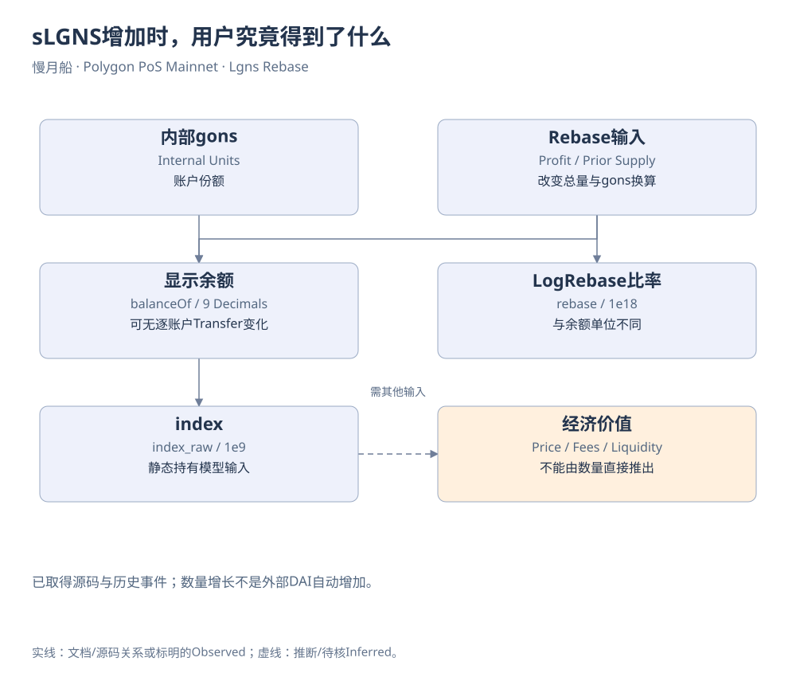

[可编辑原图](assets/diagrams/lgns-rebase.drawio)

延伸核对：[Staked样本](examples/transactions/case-10.md) · [Rebase样本](examples/transactions/case-11.md)。

来源与核对：[slgns-code-scan](https://polygonscan.com/address/0x99a57e6c8558bc6689f894e068733adf83c19725#code)；[staking-code-scan](https://polygonscan.com/address/0x1964ca90474b11ffd08af387b110ba6c96251bfc#code)。研究基准：2026-10-19；资料获取：2026-10-19—20。

[返回目录](SUMMARY.md)

---

# 第39章｜用DAI、储备和退出模型检查账面价值

价格乘余额给出账面价值，池子曲线才约束一次卖出能换到多少。作者Query 8390372把这两种观察放在一起，固定截止为2026年8月18日09:28:58 UTC。本轮读取其旧结果，并离线复算情景公式；这些数值描述历史模型，不代表今天的储备或未来保证成交。

一千DAI初始本金的静态持有模型，截止时给出约41,424.2193 LGNS。使用模型日级价格，账面值约53,713.2415 DAI。结果同时保存约55,903,905.5437 LGNS与72,735,513.9392 DAI的池子储备。储备比价与日级价格略有差别，因此账面折价也不完全等于单纯曲线冲击。

模型的初始买入按历史日价换算，没有模拟大额建仓冲击。退出时先按5% Token费用扣除卖出数量，再按0.3% AMM费用进入常数乘积公式，得到约51,012.0486 DAI的情景输出。取得的Pair源码支持相应997手续费结构，LGNS源码初始feeRatio为5000、PRECISION为100000。历史整个窗口费率未变的说法仍来自旧研究，本轮未重新扫描完整FeeRatioChanged历史。

费用条件还比“卖出税”三个字复杂。LGNS源码按主交易对方向和INTERN_SYSTEM角色判断是否收费：向Pair转入可能涉及卖出或加池，从Pair转出可能涉及买入或撤池。管理员能够修改比例，当前角色成员与主交易对状态也会影响实际路径。因此5%是旧模型假设及其历史依据，不能直接宣布所有当前地址都按这个比例交易。

小额模型结果不能线性放大。一万DAI初始仓位的旧结果给出约506,920.7885 DAI情景退出值，折价已经不同。持仓越大，对池子储备造成的冲击越明显。一次性退出模型还不包含MEV、Gas、前置成交、交易失败或其他路径，实际可得金额必须在交易发生时确认。

资金边界Query 8391200又给出另一类数：固定口径下累计来源约60.8902亿DAI、累计去向约60.0432亿DAI，净留存约8470.38万DAI；累计添加流动性约5.6347亿，移除约2.9217亿。它们是六合约边界与分类模型的结果，不能叫作项目利润、用户损失或全部新投资者投入。

如此大的累计流量可以由同一资产反复流转形成。事件键无重复，只排除特定重复记录问题，并不排除循环资金或关联交易。Pair内Swap净流向与核心集合外部净流量也不是同一口径。专题保留月度底账和差异说明，不把几组不同截止的数据拼成一个貌似守恒的新结论。

这一模型的储备来自截止前最后Sync，而账面价格来自另一条日级序列，两者不能无说明地视为同一瞬间现价。本轮复算保留两种价格键，并把公式结果与原Query逐项比较。能够复现公式说明算术一致，尚不能证明全部历史储备和费率输入均已重新独立验证。

这组证据修正了一个过于简单的故事：不能仅凭Rebase就断言模型中的小额持有人最终价值下降；也不能因为历史情景输出高于初始本金，就宣布系统可持续或全部用户都能兑现。数量、价格、储备、费用与仓位规模必须一起看，结论才与数据保持相同边界。

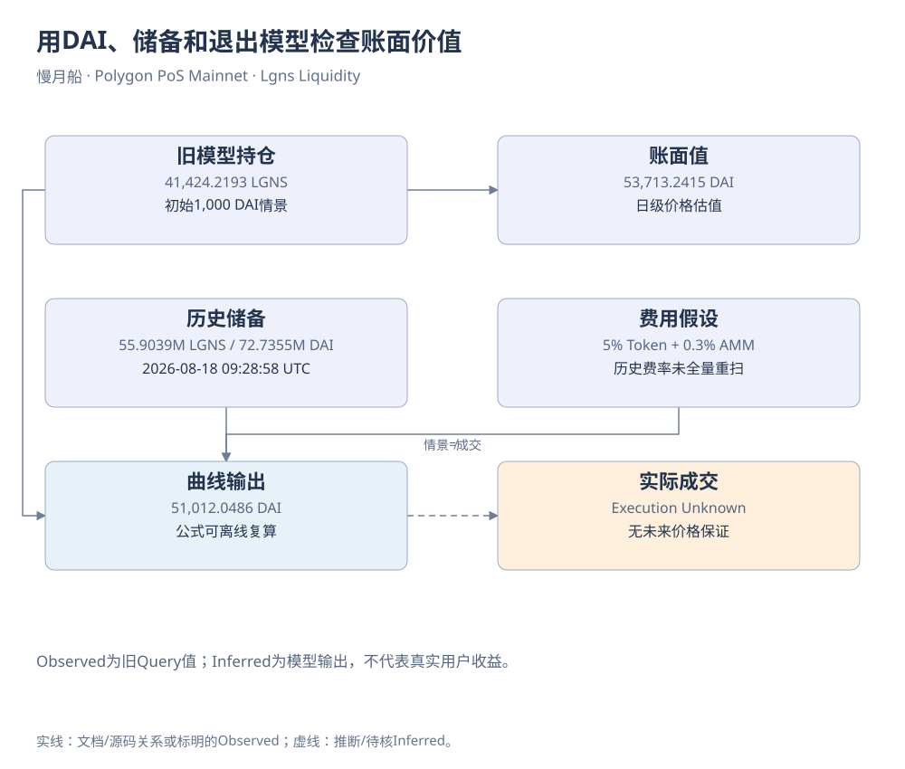

[可编辑原图](assets/diagrams/lgns-liquidity.drawio)

延伸核对：[离线模型复算](reports/evidence-checks.json)。

来源与核对：[pair-code-scan](https://polygonscan.com/address/0x882df4b0fb50a229c3b4124eb18c759911485bfb#code)；[lgns-code-scan](https://polygonscan.com/address/0xeb51d9a39ad5eef215dc0bf39a8821ff804a0f01#code)。研究基准：2026-10-19；资料获取：2026-10-19—20。

[返回目录](SUMMARY.md)

---

# 第40章｜回到证据：LGNS研究能说到哪里

经过合约、事件、质押和流动性分析，我们可以对LGNS提出具体判断，却仍不应该把看板标题当作结论。已经取得的是一组合约的已验证源码、作者历史Query与结果样本，以及若干可定位交易的浏览器记录。它们足以解释重要机制，也留下需要继续核实的控制与历史状态问题。

能够直接说明的技术能力包括：LGNS的MINT角色可以增发，默认管理员可以调整主交易对与费用比例；Staking的Manager可以修改部分参数；Treasury的授权角色可以管理储备或铸造奖励。费用上限在源码中可达到PRECISION对应的比例。这些是应当向读者清楚展示的集中权限，不需要附加没有证据的恶意动机。

已经观察到的历史模型包括：sLGNS按特定Rebase会计增长，旧质押统计没有覆盖完整Unstake，固定时点的AMM退出值随仓位规模变化，核心集合的DAI流量远大于净留存。它们说明系统存在真实稳定币移动和复杂内部路径，但累计移动不是经营收入，更不自动证明外部现金持续支持了全部奖励。

撤池归因提供了另一个需要克制的例子。旧Query 8390785把最大接收方识别为合约，并观察到后续DAI流向Pair；同时列出顶层调用者与创建地址。这比“某地址拿走巨款”的叙述更完整，却仍不能证明每笔后续转账的唯一资金血缘，也不能仅凭回到Pair就宣布没有控制风险。

当前Controller、完整角色变更、LP最终控制、Distributor状态、全量供应历史和项目外部收入，本轮仍有缺口。项目官网或审计入口可以帮助定位披露，但未经核对的宣传不能用于填补资产负债表。尤其是任何人可按固定价值赎回的主张，需要与Treasury的资格限制和真实资产可用性逐项比较。

风险报告因此采用“能力—行为—经济影响”三栏。能力有源码，行为需要交易，经济影响需要数量、时间、资产性质和用户权利。严重风险可以明确写，例如特权角色影响增发和费用、市场退出依赖有限储备、部分关键状态尚未核实；不能把这些直接替换成诈骗、违法或安全无虞。

本篇也没有把模型中的一千DAI情景当作真实投资建议。历史静态持有结果是研究工具，用来检验一个假设是否符合已有数据，而不是预测后来任何人的收益。独立专题保存公式、来源、原结果和限制，使读者可以重新计算，也可以指出模型缺少哪些现实条件。

Polygon篇最终完成的是一套可复用路线：先理解Bor、Heimdall与Ethereum的职责，再选择正确数据粒度，继而重建资产与合约路径，最后把结论放回证据层次。LGNS让这条路线面对真实复杂性。研究的价值不在迅速给项目贴标签，而在让每个重要判断都能沿着来源、交易和计算逐级核对。

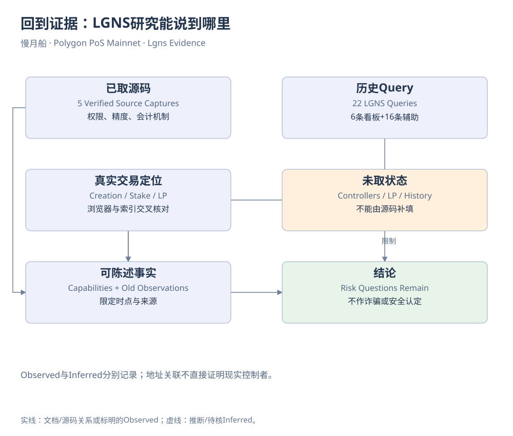

[可编辑原图](assets/diagrams/lgns-evidence.drawio)

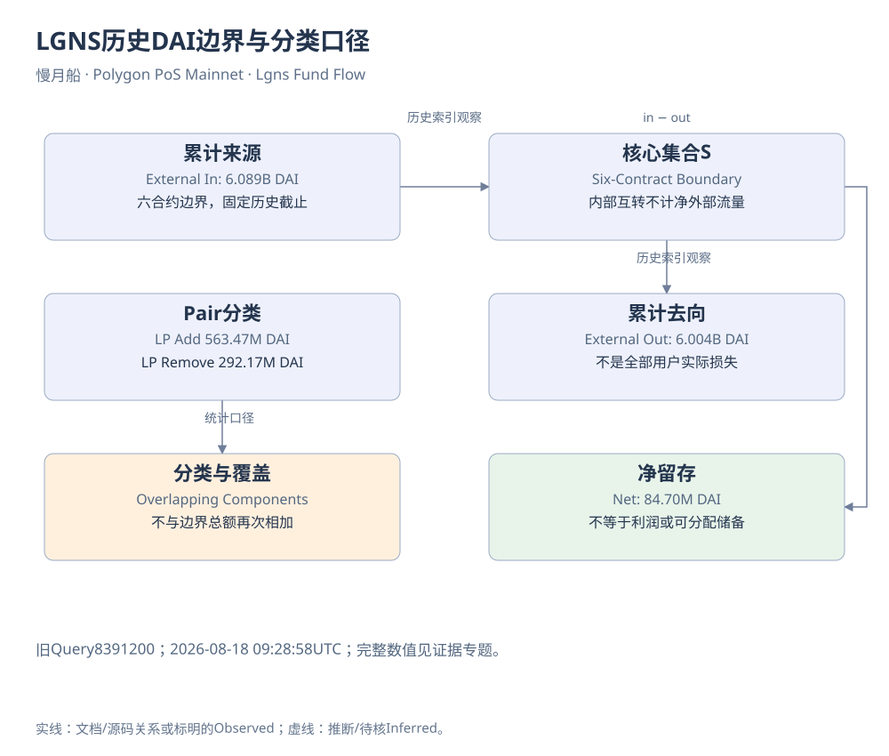

[可编辑原图](assets/diagrams/lgns-fund-flow.drawio)

延伸核对：[独立LGNS专题](research/lgns/LGNS_CASE_STUDY.md) · [证据矩阵](research/lgns/evidence_matrix.md)。

来源与核对：[treasury-code-scan](https://polygonscan.com/address/0x7b9b7d4f870a38e92c9a181b00f9b33cc8ef5321#code)；[lgns-code-scan](https://polygonscan.com/address/0xeb51d9a39ad5eef215dc0bf39a8821ff804a0f01#code)。研究基准：2026-10-19；资料获取：2026-10-19—20。

[返回目录](SUMMARY.md)

---

# 桥接字段与证据参考

两边网络分别记录Chain ID、合约、交易哈希、区块号、区块哈希、时间、事件索引、消息/退出标识、资产地址、原始整数、精度和状态。Ethereum发起成功不等于Bor目标成功，Polygon销毁不等于Ethereum完成释放。

[官方状态传递文档](https://docs.polygon.technology/pos/how-to/bridging/l1-l2-communication/state-transfer)给出StateSender（Ethereum）`0x28e4F3a7f651294B9564800b2D01f35189A5bFbE`与StateReceiver（Polygon）`0x0000000000000000000000000000000000001001`。这些地址来自协议文档，未在本轮独立重编译其代码。

存款：根链锁定/接收→消息→Heimdall记录→Bor处理→目标资产变化。退出：子链发起/销毁→本地确认→根链检查点覆盖→证明→退出执行→释放。Approve是授权，不计入实际跨链金额。

库存与流量分开，锁定与铸造不重复相加。发起队列和完成队列分别保存，未完成项不从延迟样本中静默删除。

本轮未取得PoS桥完整双侧闭环。SQL只展示已核实Schema中的特定Ethereum侧FxTunnel事件，不推定全桥覆盖。State-sync文档尾部仍保留旧synthetic receipt描述，与PIP-74规范化交易表示需按版本区分，不用于断言2026交易根包含规则。

[可编辑原图](assets/diagrams/milestone-vs-checkpoint.drawio)

---

# 数据表索引

[完整实时字段快照](research/polygon_schema/SCHEMA.md)。以下仅列本篇核心，不代表Catalog全部返回项都已运行验证。

| 表 | 一行代表/用途 | 关键注意 |
|---|---|---|
| `polygon.blocks` | Bor区块头 | date分区；miner不能当生产者 |
| `polygon.transactions` | 交易记录 | 包含系统类型；block_date |
| `polygon.traces` | 执行帧 | tx_hash+trace_address候选键 |
| `polygon.logs` | Raw事件 | tx_hash+index；topic按ABI |
| `polygon.creation_traces` | 创建记录 | 实际block_month；无type/success |
| `tokens.transfers` | 可替代资产移动 | amount已标准化，缺价单列 |
| `dex.trades` | 池级成交段 | 多跳可能多段 |
| `gas.fees` | 费用模型行 | 分量与收益分别解释 |
| `prices.hour` | 资产小时价格 | 链+合约+时点与价格源 |
| `tokens.erc20` | 代币元数据 | 不是历史状态证明 |
| `tokens.supply_latest` | 最新供应快照 | 不能冒充历史供应 |
| `quickswap_polygon.uniswapv2pair_evt_sync` | Pair储备事件 | token0/1与各自精度 |
| `maker_polygon.dai_evt_transfer` | DAI事件 | 固定Polygon DAI合约 |
| `polygon_pos_bridge_ethereum.fxerc20roottunnel_evt_fxdepositerc20` | Ethereum侧Fx存款事件 | 特定桥覆盖，非全部存款 |

本轮polygon canonical返回9表；未把候选polygon.withdrawals当作已经确认存在且适用的桥提款表。NFT和Balances候选的Catalog结果单独保留，不用表名推定完整时间覆盖。

---

# 术语表

**Bor**：Polygon执行客户端，运行EVM并按协议生产/验证区块。

**Heimdall v2**：基于Cosmos SDK与CometBFT的共识协调应用。

**Validator**：按协议状态和投票权参与确认的验证者。

**Block Producer**：获选并负责某段Bor区块生产的角色。

**Span**：具有生产安排的Bor高度区间。

**Sprint**：Span内固定区块分组；当前仍涉及状态同步边界。

**Milestone**：对连续Bor历史建立本地最终确认的机制。

**Checkpoint**：向Ethereum提交的历史承诺，与本地确认不同。

**State Sync**：从根链特定事件到Bor接收处理的消息机制。

**VEBloP**：验证者选举区块生产者的组织方式。

**Witness**：验证执行所需状态见证，不等同零知识有效性证明。

**POL**：当前Polygon原生Gas资产；根链ERC-20另有身份。

**Raw**：接近执行原始记录的索引表。

**Decoded**：利用ABI解释事件和调用的数据。

**Curated**：按业务模型整理的数据。

**Trace**：执行帧或内部调用轨迹。

**Log**：合约发出并成功提交的事件记录。

**Grain**：一行数据代表的对象。

**Rebase**：通过供应/全局换算影响余额的会计机制。

**gons**：sLGNS内部份额单位。

**LP Token**：池子流动性份额的合约表示。

**Treasury**：具有特定资产与权限规则的金库，不天然等于现金储备。

**Proxy**：把调用委托给实现的合约结构。

**Capability**：源码或权限允许的技术能力。

**Observed**：已观察记录，需注明来源与窗口。

**Inferred**：依赖假设或启发式的推断。

---

# 协议版本时间线

Bor与Heimdall分别编号。精确时间采用公开区块记录；~为官方计划时间，未伪装为精确激活时间。

| 升级 | 客户端 | 激活高度 | UTC时间 | 数据影响 | 证据状态 |
|---|---|---:|---|---|---|
| [Bhilai](https://polygonscan.com/block/73440256) | Bor | 73440256 | 2025-07-01T08:48:33+00:00 | Pectra/EIP-7702、Gas容量与费用参数 | CONFIG_HEIGHT_AND_EXPLORER_TIMESTAMP |
| [Rio](https://polygonscan.com/block/77414656) | Bor | 77414656 | 2025-10-08T14:23:04+00:00 | VEBloP、单生产者Span、Witness架构 | CONFIG_HEIGHT_AND_EXPLORER_TIMESTAMP |
| [Madhugiri](https://polygonscan.com/block/80084800) | Bor | 80084800 | 2025-12-09T10:04:13+00:00 | 执行与交易表示；PIP-74相关系统交易背景 | CONFIG_HEIGHT_AND_EXPLORER_TIMESTAMP |
| [Dandeli](https://polygonscan.com/block/81424000) | Bor | 81424000 | 2026-01-09T14:01:02+00:00 | 目标Gas比例/参数背景；实现细节仍需专门重放核对 | CONFIG_HEIGHT_AND_EXPLORER_TIMESTAMP |
| [Lisovo](https://polygonscan.com/block/83756500) | Bor | 83756500 | 2026-03-04T14:03:51+00:00 | PIP-79边界验证与可配置费用参数 | CONFIG_HEIGHT_AND_EXPLORER_TIMESTAMP |
| [Giugliano](https://polygonscan.com/block/85268500) | Bor | 85268500 | 2026-04-08T14:03:57+00:00 | PIP-83头部Gas参数、PIP-66早期公告 | CONFIG_HEIGHT_AND_EXPLORER_TIMESTAMP |
| [Chicago](https://polygonscan.com/block/87218600) | Bor | 87218600 | 2026-05-21T14:04:18+00:00 | PIP-88操作/预编译Gas重定价 | CONFIG_HEIGHT_AND_EXPLORER_TIMESTAMP |
| [Valencia](https://polygonscan.com/block/89531000) | Bor | 89531000 | 2026-07-02T14:11:35+00:00 | Bor v2.9.0执行层硬分叉；详细改动未独立穷尽 | CONFIG_HEIGHT_AND_EXPLORER_TIMESTAMP |
| [Austin](https://polygonscan.com/block/91949700) | Bor | 91949700 | 2026-08-13T13:59:37+00:00 | Bor v2.10.0执行层硬分叉；详细改动未独立穷尽 | CONFIG_HEIGHT_AND_EXPLORER_TIMESTAMP |
| [Heimdall v2](https://github.com/0xPolygon/heimdall-v2/releases) | Heimdall | 未另定本篇高度 | 2025-07-10 | 共识/模块规则；不是Bor高度 | OFFICIAL_RELEASE_DATE_ONLY |
| [Phuket](https://github.com/0xPolygon/heimdall-v2/releases) | Heimdall | 44070000 | 尚未取得 | 共识/模块规则；不是Bor高度 | OFFICIAL_CONFIG_AND_RELEASE_HEIGHT; RAW_TIMESTAMP_UNAVAILABLE |
| [Zurich](https://github.com/0xPolygon/heimdall-v2/releases) | Heimdall | 47880000 | 2026-06-25 ~14:00 UTC | 共识/模块规则；不是Bor高度 | OFFICIAL_SCHEDULE_NOT_RAW_TIMESTAMP |
| [Ithaca](https://github.com/0xPolygon/heimdall-v2/releases) | Heimdall | 50185000 | 2026-07-29 ~14:00 UTC | 共识/模块规则；不是Bor高度 | OFFICIAL_SCHEDULE_NOT_RAW_TIMESTAMP |
| [Kyoto](https://github.com/0xPolygon/heimdall-v2/releases) | Heimdall | 51533000 | 尚未取得 | 共识/模块规则；不是Bor高度 | OFFICIAL_CONFIG_AND_RELEASE_HEIGHT; RAW_TIMESTAMP_UNAVAILABLE |
| [Lugano](https://github.com/0xPolygon/heimdall-v2/releases) | Heimdall | 54627000 | 2026-10-01T16:22:06.133511367Z | 共识/模块规则；不是Bor高度 | OFFICIAL_HEIGHT_AND_HEIMDALL_BLOCK_CAPTURE |

版本冲突：PIP-84写85,245,000；官方Bor配置/发布公告写85,268,500，后者的区块实际时间2026-04-08 14:03:57UTC已取得。书稿采用后者。

Heimdall v2上线官方文章日期为2025-07-10；不强行构造迁移前后同一个高度语义。Heimdall v0.12.2（2026-10-14）、Bor v2.10.3（2026-10-15）已发布，但发布版本不等同于新的硬分叉。Hampi在固定Bor配置中为nil，未列为已激活。PIP-91/92的链上治理执行未核实，不因提案存在即宣布生效。

[固定版本Bor配置](https://raw.githubusercontent.com/0xPolygon/bor/1cdf43c99d97cb9e18860776d8f69a416b49adf4/params/config.go) · [Heimdall配置](https://raw.githubusercontent.com/0xPolygon/heimdall-v2/develop/helper/config.go) · [发布元数据](https://api.github.com/repos/0xPolygon/heimdall-v2/releases?per_page=30)

---

# 参考来源与作者作品

[完整来源台账](research/source_catalog.md) · [Query目录](research/dune/query-catalog.json) · [LGNS独立专题](research/lgns/LGNS_CASE_STUDY.md)。

[Polygon原Dashboard](https://dune.com/slowmoonship/polygon-pos-data-structure-v0-1-polygon-pos)与[LGNS原Dashboard](https://dune.com/slowmoonship/lgns-scam-check-or-lgnsshi-zha-pian-pan-ma)均只读。

- [architecture](https://docs.polygon.technology/pos/architecture/overview.md)；[本地快照](https://docs.polygon.technology/pos/architecture/overview.md)。
- [bor-intro](https://docs.polygon.technology/pos/architecture/bor/introduction.md)；[本地快照](https://docs.polygon.technology/pos/architecture/bor/introduction.md)。
- [heimdall](https://docs.polygon.technology/pos/architecture/heimdall_v2/introduction.md)；[本地快照](https://docs.polygon.technology/pos/architecture/heimdall_v2/introduction.md)。
- [milestones](https://docs.polygon.technology/pos/architecture/heimdall_v2/milestones.md)；[本地快照](https://docs.polygon.technology/pos/architecture/heimdall_v2/milestones.md)。
- [checkpoints](https://docs.polygon.technology/pos/architecture/heimdall_v2/checkpoints.md)；[本地快照](https://docs.polygon.technology/pos/architecture/heimdall_v2/checkpoints.md)。
- [pip-64-asof](https://raw.githubusercontent.com/0xPolygon/Polygon-Improvement-Proposals/7ca861517bcdcba3e1f2b751762c6c2e786d7caa/PIPs/PIP-64.md)；[本地快照](https://raw.githubusercontent.com/0xPolygon/Polygon-Improvement-Proposals/7ca861517bcdcba3e1f2b751762c6c2e786d7caa/PIPs/PIP-64.md)。
- [pip-74-asof](https://raw.githubusercontent.com/0xPolygon/Polygon-Improvement-Proposals/7ca861517bcdcba3e1f2b751762c6c2e786d7caa/PIPs/PIP-74.md)；[本地快照](https://raw.githubusercontent.com/0xPolygon/Polygon-Improvement-Proposals/7ca861517bcdcba3e1f2b751762c6c2e786d7caa/PIPs/PIP-74.md)。
- [pip-79-asof](https://raw.githubusercontent.com/0xPolygon/Polygon-Improvement-Proposals/7ca861517bcdcba3e1f2b751762c6c2e786d7caa/PIPs/PIP-79.md)；[本地快照](https://raw.githubusercontent.com/0xPolygon/Polygon-Improvement-Proposals/7ca861517bcdcba3e1f2b751762c6c2e786d7caa/PIPs/PIP-79.md)。
- [pip-83-asof](https://raw.githubusercontent.com/0xPolygon/Polygon-Improvement-Proposals/7ca861517bcdcba3e1f2b751762c6c2e786d7caa/PIPs/PIP-83.md)；[本地快照](https://raw.githubusercontent.com/0xPolygon/Polygon-Improvement-Proposals/7ca861517bcdcba3e1f2b751762c6c2e786d7caa/PIPs/PIP-83.md)。
- [pip-89-asof](https://raw.githubusercontent.com/0xPolygon/Polygon-Improvement-Proposals/7ca861517bcdcba3e1f2b751762c6c2e786d7caa/PIPs/PIP-89.md)；[本地快照](https://raw.githubusercontent.com/0xPolygon/Polygon-Improvement-Proposals/7ca861517bcdcba3e1f2b751762c6c2e786d7caa/PIPs/PIP-89.md)。
- [pip-90-asof](https://raw.githubusercontent.com/0xPolygon/Polygon-Improvement-Proposals/7ca861517bcdcba3e1f2b751762c6c2e786d7caa/PIPs/PIP-90.md)；[本地快照](https://raw.githubusercontent.com/0xPolygon/Polygon-Improvement-Proposals/7ca861517bcdcba3e1f2b751762c6c2e786d7caa/PIPs/PIP-90.md)。
- [matic-to-pol](https://docs.polygon.technology/pos/concepts/tokens/matic-to-pol.md)；[本地快照](https://docs.polygon.technology/pos/concepts/tokens/matic-to-pol.md)。
- [dune-polygon](https://docs.dune.com/data-catalog/evm/polygon/overview.md)；[本地快照](https://docs.dune.com/data-catalog/evm/polygon/overview.md)。
- [dune-transfers](https://docs.dune.com/data-catalog/curated/token-transfers/evm/token-transfers.md)；[本地快照](https://docs.dune.com/data-catalog/curated/token-transfers/evm/token-transfers.md)。
- [dune-dex](https://docs.dune.com/data-catalog/curated/dex-trades/evm/dex-trades.md)；[本地快照](https://docs.dune.com/data-catalog/curated/dex-trades/evm/dex-trades.md)。
- [dune-prices](https://docs.dune.com/data-catalog/curated/prices/overview.md)；[本地快照](https://docs.dune.com/data-catalog/curated/prices/overview.md)。
- [eip-1967](https://eips.ethereum.org/EIPS/eip-1967)；[本地快照](https://eips.ethereum.org/EIPS/eip-1967)。

---

# 风险研究与证据分层

Level 1：可定位交易、事件、字节码、回执与实际调用。浏览器/索引输出仍保留服务来源，不能当作本机共识验签。

Level 2：协议文档、已验证源码、项目方机制披露。源码能力与部署后状态分开。

Level 3：Dune历史结果、SQL计算、价格与余额快照。时间、粒度、模型与缺失覆盖必须明确。

Level 4：时间窗归因、地址聚类及可能控制关系。图中用虚线Inferred，不冒充Observed资金路径。

Level 5：研究判断与经济风险。明确能力、行为、影响三段；严重权限可以直接指出，但不把未知意图写成诈骗事实。

审计报告须匹配地址、版本、范围与未解决发现；管理员现值须指定区块；储备须扣除资产限制、内部代币与用户义务的混淆。没有产生无来源的风险评分。

项目主张未核实既不等于真实，也不等于虚假。链上证据一般不能独自完成现实受益人、违法意图与法律认定。

[可编辑原图](assets/diagrams/risk-evidence.drawio)

---
