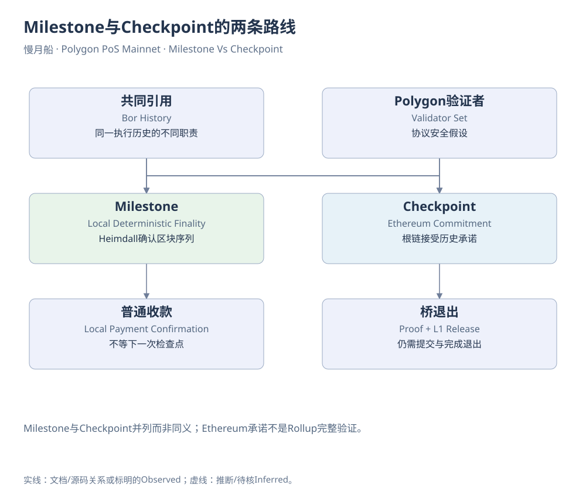

# 桥接字段与证据参考

两边网络分别记录Chain ID、合约、交易哈希、区块号、区块哈希、时间、事件索引、消息/退出标识、资产地址、原始整数、精度和状态。Ethereum发起成功不等于Bor目标成功，Polygon销毁不等于Ethereum完成释放。

[官方状态传递文档](https://docs.polygon.technology/pos/how-to/bridging/l1-l2-communication/state-transfer)给出StateSender（Ethereum）`0x28e4F3a7f651294B9564800b2D01f35189A5bFbE`与StateReceiver（Polygon）`0x0000000000000000000000000000000000001001`。这些地址来自协议文档，未在本轮独立重编译其代码。

存款：根链锁定/接收→消息→Heimdall记录→Bor处理→目标资产变化。退出：子链发起/销毁→本地确认→根链检查点覆盖→证明→退出执行→释放。Approve是授权，不计入实际跨链金额。

库存与流量分开，锁定与铸造不重复相加。发起队列和完成队列分别保存，未完成项不从延迟样本中静默删除。

本轮未取得PoS桥完整双侧闭环。SQL只展示已核实Schema中的特定Ethereum侧FxTunnel事件，不推定全桥覆盖。State-sync文档尾部仍保留旧synthetic receipt描述，与PIP-74规范化交易表示需按版本区分，不用于断言2026交易根包含规则。

[可编辑原图](../../assets/diagrams/milestone-vs-checkpoint.drawio)

[目录](../../SUMMARY.md) · [上一章](../part-10/40-chapter.md) · [下一章](data-table-index.md)
