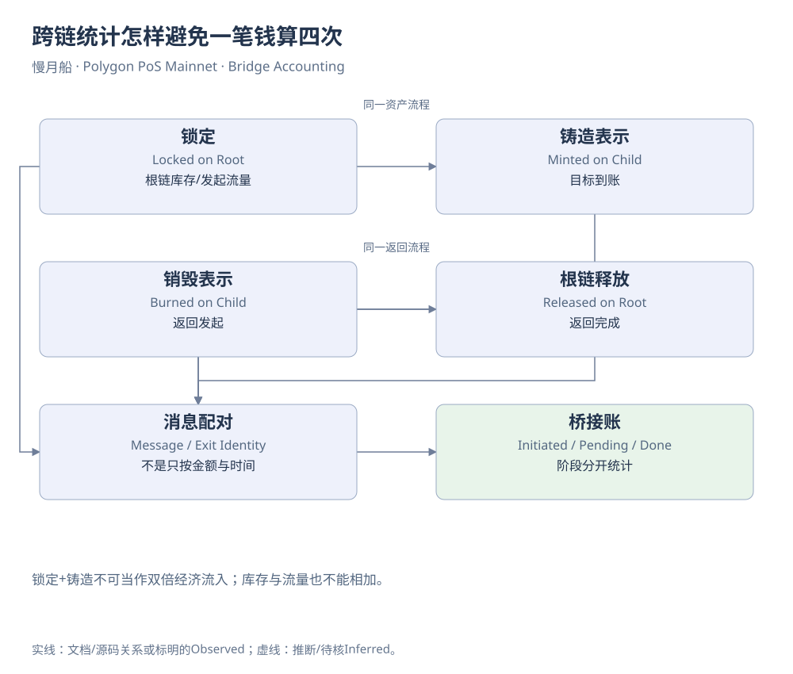

# 第20章｜跨链统计怎样避免一笔钱算四次

一百个代币经历锁定、铸造、销毁和释放，链上会留下四种动作，却不是四百个代币的新增经济活动。桥接分析的难点不在加法，而在决定哪些记录表示同一份资产的不同阶段，以及我们要测量的是库存、流量还是完成状态。

锁定额描述根链合约接收并保管的资产；铸造额描述子链新增表示；销毁额描述表示被消去；释放额描述根链资产真正交付。典型映射机制下，它们存在对应关系，但观察窗口不同、消息尚未执行、手续费或特殊资产规则，都可能造成暂时差异。差异需要解释，不能强行归零。

假设某天Ethereum锁入一百、Polygon只处理八十，其余二十仍待处理。按根链发起口径，存款是一百；按子链到账口径，到账是八十；待处理是二十。把一百加八十叫作一百八十流入，混合了两个阶段。反向提款也同理：销毁与释放应各自统计，再通过配对关系解释差额。

库存指标与流量指标更不能直接相加。某时点桥合约余额是库存，当日Deposit之和是流量。桥合约余额可能包含历史未退出资产，也可能受特殊转账或管理操作影响。仅凭余额上升，不能断言新增用户存款恰好等于差值；应与事件、消息状态和资产机制共同核对。

跨链稳定币还可能通过发行方的原生铸造销毁体系迁移，而非同一PoS桥。不同机制可以提供相似用户体验，资金统计却需要分别建模。研究者应在记录中保留bridge_protocol、root_token、child_token、message_id与两边网络，而不是以symbol相同为唯一关联条件。

时间窗口最好保留两套：发起时间用于观察需求，完成时间用于观察到账和处理速度。若只按完成日期筛选，再用发起金额作分母，会把跨日待处理项丢掉。计算延迟时还要保留未完成样本，不能只对已经成功完成的记录取平均，再称为所有用户的等待体验。

教学SQL因此先输出单侧候选，使用真实事件键防止重复，并把跨链配对留给明确标识。作者原边界查询更适合展示“表所在网络与合约命名不同”的问题，不适合直接作为全部桥接资金量。完整资金量需要补齐根链和子链覆盖，不能靠扩大表名解释来完成。

统计完成率时，观察期末尚未完成的发起项应保留在分母或单独列示。若把它们全部删除，就会高估桥接处理效果。发起队列和完成队列最好各自保存，后续新增证据到来时再更新配对状态。

桥接账本最后应能回答四个清楚的问题：发起多少，到账多少，等待多少，哪些已完成返回。每个数字都有一套证据路径和时间定义。读者建立这张账后，再进入DeFi项目，就会自然警惕另一种重复：同一笔稳定币经过Router、Pool和Treasury时，也不能被重复叫作外部收入。

[可编辑原图](../../assets/diagrams/bridge-accounting.drawio)

来源与核对：[mapped-tokens](https://docs.polygon.technology/pos/reference/mapped-tokens.md)；[state-transfer](https://docs.polygon.technology/pos/how-to/bridging/l1-l2-communication/state-transfer.md)。研究基准：2026-10-19；资料获取：2026-10-19—20。

[返回目录](../../SUMMARY.md)

[上一章](19-chapter.md) · [下一章](../part-06/21-chapter.md)
