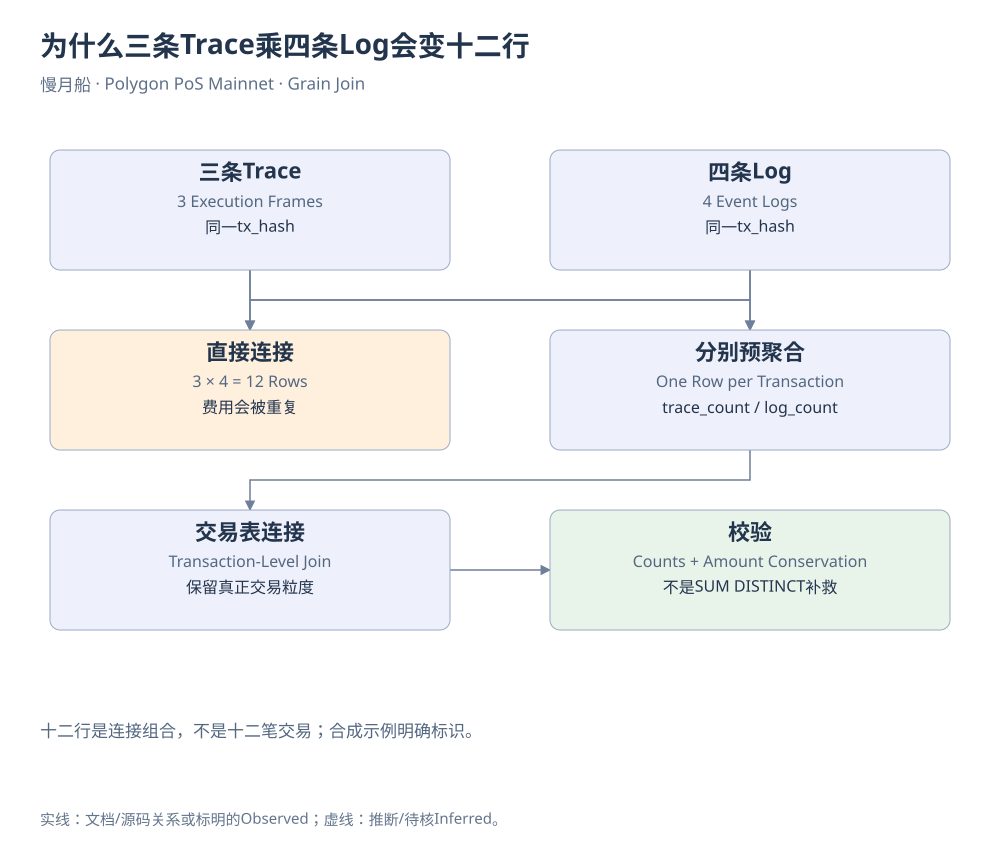

# 第22章｜为什么三条Trace乘四条Log会变十二行

一笔交易有三条Trace和四条Log。把两表直接按交易哈希连接，为什么会得到十二行？因为数据库为同一键上的每条左记录配上每条右记录，三乘四就是十二。它没有出错，出错的是研究者把连接后的行数继续叫作交易次数，或把每行重复的金额再加了一遍。

设交易费用是一POL。连接Trace与Log之后，这一费用可能在十二行里各出现一次。SUM(fee)得到十二POL，并不说明用户真的付了十二倍。简单加DISTINCT也未必正确：两笔不同交易可能恰好付同样费用，SUM(DISTINCT fee)反而会把真实金额合并掉。修复方法来自粒度，而不是事后碰运气去重。

如果问题是比较每笔交易的Trace数与Log数，先分别按tx_hash聚合，再连接Transaction。此时每个子表每笔交易只剩一行，连接关系才符合预期。若问题是解释具体某条事件，则应保留日志索引，寻找对应调用语境，而不是把所有Trace与所有Log做笛卡尔式配对。

过滤条件也会改变粒度和总体。LEFT JOIN之后，在WHERE里要求右表某字段非空，通常会把缺少右记录的交易剔除，效果接近内连接。分析零日志交易时，这种写法会让它们消失。应明确条件属于子表筛选、连接条件还是最终样本定义，并对连接前后交易数做检查。

COUNT(*)数连接行，COUNT(DISTINCT tx_hash)数不同交易标识，COUNT(DISTINCT from)数地址。这三者可以同时有意义，却不能互换名称。去重键还要带上网络；跨链Curated表里相同格式哈希没有天然的全球研究语义。多跳DEX路径尤其需要区分成交段数、交易数与用户操作数。

金额连接比次数更危险。给Transfer接价格时，如果一个时间点匹配多行价格，金额也会膨胀。应先确定价格表的时间粒度与合约键，再将价格限定为每条转账最多一个匹配。缺价行要保留覆盖标记，不能被内连接静默删掉后仍称为全部转账总额。

本篇提供一条合成示例展示三乘四，以及按交易预聚合后的修正。它使用VALUES构造教学数据，不伪装成真实链上记录。另有真实交易查询沿着作者旧样本定位，通过明确日期和哈希限制范围。演示统计错误与证明主网事实，可以使用不同材料，但必须清楚标识。

注意数据库中的空值也会影响计数。COUNT(column)通常不计算空值，而COUNT(*)会计算该行；缺少交易哈希的特殊记录可能因此在两种口径中产生差别。解释差异时先读字段与样本，不要立即用填零或删除来让两组数字相等。

一个实用习惯是在每个CTE旁写“一行是什么”。只要最终连接的两边粒度不一致，就先想清楚是否允许一对多。最后再验证金额是否守恒、交易键是否意外增加。这种习惯比记住几十条SQL技巧更持久，也会在LGNS的资金边界和LP事件分析中反复发挥作用。

[可编辑原图](../../assets/diagrams/grain-join.drawio)

来源与核对：[dune-transfers](https://docs.dune.com/data-catalog/curated/token-transfers/evm/token-transfers.md)；[dune-dex](https://docs.dune.com/data-catalog/curated/dex-trades/evm/dex-trades.md)。研究基准：2026-10-19；资料获取：2026-10-19—20。

[返回目录](../../SUMMARY.md)

[上一章](21-chapter.md) · [下一章](23-chapter.md)
