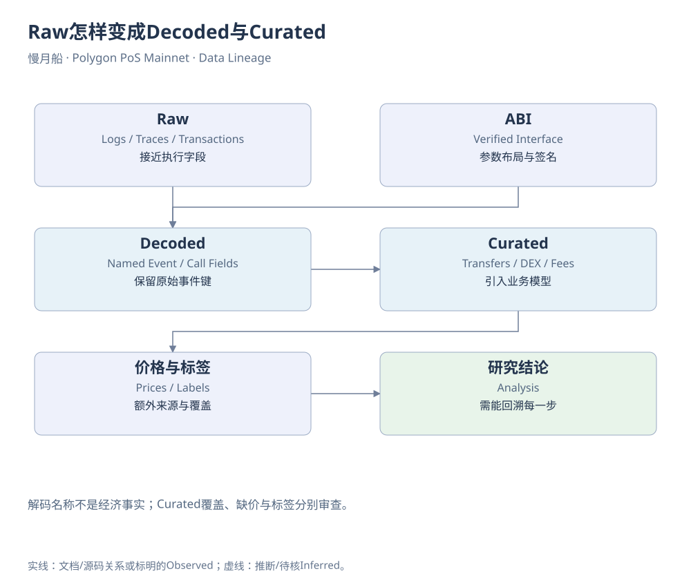

# 第23章｜Raw怎样变成Decoded与Curated

Raw事件里只有topic和字节，Decoded表却能直接给出amount、sender等名称，Curated表还能显示代币符号与美元金额。这条路径省去了大量重复工作，也加入了不同层次的解释。分析者需要知道每一层从哪里来，才能判断某个方便字段是否适合当前问题。

Decoded依靠合约ABI，把事件签名与参数布局对应到Raw Log。它能把复杂字节展开成可读列，但不能自动证明项目宣传的经济意义。一个名叫Reward的事件，可能记录新发行代币，而不是外部收入；一个名叫Deposit的事件，也可能只是合约内部记账。名称来自接口，含义仍需源码与资金变化解释。

解码结果应能回到原始身份：链、合约、交易哈希、日志索引。作者Polygon样本把Aave Supply事件与Raw Log按这些条件核对，展示了正确的血缘连接。若某个字段在Decoded中为空，应检查来源与模型，不能因为Raw能匹配就认定所有解码字段都同样完整。

Curated进一步跨协议整理业务对象。tokens.transfers统一多种可替代资产移动；dex.trades整理池子成交段；gas.fees归纳费用。它们有明确的转换规则和覆盖范围。例如转账表包含原生与ERC-20路径，字段填充方式可能不同；DEX表一行常代表一段池级成交，不能直接当作用户的一次完整交换。

价格富化又增加了来源、时间与估值选择。美元金额可能使用外部价格或链上模型，并不保证每个长尾资产都有同样可靠的价格。没有价格应当显示为缺失，而不是默认零美元；有价格也不代表用户能按该价格卖出全部持仓。LGNS的退出模型正是为了解释这层差别。

实体标签位于更外的一层。某个地址被标为交易所、Router或项目金库，可能来自公开披露、平台维护或启发式。标签可以帮助提问，却不能自动证明最终控制人。可编辑资金图应给观察到的转移画实线，给推测关联画虚线，并把标签来源附在证据记录中。

当不同表结果不一致时，应沿血缘往回查。先比时间窗口和网络，再比资产地址和单位，然后看Raw覆盖、解码ABI与Curated模型。不要直接把较大的那个数字当作更完整，也不要因为某个表更方便就宣布另一来源错误。差异本身可能暴露未覆盖的交易类型或不同经济口径。

如果研究结果需要长期保存，应把取得的Schema和模型说明一起归档。平台后来增加覆盖、修改字段或更新标签，今天重复打开同一链接可能得到不同内容。正文中的获取日期与本地快照，使历史判断仍然能够被追溯。

数据血缘最后让读者可以沿“结论→计算→表→事件→合约”退回原点。书稿中的图表和SQL都保留这条路线。下一章把它用在作者现有Polygon看板上，既复用已有成果，也检查历史图表中哪些观察需要加上新的版本或解释。

[可编辑原图](../../assets/diagrams/data-lineage.drawio)

来源与核对：[dune-transfers](https://docs.dune.com/data-catalog/curated/token-transfers/evm/token-transfers.md)；[dune-dex](https://docs.dune.com/data-catalog/curated/dex-trades/evm/dex-trades.md)；[dune-prices](https://docs.dune.com/data-catalog/curated/prices/overview.md)。研究基准：2026-10-19；资料获取：2026-10-19—20。

[返回目录](../../SUMMARY.md)

[上一章](22-chapter.md) · [下一章](24-chapter.md)
