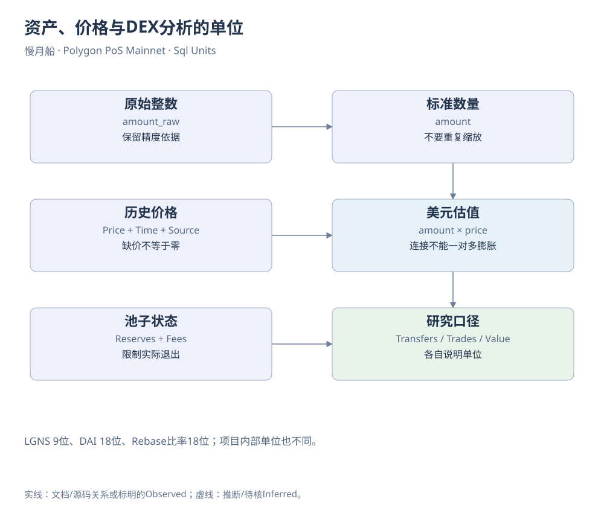

# 第31章｜资产、价格与DEX分析的单位

资产SQL最容易出现的错误，往往不是语法，而是把已经标准化的金额再缩放一次，或把没有美元价格的资产当成零价值。写查询时应先给每个金额列贴单位：原始整数、代币数量、报价资产数量或美元估值。列名清楚，计算才不容易在中间失去意义。

tokens.transfers中的amount_raw保留整数语义，amount通常已经按代币精度标准化。若从Raw Log解码value，需要自己查decimals；若直接用amount，就不要再次除以十的精度次方。不同资产精度必须分别取得，不能用一个1e18覆盖所有Polygon Token。

稳定币也要按地址筛选。一个符号可能有多种合约，一种资产也可能在迁移后换了名称。教学查询把网络与合约条件写在底层，再按日聚合。若要合并原生USDC与桥接版本，说明中必须解释这个经济口径，并保留分项结果，让读者仍能看见不同资产来源。

美元价格会引入新的连接键。价格粒度可能是分钟、小时或日，源数据可能来自不同市场。给转账匹配价格时，先确保每条转账只得到一个价格；缺价行单列，不能被内连接删除。SUM(amount_usd)描述的是已有估值覆盖的部分，不自动等于全部资产移动的经济总量。

DEX查询需要同时报告成交段数与不同交易数。一个用户路线经过多个池时，段数自然更多；若把每段美元金额相加，得到的是池级活动量。研究某个项目的买卖压力，还要固定目标池与资产方向，不能把全链成交量当成该项目新资金流入。

流动性查询进一步读取Mint、Burn或Sync。储备比值必须先按两侧精度换算；某个Sync时点的储备也不能代表整天始终可用的退出深度。需要日末状态时，应确定当天最后事件与历史覆盖，必要时用历史合约读取交叉核对，而不是对一天所有储备快照求和。

LGNS案例为单位检查提供了很好的练习。代币与sLGNS均为9位，DAI为18位；LogRebase里的比率却另用1e18缩放，index又回到9位显示余额单位。同一个项目内部就有三种不同计量方式。把它们写成同一个“amount”，SQL很容易得到看似精确却完全错误的结果。

精确资产核算与展示数值可以并存。底账保留整数和精度，图表使用适当小数；合计时在原始单位完成，再进行展示换算，能减少逐行舍入误差。若使用DOUBLE分析大范围趋势，应把近似计算与精确账本核对分开说明。

查询说明最后应回答结果能够支持什么。Token转账额可以描述资产移动，DEX量可以描述池级成交，储备可以支持某时点情景报价。它们不能直接回答用户利润、项目营业收入或全部赎回能力。保持单位与对象一致，才能把数据分析接到后面的证据判断。

[可编辑原图](../../assets/diagrams/sql-units.drawio)

延伸核对：[18条SQL说明与源码](../../examples/sql/README.md)。

来源与核对：[dune-transfers](https://docs.dune.com/data-catalog/curated/token-transfers/evm/token-transfers.md)；[dune-prices](https://docs.dune.com/data-catalog/curated/prices/overview.md)；[dune-dex](https://docs.dune.com/data-catalog/curated/dex-trades/evm/dex-trades.md)。研究基准：2026-10-19；资料获取：2026-10-19—20。

[返回目录](../../SUMMARY.md)

[上一章](30-chapter.md) · [下一章](32-chapter.md)
