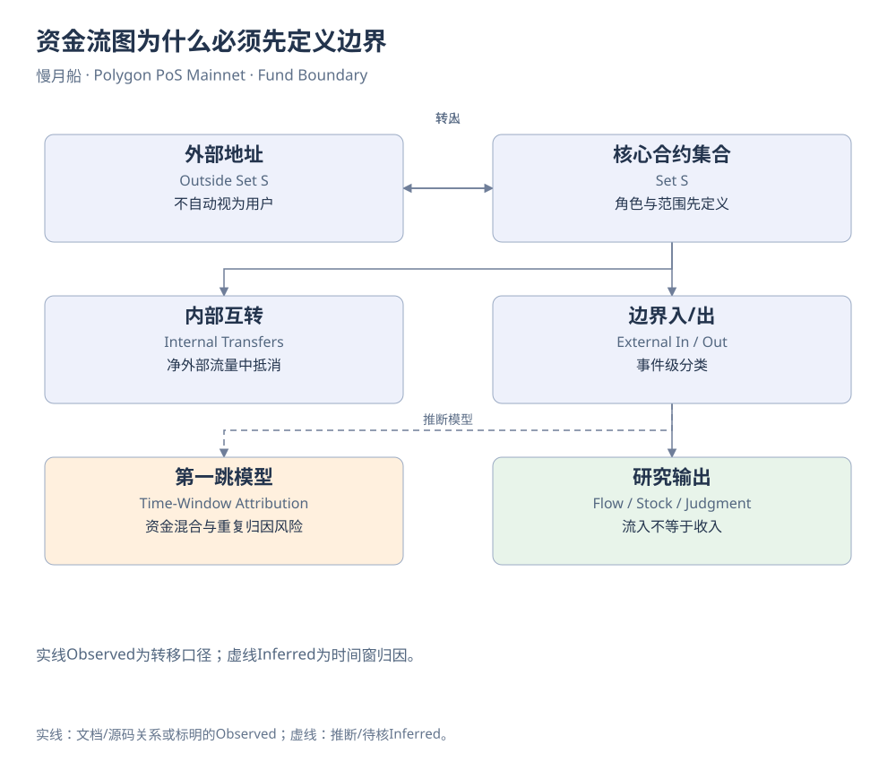

# 第35章｜资金流图为什么必须先定义边界

画资金流图之前，先在纸上圈一个边界。如果圈住Pair，用户买入是流入，卖出是流出；如果圈住Pair、Treasury和Staking，部分原来被视为外部的移动会变成内部转移。边界不是绘图装饰，而是决定净流量计算含义的模型选择。

设集合S包含已经核实的核心合约。外部地址转入S记为流入，S转向外部记为流出，S内部互转另列并在净外部流量中抵消。这个规则能减少重复，却不能把所有流入都变成营业收入。流入可能是用户存款、流动性提供、借款、循环资金或其他需要解释的资产移动。

事件粒度也影响分类。同一笔交易可以同时Swap、增减流动性和支付费用。若查询先给整笔交易贴上“加池”标签，再把该交易全部DAI Transfer归为加池，就可能吞掉其他业务移动。更可靠的方法是先按事件或明确资产路径分类，再汇总到交易或月份，并保留未分类项。

守恒检查帮助发现错误。指定资产、边界与窗口后，期末减期初应与净流量在相同会计假设下相容。若不相容，先查窗口、初始余额、特殊机制、重复连接与遗漏，不要马上推断资金被盗。某些代币会Rebase或收费，普通Transfer累加本来就可能不适用。

“第一跳去向”也不是资金血缘的完整证明。一个地址收到资产后，在二十四小时内又转出相近数量，可能涉及此前余额、其他入账和循环操作。把后续全部转账都归给前一笔资金，会发生重复归因。时间窗口模型应说明资金混合与重用问题，不能把统计关联画成唯一确定路径。

地址角色同样要谨慎。Router可以代表许多用户，托管合约可以由某个管理员控制，EOA也可能由机构自动化管理。资金返回Pair可能是重新加池、交易或其他操作，不能仅凭终点相同就证明全部资金从未被项目控制。需要具体交易上下文与LP份额变化来解释。

作者LGNS研究中，Pair边界和六合约核心边界给出不同问题的答案；撤池排名与第一跳模型又观察资金接收路径。书稿不会把它们合并为一个“项目赚了多少钱”。独立专题保留原始Query、截止时间与角色来源，让读者看到模型怎样改变数字与结论。

金额图还需要标单位和聚合窗口。箭头粗细若表示累计DAI流量，就不能与旁边表示Token数量的线直接比较；节点余额若来自期末快照，也不能画成窗口内总流入。图例说明这些差别，才能避免视觉上制造错误因果。

一张好的资金图最终应当可以退回明细：箭头对应什么资产、哪些事件、什么时间、如何汇总、是否属于观察或推测。未知路径留在图上，比凭猜测把每条线闭合更有价值。只有这样，资金地图才能成为下一章风险判断的证据，而不是一幅已经预设结论的故事图。

[可编辑原图](../../assets/diagrams/fund-boundary.drawio)

来源与核对：[dune-transfers](https://docs.dune.com/data-catalog/curated/token-transfers/evm/token-transfers.md)。研究基准：2026-10-19；资料获取：2026-10-19—20。

[返回目录](../../SUMMARY.md)

[上一章](34-chapter.md) · [下一章](36-chapter.md)
