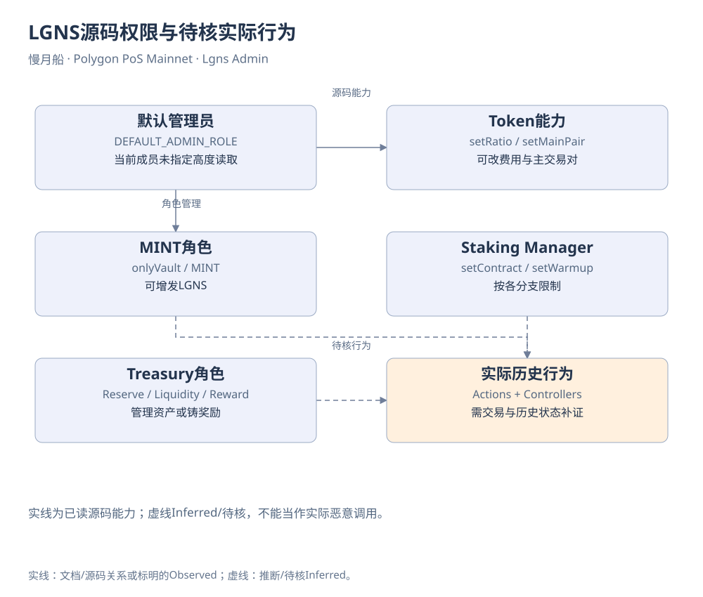

# LGNS / Origin：从合约与DAI记录重新审视风险问题

研究基准2026-10-19；旧模型主要固定截止2026-08-18 09:28:58UTC。范围为Polygon PoS上的指定合约，不把其他链、网站后续新资产或同名Token混入。

## 调查入口和取得材料

作者[原看板](https://dune.com/slowmoonship/lgns-scam-check-or-lgnsshi-zha-pian-pan-ma)ID218654，14图对应6条不同Query。本轮另外取回16条辅助Query，共22条原SQL与初始样本；随后对6条关键Query取回完整既有结果，共8082行。结果完整不代表Raw事件全量取得，完整结果核对见[补充报告](full_results_review.md)。

看板标题提出“是否诈骗”的问题；本报告独立判断每项证据，先处理身份、会计、流动性与权限，再讨论能作出的结论。报告没有购买额度、执行新SQL、修改原看板或触发钱包操作。

## 身份、部署与源码

LGNS是地址`0xeb51d9a39ad5eef215dc0bf39a8821ff804a0f01`的Longinus代币。构造源码确认9位精度；部署交易位于2024-03-06 16:34:26UTC、Bor54,339,832。sLGNS也为9位，独立地址记账。Staking、Treasury与Pair均取得已验证源码和ABI，Turbine角色仍主要来自旧Query。

五个源码页面的创建地址相同，这支持部署关联线索。它不能替代当前管理者状态，不能证明现实身份，也不说明全部后续行为由同一人控制。[身份底表](contracts.md)保存地址、部署交易与取得范围；源码没有在本机重编译匹配部署字节码。

## 用户质押与Rebase

Staking.stake会触发rebase、接收LGNS、更新Warmup信息，再转出相应sLGNS表示。claim与forfeit处理等待记录，unstake使用sLGNS与LGNS交换。没有显式Unstaked事件，原Query没有把未完成的替代扫描包装成完整退出统计。

sLGNS内部采用gons与全局换算，Rebase使显示余额变化。LogRebase的rebase字段按1e18解释，index按9位显示单位解释。2024-03-06首样本交易同时具有事件17的epoch零Rebase与事件24的一LGNS Staked。这说明一笔交易的多个事件不等于多次外部收入。

源码中存在奖励铸造与按余额差额分配路径，但没有据此证明外部经营收益。总供应、质押数量、可赎回LGNS和可换得DAI是不同对象。初始五百万sLGNS会计常量也不等于五百万外部资产进入系统。

## 权限与用户退出条件

LGNS的MINT角色允许增发，默认管理员可设置主Pair并修改买卖费用比例。源码setRatio只要求不超过PRECISION，技术上允许达到100%这一上限；尚未取得证据说明管理员实际如此设置。INTERN_SYSTEM与主Pair方向还影响收费，5%不能无条件外推为所有地址的当前实际费用。

Staking Manager可设置部分合约和Warmup参数，分支有一次性设置等限制。Treasury的withdraw要求储备支出资格，manage要求管理资格与excessReserves条件，mintRewards也有角色及余额约束。存在储备不等于普通用户拥有对DAI的自由固定兑付权。

[可编辑原图](../../assets/diagrams/lgns-admin.drawio)

当前角色成员、Manager、LP最终控制与完整管理历史没有取得指定区块状态，因此图中只把源码能力作为实线，实际动作与控制者待核。部署者不被自动填成现任Controller。

## 历史资金边界

原研究选取六合约集合，统计Polygon DAI进入和离开集合的事件，内部互转抵消。固定截止的Query8391200返回累计来源约60.8902亿DAI、去向约60.0432亿、净留存约8470.38万；LP添加约5.6347亿、移除约2.9217亿是分类结果，不再与总额相加。

这些数不是项目利润、独立用户投入或受害损失。资产可以反复周转；事件键没有重复，只能排除该键下的重复行，不能排除循环活动。另一个Query覆盖到8月20日，不能与8月18日固定截止混用。[资金模型](fund_flow_model.md)保留集合、方向、时间与分类限制。

旧撤池归因显示首位接收方为合约，后续DAI有流回Pair的路径。这个观察反对只凭一个接收地址讲述确定的“卷款”故事，但不能证明全部资金未被控制或每笔后续转账属于唯一资金血缘。第一跳时间窗会受混合余额与重复归因影响。

## 数量增长与可兑现模型

一千DAI静态持有模型在截止时给出41,424.2193LGNS，日级账面值53,713.2415DAI。旧结果储备约55.9039百万LGNS与72.7355百万DAI。先按5%Token费，再按0.3%AMM费计算，情景输出约51,012.0486DAI。本轮用Decimal复算完整3584个退出情景，最大算术误差约2.32e-8DAI。

这只是公式与旧结果一致性，不是重新取得所有输入。5%全历史不变性来自旧研究，本轮未重扫费用事件；储备与日级价格也不是同一价格键。不同仓位必须重新套曲线，不能按一千本金收益率线性放大。初始仓位按日价线性换算，未模拟大额建仓冲击；Gas、MEV、交易失败和前置成交均未包含。

历史数据因此不支持“只要Rebase，模型小额持有人必然越持有越穷”的简单结论；也不支持“所有用户都能取得相同实际收益”或“系统长期可持续”。模型检验的是假设，真实收益需要实际买入、持有、退出与成本记录。

## 披露、证据缺口与结论

项目网站搜索索引存在发行、收益与储备叙述，但本轮直接下载首页及旧PDF链接均返回HTML壳，未取得真正白皮书与完整审计报告。[项目主张对照](project_claims.md)将自述、需要的证据与实际取得分别列示，不把新阶段资产名称倒灌进旧LGNS/DAI研究。

可以明确陈述：存在集中权限；sLGNS为特殊Rebase会计；退出价值受费用、储备与仓位影响；DAI历史流量需要边界解释。仍缺当前供应、管理成员、完整费率/LP/金库历史、外部收益与义务等关键材料。

这些缺口使我们不能认定项目诈骗，也不能认定完全安全。技术能力、实际行为、经济影响和法律性质应分别取证。完整[证据矩阵](evidence_matrix.md)、[真实交易索引](transaction_index.md)与[限制](limitations.md)让后续研究可以继续补证，而不必接受一个预先写好的结论。
