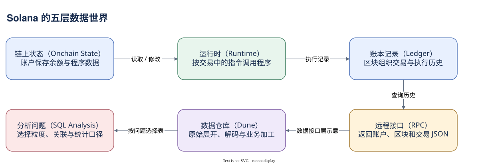

# 00.00 先拥有一张数据地图

一个懂 SQL 的人打开 Solana 交易页面，往往能认出地址、金额和时间，却不知道该把它们放进怎样的数据模型。同一笔交易为什么调用十几个程序？为什么一个钱包的代币不直接记在钱包地址下面？为什么统计指令的 SQL 得到的行数远多于交易数？本篇从这些困惑出发，建立一张可用于分析的数据地图。

Solana 是允许许多人共同提交和验证操作的公链。它维护公开状态，并按共同规则接受对状态的修改。你不能像连接自己的数据库那样，直接执行 UPDATE 改别人余额；必须提交符合签名、权限和程序规则的交易。数据库思维仍然有用：识别对象、理解一行代表什么、找到稳定关联键。但它是一种分析方法，不能替代链本身的模型。

先把五个层次分开。链上状态回答“现在存着什么”：账户（Account）是保存 SOL 余额和程序数据的基本单元。运行时（Runtime）回答“怎样修改”：交易（Transaction）带着签名和执行请求，指令（Instruction）要求程序（Program）完成某个动作。程序是执行逻辑；通常把业务状态保存在另外的数据账户中。账本还组织区块及交易历史，让这些行为有共同的先后坐标。

RPC 是远程过程调用接口，回答“外界怎样读取”。它可能返回交易请求、执行结果、前后余额和调用记录。RPC 的 JSON 结构不等于一张平面表，也不保证任意服务商都保存全部历史。Dune 则把索引到的数据展开、解码和加工成表。最后，分析师用 SQL 选择对象、连接关系并定义业务口径。这五层不能混着说：Dune 中的一条 DEX 交易记录，可能是加工后识别出的一个池段，既不是一个原生账户，也未必是一整次用户换币。

全书采用三个已从主网最终确认区块获取的案例：一笔简单 SOL 转账、一笔同一授权者的 Token 账户之间转账，以及一笔带多层调用的路由交易。真实 signature、费用和余额另有来源索引，后面的章节会逐步拆开它们。概念图只展示关系；没有真实地址的示意节点不会冒充主网证据。

你会先掌握时间、Slot 和 Block，再看交易内部的签名、账户清单与指令。随后研究程序调用和账户权限，理解 SOL 与 Token 的状态位置。进入 Dune 时，重点变成表粒度、JOIN、单位和覆盖范围，最后把这些方法放进真实案例与独立研究流程。

已有的 Solana Dune 看板贯穿其中。它已经把区块、指令、账户活动和资产移动分开；本篇会解释这种分类为什么必要。例如账户活动图只覆盖一个地址前缀队列，不能拿它推算全网用户。已有查询提供了可复用的思路；本书新增教学 SQL 会明确标示是否执行过。

读完后，你应该能从一笔陌生交易出发，指出谁签名、哪个程序执行、哪些账户变化，以及每张分析表怎样保留或加工这些事实。第一步很小：先知道这笔交易在账本上处于哪里。

[编辑原图（draw.io）](./assets/data-world.drawio)

参考来源（核验日期：2026-10-09）：

- [Solana 核心概念](https://solana.com/docs/core)
- [Dune 区块表](https://docs.dune.com/data-catalog/solana/blocks)
- [Dune 交易表](https://docs.dune.com/data-catalog/solana/transactions)

<!-- NAV -->

[总目录](../README.md) · [下一章：把一笔行为放回账本](../01-ledger/index.md)
