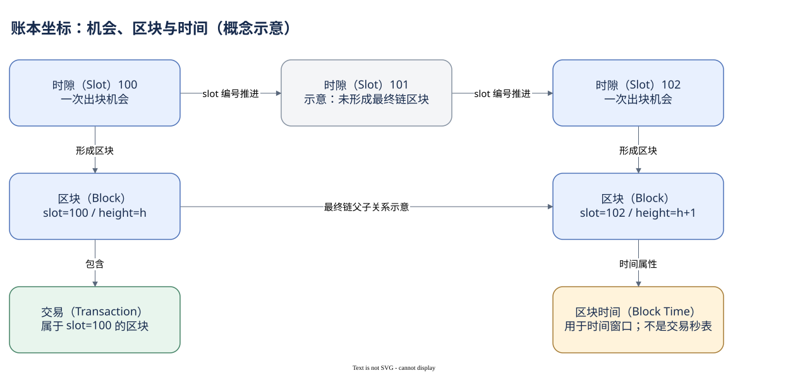

# 01.02 时间与确认程度

区块中的几百笔交易可能拥有相同的 `block_time`。这是否表示它们在同一微秒执行？不是。区块时间是给区块附加的时间坐标；它不会为每条指令提供独立的精密计时。

Solana RPC 的 `blockTime` 是 Unix 时间戳，并允许空值。Dune 的交易 `block_time` 对应交易所属区块的时间，`block_date` 用于日期和分区过滤。分析师通常以 UTC 完整日统计历史活动。若要研究北京时间的一天，应明确转换时间边界，而不是把 UTC 的日期标签直接改成北京时间。

同一个时间戳下，需要用账本位置区分记录：交易属于某个 Slot，在区块中还有位置索引；指令在交易里另有顺序。不过索引提供的是记录和执行结构的顺序，不能直接量出用户点击、网络接收或程序耗时。把这些时点都叫“交易时间”，会让延迟分析失去意义。

确认程度同样需要分开。`processed` 表示某个节点已经处理；`confirmed` 表示达到较强的网络投票确认；`finalized` 表示达到最终确认边界。这里关注的是读取结果的稳定程度。钱包为了及时反馈可能先显示早期结果，历史研究则更适合使用稳定记录。它们并非三笔不同交易，而是对同一行为的不同观察阶段。

本篇真实案例使用官方 RPC 的 `finalized` 参数获取，缓存保留了读取时间和区块时间。读取时间是研究工作何时发生；区块时间是链上记录所附的历史坐标。未来重新打开缓存不会改变这笔交易的历史时间，但也不能据此宣称重新核验了当前节点状态。

仓库还有自己的更新延迟。今天最后一分钟的记录不足，可能仅仅是尚未完成索引。比较两个日期时，应选择同样完整的窗口；比较 RPC 与 Dune 时，应先固定 signature，再检查时间、覆盖和数据加工规则，而不是要求两个接口同时返回完全相同的行数。

下面只取一个完整 UTC 日中的短窗口，减少近实时更新造成的误读。


SQL 验证状态：字段已按官方 Schema 或当前已保存 SQL 核对；本书版本仅完成静态检查，尚未执行。

```sql
SELECT id, block_slot, block_time, "index", success
FROM solana.transactions
WHERE block_date = DATE '2026-10-07'
  AND block_time >= TIMESTAMP '2026-10-07 00:00:00'
  AND block_time <  TIMESTAMP '2026-10-07 00:01:00'
ORDER BY block_slot, "index"
LIMIT 20
```

这些行可以帮助检查排序和时间分布，却不能代表全天的随机样本。确认了位置、时间与窗口后，下一章开始把区块记录聚合成网络活动指标。



[编辑原图（draw.io）](./assets/ledger-coordinates.drawio)

参考来源（核验日期：2026-10-09）：

- [Solana RPC 与确认程度](https://solana.com/docs/rpc)
- [Dune 交易表](https://docs.dune.com/data-catalog/solana/transactions)
- [RPC getBlock](https://solana.com/docs/rpc/http/getblock)

<!-- NAV -->

[总目录](../README.md) · [上一章：Slot 为什么不等于 Block](01-slot-block.md) · [下一章：用区块表观察网络](03-block-table.md)
