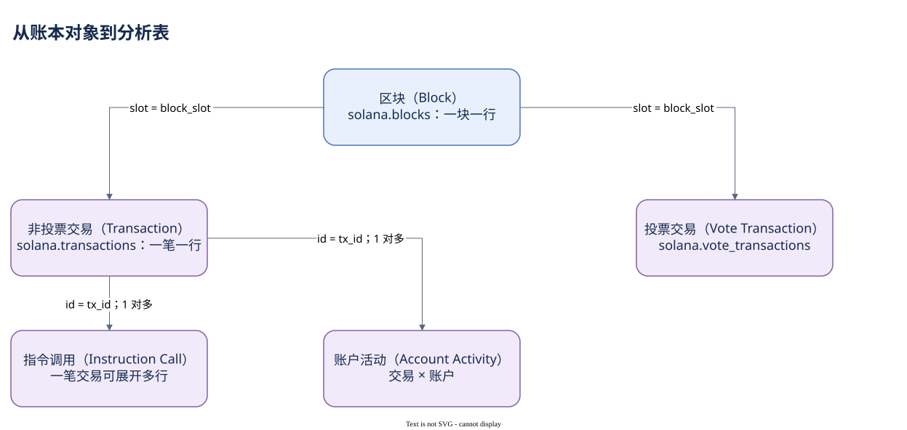

# 01.99 先固定坐标，再讨论行为

现在可以把四种坐标放在一起：Slot 标识出块机会，Block 是实际组织交易的账本对象，Height 沿链统计区块，Block Time 为历史分析提供时间边界。它们有关联，却不测量同一件事。Slot 缺号不能单独证明数据丢失；同一时间戳也不能唯一识别交易。

读取结果的确认程度和数据源的历史覆盖，决定观察能有多稳定、多完整。RPC 的 finalized 与缓存读取日期要分别记录；Dune 的更新延迟要与业务下降分开。固定一个完整 UTC 窗口，是最简单的可复现起点。

进入仓库后，`solana.blocks.slot` 与交易的 `block_slot` 建立位置关系。非投票交易和投票交易分别有对应表。网络指标可以先用块级预聚合字段，但不能把“非投票交易数”自动叫作用户数。日级聚合结束后，一行的含义已经从区块变成日期，后续 JOIN 也必须遵守这个变化。

你已经能判断一张交易活动图的分母、时间窗口和数据来源。接下来问更细的问题：一笔交易向网络提交了怎样的请求？谁通过签名授权？哪一部分是原始请求，哪一部分只有执行后才产生？这些区别会决定交易表中的字段应该怎样读。

[编辑原图（draw.io）](./assets/block-to-tables.drawio)

参考来源（核验日期：2026-10-09）：

- [Dune 区块表](https://docs.dune.com/data-catalog/solana/blocks)
- [Dune 交易表](https://docs.dune.com/data-catalog/solana/transactions)
- [Solana RPC 与确认程度](https://solana.com/docs/rpc)

<!-- NAV -->

[总目录](../README.md) · [上一章：用区块表观察网络](03-block-table.md) · [下一章：一笔交易是一份完整请求](../02-transactions/index.md)
