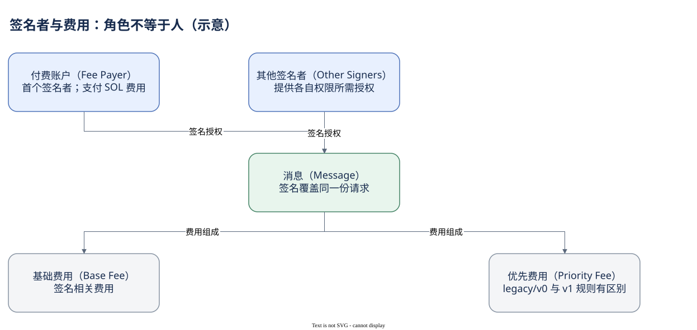

# 02.02 谁签名，谁付费

浏览器把一个地址放在交易顶部，并不意味着这个地址就是本次业务的全部参与者。首先辨认它是不是付费者，再检查指令中谁授权资产移动。

Fee Payer 是交易的付费账户。在 legacy/v0 的账户顺序中，它位于首位并签名，首个签名也用来标识交易。其他账户可以为自己的权限签名。一笔交易因此可能由一个账户付费、由另一个账户授权 Token 转出。托管服务、代付和多签场景会进一步让“付费账户”“授权账户”“自然人”成为不同概念。

Dune 的 `signer` 描述主要签名者，也就是付费者；`signers` 保存签名者数组。不要因为字段只差一个 s 就把它们当作同义词。`account_keys` 则包含全部被引用账户，其中有程序和只读数据地址，大多数不一定签名。要研究签名账户活跃，可以统计 signers；要研究触达账户，应进入账户活动层并明确筛选。

交易费用用 SOL 支付，RPC 的 `meta.fee` 和 Dune 的 `fee` 都以 lamports 表示。1 SOL 等于十亿 lamports。主网 SOL 案例的费用为 5,000 lamports，即 0.000005 SOL，这个数字来自缓存的执行结果，不是从钱包净流出额倒推出来的。

计算单位（Compute Units，CU）衡量执行资源，不是时间或金额。费用一般包含基础部分和优先部分。legacy/v0 的优先费用与请求的计算单位价格、计算单位上限有关；实际消耗的 CU 不等于计费所采用的请求上限。v1 把相关资源配置移入 Message，并使用不同的优先费用表达。因此仅用 `compute_units_consumed` 乘某个价格，不足以还原所有版本的费用。

手续费也不等于所有 SOL 净支出。账户创建需要余额支持存储，关闭账户会退回相关 lamports，某些协议还另收业务费用。想估计付费成本时，直接读 fee；想解释钱包余额差时，再加入转账、账户生命周期和协议动作。

这段 SQL 读取付费字段并转换单位，不把账户列表或指令 JOIN 进来。


SQL 验证状态：字段已按官方 Schema 或当前已保存 SQL 核对；本书版本仅完成静态检查，尚未执行。

```sql
SELECT id, signer AS fee_payer, signers, fee,
       CAST(fee AS double) / 1000000000 AS fee_sol,
       compute_units_consumed
FROM solana.transactions
WHERE block_date = DATE '2026-10-07'
  AND block_time >= TIMESTAMP '2026-10-07 00:00:00'
  AND block_time <  TIMESTAMP '2026-10-07 00:01:00'
ORDER BY block_slot, "index"
LIMIT 10
```

浮点转换适合展示；精确结算应保留原始整数。还有一个容易漏掉的问题：失败交易也可能收费，下一章解释为什么。



[编辑原图（draw.io）](./assets/roles-fees.drawio)

参考来源（核验日期：2026-10-09）：

- [Solana 交易结构](https://solana.com/docs/core/transactions/transaction-structure)
- [Dune 交易 Schema](https://docs.dune.com/data-catalog/solana/transactions)
- [Solana 费用](https://solana.com/docs/core/fees)
- [RPC JSON 结构](https://solana.com/docs/rpc/json-structures)

<!-- NAV -->

[总目录](../README.md) · [上一章：签名与 Message](01-message.md) · [下一章：失败后还留下什么](03-results.md)
