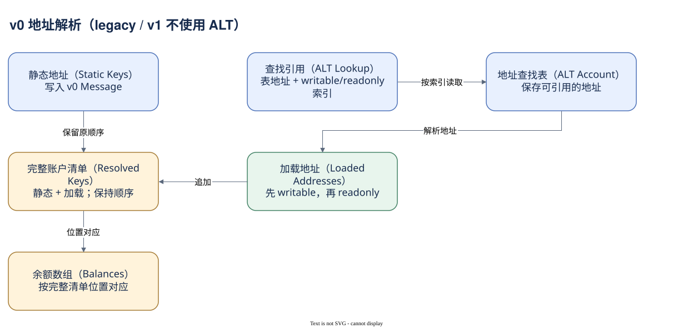

# 02.04 版本与地址查找表

RPC 返回一笔 v0 交易时，消息里直接写出的地址可能少于前后余额数组的长度。不是余额多出了一些神秘账户，而是你还没有把地址查找表加载进来。

地址查找表（Address Lookup Table，ALT）是保存地址列表的账户。v0 Message 可以携带表地址和位置索引，在执行时取出相应地址。它压缩的是消息中的地址引用，不是把账户状态搬出链，也不是让指令可以访问未声明的任意账户。签名账户仍需由消息的静态地址提供，不能只通过 ALT 临时补进来签名。

读普通 JSON 编码的 v0 交易时，要分清静态账户清单、`addressTableLookups` 和执行元数据里的 `loadedAddresses`。解析后的有效清单按静态地址、加载的 writable 地址、加载的 readonly 地址组成；余额和编译指令的位置引用要在同一套完整顺序中解释。使用 jsonParsed 时，RPC 可以直接给已解析清单，并用 source 标明地址来自交易还是 lookupTable；不要再次追加，造成重复。

本篇路由案例是 v0，解析后的清单同时出现 `source=transaction` 和 `source=lookupTable`。它是理解 ALT 的真实例子。SOL 和 Token 转账案例则为 legacy，不需要 ALT。版本只是消息格式，不应拿它给业务分类：v0 既可能换币，也可能只是转账。

截至此次核验，官方文档还列出 v1：它扩大消息承载能力，把资源限制移入消息配置，并不使用 ALT。实际读取主网区块时，`maxSupportedTransactionVersion=0` 返回版本不支持错误，改为 1 后才读到整个区块。这是当前接口实测，不能把“versioned transaction 都用 ALT”当成永久规则。

Dune 文档的 `version` 说明仍列 legacy 和 0，并提供 `address_table_lookups`、`loaded_addresses`。本轮没有执行查询确认 v1 的仓库覆盖与字段表达，所以书稿不把 RPC 的支持情况转成 Dune 支持结论。研究新版本时，应重新检查目录与实测样本。

下面观察窗口内的版本标签，暂不把标签映射成未经验证的新枚举。


SQL 验证状态：字段已按官方 Schema 或当前已保存 SQL 核对；本书版本仅完成静态检查，尚未执行。

```sql
SELECT version, COUNT(*) AS transaction_rows
FROM solana.transactions
WHERE block_date = DATE '2026-10-07'
  AND block_time >= TIMESTAMP '2026-10-07 00:00:00'
  AND block_time <  TIMESTAMP '2026-10-07 00:01:00'
GROUP BY version
ORDER BY transaction_rows DESC
```

知道版本、完整地址与执行状态以后，交易结构才算读稳。下一模块开始追踪具体指令怎样调用程序。



[编辑原图（draw.io）](./assets/v0-addresses.drawio)

参考来源（核验日期：2026-10-09）：

- [交易版本与 ALT](https://solana.com/docs/core/transactions/versioned-transactions)
- [RPC JSON 结构](https://solana.com/docs/rpc/json-structures)
- [Dune 交易 Schema](https://docs.dune.com/data-catalog/solana/transactions)

<!-- NAV -->

[总目录](../README.md) · [上一章：失败后还留下什么](03-results.md) · [下一章：从请求到结果](summary.md)
