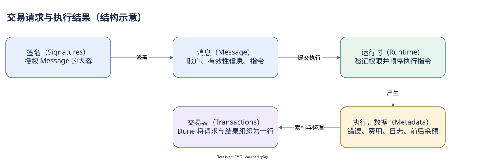

# 02.00 一笔交易是一份完整请求

区块让我们找到一笔交易，但交易本身仍像一个密封信封：上面有编号、付费者和费用，里面装了几条执行要求。打开信封时，最重要的区别是“提交的请求”与“执行后得到的结果”。

Solana 的交易由签名和消息构成。签名（Signature）表示相关账户授权了消息内容。消息（Message）包含要使用的账户、交易有效性信息以及指令。指令告诉某个程序做一件事；一笔交易可以按顺序提交多条指令。因此交易不是一条孤立的转账记录，它可能同时包含账户创建、代币移动和业务调用。

消息中的账户清单解决的是“执行需要哪些地址”。其中有些账户需要签名，有些可写，有些只读，还有被调用的程序。签名者（Signer）是提供密码学授权的账户；付费者（Fee Payer）承担交易费用。被引用的全部地址并非签名者集合，签名者集合也不能直接当作真人列表。

请求提交后，运行时检查签名、有效性与权限，并执行指令。执行结果会新增错误状态、费用、日志、计算消耗以及前后余额。RPC 把这些结果放在 `meta` 等结构里。签名授权的是原始 Message，不是未来的日志或余额；把二者混淆，会让你误以为客户端在发交易时已经写好了所有结果。

交易中的普通业务指令具有原子性：整笔成功才提交它们的业务状态变化。某条指令失败时，不能把前面看见的调用日志当成已完成的业务动作。不过失败交易仍可能支付费用，所以“业务没成功”不意味着“链上没有记录或没有 SOL 变化”。后面会在专门一章处理这个差别。

在 Dune 的 `solana.transactions` 中，一行保存一笔非投票交易的请求信息和执行观察。`id` 与首个 `signature` 作为交易标识，`signers` 和 `account_keys` 是不同数组，`instructions` 含有嵌套结构，`success`、`fee` 和前后余额描述执行结果。看懂这些字段前，先用一笔交易的身份守住范围，不要急着把全部数组同时展开。

版本会进一步影响读取。legacy、v0 和当前官方文档中的 v1 不使用完全相同的消息布局。v0 可以借助地址查找表引用账户，而 v1 的规则不同。我们已经实测到主网区块含 v1，但此次 Dune 文档仍主要描述 legacy/v0；这意味着 RPC 能读取某个版本，不自动证明仓库已完整支持它。

本模块依次打开 Message、识别签名和费用、解释失败结果、处理版本与地址解析。完成后，你会读懂交易表的一行，并知道哪些问题必须进入指令或账户层才能回答。

本模块阅读顺序：

- [签名与 Message](./01-message.md)
- [谁签名，谁付费](./02-signers-fees.md)
- [失败后还留下什么](./03-results.md)
- [版本与地址查找表](./04-versions-alt.md)
- [从请求到结果](./summary.md)

[编辑原图（draw.io）](./assets/request-result.drawio)

参考来源（核验日期：2026-10-09）：

- [Solana 交易结构](https://solana.com/docs/core/transactions/transaction-structure)
- [Dune 交易 Schema](https://docs.dune.com/data-catalog/solana/transactions)
- [交易版本与 ALT](https://solana.com/docs/core/transactions/versioned-transactions)

<!-- NAV -->

[总目录](../README.md) · [上一章：先固定坐标，再讨论行为](../01-ledger/summary.md) · [下一章：签名与 Message](01-message.md)
