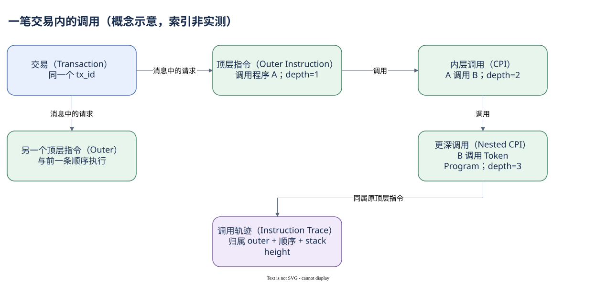

# 03.02 CPI 是调用，不是新交易

钱包只签了一笔交易，浏览器为什么显示程序 A、B 和 Token Program 的调用？因为程序可以在执行中调用另一个程序，就像一次业务流程中转入几个处理环节。

CPI 是程序发起的内部指令调用。钱包提交的 Message 列出顶层指令；运行时执行其中一条时，该程序可能构造新指令交给另一个程序处理。后者还可以继续调用。所有这些执行仍在原交易的授权、结果与资源边界里，不会凭空出现一个新的用户签名交易。

调用者向被调用者传递账户和已有权限。被调用者不能因为处于更深一层，就把只读账户升级成可写，或获得原本没有的普通签名权限。程序可以使用 `invoke_signed` 为由其自身 Program ID 派生的 PDA 提供运行时授权；这项特殊机制将在账户模块解释，它不是拿到某个人的私钥。

内层调用共用交易的计算预算，消耗会降低可用预算。调用失败对上层的影响要按程序处理与最终交易结果判断：程序可能处理某些内部错误，但若错误最终使交易失败，普通业务状态不会部分提交。不要只按日志中一个内部失败就直接给整笔交易定失败，也不要忽略最终 `tx_success`。

Dune 用 `is_inner` 区分顶层和内层，`outer_instruction_index` 给内层行保留所属顶层指令。`inner_instruction_index` 表示展开后的内部位置，顶层行该字段通常为空。一笔路由交易可能因此产生很多行。统计 CPI 率时，要说明分子是内层调用数还是“包含 CPI 的交易数”，这两种比例回答不同问题。

下面让每个交易身份只出现一次，统计窗口中的调用构成。这个聚合只计调用，不推断业务类型。


SQL 验证状态：字段已按官方 Schema 或当前已保存 SQL 核对；本书版本仅完成静态检查，尚未执行。

```sql
SELECT tx_id,
       COUNT_IF(NOT is_inner) AS outer_calls,
       COUNT_IF(is_inner) AS inner_calls
FROM solana.instruction_calls
WHERE block_time >= TIMESTAMP '2026-10-07 00:00:00'
  AND block_time <  TIMESTAMP '2026-10-07 00:01:00'
GROUP BY tx_id
ORDER BY inner_calls DESC
LIMIT 10
```

查询没有筛成功状态，因为这里研究调用轨迹；若解释实际业务完成量，应加入结果条件。掌握顶层归属后，还需要分清内部顺序与真正的父子调用关系。



[编辑原图（draw.io）](./assets/cpi-tree.drawio)

参考来源（核验日期：2026-10-09）：

- [Solana CPI](https://solana.com/docs/core/cpi)
- [Dune 指令调用表](https://docs.dune.com/data-catalog/solana/instruction-calls)
- [RPC JSON](https://solana.com/docs/rpc/json-structures)

<!-- NAV -->

[总目录](../README.md) · [上一章：Program 与 Instruction](01-program-instruction.md) · [下一章：调用顺序、深度与日志](03-trace-logs.md)
