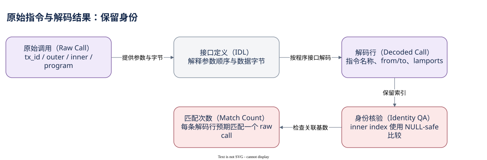

# 03.04 从字节到可读动作

原始指令已经知道调用哪个程序，却仍看不懂 `data`。解码的价值是把程序接口中的操作和参数恢复成可查询字段；它不会改变原指令身份，也不能替代最终执行状态。

IDL 是接口定义，说明程序有哪些指令、参数怎样编码以及账户位置怎样命名。Dune 按此建立解码表。例如 System Program transfer 的行可以给出 `account_from`、`account_to` 和 `lamports`。原始调用中的一串参数地址因而获得具体角色，金额也从字节变成数值。这个解释只在匹配的程序与接口版本下有效。

解码表是加工层，不是 Solana Runtime 另外写入的一套关系型记录。命名字段让分析更简单，但分析师仍需追问：它对应哪个程序版本？一行代表哪种指令？失败调用是否保留？字段来自解码、元数据还是额外模型？没有这些边界，友好的名字反而容易造成过度确信。

原始调用与解码行通常通过 tx_id、outer 索引、inner 索引和执行程序连接。顶层调用的 inner 索引为 NULL，普通等号不会让两个 NULL 相等。DuneSQL 使用 `IS NOT DISTINCT FROM` 进行 NULL-safe 比较，使顶层行也能匹配。若只按 tx_id 关联，一笔多次 transfer 的交易会把解码金额重复连接到多条调用上。

已有 Query 8435196 保留了这组键，并输出 raw_match_count。原材料包报告此前样本核验通过，但此次只读取当前 SQL，没有重跑。该查询还揭示了目录与引擎的历史字段差异：执行定义使用 `call_` 前缀，不能随手去掉前缀。具体类型的当日引擎验证仍未完成。

下面简化原查询，只读解码表中的业务字段。它适合观察 System Program transfer，但不是钱包全部 SOL 流量：账户创建、关闭及程序直接修改 lamports 等还需单独解释。


SQL 验证状态：字段已按官方 Schema 或当前已保存 SQL 核对；本书版本仅完成静态检查，尚未执行。

```sql
SELECT call_tx_id AS tx_id,
       call_outer_instruction_index AS outer_index,
       call_inner_instruction_index AS inner_index,
       account_from, account_to, lamports
FROM system_program_solana.system_program_call_transfer
WHERE call_block_time >= TIMESTAMP '2026-10-07 00:00:00'
  AND call_block_time <  TIMESTAMP '2026-10-07 00:01:00'
ORDER BY call_block_time, call_tx_index
LIMIT 10
```

这些字段已在现有 SQL 中读到，仍不声称这份教学改写已执行。现在动作和调用结构都清楚了，接下来要看它们最终作用于什么状态。



[编辑原图（draw.io）](./assets/raw-decoded.drawio)

参考来源（核验日期：2026-10-09）：

- [Dune 指令调用表](https://docs.dune.com/data-catalog/solana/instruction-calls)
- [Dune IDL 解码表](https://docs.dune.com/data-catalog/solana/idl-tables)
- [原查询 8435196](https://dune.com/queries/8435196)

<!-- NAV -->

[总目录](../README.md) · [上一章：调用顺序、深度与日志](03-trace-logs.md) · [下一章：画出一次调用的骨架](summary.md)
