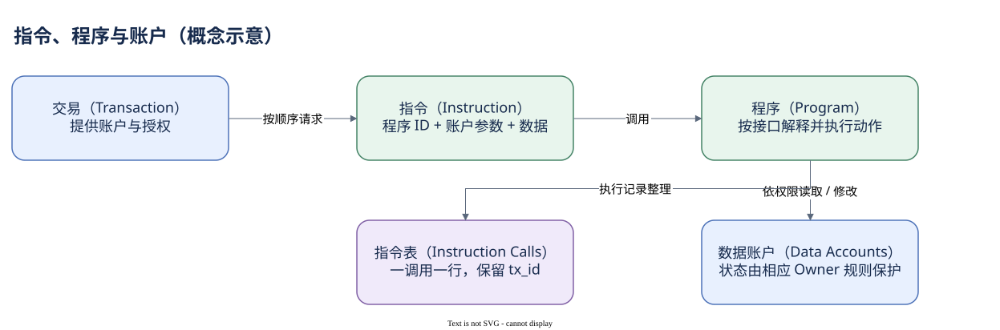

# 03.00 从做了什么到谁在执行

一笔交易的费用和结果已经清楚，但“它做了什么”仍然没有答案。账户清单可能有几十个地址，顶层指令却只有几条；执行过程中又出现大量内部调用。分析师需要把动作、执行者和状态对象重新接起来。

指令（Instruction）是一项交给程序执行的要求。它指出程序，列出需要使用的账户，并携带程序所需的数据。程序（Program）实现处理逻辑；账户（Account）保存执行需要读取或修改的状态。例如 System Program 的转账指令移动 SOL，Token Program 的转账指令修改代币账户余额。两个动作都叫 transfer，但读取的状态与权限规则不同。

执行者也可能继续调用别的程序。跨程序调用（Cross-Program Invocation，CPI）发生在一条指令的执行之中，依然属于原交易。路由程序可以调用池程序，池程序再调用 Token Program 移动资产。外层是业务组织，内层是具体执行，不能把每次内部调用当成另一个用户发起的交易。

Dune 为这类分析提供 `solana.instruction_calls`。它把交易中的嵌套调用展开为行，保留 `tx_id`、顶层归属索引、内层索引、执行程序和调用深度。交易表一行对应多条调用行，因此研究交易数量要去重 tx_id；研究调用量则可以数行，但还应区分 outer 与 inner。

日志（Log）与计算单位（Compute Units，CU）提供额外执行观察。日志帮助读调用路径与错误，CU 描述执行资源消耗。日志不是通用事件数据库，不能只搜索某个单词就宣称有成交；CU 也不能直接当作金额或耗时。最终业务判断仍需结合指令接口、交易结果与状态变化。

如果直接读二进制数据太困难，可以进入解码表。接口定义（Interface Definition Language，IDL）把程序的参数顺序和数据布局转成字段名称。Dune 的 System Program transfer 解码示例已经保存在 Query 8435196。它展示了怎样通过身份键连接 raw 与 decoded，而不仅仅是给字节换个易读名字。

这一模块不要求你学习 Rust 或写合约。目标是理解执行结构，并知道什么时候原始表足够、什么时候需要解码。现有看板的指令数、outer/inner 比例和程序调用量三个查询，正好从不同角度观察这张调用网络。它们都不能直接叫作用户数。

我们会先辨认动作与程序，再恢复 CPI 归属、调用深度和日志，最后核对 raw 到 decoded 的一一关系。这样后面解释账户和资产变化时，每个结论都有可追踪的执行来源。

本模块阅读顺序：

- [Program 与 Instruction](./01-program-instruction.md)
- [CPI 是调用，不是新交易](./02-cpi.md)
- [调用顺序、深度与日志](./03-trace-logs.md)
- [从字节到可读动作](./04-decoding.md)
- [画出一次调用的骨架](./summary.md)

[编辑原图（draw.io）](./assets/action-program.drawio)

参考来源（核验日期：2026-10-09）：

- [Solana Programs](https://solana.com/docs/core/programs)
- [Solana Instructions](https://solana.com/docs/core/instructions)
- [Solana CPI](https://solana.com/docs/core/cpi)
- [Dune 指令调用表](https://docs.dune.com/data-catalog/solana/instruction-calls)

<!-- NAV -->

[总目录](../README.md) · [上一章：从请求到结果](../02-transactions/summary.md) · [下一章：Program 与 Instruction](01-program-instruction.md)
