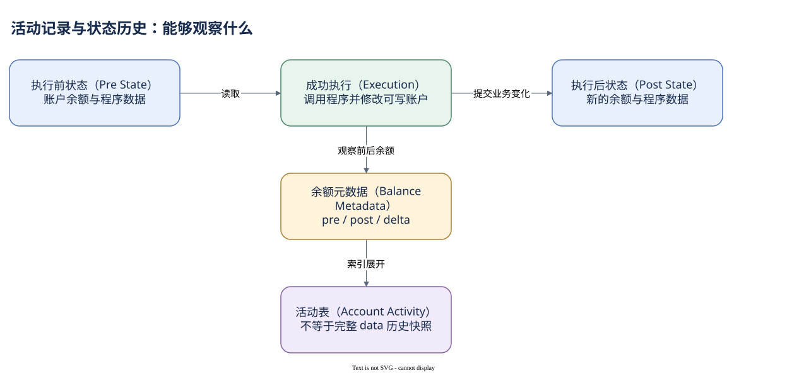

# 04.03 状态变化与账户生命周期

一行账户活动记录能否告诉你一个账户的完整历史？它能告诉你这次交易中的一些使用与余额观察，但不能自动恢复任意程序数据在所有时点的内容。

`solana.account_activity` 的粒度是交易与账户的组合。`tx_id` 指交易，`address` 指被观察账户，`signed` 和 `writable` 描述使用权限，pre/post 和 balance_change 描述 SOL 前后余额。代币字段提供另一套金额与授权信息。历史样本报告 `(tx_id,address)` 唯一，但没有声明数据库主键；正式分析前仍要检查自己的窗口。

权限与变化要分开。writable 为真，不保证余额改变，因为程序可能只改 data，或者最终失败回滚。余额差为零，也不保证没有重要行为：账户可能被读取，代币权限可能改变，或同笔交易中的转入和转出互相抵消。活动表的余额字段无法代替任意 data 的逐字节历史。

账户还有生命周期。创建需要分配空间并满足余额要求，初始化让程序 data 获得业务含义，后续指令修改状态，符合程序规则时可以关闭并退回 lamports。关闭账户退回的 SOL 不是普通买卖收入；新建 Token Account 的存储余额也不应直接当成代币购买金额。

当前 RPC 状态与历史观察并非同一个时点。今天 `getAccountInfo` 返回空，可能因为账户已关闭；它不能证明上个月交易没有使用该账户。地址可能在符合规则时再次被创建，所以跨期研究还需观察生命周期，不能假定地址对应永不改变的状态版本。

已有看板为降低大表扫描，使用 `address_prefix='25'` 队列。它是可复现的账户子集，不是随机代表全网的用户样本。该字段在已有 SQL 中可见，但此次官方 Schema 未列出，因此本章教学查询采用文档确认的字段，另保留队列查询的来源与限制。


SQL 验证状态：字段已按官方 Schema 或当前已保存 SQL 核对；本书版本仅完成静态检查，尚未执行。

```sql
SELECT tx_id, address, signed, writable,
       pre_balance, post_balance, balance_change,
       token_mint_address, token_balance_change
FROM solana.account_activity
WHERE block_time >= TIMESTAMP '2026-10-09 11:26:00'
  AND block_time <  TIMESTAMP '2026-10-09 11:27:00'
  AND tx_id = '2my5AGATup7YFYAbCMWaF79T16EFAw4HnMgpYtesn1EsVD2FPQkEvbFcZuwZYJfoqWnMsfcWENrWzoWBNF4gEmxJ'
ORDER BY address
```

这段查询意在把真实 SOL 案例映射到账户活动；尚未在 Dune 执行，所以不提前给它填入 RPC 的结果行。下一模块会在这种区分下读取具体资产。



[编辑原图（draw.io）](./assets/state-history.drawio)

参考来源（核验日期：2026-10-09）：

- [Dune 账户活动表](https://docs.dune.com/data-catalog/solana/account-activity)
- [Solana Accounts](https://solana.com/docs/core/accounts)
- [Account Structure](https://solana.com/docs/core/accounts/account-structure)
- [Token 账户结构](https://solana.com/docs/tokens)

<!-- NAV -->

[总目录](../README.md) · [上一章：Authority 与 PDA](02-authority-pda.md) · [下一章：把权限与数据分开](summary.md)
