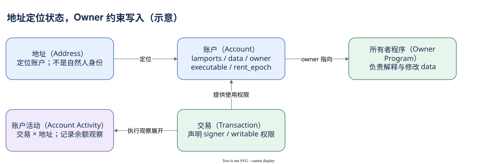

# 04.00 地址后面存着什么

同一个 Solana 地址，有时出现在钱包页面，有时是程序，有时是池状态或代币账户。地址的字符串格式相同，背后对象的作用却不同。分析之前，先问“这个地址定位了什么账户”。

Solana 状态可以按地址定位。账户（Account）是基本状态单元，保存 lamports、data、owner、executable 和保留的 rent_epoch 字段。地址是键，账户内容是状态值；它与数据库键值记录有可比较之处，却没有天然提供业务表、外键约束和历史版本。程序的数据布局决定了 data 中有哪些业务字段。

钱包通常负责管理密钥并提交请求，钱包地址可以对应一个用于持有 SOL 的账户。但账户不限于钱包：程序、代币 Mint、代币账户、池状态和系统变量都通过账户体系承载。把 account_activity 的地址数叫作用户数，会把这些不同对象揉成一个指标。

Owner 是最关键的字段之一。基础账户的 owner 指向负责数据的程序，运行时据此约束数据修改和 lamports 扣减。它不是“谁经济上拥有这个资产”。程序还可以在 data 中定义业务授权者（Authority），例如谁可以转出代币、改变管理权限或关闭账户。两个层级经常都使用 owner 这个英文词，必须结合字段位置理解。

另一个常见对象是程序派生地址（Program Derived Address，PDA）。它按程序 ID 与种子确定，没有普通私钥。派生地址不会自动创建账户；要在该地址保存状态，仍需创建并初始化对应账户。派生程序的授权能力与账户 data 的 Owner 也不是同一关系，不能把它们画成同一个箭头。

交易给账户提供 signer 和 writable 等使用权限，程序在自己的规则下决定是否接受操作。可写意味着允许参与写入，并不证明这次真的改变了余额；未签名也不意味着没有授权，PDA 或协议定义的权限机制可能参与其中。读交易字段时，需要回到程序的实际业务规则。

Dune 的账户活动表将一笔交易中每个账户的使用和余额观察展开成行。它能支持谁签名、哪些余额变化等问题，但不是任意 data 的完整历史快照。想研究池储备、权限变更或账户关闭，可能还需要解码指令、专门状态索引与官方账户布局。

本模块会把地址、基础 Owner、业务 Authority、PDA 和账户生命周期分开。完成这一步，代币模块中的钱包、Mint、Token Account 与 ATA 就不再只是几种相似的地址字符串。

本模块阅读顺序：

- [Account 与程序 Owner](./01-account-owner.md)
- [Authority 与 PDA](./02-authority-pda.md)
- [状态变化与账户生命周期](./03-activity-lifecycle.md)
- [把权限与数据分开](./summary.md)

[编辑原图（draw.io）](./assets/account-fields.drawio)

参考来源（核验日期：2026-10-09）：

- [Solana Accounts](https://solana.com/docs/core/accounts)
- [Account Structure](https://solana.com/docs/core/accounts/account-structure)
- [Solana PDA](https://solana.com/docs/core/pda)
- [Dune 账户活动表](https://docs.dune.com/data-catalog/solana/account-activity)
- [Token 账户结构](https://solana.com/docs/tokens)

<!-- NAV -->

[总目录](../README.md) · [上一章：画出一次调用的骨架](../03-instructions/summary.md) · [下一章：Account 与程序 Owner](01-account-owner.md)
