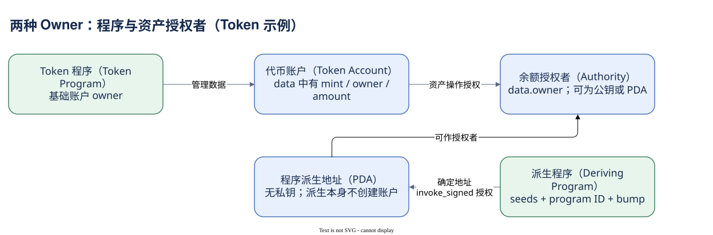

# 04.99 把权限与数据分开

地址定位账户，账户保存状态；钱包只是账户世界的一部分。基础 Owner 指向解释和管理 data 的程序，业务 Authority 则由程序数据与规则定义。Token Account 中两个 owner 恰好揭示这种层级差异：Token Program 负责数据，授权者决定业务操作。

PDA 是确定派生、没有普通私钥的地址。派生本身不创建账户，派生程序也不自动成为账户 data 的 Owner。`invoke_signed` 提供受运行时检查的内部授权，不代表链上出现了一个新的外部签名。不能只凭 signer 列表否认 PDA 授权，也不能只凭地址形态认定 PDA。

账户活动提供交易中的权限与余额观察。可写不等于发生写入，零余额差不等于没有业务，历史活动不等于任意 data 的完整快照。创建和关闭账户还会带来与普通转账不同的 SOL 变化，解释资金流时需要单独处理。

现在你有能力区分四种关系：地址到状态、Owner 到程序、Authority 到业务操作、交易到账户活动。下一模块会把它们落到 SOL 与 Token 上：Mint 定义资产，Token Account 保存余额，ATA 提供确定的默认位置，单位与加工口径决定金额怎样解释。

[编辑原图（draw.io）](./assets/owner-authority.drawio)

参考来源（核验日期：2026-10-09）：

- [Solana Accounts](https://solana.com/docs/core/accounts)
- [Account Structure](https://solana.com/docs/core/accounts/account-structure)
- [Solana PDA](https://solana.com/docs/core/pda)
- [Dune 账户活动表](https://docs.dune.com/data-catalog/solana/account-activity)
- [Token 账户结构](https://solana.com/docs/tokens)

<!-- NAV -->

[总目录](../README.md) · [上一章：状态变化与账户生命周期](03-activity-lifecycle.md) · [下一章：金额究竟存在哪里](../05-tokens/index.md)
