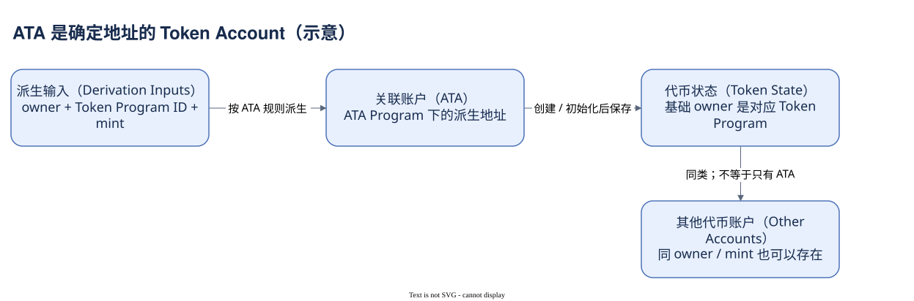

# 05.02 Mint、Token Account 与 ATA

一个钱包持有 USDC，应该查哪个地址的余额？Mint 地址标识 USDC，钱包地址表示授权角色，但具体数量通常放在这个钱包控制的一个或多个 Token Account 中。

Mint Account 保存资产的全局属性：供给、decimals、发行权限和冻结权限等。Token Account 指向一个 Mint，并保存 amount、业务 owner 以及授权相关状态。普通 Token Account 不会同时保存很多种 Mint 的通用余额。钱包显示多种资产，是把多份账户状态按 Mint 汇总后的视图。

基础 Owner 与业务 Owner 在这里再次分开。Mint 与 Token Account 的基础 owner 指向 Token Program 或 Token-2022 Program。Token Account 的 data.owner 指向授权者，可能是普通公钥、多签安排所用地址或协议的 PDA。发行权限属于 Mint；不能把 Token Account owner 当成整个资产的增发权限。

ATA 简化默认账户的查找。它在 Associated Token Account Program 的派生规则下，结合 owner、Token Program ID 与 Mint 得到确定地址。包含 Token Program ID 是必要边界，不能只记“钱包加 Mint”而忽略原始 Token 与 Token-2022 的区别。派生地址可在账户创建前计算，计算出来并不证明已有余额。

一个 owner 与 Mint 可以有其他普通 Token Account，因此查询钱包余额不能只认 ATA；也不能把 Token Account 地址直接当成另一个用户。真实 Token 案例正是同一 owner 的两个账户之间移动 USDC，两个账户数量变了，owner 合计数量却没有外流。

Dune 的 `solana_utils.token_accounts` 提供 address、token_mint_address、token_balance_owner 和 account_type 等关系字段；`tokens_solana.fungible` 按 Mint 整理 symbol 和 decimals。关联前先核验 address 或 Mint 候选唯一性，文档中的角色描述不是数据库唯一约束。

这段查询以真实案例的 owner 为条件找相关账户，不假定只有一个 ATA。


SQL 验证状态：字段已按官方 Schema 或当前已保存 SQL 核对；本书版本仅完成静态检查，尚未执行。

```sql
SELECT address AS token_account,
       token_mint_address, token_balance_owner, account_type
FROM solana_utils.token_accounts
WHERE token_balance_owner = 'CCSccmE7WBfSF47anEEtevxJp14Fs6DEKT9SZMKmD62T'
  AND token_mint_address = 'EPjFWdd5AufqSSqeM2qN1xzybapC8G4wEGGkZwyTDt1v'
LIMIT 20
```

它读的是仓库关系表，不是该交易时点的完整账户快照。下一章会解释这些数量怎样从原始整数变成展示值，以及为什么扩展规则需要继续核对。



[编辑原图（draw.io）](./assets/ata-model.drawio)

参考来源（核验日期：2026-10-09）：

- [Solana Token 模型](https://solana.com/docs/tokens)
- [关联代币账户](https://solana.com/docs/tokens/basics/create-token-account)
- [Dune Token Accounts](https://docs.dune.com/data-catalog/curated/token-metadata/solana/token-accounts)
- [Dune Mint 元数据](https://docs.dune.com/data-catalog/curated/token-metadata/solana/token-metadata)

<!-- NAV -->

[总目录](../README.md) · [上一章：SOL 转账与余额变化](01-sol.md) · [下一章：单位与 Token-2022](03-units-token2022.md)
