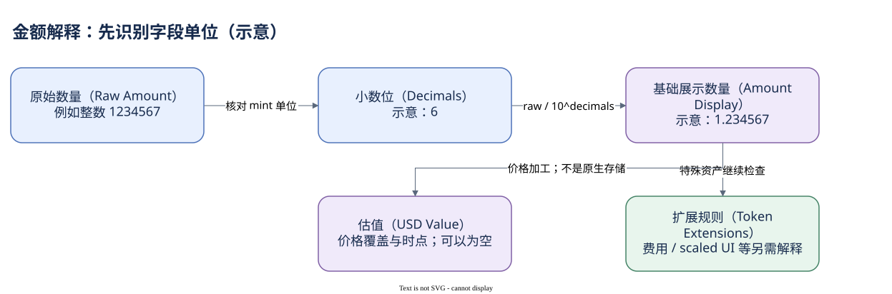

# 05.03 单位与 Token-2022

为什么同一笔转账同时出现 878126444 和 878.126444？它们可以是同一个数量的两种单位。真实 Token 案例的 Mint 使用 6 位小数，前者是原始整数，后者是基础展示数量。

普通 Token 的原始数量保存为整数，decimals 给出十进制小数位。转换关系为 raw amount 除以 10 的 decimals 次方。数据库里把原始金额与已经调整的金额再次混算，是常见的百万倍或十亿倍误差。先确认字段定义，再做转换，不要看到 amount 这个名字就固定除以某个数字。

Dune transfers 的 `amount` 是原始 UINT256，`amount_display` 是展示用 DOUBLE，`amount_usd` 是美元估值。account_activity 的 Token 余额与变化则在文档中明确已做 decimal 调整。这些字段不是同一种单位；为了显示方便而转成浮点，也不应丢弃用于精确对账的原始整数。

Mint 的 decimals 来自资产身份。symbol 可能缺失或重复，不适合用于选择小数位。JOIN 元数据时，要保留 Mint 地址并检查元数据唯一性；一条移动记录匹配两个 metadata 行，会直接把金额加倍。缺少 decimals 的记录也不能偷偷填成 9，应该保留未解释状态。

Token-2022 在基础模型上增加可选扩展。转账费用可能使名义转出数量与接收方可用数量不同；Transfer Hook 可能引入额外程序调用；scaled UI amount 或其他展示相关规则也要求进一步解释 UI 数值。只有某个 Mint 开启相应扩展时规则才适用，不能按程序版本一刀切推断。

所以对账至少分三步：识别 Mint 和 Token Program，读取原始数量与基础单位，再核对实际启用的扩展和前后状态。Dune 通用金额字段便于跨资产统计，但是否包含某种扩展的全部业务含义，需要检查具体模型与样本。美元估值还依赖价格来源与覆盖，不是 Mint 原生存储的字段。


SQL 验证状态：字段已按官方 Schema 或当前已保存 SQL 核对；本书版本仅完成静态检查，尚未执行。

```sql
SELECT tx_id, token_mint_address, token_version, action,
       amount, amount_display, amount_usd
FROM tokens_solana.transfers
WHERE block_date = DATE '2026-10-09'
  AND block_time >= TIMESTAMP '2026-10-09 11:26:00'
  AND block_time <  TIMESTAMP '2026-10-09 11:27:00'
  AND tx_id = '4PbUPBscjXmg85MdEwtoDQq1Q2pMoAwjxTSotkRGbX5itYe1gAYufZZFmaqQnyGe8yrakTLf2hsNwYYp11bzjiuQ'
ORDER BY outer_instruction_index, inner_instruction_index NULLS FIRST
```

查询用于并列观察三种金额，不宣称估值完整。下一章把金额从单次动作带到一个期间，区分流量和余额。



[编辑原图（draw.io）](./assets/amount-units.drawio)

参考来源（核验日期：2026-10-09）：

- [Solana Token 模型](https://solana.com/docs/tokens)
- [Token-2022 官方说明](https://www.solana-program.com/docs/token-2022)
- [Dune 资产移动表](https://docs.dune.com/data-catalog/curated/token-transfers/solana/solana-token-transfers)
- [Dune 账户余额字段](https://docs.dune.com/data-catalog/solana/account-activity)
- [Dune Mint 元数据](https://docs.dune.com/data-catalog/curated/token-metadata/solana/token-metadata)

<!-- NAV -->

[总目录](../README.md) · [上一章：Mint、Token Account 与 ATA](02-mint-token-account.md) · [下一章：流量与存量](04-transfers-balances.md)
