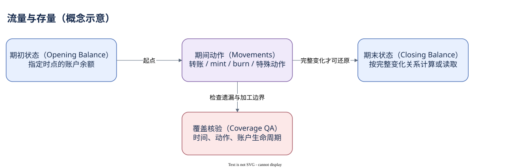

# 05.04 流量与存量

把过去七天转入减去转出，就得到钱包余额了吗？只有你知道期初状态，并且覆盖了全部相关变化时，这个推导才成立。一般的 transfers 查询更适合描述期间移动。

余额是某个时点的存量，转账是两个状态之间的动作。期末余额等于期初余额加完整期间变化，是一个有条件的恒等关系。缺少更早持仓、增发、销毁、关闭、授权者变化或特殊程序行为时，仅对普通 transfer 求和不足以还原存量。

Dune 资产移动表包含 action。`transfer`、`mintTo`、`burn` 等有不同业务含义，源或目标地址也可能为空。不要把所有行都当成两个钱包之间转账；不要把 mint 增发当成另一个持有人付款。研究资金流时，需要明确哪些 action 被纳入，哪些另行报告。

对 Token Account 求净变化，与对 owner 汇总净变化也不同。同一 owner 的两个账户之间转账，会改变两份局部状态，却不构成该 owner 的对外资产流出。真实 Token 案例给出这个完整反例：源账户减少 878.126444，目标增加同量，owner 汇总不变，SOL 费用另算。

如果授权者在期间变化，把当前 owner 关系套到全部历史，也可能把旧持有人时期的流量归给新 owner。关系表不是天然的时间维表；需要历史字段或交易时点证据支持归因。地址标签还可能来自加工来源，不能自动推断最终自然人或受益所有权。

下面按 action 拆开一段期间的移动数量，同时保留交易去重与美元覆盖指标。不同 Mint 的 amount_display 没有共同经济单位，因此没有把它们直接加成“全网代币数量”。


SQL 验证状态：字段已按官方 Schema 或当前已保存 SQL 核对；本书版本仅完成静态检查，尚未执行。

```sql
SELECT action,
       COUNT(*) AS movement_rows,
       COUNT(DISTINCT tx_id) AS distinct_transactions,
       COUNT_IF(amount_usd IS NOT NULL) AS usd_covered_rows
FROM tokens_solana.transfers
WHERE block_date = DATE '2026-10-07'
  AND block_time >= TIMESTAMP '2026-10-07 00:00:00'
  AND block_time <  TIMESTAMP '2026-10-07 00:01:00'
GROUP BY action
ORDER BY movement_rows DESC
```

结果回答动作构成与覆盖，不回答钱包当前资产总额。下一模块转向仓库分析，把这些对象、单位与期间关系落实为可核查的 SQL。



[编辑原图（draw.io）](./assets/flow-stock.drawio)

参考来源（核验日期：2026-10-09）：

- [Dune 资产移动表](https://docs.dune.com/data-catalog/curated/token-transfers/solana/solana-token-transfers)
- [Dune 账户余额字段](https://docs.dune.com/data-catalog/solana/account-activity)
- [Solana Token 模型](https://solana.com/docs/tokens)

<!-- NAV -->

[总目录](../README.md) · [上一章：单位与 Token-2022](03-units-token2022.md) · [下一章：把一笔资产移动连回账户](summary.md)
