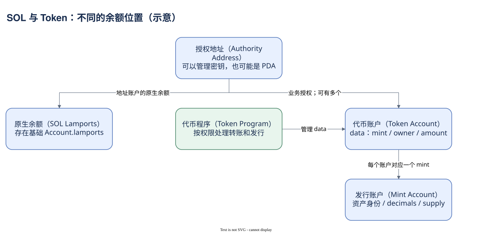

# 05.00 金额究竟存在哪里

钱包界面把 SOL、USDC 和其他资产显示在同一列，但链上保存它们的方式并不相同。分析金额之前，先找到资产身份、余额位置和授权关系。

SOL 是 Solana 的原生资产，基础账户的 lamports 字段保存其余额。SPL Token 则通过代币程序管理账户 data：Mint Account 定义某个资产，Token Account 保存该资产在一个账户中的数量。Token Account 中的业务 owner 授权操作，基础 owner 仍指向对应 Token Program。钱包页面把多个账户整理成一个资产列表，链上并没有因此只保留钱包地址的一份通用资产数组。

一个授权地址可以关联多个 Mint，也可以为同一个 Mint 拥有多个 Token Account。关联代币账户（Associated Token Account，ATA）给常用余额位置提供确定的地址规则，便于钱包和应用查找。ATA 是一种 Token Account，不是新的代币，也不表示其他普通 Token Account 不存在。

Mint 地址是资产身份，symbol 是展示标签。不同 Mint 可以使用相同符号，不能只按 USDC 这几个字母识别资产。Mint 中的 decimals 决定普通原始数量怎样转换成展示数量：例如 6 位小数的原始整数 1,234,567 对应 1.234567 个单位。这里只是教学示意，不能把所有 Solana 资产都设成 9 位小数。

Token-2022 提供可选择的扩展功能，例如转账费用、额外调用和展示相关规则。不能因为地址由 Token-2022 管理就认定开启了所有扩展，也不能用普通转账的金额对账假设覆盖所有资产。需要先核对 Mint、程序版本和实际扩展状态，再解释名义数量与余额变化。

Dune 的 `tokens_solana.transfers` 把多类资产移动整理成统一表。它包括普通 transfer，也可包含 mintTo、burn 等 action，并覆盖部分 native SOL、SPL Token 与 Token-2022。原始数量、展示数量和美元估值来自不同解释步骤；金额友好不意味着覆盖绝对完整。

账户余额是存量，期间转账是流量。仅把几天的转入减转出相加，缺少期初状态与其他动作时不能得到当前资产总额。关闭账户、包装 SOL 和授权者变化也会影响解释。仓库中已有的余额字段应先核对单位；Dune account_activity 的 Token 数值已做 decimal 调整，不能再除一次。

本模块先拆 SOL 余额差，再连接 Mint、Token Account 与 ATA，随后讨论单位与扩展，最后回到流量和存量。你会学会在每次 SUM 金额之前，把对象和单位写完整。

本模块阅读顺序：

- [SOL 转账与余额变化](./01-sol.md)
- [Mint、Token Account 与 ATA](./02-mint-token-account.md)
- [单位与 Token-2022](./03-units-token2022.md)
- [流量与存量](./04-transfers-balances.md)
- [把一笔资产移动连回账户](./summary.md)

[编辑原图（draw.io）](./assets/asset-model.drawio)

参考来源（核验日期：2026-10-09）：

- [Solana Token 模型](https://solana.com/docs/tokens)
- [关联代币账户](https://solana.com/docs/tokens/basics/create-token-account)
- [Token-2022 官方说明](https://www.solana-program.com/docs/token-2022)
- [Dune 资产移动表](https://docs.dune.com/data-catalog/curated/token-transfers/solana/solana-token-transfers)
- [Dune 账户余额字段](https://docs.dune.com/data-catalog/solana/account-activity)
- [Dune Mint 元数据](https://docs.dune.com/data-catalog/curated/token-metadata/solana/token-metadata)

<!-- NAV -->

[总目录](../README.md) · [上一章：把权限与数据分开](../04-accounts/summary.md) · [下一章：SOL 转账与余额变化](01-sol.md)
