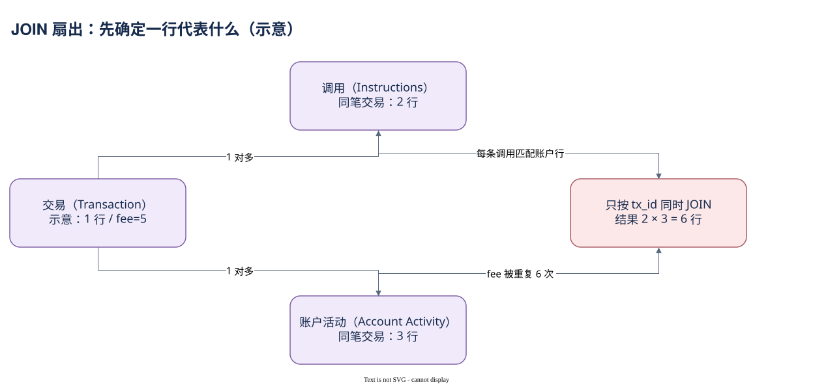

# 06.02 JOIN 前先守住行数

交易费用本来总计 5 lamports，JOIN 后却变成 30。图中的数字是教学示意，错误来自同一笔交易的两条调用与三个账户行两两匹配。JOIN 没有失灵，SQL 正在忠实执行你写出的多对多关系。

交易到调用是 1 对多，交易到账户活动也是 1 对多。调用行和账户活动行共享 tx_id，不代表二者逐行一一对应。一个账户可能参与多次调用，一次调用也使用多个账户。只按交易 identity 同时连接两份明细，结果粒度会变成调用与账户的组合。

若问题是“调用过 System Program 的交易支付了多少费用”，需要的主对象仍是交易。可以先把相关调用按 tx_id 聚合成一行，再 LEFT JOIN 交易；或用 EXISTS 只判断是否存在匹配调用。不要用 `SUM(DISTINCT fee)` 补救重复，因为不同交易相同的费用会被错误去掉。

若问题本来就是“每条指令使用哪些账户”，需要进一步读取 account_arguments 或程序接口，建立局部参数关系。account_activity 只描述全交易账户观察，不能替代每条指令的参数清单。因此防扇出不仅是性能优化，更是让结果对应正确的问题。

关联时要在各侧都限制合适时间范围，否则窄窗口主表仍可能让大明细扫描过宽。LEFT JOIN 的明细筛选应放在子查询或 ON 中；若在最终 WHERE 要求右侧字段非空，关联可能变成只保留匹配行。是否保留没有匹配的交易，必须由业务范围决定。

下面把 System Program 调用汇总到交易，再计算费用。每条交易行最多匹配一个聚合行，因此交易级 fee 保持原粒度。


SQL 验证状态：字段已按官方 Schema 或当前已保存 SQL 核对；本书版本仅完成静态检查，尚未执行。

```sql
WITH calls_per_tx AS (
    SELECT tx_id, COUNT(*) AS call_count
    FROM solana.instruction_calls
    WHERE block_time >= TIMESTAMP '2026-10-07 00:00:00'
      AND block_time <  TIMESTAMP '2026-10-07 00:01:00'
      AND executing_account = '11111111111111111111111111111111'
    GROUP BY tx_id
)
SELECT COUNT(*) AS touched_transactions,
       SUM(t.fee) AS fee_lamports,
       SUM(i.call_count) AS calls
FROM solana.transactions t
JOIN calls_per_tx i ON t.id = i.tx_id
WHERE t.block_date = DATE '2026-10-07'
  AND t.block_time >= TIMESTAMP '2026-10-07 00:00:00'
  AND t.block_time <  TIMESTAMP '2026-10-07 00:01:00'
```

INNER JOIN 在这里有明确目的：只保留触达该程序的交易。执行后仍需检查交易 ID 唯一性与匹配覆盖；本书尚未执行这份改写。下一章处理同一行内部的数组对应关系。



[编辑原图（draw.io）](./assets/join-fanout.drawio)

参考来源（核验日期：2026-10-09）：

- [Dune Transactions](https://docs.dune.com/data-catalog/solana/transactions)
- [Dune Instruction Calls](https://docs.dune.com/data-catalog/solana/instruction-calls)
- [Dune Account Activity](https://docs.dune.com/data-catalog/solana/account-activity)

<!-- NAV -->

[总目录](../README.md) · [上一章：RPC、原始表与加工表](01-rpc-lineage.md) · [下一章：数组、索引与空值](03-arrays.md)
