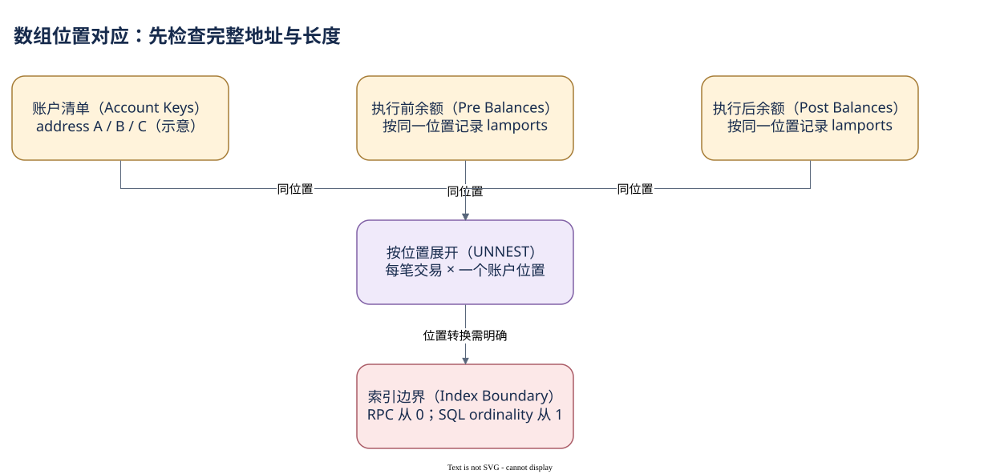

# 06.03 数组、索引与空值

一个账户的执行前余额，怎样与它的执行后余额和地址正确配对？三个数组必须按同一位置对齐，不能分别展开后只按交易身份连接。

交易表的 `account_keys`、`pre_balances`、`post_balances` 保存位置对应关系。若各有三个元素，分开 UNNEST 后按 tx_id JOIN，可能得到二十七种组合；其中大部分都不是同一个账户。正确做法是按位置并列展开，或通过明确索引读取同一个位置。

DuneSQL 的 `UNNEST` 可以同时展开多个数组，WITH ORDINALITY 追加从 1 开始的位置。数组长度不等时，短数组可能补 NULL，因此仍要检查长度，不能把补空当成真实零余额。特别是 v0，要先确认账户清单已包含加载地址且顺序正确。长度相同也不证明顺序一致，必要时对照 RPC 地址。

RPC 的 Token 余额 `accountIndex` 从 0 开始，指向交易有效账户清单。DuneSQL 用下标读取时则从 1 开始，需要加一。不要把这条规则推广到所有展开表：instruction_calls 的索引起点由其模型决定，应该保持返回值并实测映射，不能因为 SQL 数组从一开始就自行移动 outer/inner 编号。

NULL 也有不同含义。顶层调用的 inner index 为空表示结构上没有内层位置；USD 为空表示缺少估值；账户创建时某个 Token 前余额项可能不在数组里。它们都不能简单变成 0。关联两个顶层调用身份需要 NULL-safe 比较，而计算金额差应先明确缺项的生命周期含义。

下面以真实 legacy SOL 案例检查数组对齐，再观察逐账户 lamports 差。该交易不涉及 ALT，适合作为位置展开的最小例子。


SQL 验证状态：字段已按官方 Schema 或当前已保存 SQL 核对；本书版本仅完成静态检查，尚未执行。

```sql
WITH one_tx AS (
    SELECT id, account_keys, pre_balances, post_balances
    FROM solana.transactions
    WHERE block_date = DATE '2026-10-09'
      AND id = '2my5AGATup7YFYAbCMWaF79T16EFAw4HnMgpYtesn1EsVD2FPQkEvbFcZuwZYJfoqWnMsfcWENrWzoWBNF4gEmxJ'
      AND cardinality(account_keys) = cardinality(pre_balances)
      AND cardinality(pre_balances) = cardinality(post_balances)
)
SELECT id, position, address, pre_lamports, post_lamports,
       post_lamports - pre_lamports AS delta_lamports
FROM one_tx
CROSS JOIN UNNEST(account_keys, pre_balances, post_balances)
    WITH ORDINALITY AS u(address, pre_lamports, post_lamports, position)
ORDER BY position
```

查询仍是静态版本，没有以 RPC 三个账户的结果冒充 Dune 输出。掌握位置和空值以后，下一章把结构核查扩展到覆盖和统计质量。



[编辑原图（draw.io）](./assets/array-alignment.drawio)

参考来源（核验日期：2026-10-09）：

- [RPC JSON 结构](https://solana.com/docs/rpc/json-structures)
- [Dune Transactions](https://docs.dune.com/data-catalog/solana/transactions)
- [DuneSQL 数组操作](https://docs.dune.com/query-engine/Functions-and-operators/array)

<!-- NAV -->

[总目录](../README.md) · [上一章：JOIN 前先守住行数](02-joins.md) · [下一章：时间窗口与质量核验](04-quality.md)
