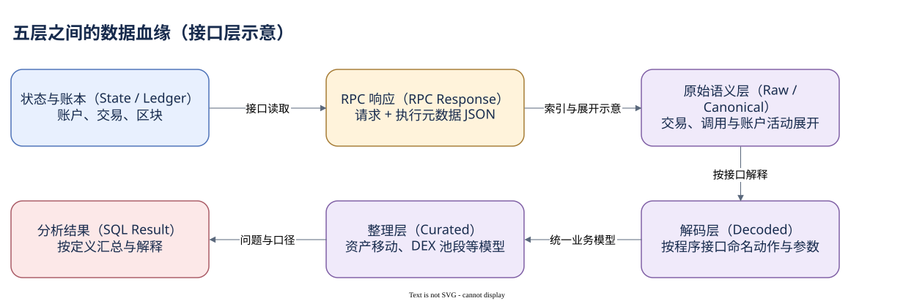

# 06.00 进入仓库前先问粒度

链上对象已经清楚，为什么 SQL 仍然容易算错？因为仓库把同一笔行为组织成多种粒度：交易一行、指令多行、账户活动多行、资产移动多行、DEX 池段再多行。字段名相似，不意味着记录可以逐行对齐。

RPC 返回的交易 JSON 同时包括请求与执行元数据。账户清单和余额是数组，内部指令按顶层归属嵌套，Token 余额还带 Mint 与账户索引。把这种结构变成表，本身就包含展开与整理。Dune 的 Raw 或 Canonical 指的是保留账本对象语义的基础分析层，不代表“网络直接存了一张平面 SQL 表”。

Decoded 层进一步按程序接口解释字节，给动作和参数命名。Curated 层把不同程序的行为统一成资产移动、DEX 池段等业务模型。这些加工是分析便利的来源，也引入了选择、覆盖和新粒度。读 `dex_solana.trades` 时，不能因为表名有 trades 就假定一行等于一个用户订单。

关系型数据库知识在这里发挥最大作用：先写粒度，辨认候选键，检查关联基数，再决定在哪一层求和。区别在于仓库未必公开真实 PK/FK 约束，协议与解码还有版本变化。语义上应唯一的字段，仍要在你的时间窗口里做精确核验。历史样本通过不能保证全部未来数据。

最常见的错误是 JOIN 扇出。交易表的一笔交易有两条指令和三个账户活动，两个明细同时按 tx_id 相连，可能得到六行。此时 fee 被复制了六次；`SUM(DISTINCT fee)` 也无法修复，因为不同交易可能支付相同费用。解决办法来自问题本身：需要交易级指标就先把明细聚合到交易，或用 EXISTS 判断是否触达。

数组与索引是第二类问题。RPC 从零编号，DuneSQL 数组下标和 ordinality 从一开始。要给 Token 余额的 accountIndex 找地址，需要明确转换；要展开 pre/post SOL 余额，需要保持完整地址顺序。v0 地址加载与 jsonParsed 已解析行为，已经在交易模块说明。

第三类问题是质量与覆盖。空结果可能是没有行为，也可能是索引延迟、版本兼容或筛选不对。USD NULL 表示缺少估值，不等于资产没有价值。当前关系表不一定提供历史状态。SQL 可以运行成功，仍然可能用错对象和分母；技术解释与数据核验必须一起完成。

本模块将数据血缘、JOIN、数组和质量分开讲，最后把它们收束成一份能解释自己口径的查询。真正的目标不是背字段，而是让结果可以从聚合一路追溯到原始交易与状态。

本模块阅读顺序：

- [RPC、原始表与加工表](./01-rpc-lineage.md)
- [JOIN 前先守住行数](./02-joins.md)
- [数组、索引与空值](./03-arrays.md)
- [时间窗口与质量核验](./04-quality.md)
- [一条能解释自己的查询](./summary.md)

[编辑原图（draw.io）](./assets/data-lineage.drawio)

参考来源（核验日期：2026-10-09）：

- [RPC JSON 结构](https://solana.com/docs/rpc/json-structures)
- [Dune Transactions](https://docs.dune.com/data-catalog/solana/transactions)
- [Dune Instruction Calls](https://docs.dune.com/data-catalog/solana/instruction-calls)
- [Dune Account Activity](https://docs.dune.com/data-catalog/solana/account-activity)
- [Dune DEX 数据模型](https://docs.dune.com/data-catalog/curated/dex-trades/solana/solana-dex-trades)

<!-- NAV -->

[总目录](../README.md) · [上一章：把一笔资产移动连回账户](../05-tokens/summary.md) · [下一章：RPC、原始表与加工表](01-rpc-lineage.md)
