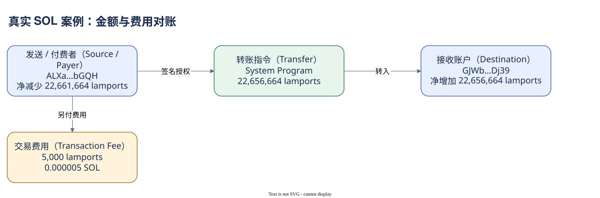

# 07.01 完整拆开一笔 SOL 转账

这笔交易的身份是 `2my5AGATup7YFYAbCMWaF79T16EFAw4HnMgpYtesn1EsVD2FPQkEvbFcZuwZYJfoqWnMsfcWENrWzoWBNF4gEmxJ`。它只请求 System Program 移动 SOL，适合检查一笔行为从 Message 到余额的完整链路。图中地址是缩写，下面保留完整身份。

发送及付费账户为 `ALXanyamBmyztmriLg8br2TkS677p6ubVw7A1YpRbGQH`，接收账户为 `GJWbz8RXcw1WitSnk5dYnDnaHBFnjyXsovWyTkgcDj39`。第三个账户是 System Program。只有发送者在解析清单中标为 signer，两个业务账户可写，程序只读。被引用的账户数为三，不代表三个人。

Message 只有一条顶层 transfer，parsed info 中的 lamports 为 22,656,664，即 0.022656664 SOL。它指定 source 与 destination；这使我们不必用余额差猜方向。meta.err 为空，没有内层调用，RPC 报告费用为 5,000 lamports。

发送账户执行前为 59,172,791 lamports，执行后为 36,511,127，净减少 22,661,664。接收账户从 0 增至 22,656,664。两侧差额恰好满足“发送者减少 = 接收者增加 + 费用”，所有被引用账户的 lamports 合计变化为负 5,000。

这个对账并非通用资金流公式。它成立是因为此交易只有一个普通 SOL 转账，发送者同时付费，没有创建或关闭账户等额外动作。多指令交易可以让同一账户在期间先收后付，净差只保留合计。研究具体转账仍需读指令，研究最终净变化才读 pre/post。

映射到 Dune，交易表应按 id 定位请求与 fee，指令调用表观察 System Program transfer，账户活动表观察逐账户变化。行数未实测，不能提前保证每张表返回多少行。下面先读交易层，留住同一 signature。


程序账户的基础余额在前后都为 1 lamport，没有因被调用就成为收款方。它在账户清单中是只读执行者。这个小细节说明同一份数组包含不同类型的地址：两份业务余额与程序账户的余额，都必须按角色解释。对账时保留原始整数，可以精确看出那 5,000 lamports 的差额；转成界面小数后再四舍五入，反而可能隐藏这条证据。

SQL 验证状态：字段已按官方 Schema 或当前已保存 SQL 核对；本书版本仅完成静态检查，尚未执行。

```sql
SELECT id, signer, success, fee,
       account_keys, pre_balances, post_balances
FROM solana.transactions
WHERE block_date = DATE '2026-10-09'
  AND id = '2my5AGATup7YFYAbCMWaF79T16EFAw4HnMgpYtesn1EsVD2FPQkEvbFcZuwZYJfoqWnMsfcWENrWzoWBNF4gEmxJ'
```

读取后应先核对版本和数组对应，再与 RPC 的三份账户观察比较。若没有行，先检查更新与覆盖。下一章会让相同方法读到一个更有意思的结果：资产在两个账户间移动，却没有离开同一 owner。



[编辑原图（draw.io）](./assets/sol-case.drawio)

参考来源（核验日期：2026-10-09）：

- [Solana RPC getBlock](https://solana.com/docs/rpc/http/getblock)
- [RPC JSON](https://solana.com/docs/rpc/json-structures)
- [Dune Transactions](https://docs.dune.com/data-catalog/solana/transactions)

<!-- NAV -->

[总目录](../README.md) · [上一章：用三个案例贯穿数据地图](index.md) · [下一章：完整拆开一笔 Token 转账](02-token-case.md)
