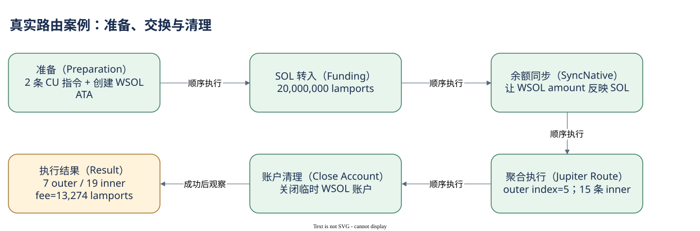
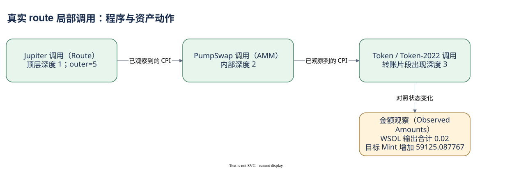

# 07.03 聚合路由与多次 Swap

交易 `3d5V1UTKTAB6uAD7GAd2Rv9o9nFNm9X5pfr3uebL93LxDT91RrHR2ndtJBbPmNttvSDG1TgXGUdLCcdpWxKgiztQ` 是 v0，包含两个签名者、32 个解析后账户，以及 7 条顶层和 19 条内层记录。它展示一个换币流程怎样连起账户生命周期、CPI 和资产移动。

前两条是计算预算设置。接着创建 WSOL 关联账户，向它转入 20,000,000 lamports，再用 SyncNative 同步数量。顶层 index=5 调用 Jupiter，最后关闭临时 WSOL 账户。这七个步骤是本笔 RPC 请求里的实际顺序，索引采用 RPC 的零起点；Dune 映射仍需核验自己的索引表达。

Jupiter 程序地址由其官方解析器仓库确认。该顶层组里记录 15 条内部调用，包含 PumpSwap、Token 和 Token-2022 程序；另外 4 条内部记录属于前面的 ATA 创建。PumpSwap 地址也由官方项目文档确认。调用深度出现 2 与 3，说明顶层归属与直接调用者不是同一种关系。

从临时 WSOL 账户转出的 Token 原始数量合计为 20,000,000，包含 19,717,522 和其他几份输出。目标 Mint `HSZCUrkyJspqMAUrrKr4kSC7j9cKadqVVo4xTyFG7mDi` 的用户账户净增加 59,125,087,767 原始单位，decimals=6，即 59125.087767。这里按 Mint 报告，不为未知资产补写 symbol 或美元价值。

付费者 SOL 净减少 20,013,274 lamports，正好是 20,000,000 的资金与 13,274 的交易费用之和。内部还出现向另一个账户转入 1,346,200 lamports 并 allocate/assign 的动作，但该账户执行前后的余额均为零，不能把中间转入额当成持久支出。临时 WSOL 账户也在关闭后退回剩余 lamports。这个对账说明日志里的中间动作与整笔净成本必须分开。

调用记录多也不证明多跳成交。某些内部调用是账户准备、权限和费用处理，程序还可能发出自身调用或事件。此例不能仅按 PumpSwap 出现次数认定池段数量。Dune 的 dex_solana.trades 按模型识别池执行段；同一意图经过多个池时可有多行，但本笔实际输出尚未查询。


SQL 验证状态：字段已按官方 Schema 或当前已保存 SQL 核对；本书版本仅完成静态检查，尚未执行。

```sql
SELECT tx_id, project, trader_id,
       token_bought_mint_address, token_sold_mint_address,
       token_bought_amount, token_sold_amount, amount_usd
FROM dex_solana.trades
WHERE block_date = DATE '2026-10-09'
  AND block_month = DATE '2026-10-01'
  AND tx_id = '3d5V1UTKTAB6uAD7GAd2Rv9o9nFNm9X5pfr3uebL93LxDT91RrHR2ndtJBbPmNttvSDG1TgXGUdLCcdpWxKgiztQ'
```

它用于查看仓库识别出的业务段，不直接把池段 USD 合计称作用户投入额。下一步是在三个案例之间比较同一条证据路线。



[编辑原图（draw.io）](./assets/swap-lifecycle.drawio)



[编辑调用原图（draw.io）](./assets/swap-calls.drawio)

参考来源（核验日期：2026-10-09）：

- [Solana RPC getBlock](https://solana.com/docs/rpc/http/getblock)
- [RPC JSON](https://solana.com/docs/rpc/json-structures)
- [Jupiter 官方解析器与 Program ID](https://github.com/jup-ag/instruction-parser)
- [PumpSwap 官方文档](https://github.com/pump-fun/pump-public-docs/blob/main/docs/PUMP_SWAP_README.md)
- [Dune DEX 模型](https://docs.dune.com/data-catalog/curated/dex-trades/solana/solana-dex-trades)
- [WSOL](https://solana.com/docs/tokens/basics/sync-native)

<!-- NAV -->

[总目录](../README.md) · [上一章：完整拆开一笔 Token 转账](02-token-case.md) · [下一章：让不同视角回到同一事实](summary.md)
