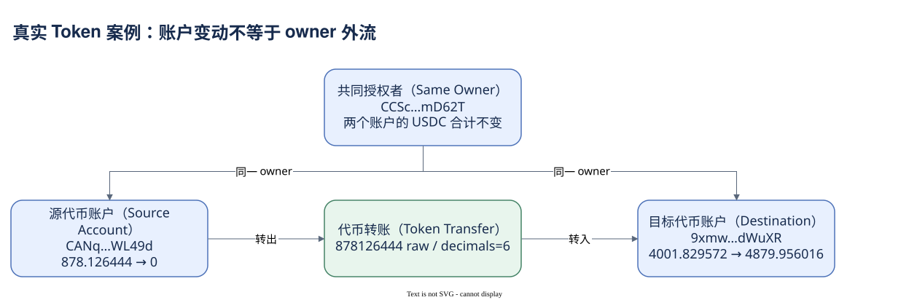

# 07.99 让不同视角回到同一事实

三个案例的共同起点是固定交易身份、网络和确认程度。SOL 转账让请求金额、两侧余额与费用组成一个很小的闭环。Token 转账把同一逻辑迁移到代币账户，揭示局部账户变化不等于 owner 的对外资产流。

路由交易再加入账户准备、WSOL、CPI、状态投入和清理。签名者不是全部账户，顶层不是全部调用，调用数不是成交段数，钱包净差也不等于费用。只有把交易、指令、账户和资产位置连起来，才能解释这笔行为的全部相关数字。

RPC 已观察与本地算术核验构成此次案例证据。程序名称由官方资料核对，未知 Mint 保留地址，不补写 symbol、价格或人类身份。Dune SQL 提供从这些真实 identity 出发的映射路线，但尚未执行；因此它们的表行数、覆盖和模型结果仍不能作为实测事实。

当你研究下一笔陌生交易，可以重复同一过程：先看结果与版本，再辨认角色和调用，最后用原始单位对账。复杂度应由实际问题决定；不要因为一笔交易能产生几十行，就一次 JOIN 全部明细。下一模块把这条路线整理成独立分析的方法。

[编辑原图（draw.io）](./assets/token-case.drawio)

参考来源（核验日期：2026-10-09）：

- [Solana RPC getBlock](https://solana.com/docs/rpc/http/getblock)
- [RPC JSON](https://solana.com/docs/rpc/json-structures)
- [Token 模型](https://solana.com/docs/tokens)
- [Dune DEX 模型](https://docs.dune.com/data-catalog/curated/dex-trades/solana/solana-dex-trades)

<!-- NAV -->

[总目录](../README.md) · [上一章：聚合路由与多次 Swap](03-swap-case.md) · [下一章：从业务问题出发](../08-analysis/index.md)
