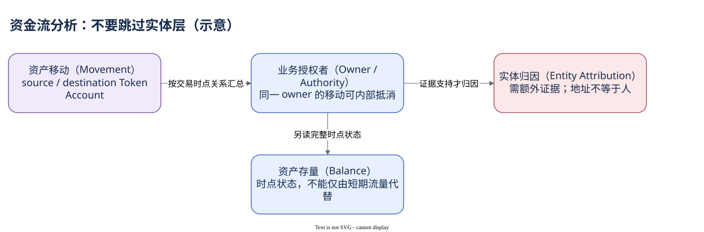

# 08.01 钱包行为与资金流向

钱包的“活跃”和“资金流”应该分别怎样统计？先区分地址在交易中的参与角色，以及它控制的 Token Account。仅把某个地址出现次数相加，既不能得到真人活跃，也不能保证得到完整资金流。

交易签名可以描述授权行为，fee payer 可以描述付费行为，account_activity 描述被使用账户，transfers 描述资产移动。一个程序、池状态或接收账户也能出现在活动里，却不是发送交易的人。研究签名地址时应明确集合来自 signers；只看主 signer 会遗漏其他签名者，并可能把代付者当成全部业务用户。

Token 资金流要先按 Mint 确定资产，再选择 Token Account 或 owner 粒度。同一 owner 的内部账户转账应在净流量中抵消。若源和目标 owner 相同，它可以贡献账户移动量，却不贡献该 owner 的对外流出。未知 owner 或缺失关系不能直接填成钱包地址。

计算方向时，自转应先判断，否则先匹配 from_owner 的 CASE 会把双侧同 owner 误标为流出。下面直接构造转入减转出的表达，让同 owner 行自动抵消；只统计指定 Mint 和 transfer action，不把增发、销毁当作普通双边付款。


SQL 验证状态：字段已按官方 Schema 或当前已保存 SQL 核对；本书版本仅完成静态检查，尚未执行。

```sql
SELECT token_mint_address,
       SUM(
           CASE WHEN to_owner = 'CCSccmE7WBfSF47anEEtevxJp14Fs6DEKT9SZMKmD62T'
                THEN amount_display ELSE 0 END
         - CASE WHEN from_owner = 'CCSccmE7WBfSF47anEEtevxJp14Fs6DEKT9SZMKmD62T'
                THEN amount_display ELSE 0 END
       ) AS net_transfer_display
FROM tokens_solana.transfers
WHERE block_date = DATE '2026-10-09'
  AND block_time >= TIMESTAMP '2026-10-09 11:26:00'
  AND block_time <  TIMESTAMP '2026-10-09 11:27:00'
  AND token_mint_address = 'EPjFWdd5AufqSSqeM2qN1xzybapC8G4wEGGkZwyTDt1v'
  AND action = 'transfer'
  AND (from_owner = 'CCSccmE7WBfSF47anEEtevxJp14Fs6DEKT9SZMKmD62T'
       OR to_owner = 'CCSccmE7WBfSF47anEEtevxJp14Fs6DEKT9SZMKmD62T')
GROUP BY token_mint_address
```

这里统计期间转账净额，不是期末余额；Token-2022 特殊金额规则也需要另查。若目标是精确账务，应保留原始整数并避免展示字段的浮点误差。观察金额为 NULL 的记录还要另外报告，不能默默忽略后声称完整。

owner 也不是最终自然人。托管平台、协议 PDA、多签和代付服务会改变控制与经济归属关系。地址标签可以作为归因线索，但证明某个人持有或受益，需要额外证据。链上转账事实、业务授权、现实控制和最终受益应分别描述。

这种边界不是分析的终点。它帮助你把下一步问题问得更准确：是要查账户净变化、某个实体控制的地址集合，还是某协议的业务收益？下一章进入协议研究，把程序身份与业务模型逐步连接。



[编辑原图（draw.io）](./assets/wallet-flow.drawio)

参考来源（核验日期：2026-10-09）：

- [Dune Transactions](https://docs.dune.com/data-catalog/solana/transactions)
- [Dune Account Activity](https://docs.dune.com/data-catalog/solana/account-activity)
- [Dune Transfers](https://docs.dune.com/data-catalog/curated/token-transfers/solana/solana-token-transfers)
- [Solana Authority 模型](https://solana.com/docs/tokens)

<!-- NAV -->

[总目录](../README.md) · [上一章：从业务问题出发](index.md) · [下一章：研究陌生协议](02-protocol.md)
