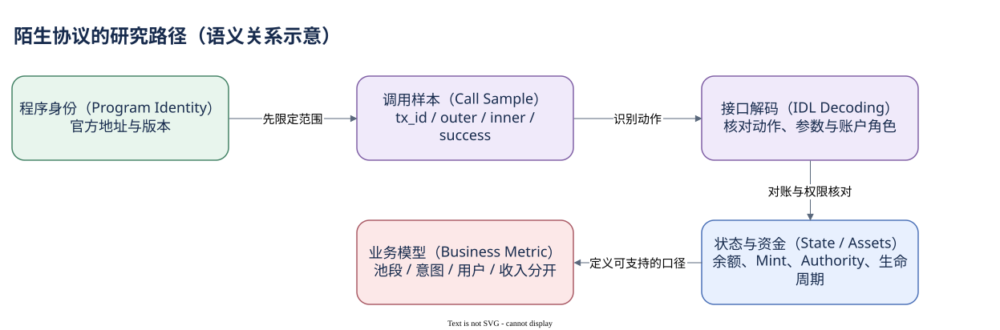

# 08.02 研究陌生协议

第一次研究某个协议时，最有价值的起点往往不是项目简介，而是一个由官方资料确认的 Program ID 和一笔成功交易。它们给出可以复查的执行边界。

先核对程序身份与版本。协议可能有旧、新多个部署地址，聚合器又可能调用许多外部程序。一个 Program ID 能帮助限定执行者，却不自动代表全部产品，也不保证每次调用都是成交。保存官方地址来源，检查更新日期，再从 instruction_calls 建立小样本。

随后识别指令。阅读 IDL 或官方接口，核对指令识别标记（discriminator）、参数顺序与账户角色；有 Dune 解码表时，先检查其字段与 raw identity 对应。只有 Program 名称，没有动作类型，就不能把全部调用量称为 Swap、存款或收入。没有解码覆盖时，应明确停在调用观察层。

第三步核对状态和资金。把成功调用与 Token/SOL 变化连接，区分池储备、用户账户、临时账户、费用接收方和权限对象。读 account_arguments 可以找局部动作角色，读 account_activity 可以看整笔净差。二者不应只按 tx_id 拼成无边界的金额组合。

路由案例提供了真实研究过程：官方地址确认 Jupiter 与 PumpSwap，RPC 观察跨程序调用，Token 指令和前后余额证明实际金额，而 Dune 池段数量与 USD 尚未验证。PumpSwap 程序出现多次，仍不能按次数推断多笔成交；一些调用可能服务于准备、事件或状态处理。

如果模型已提供 dex_solana.trades，最后再决定统计池段还是用户意图。协议池活动适合池段口径，用户投入需要路由与净流证据。`trader_id` 是模型角色，不能直接声称真人。汇总 USD 还应同时提供缺值覆盖，尤其不要把不同路径段相加后当作用户唯一成交金额。


SQL 验证状态：字段已按官方 Schema 或当前已保存 SQL 核对；本书版本仅完成静态检查，尚未执行。

```sql
SELECT project,
       COUNT(*) AS pool_segments,
       COUNT(DISTINCT tx_id) AS distinct_transactions,
       SUM(amount_usd) AS covered_segment_volume_usd,
       COUNT_IF(amount_usd IS NULL) AS unpriced_segments
FROM dex_solana.trades
WHERE block_month = DATE '2026-10-01'
  AND block_date = DATE '2026-10-07'
  AND block_time >= TIMESTAMP '2026-10-07 00:00:00'
  AND block_time <  TIMESTAMP '2026-10-07 00:01:00'
GROUP BY project
ORDER BY pool_segments DESC
LIMIT 10
```

这段 SQL 描述窗口内被模型覆盖的池段，不按名称猜额外协议范围。下一章把来源、SQL 与结果一起保存，确保研究不是一次无法复查的截图。



[编辑原图（draw.io）](./assets/protocol-evidence.drawio)

参考来源（核验日期：2026-10-09）：

- [Solana Programs](https://solana.com/docs/core/programs)
- [Dune Instruction Calls](https://docs.dune.com/data-catalog/solana/instruction-calls)
- [Dune DEX 模型](https://docs.dune.com/data-catalog/curated/dex-trades/solana/solana-dex-trades)
- [Jupiter 官方解析器](https://github.com/jup-ag/instruction-parser)
- [PumpSwap 官方资料](https://github.com/pump-fun/pump-public-docs/blob/main/docs/PUMP_SWAP_README.md)

<!-- NAV -->

[总目录](../README.md) · [上一章：钱包行为与资金流向](01-wallet-flow.md) · [下一章：让分析可重现](03-reproducibility.md)
